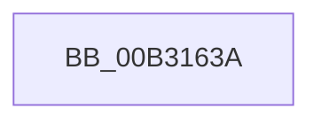

# sub_00B3163A

- RVA: `0x00B3163A`–`0x00B316B3` (길이 `121` bytes)
- VA: `0x0000000140B3163A`
- 실행 섹션: `PAGE`
- PDB 이름 있음: `아니요`; PDB Function 태그: `아니요`
- unwind 정보 RVA: `0x000A70B4`
- 디코드: `26`개 명령, `121/121` bytes 표시
- 미해석 바이트: `0` (있으면 어셈블리에 `.byte`로 보존)

> 이 문서는 커널 이미지의 기계어와 PDB 기호를 분석해 생성했습니다. 4번과 5번은 함수 원형과 자료형을 바이너리 사용 방식에서 추정한 C 해석이며 원본 소스 복구 결과는 아닙니다.

## 1. Dependencies

- 직접 호출 지점: **0**; 고유 호출 대상: **0**
- 직접 호출자로 확인된 함수: **0**
- RIP 상대 이미지 참조: **0**

### Outgoing calls
- 직접 디코드된 call 명령이 없습니다.

### Direct callers
- 이 함수 시작 RVA로 연결되는 직접 call은 확인되지 않았습니다. 간접 호출은 완전히 역산할 수 없습니다.

### Static image references
- 디코드된 RIP-relative 메모리 참조가 없습니다.

## 2. Other-region calls and transfers

- 다른 실행 섹션으로 향하는 call: **0**
- call이 아닌 외부 분기/꼬리 이동: **1**
  - `0x00B316AE` → [EtwTraceJobSetQuery + 0x303](../9F/EtwTraceJobSetQuery_function_009FB480.md) (`tail-transfer`)

## 3. Assembly (complete function range)

```asm
00B3163A  48 8D 45 40                     lea rax, [rbp + 0x40]
00B3163E  4C 89 45 A0                     mov qword ptr [rbp - 0x60], r8
00B31642  48 89 44 24 48                  mov qword ptr [rsp + 0x48], rax
00B31647  4D 8D 50 08                     lea r10, [r8 + 8]
00B3164B  48 8D 45 50                     lea rax, [rbp + 0x50]
00B3164F  48 89 4D A8                     mov qword ptr [rbp - 0x58], rcx
00B31653  48 89 44 24 50                  mov qword ptr [rsp + 0x50], rax
00B31658  4D 8D 58 10                     lea r11, [r8 + 0x10]
00B3165C  48 8D 45 60                     lea rax, [rbp + 0x60]
00B31660  4C 89 55 B0                     mov qword ptr [rbp - 0x50], r10
00B31664  48 89 44 24 58                  mov qword ptr [rsp + 0x58], rax
00B31669  48 8D 5D D0                     lea rbx, [rbp - 0x30]
00B3166D  48 8D 45 70                     lea rax, [rbp + 0x70]
00B31671  48 C7 45 B8 08 00 00 00         mov qword ptr [rbp - 0x48], 8
00B31679  48 89 44 24 60                  mov qword ptr [rsp + 0x60], rax
00B3167E  48 8D 7D E0                     lea rdi, [rbp - 0x20]
00B31682  48 8D 85 80 00 00 00            lea rax, [rbp + 0x80]
00B31689  4C 89 5D C0                     mov qword ptr [rbp - 0x40], r11
00B3168D  48 C7 45 C8 01 00 00 00         mov qword ptr [rbp - 0x38], 1
00B31695  48 8D 75 F0                     lea rsi, [rbp - 0x10]
00B31699  BA 10 00 00 00                  mov edx, 0x10
00B3169E  4C 8D 75 00                     lea r14, [rbp]
00B316A2  4C 8D 7D 10                     lea r15, [rbp + 0x10]
00B316A6  4C 8D 65 20                     lea r12, [rbp + 0x20]
00B316AA  4C 8D 6D 30                     lea r13, [rbp + 0x30]
00B316AE  E9 D0 A0 EC FF                  jmp 0x1409fb783
```

## 4. C-style interpretation (structured pseudocode)

```c
__int64 __fastcall sub_00B3163A(__int64 a1, __int64 a2, __int64 a3)
{
    unsigned __int64 v_stack_p48;
    unsigned __int64 v_stack_p50;
    unsigned __int64 v_stack_p58;
    unsigned __int64 v_stack_p60;

    *(unsigned __int64 *)(v_rbp - 96) = a3;
    v_stack_p48 = v_rbp + 64;
    *(unsigned __int64 *)(v_rbp - 88) = a1;
    v_stack_p50 = v_rbp + 80;
    *(unsigned __int64 *)(v_rbp - 80) = a3 + 8;
    v_stack_p58 = v_rbp + 96;
    *(unsigned __int64 *)(v_rbp - 72) = 8;
    v_stack_p60 = v_rbp + 112;
    *(unsigned __int64 *)(v_rbp - 64) = a3 + 16;
    *(unsigned __int64 *)(v_rbp - 56) = 1;
}
```

## 5. (Beta) C Style

```c
int64_t sub_00B3163A(int64_t Arg1, int64_t Arg2, void *Arg3)
{
    uint8_t *arg3 = (uint8_t *)Arg3;

    uint64_t v_stack_p48;
    uint64_t v_stack_p50;
    uint64_t v_stack_p58;
    uint64_t v_stack_p60;

    *(void **)(local_rbp - 0x60) = Arg3;
    v_stack_p48 = local_rbp + 64;
    *(uint64_t *)(local_rbp - 0x58) = Arg1;
    v_stack_p50 = local_rbp + 80;
    *(void **)(local_rbp - 0x50) = Arg3 + 8;
    v_stack_p58 = local_rbp + 96;
    *(uint64_t *)(local_rbp - 0x48) = 8;
    v_stack_p60 = local_rbp + 112;
    *(void **)(local_rbp - 0x40) = Arg3 + 16;
    *(uint64_t *)(local_rbp - 0x38) = 1;
}
```

### 관측된 메모리 오프셋

구조체 형식이 확인되지 않은 접근은 인자 기준의 오프셋으로만 기록했습니다.

| 기준 인자 | 오프셋 표현 | 폭 (bit) | 접근 |
|---|---:|---:|---|
| `Arg3` | `+ 0x8` | `64` | `R` |
| `Arg3` | `+ 0x10` | `64` | `R` |

## 6. Execution-region graph

[열기: 2D/3D 그래프와 함수 탐색 컨트롤 패널](../../../control-panel.html?section=page&rva=0x00B3163A&view=graph)

- 2D 그래프는 위에서 아래로 흐르고, 3D 그래프는 빈 공간을 드래그해 회전합니다. Shift+드래그는 이동, 휠은 확대·축소, 함수 노드 선택은 대상 보고서 이동입니다.

### Static fallback


