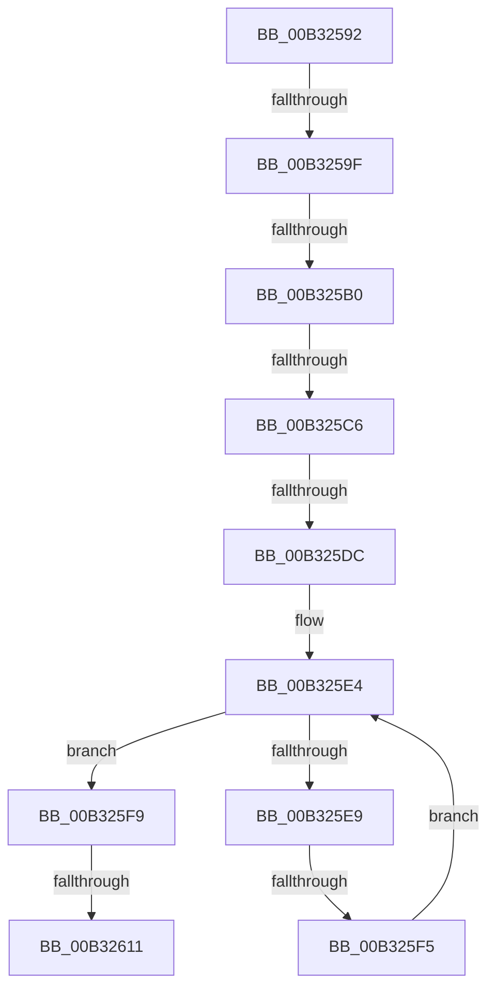

# sub_00B32592

- RVA: `0x00B32592`–`0x00B3261C` (길이 `138` bytes)
- VA: `0x0000000140B32592`
- 실행 섹션: `PAGE`
- PDB 이름 있음: `아니요`; PDB Function 태그: `아니요`
- unwind 정보 RVA: `0x000A7200`
- 디코드: `32`개 명령, `138/138` bytes 표시
- 미해석 바이트: `0` (있으면 어셈블리에 `.byte`로 보존)

> 이 문서는 커널 이미지의 기계어와 PDB 기호를 분석해 생성했습니다. 4번과 5번은 함수 원형과 자료형을 바이너리 사용 방식에서 추정한 C 해석이며 원본 소스 복구 결과는 아닙니다.

## 1. Dependencies

- 직접 호출 지점: **1**; 고유 호출 대상: **1**
- 직접 호출자로 확인된 함수: **0**
- RIP 상대 이미지 참조: **0**

### Outgoing calls
- `0x00B32604` → [EtwpCreatePerfectHashFunction](../9F/EtwpCreatePerfectHashFunction_function_009FD6CC.md) (function, `0x009FD6CC`)

### Direct callers
- 이 함수 시작 RVA로 연결되는 직접 call은 확인되지 않았습니다. 간접 호출은 완전히 역산할 수 없습니다.

### Static image references
- 디코드된 RIP-relative 메모리 참조가 없습니다.

## 2. Other-region calls and transfers

- 다른 실행 섹션으로 향하는 call: **0**
- call이 아닌 외부 분기/꼬리 이동: **7**
  - `0x00B32599` → [EtwpAllocateFilter + 0xFF](../9F/EtwpAllocateFilter_function_009FC948.md) (`tail-transfer`)
  - `0x00B325AA` → [EtwpAllocateFilter + 0xFF](../9F/EtwpAllocateFilter_function_009FC948.md) (`tail-transfer`)
  - `0x00B325C0` → [EtwpAllocateFilter + 0xFF](../9F/EtwpAllocateFilter_function_009FC948.md) (`tail-transfer`)
  - `0x00B325D6` → [EtwpAllocateFilter + 0xFF](../9F/EtwpAllocateFilter_function_009FC948.md) (`tail-transfer`)
  - `0x00B325EF` → [EtwpAllocateFilter + 0xFF](../9F/EtwpAllocateFilter_function_009FC948.md) (`tail-transfer`)
  - `0x00B3260B` → [EtwpAllocateFilter + 0x84](../9F/EtwpAllocateFilter_function_009FC948.md) (`tail-transfer`)
  - `0x00B32617` → [EtwpAllocateFilter + 0x84](../9F/EtwpAllocateFilter_function_009FC948.md) (`tail-transfer`)

## 3. Assembly (complete function range)

```asm
00B32592  4C 8B 1A                        mov r11, qword ptr [rdx]
00B32595  49 39 40 30                     cmp qword ptr [r8 + 0x30], rax
00B32599  0F 85 A8 A4 EC FF               jne 0x1409fca47
00B3259F  8B 52 08                        mov edx, dword ptr [rdx + 8]
00B325A2  8D 42 FA                        lea eax, [rdx - 6]
00B325A5  3D FA 03 00 00                  cmp eax, 0x3fa
00B325AA  0F 87 97 A4 EC FF               ja 0x1409fca47
00B325B0  45 0F B7 43 02                  movzx r8d, word ptr [r11 + 2]
00B325B5  4A 8D 0C 45 04 00 00 00         lea rcx, [r8*2 + 4]
00B325BD  48 3B D1                        cmp rdx, rcx
00B325C0  0F 85 81 A4 EC FF               jne 0x1409fca47
00B325C6  41 0F B7 C0                     movzx eax, r8w
00B325CA  B9 01 00 00 00                  mov ecx, 1
00B325CF  66 2B C1                        sub ax, cx
00B325D2  66 83 F8 3F                     cmp ax, 0x3f
00B325D6  0F 87 6B A4 EC FF               ja 0x1409fca47
00B325DC  33 D2                           xor edx, edx
00B325DE  41 B9 FF FF 00 00               mov r9d, 0xffff
00B325E4  41 3B D0                        cmp edx, r8d
00B325E7  73 10                           jae 0x140b325f9
00B325E9  66 45 39 4C 53 04               cmp word ptr [r11 + rdx*2 + 4], r9w
00B325EF  0F 84 52 A4 EC FF               je 0x1409fca47
00B325F5  03 D1                           add edx, ecx
00B325F7  EB EB                           jmp 0x140b325e4
00B325F9  41 8A 0B                        mov cl, byte ptr [r11]
00B325FC  49 8D 53 04                     lea rdx, [r11 + 4]
00B32600  4C 8D 4B 30                     lea r9, [rbx + 0x30]
00B32604  E8 C3 B0 EC FF                  call 0x1409fd6cc
00B32609  85 C0                           test eax, eax
00B3260B  0F 88 BB A3 EC FF               js 0x1409fc9cc
00B32611  81 0B 00 10 00 80               or dword ptr [rbx], 0x80001000
00B32617  E9 B0 A3 EC FF                  jmp 0x1409fc9cc
```

## 4. C-style interpretation (structured pseudocode)

```c
__int64 __fastcall sub_00B32592(__int64 a1, __int64 a2, __int64 a3)
{
    __int64 result;

    result = (unsigned __int16)(((unsigned __int16)(*(unsigned __int16 *)(*(unsigned __int64 *)(a2) + 2))) - (1));
    a2 = 0;
loc_00B325E4:
    if (0 >= ((unsigned int)(*(unsigned __int16 *)(*(unsigned __int64 *)(a2) + 2)))) goto loc_00B325F9;
    a2 = (unsigned int)((a2) + (1));
    goto loc_00B325E4;
loc_00B325F9:
    result = EtwpCreatePerfectHashFunction(*(unsigned __int8 *)(*(unsigned __int64 *)(a2)), *(unsigned __int64 *)(a2) + 4, *(unsigned __int16 *)(*(unsigned __int64 *)(a2) + 2), v_rbx + 48);
}
```

## 5. (Beta) C Style

```c
int64_t sub_00B32592(int64_t Arg1, void *Arg2, void *Arg3)
{
    uint8_t *arg2 = (uint8_t *)Arg2;
    uint8_t *arg3 = (uint8_t *)Arg3;

    int64_t result;

    result = (uint16_t)(((uint16_t)(*(uint16_t *)(*(uint64_t *)(arg2) + 0x2))) - (1));
    Arg2 = 0;
loc_00B325E4:
    if (0 >= ((uint32_t)(*(uint16_t *)(*(uint64_t *)(arg2) + 0x2)))) goto loc_00B325F9;
    Arg2 = (uint32_t)((Arg2) + (1));
    goto loc_00B325E4;
loc_00B325F9:
    result = EtwpCreatePerfectHashFunction(*(uint8_t *)(*(uint64_t *)(arg2)), *(uint64_t *)(arg2) + 4, *(uint16_t *)(*(uint64_t *)(arg2) + 0x2), local_rbx + 48);
}
```

### 관측된 메모리 오프셋

구조체 형식이 확인되지 않은 접근은 인자 기준의 오프셋으로만 기록했습니다.

| 기준 인자 | 오프셋 표현 | 폭 (bit) | 접근 |
|---|---:|---:|---|
| `Arg2` | `+ 0x0` | `64` | `R` |
| `Arg2` | `+ 0x8` | `32` | `R` |
| `Arg3` | `+ 0x30` | `64` | `R` |

## 6. Execution-region graph

[열기: 2D/3D 그래프와 함수 탐색 컨트롤 패널](../../../control-panel.html?section=page&rva=0x00B32592&view=graph)

- 2D 그래프는 위에서 아래로 흐르고, 3D 그래프는 빈 공간을 드래그해 회전합니다. Shift+드래그는 이동, 휠은 확대·축소, 함수 노드 선택은 대상 보고서 이동입니다.

### Static fallback


