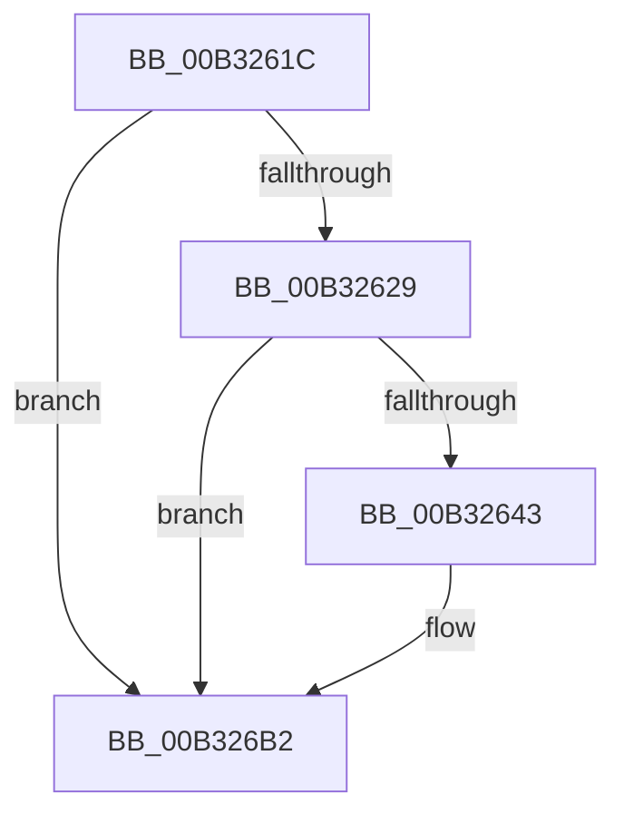

# sub_00B3261C

- RVA: `0x00B3261C`–`0x00B326BC` (길이 `160` bytes)
- VA: `0x0000000140B3261C`
- 실행 섹션: `PAGE`
- PDB 이름 있음: `아니요`; PDB Function 태그: `아니요`
- unwind 정보 RVA: `0x000A7254`
- 디코드: `31`개 명령, `160/160` bytes 표시
- 미해석 바이트: `0` (있으면 어셈블리에 `.byte`로 보존)

> 이 문서는 커널 이미지의 기계어와 PDB 기호를 분석해 생성했습니다. 4번과 5번은 함수 원형과 자료형을 바이너리 사용 방식에서 추정한 C 해석이며 원본 소스 복구 결과는 아닙니다.

## 1. Dependencies

- 직접 호출 지점: **2**; 고유 호출 대상: **2**
- 직접 호출자로 확인된 함수: **0**
- RIP 상대 이미지 참조: **2**

### Outgoing calls
- `0x00B3263A` → [tlgKeywordOn](../../text/42/tlgKeywordOn_function_0042EAA0.md) (function, `0x0042EAA0`)
- `0x00B326AD` → [tlgWriteAgg](../../text/2F/tlgWriteAgg_function_002F0F7C.md) (function, `0x002F0F7C`)

### Direct callers
- 이 함수 시작 RVA로 연결되는 직접 call은 확인되지 않았습니다. 간접 호출은 완전히 역산할 수 없습니다.

### Static image references
- `0x00B3261C` → RVA `0x00E09168` (`.data`; read)
- `0x00B3264F` → RVA `0x00054ABE` (`.rdata`; read)

## 2. Other-region calls and transfers

- 다른 실행 섹션으로 향하는 call: **2**
  - `0x00B3263A` → [tlgKeywordOn](../../text/42/tlgKeywordOn_function_0042EAA0.md) (`PAGE` → `.text`)
  - `0x00B326AD` → [tlgWriteAgg](../../text/2F/tlgWriteAgg_function_002F0F7C.md) (`PAGE` → `.text`)
- call이 아닌 외부 분기/꼬리 이동: **1**
  - `0x00B326B7` → [EtwpUpdateGuidEnableInfo + 0x245](../9F/EtwpUpdateGuidEnableInfo_function_009FCF48.md) (`tail-transfer`)

## 3. Assembly (complete function range)

```asm
00B3261C  83 3D 45 6B 2D 00 05            cmp dword ptr [rip + 0x2d6b45], 5
00B32623  0F 86 89 00 00 00               jbe 0x140b326b2
00B32629  48 BA 00 00 00 00 00 20 00 00   movabs rdx, 0x200000000000
00B32633  48 8D 0D 2E 6B 2D 00            lea rcx, [rip + 0x2d6b2e]
00B3263A  E8 61 C4 8F FF                  call 0x14042eaa0
00B3263F  84 C0                           test al, al
00B32641  74 6F                           je 0x140b326b2
00B32643  48 8D 45 97                     lea rax, [rbp - 0x69]
00B32647  4C 89 4D 97                     mov qword ptr [rbp - 0x69], r9
00B3264B  48 89 45 CF                     mov qword ptr [rbp - 0x31], rax
00B3264F  48 8D 15 68 24 52 FF            lea rdx, [rip - 0xaddb98]
00B32656  B8 00 00 00 81                  mov eax, 0x81000000
00B3265B  48 C7 45 D7 08 00 00 00         mov qword ptr [rbp - 0x29], 8
00B32663  48 89 45 9F                     mov qword ptr [rbp - 0x61], rax
00B32667  48 8D 0D FA 6A 2D 00            lea rcx, [rip + 0x2d6afa]
00B3266E  48 8D 45 9F                     lea rax, [rbp - 0x61]
00B32672  48 C7 45 E7 08 00 00 00         mov qword ptr [rbp - 0x19], 8
00B3267A  48 89 45 DF                     mov qword ptr [rbp - 0x21], rax
00B3267E  41 B9 06 00 00 00               mov r9d, 6
00B32684  48 8D 43 28                     lea rax, [rbx + 0x28]
00B32688  4C 89 45 F7                     mov qword ptr [rbp - 9], r8
00B3268C  48 89 45 EF                     mov qword ptr [rbp - 0x11], rax
00B32690  48 8D 45 8F                     lea rax, [rbp - 0x71]
00B32694  48 89 45 FF                     mov qword ptr [rbp - 1], rax
00B32698  48 8D 45 AF                     lea rax, [rbp - 0x51]
00B3269C  48 89 44 24 20                  mov qword ptr [rsp + 0x20], rax
00B326A1  44 89 45 8F                     mov dword ptr [rbp - 0x71], r8d
00B326A5  48 C7 45 07 04 00 00 00         mov qword ptr [rbp + 7], 4
00B326AD  E8 CA E8 7B FF                  call 0x1402f0f7c
00B326B2  B8 9A 00 00 C0                  mov eax, 0xc000009a
00B326B7  E9 D1 AA EC FF                  jmp 0x1409fd18d
```

## 4. C-style interpretation (structured pseudocode)

```c
__int64 __fastcall sub_00B3261C(__int64 a1, __int64 a2, __int64 a3, __int64 a4)
{
    __int64 result;
    unsigned __int64 v_stack_p20;

    if ((*(unsigned int *)(v_rip + 2976581)) <= 5) goto loc_00B326B2;
    result = tlgKeywordOn(v_rip + 2976558, a2, a3, a4);
    if ((unsigned __int8)(result) != 0) {
        result = v_rbp - 105;
        *(unsigned __int64 *)(v_rbp - 105) = a4;
        *(unsigned __int64 *)(v_rbp - 49) = result;
        a2 = v_rip - 11393944;
        result = 0x81000000ULL;
        *(unsigned __int64 *)(v_rbp - 41) = 8;
        *(unsigned __int64 *)(v_rbp - 97) = result;
        a1 = v_rip + 2976506;
        result = v_rbp - 97;
        *(unsigned __int64 *)(v_rbp - 25) = 8;
        *(unsigned __int64 *)(v_rbp - 33) = result;
        a4 = 6;
        result = v_rbx + 40;
        *(unsigned __int64 *)(v_rbp - 9) = a3;
        *(unsigned __int64 *)(v_rbp - 17) = result;
        result = v_rbp - 113;
        *(unsigned __int64 *)(v_rbp - 1) = result;
        result = v_rbp - 81;
        v_stack_p20 = result;
        *(unsigned int *)(v_rbp - 113) = (unsigned int)(a3);
        *(unsigned __int64 *)(v_rbp + 7) = 4;
        result = tlgWriteAgg(a1, a2, a3, a4);
    }
}
```

## 5. (Beta) C Style

```c
int64_t sub_00B3261C(int64_t Arg1, int64_t Arg2, int64_t Arg3, int64_t Arg4)
{
    int64_t result;
    uint64_t v_stack_p20;

    if ((*(uint32_t *)(v_rip + 0x2D6B45)) <= 5) goto loc_00B326B2;
    result = tlgKeywordOn(v_rip + 2976558, Arg2, Arg3, Arg4);
    if ((uint8_t)(result) != 0) {
        result = local_rbp - 105;
        *(uint64_t *)(local_rbp - 0x69) = Arg4;
        *(uint64_t *)(local_rbp - 0x31) = result;
        Arg2 = v_rip - 11393944;
        result = 0x81000000ULL;
        *(uint64_t *)(local_rbp - 0x29) = 8;
        *(uint64_t *)(local_rbp - 0x61) = result;
        Arg1 = v_rip + 2976506;
        result = local_rbp - 97;
        *(uint64_t *)(local_rbp - 0x19) = 8;
        *(uint64_t *)(local_rbp - 0x21) = result;
        Arg4 = 6;
        result = local_rbx + 40;
        *(uint64_t *)(local_rbp - 0x9) = Arg3;
        *(uint64_t *)(local_rbp - 0x11) = result;
        result = local_rbp - 113;
        *(uint64_t *)(local_rbp - 0x1) = result;
        result = local_rbp - 81;
        v_stack_p20 = result;
        *(uint32_t *)(local_rbp - 0x71) = (uint32_t)(Arg3);
        *(uint64_t *)(local_rbp + 0x7) = 4;
        result = tlgWriteAgg(Arg1, Arg2, Arg3, Arg4);
    }
}
```

## 6. Execution-region graph

[열기: 2D/3D 그래프와 함수 탐색 컨트롤 패널](../../../control-panel.html?section=page&rva=0x00B3261C&view=graph)

- 2D 그래프는 위에서 아래로 흐르고, 3D 그래프는 빈 공간을 드래그해 회전합니다. Shift+드래그는 이동, 휠은 확대·축소, 함수 노드 선택은 대상 보고서 이동입니다.

### Static fallback


