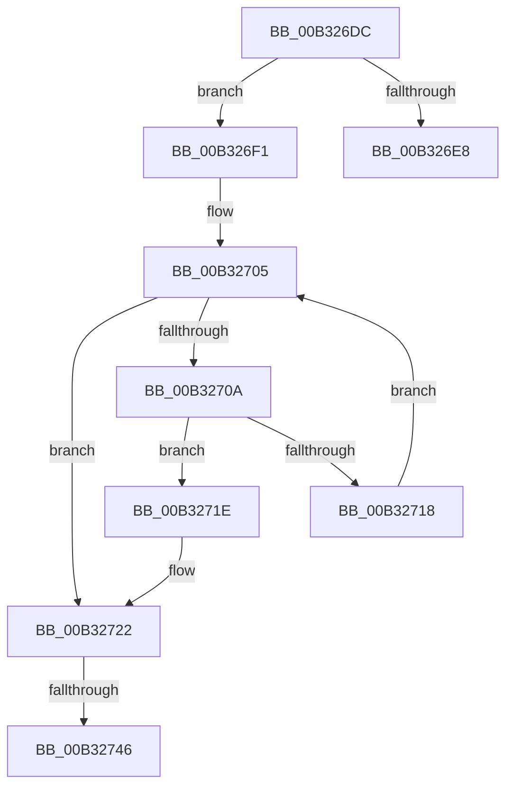

# sub_00B326DC

- RVA: `0x00B326DC`–`0x00B3274B` (길이 `111` bytes)
- VA: `0x0000000140B326DC`
- 실행 섹션: `PAGE`
- PDB 이름 있음: `아니요`; PDB Function 태그: `아니요`
- unwind 정보 RVA: `0x000A72D8`
- 디코드: `28`개 명령, `111/111` bytes 표시
- 미해석 바이트: `0` (있으면 어셈블리에 `.byte`로 보존)

> 이 문서는 커널 이미지의 기계어와 PDB 기호를 분석해 생성했습니다. 4번과 5번은 함수 원형과 자료형을 바이너리 사용 방식에서 추정한 C 해석이며 원본 소스 복구 결과는 아닙니다.

## 1. Dependencies

- 직접 호출 지점: **0**; 고유 호출 대상: **0**
- 직접 호출자로 확인된 함수: **0**
- RIP 상대 이미지 참조: **0**

### Outgoing calls
- 직접 디코드된 call 명령이 없습니다.

### Direct callers
- 이 함수 시작 RVA로 연결되는 직접 call은 확인되지 않았습니다. 간접 호출은 완전히 역산할 수 없습니다.

### Static image references
- 디코드된 RIP-relative 메모리 참조가 없습니다.

## 2. Other-region calls and transfers

- 다른 실행 섹션으로 향하는 call: **0**
- call이 아닌 외부 분기/꼬리 이동: **3**
  - `0x00B326EC` → [EtwpFillPerfectHashTable + 0x1C7](../9F/EtwpFillPerfectHashTable_function_009FD8F0.md) (`tail-transfer`)
  - `0x00B32740` → [EtwpFillPerfectHashTable + 0x1C7](../9F/EtwpFillPerfectHashTable_function_009FD8F0.md) (`tail-transfer`)
  - `0x00B32746` → [EtwpFillPerfectHashTable + 0xD4](../9F/EtwpFillPerfectHashTable_function_009FD8F0.md) (`tail-transfer`)

## 3. Assembly (complete function range)

```asm
00B326DC  41 0F B7 C3                     movzx eax, r11w
00B326E0  66 45 39 6C 82 02               cmp word ptr [r10 + rax*4 + 2], r13w
00B326E6  74 09                           je 0x140b326f1
00B326E8  66 45 03 DC                     add r11w, r12w
00B326EC  E9 C6 B3 EC FF                  jmp 0x1409fdab7
00B326F1  44 0F B7 CA                     movzx r9d, dx
00B326F5  41 0F B7 FB                     movzx edi, r11w
00B326F9  43 0F B7 44 8A 02               movzx eax, word ptr [r10 + r9*4 + 2]
00B326FF  66 41 89 44 BA 02               mov word ptr [r10 + rdi*4 + 2], ax
00B32705  66 3B CB                        cmp cx, bx
00B32708  73 18                           jae 0x140b32722
00B3270A  44 0F B7 C1                     movzx r8d, cx
00B3270E  43 0F B6 04 82                  movzx eax, byte ptr [r10 + r8*4]
00B32713  66 3B C2                        cmp ax, dx
00B32716  74 06                           je 0x140b3271e
00B32718  66 41 03 CC                     add cx, r12w
00B3271C  EB E7                           jmp 0x140b32705
00B3271E  47 88 1C 82                     mov byte ptr [r10 + r8*4], r11b
00B32722  43 8A 0C 8A                     mov cl, byte ptr [r10 + r9*4]
00B32726  66 41 03 D5                     add dx, r13w
00B3272A  41 88 0C BA                     mov byte ptr [r10 + rdi*4], cl
00B3272E  66 41 03 DD                     add bx, r13w
00B32732  0F B7 CA                        movzx ecx, dx
00B32735  66 45 03 DC                     add r11w, r12w
00B32739  3B CD                           cmp ecx, ebp
00B3273B  B9 00 00 00 00                  mov ecx, 0
00B32740  0F 87 71 B3 EC FF               ja 0x1409fdab7
00B32746  E9 79 B2 EC FF                  jmp 0x1409fd9c4
```

## 4. C-style interpretation (structured pseudocode)

```c
__int64 __fastcall sub_00B326DC(unsigned __int16 a1, unsigned __int16 a2)
{
    __int64 v_r11;
    __int64 v_rbx;

    if ((*(unsigned __int16 *)(v_r10 + (unsigned __int16)(v_r11) * 4 + 2)) == ((unsigned __int16)(v_r13))) goto loc_00B326F1;
    v_r11 = (unsigned __int16)((v_r11) + ((unsigned __int16)(v_r12)));
loc_00B326F1:
    *(unsigned __int16 *)(v_r10 + (unsigned __int16)(v_r11) * 4 + 2) = (unsigned __int16)(*(unsigned __int16 *)(v_r10 + a2 * 4 + 2));
loc_00B32705:
    if (a1 >= ((unsigned __int16)(v_rbx))) goto loc_00B32722;
    if (((unsigned __int16)(*(unsigned __int8 *)(v_r10 + a1 * 4))) == a2) goto loc_00B3271E;
    a1 = (unsigned __int16)((a1) + ((unsigned __int16)(v_r12)));
    goto loc_00B32705;
loc_00B3271E:
    *(unsigned __int8 *)(v_r10 + a1 * 4) = (unsigned __int8)(v_r11);
loc_00B32722:
    a2 = (unsigned __int16)((a2) + ((unsigned __int16)(v_r13)));
    *(unsigned __int8 *)(v_r10 + (unsigned __int16)(v_r11) * 4) = (unsigned __int8)(*(unsigned __int8 *)(v_r10 + a2 * 4));
    v_rbx = (unsigned __int16)((v_rbx) + ((unsigned __int16)(v_r13)));
    v_r11 = (unsigned __int16)((v_r11) + ((unsigned __int16)(v_r12)));
}
```

## 5. (Beta) C Style

```c
int64_t sub_00B326DC(uint16_t Arg1, uint16_t Arg2)
{
    int64_t local_r11;
    int64_t local_rbx;

    if ((*(uint16_t *)(local_r10 + (uint16_t)(local_r11) * 4 + 0x2)) == ((uint16_t)(local_r13))) goto loc_00B326F1;
    local_r11 = (uint16_t)((local_r11) + ((uint16_t)(local_r12)));
loc_00B326F1:
    *(uint16_t *)(local_r10 + (uint16_t)(local_r11) * 4 + 0x2) = (uint16_t)(*(uint16_t *)(local_r10 + Arg2 * 4 + 0x2));
loc_00B32705:
    if (Arg1 >= ((uint16_t)(local_rbx))) goto loc_00B32722;
    if (((uint16_t)(*(uint8_t *)(local_r10 + Arg1 * 4))) == Arg2) goto loc_00B3271E;
    Arg1 = (uint16_t)((Arg1) + ((uint16_t)(local_r12)));
    goto loc_00B32705;
loc_00B3271E:
    *(uint8_t *)(local_r10 + Arg1 * 4) = (uint8_t)(local_r11);
loc_00B32722:
    Arg2 = (uint16_t)((Arg2) + ((uint16_t)(local_r13)));
    *(uint8_t *)(local_r10 + (uint16_t)(local_r11) * 4) = (uint8_t)(*(uint8_t *)(local_r10 + Arg2 * 4));
    local_rbx = (uint16_t)((local_rbx) + ((uint16_t)(local_r13)));
    local_r11 = (uint16_t)((local_r11) + ((uint16_t)(local_r12)));
}
```

## 6. Execution-region graph

[열기: 2D/3D 그래프와 함수 탐색 컨트롤 패널](../../../control-panel.html?section=page&rva=0x00B326DC&view=graph)

- 2D 그래프는 위에서 아래로 흐르고, 3D 그래프는 빈 공간을 드래그해 회전합니다. Shift+드래그는 이동, 휠은 확대·축소, 함수 노드 선택은 대상 보고서 이동입니다.

### Static fallback


