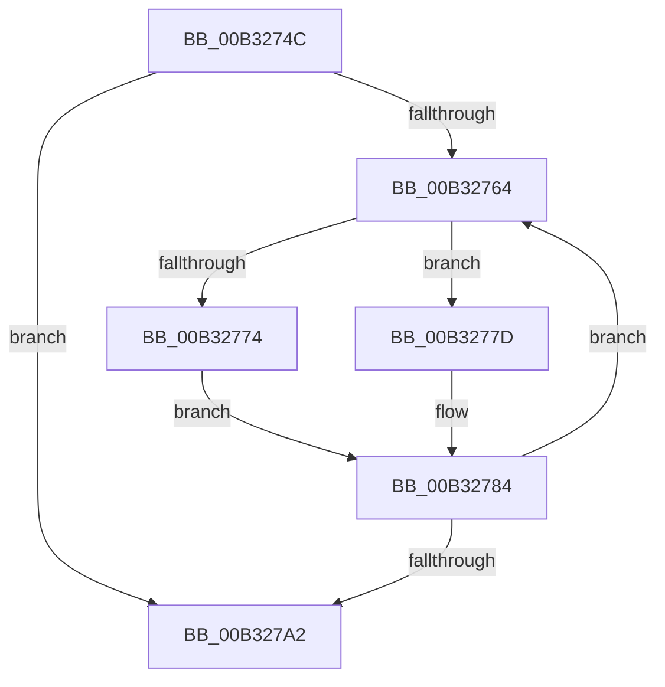

# sub_00B3274C

- RVA: `0x00B3274C`–`0x00B327AA` (길이 `94` bytes)
- VA: `0x0000000140B3274C`
- 실행 섹션: `PAGE`
- PDB 이름 있음: `아니요`; PDB Function 태그: `아니요`
- unwind 정보 RVA: `0x000A743C`
- 디코드: `25`개 명령, `94/94` bytes 표시
- 미해석 바이트: `0` (있으면 어셈블리에 `.byte`로 보존)

> 이 문서는 커널 이미지의 기계어와 PDB 기호를 분석해 생성했습니다. 4번과 5번은 함수 원형과 자료형을 바이너리 사용 방식에서 추정한 C 해석이며 원본 소스 복구 결과는 아닙니다.

## 1. Dependencies

- 직접 호출 지점: **0**; 고유 호출 대상: **0**
- 직접 호출자로 확인된 함수: **0**
- RIP 상대 이미지 참조: **0**

### Outgoing calls
- 직접 디코드된 call 명령이 없습니다.

### Direct callers
- 이 함수 시작 RVA로 연결되는 직접 call은 확인되지 않았습니다. 간접 호출은 완전히 역산할 수 없습니다.

### Static image references
- 디코드된 RIP-relative 메모리 참조가 없습니다.

## 2. Other-region calls and transfers

- 다른 실행 섹션으로 향하는 call: **0**
- call이 아닌 외부 분기/꼬리 이동: **1**
  - `0x00B327A5` → [SepDuplicateTokenUserAndGroups + 0x50](../9F/SepDuplicateTokenUserAndGroups_function_009FDFD4.md) (`tail-transfer`)

## 3. Assembly (complete function range)

```asm
00B3274C  48 8B 86 68 04 00 00            mov rax, qword ptr [rsi + 0x468]
00B32753  48 89 87 68 04 00 00            mov qword ptr [rdi + 0x468], rax
00B3275A  8B 46 7C                        mov eax, dword ptr [rsi + 0x7c]
00B3275D  89 47 7C                        mov dword ptr [rdi + 0x7c], eax
00B32760  85 C0                           test eax, eax
00B32762  74 3E                           je 0x140b327a2
00B32764  48 8B 8F 98 00 00 00            mov rcx, qword ptr [rdi + 0x98]
00B3276B  8B D3                           mov edx, ebx
00B3276D  48 03 D2                        add rdx, rdx
00B32770  3B DD                           cmp ebx, ebp
00B32772  74 09                           je 0x140b3277d
00B32774  49 8B 06                        mov rax, qword ptr [r14]
00B32777  48 8B 04 D0                     mov rax, qword ptr [rax + rdx*8]
00B3277B  EB 07                           jmp 0x140b32784
00B3277D  48 8B 87 60 04 00 00            mov rax, qword ptr [rdi + 0x460]
00B32784  48 89 04 D1                     mov qword ptr [rcx + rdx*8], rax
00B32788  41 03 D9                        add ebx, r9d
00B3278B  49 8B 06                        mov rax, qword ptr [r14]
00B3278E  48 8B 8F 98 00 00 00            mov rcx, qword ptr [rdi + 0x98]
00B32795  8B 44 D0 08                     mov eax, dword ptr [rax + rdx*8 + 8]
00B32799  89 44 D1 08                     mov dword ptr [rcx + rdx*8 + 8], eax
00B3279D  3B 5F 7C                        cmp ebx, dword ptr [rdi + 0x7c]
00B327A0  72 C2                           jb 0x140b32764
00B327A2  41 8B C0                        mov eax, r8d
00B327A5  E9 7A B8 EC FF                  jmp 0x1409fe024
```

## 4. C-style interpretation (structured pseudocode)

```c
__int64 __fastcall sub_00B3274C(__int64 a1, __int64 a2, int a3, int a4)
{
    __int64 v_rbx;

    *(unsigned __int64 *)(v_rdi + 1128) = *(unsigned __int64 *)(v_rsi + 1128);
    *(unsigned int *)(v_rdi + 124) = (unsigned int)((unsigned int)(*(unsigned int *)(v_rsi + 124)));
    if ((unsigned int)((unsigned int)(*(unsigned int *)(v_rsi + 124))) == 0) goto loc_00B327A2;
loc_00B32764:
    a2 = ((unsigned int)((unsigned int)(v_rbx))) + ((unsigned int)((unsigned int)(v_rbx)));
    if (((unsigned int)(v_rbx)) == ((unsigned int)(v_rbp))) goto loc_00B3277D;
    goto loc_00B32784;
loc_00B3277D:
loc_00B32784:
    *(unsigned __int64 *)(*(unsigned __int64 *)(v_rdi + 152) + a2 * 8) = *(unsigned __int64 *)(v_rdi + 1120);
    v_rbx = (unsigned int)((v_rbx) + (a4));
    *(unsigned int *)(*(unsigned __int64 *)(v_rdi + 152) + a2 * 8 + 8) = (unsigned int)((unsigned int)(*(unsigned int *)(*(unsigned __int64 *)(v_r14) + a2 * 8 + 8)));
    if (((unsigned int)(v_rbx)) < (*(unsigned int *)(v_rdi + 124))) goto loc_00B32764;
loc_00B327A2:
}
```

## 5. (Beta) C Style

```c
int64_t sub_00B3274C(int64_t Arg1, int64_t Arg2, int32_t Arg3, int32_t Arg4)
{
    int64_t local_rbx;

    *(uint64_t *)(local_rdi + 0x468) = *(uint64_t *)(local_rsi + 0x468);
    *(uint32_t *)(local_rdi + 0x7C) = (uint32_t)((uint32_t)(*(uint32_t *)(local_rsi + 0x7C)));
    if ((uint32_t)((uint32_t)(*(uint32_t *)(local_rsi + 0x7C))) == 0) goto loc_00B327A2;
loc_00B32764:
    Arg2 = ((uint32_t)((uint32_t)(local_rbx))) + ((uint32_t)((uint32_t)(local_rbx)));
    if (((uint32_t)(local_rbx)) == ((uint32_t)(local_rbp))) goto loc_00B3277D;
    goto loc_00B32784;
loc_00B3277D:
loc_00B32784:
    *(uint64_t *)(*(uint64_t *)(local_rdi + 0x98) + Arg2 * 8) = *(uint64_t *)(local_rdi + 0x460);
    local_rbx = (uint32_t)((local_rbx) + (Arg4));
    *(uint32_t *)(*(uint64_t *)(local_rdi + 0x98) + Arg2 * 8 + 0x8) = (uint32_t)((uint32_t)(*(uint32_t *)(*(uint64_t *)(local_r14) + Arg2 * 8 + 0x8)));
    if (((uint32_t)(local_rbx)) < (*(uint32_t *)(local_rdi + 0x7C))) goto loc_00B32764;
loc_00B327A2:
}
```

## 6. Execution-region graph

[열기: 2D/3D 그래프와 함수 탐색 컨트롤 패널](../../../control-panel.html?section=page&rva=0x00B3274C&view=graph)

- 2D 그래프는 위에서 아래로 흐르고, 3D 그래프는 빈 공간을 드래그해 회전합니다. Shift+드래그는 이동, 휠은 확대·축소, 함수 노드 선택은 대상 보고서 이동입니다.

### Static fallback


