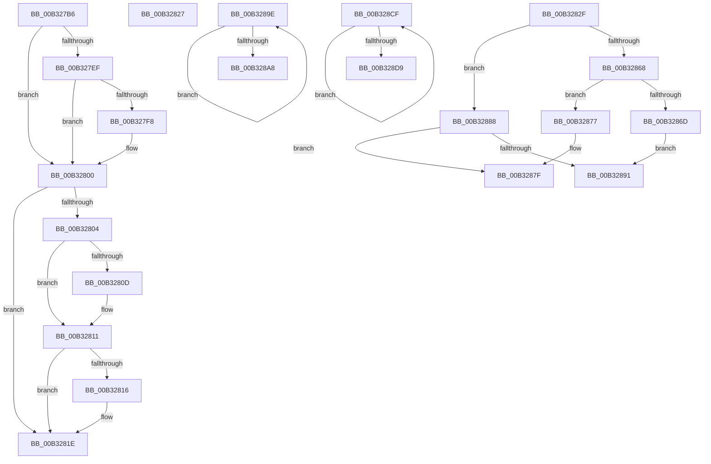

# sub_00B327B6

- RVA: `0x00B327B6`–`0x00B32900` (길이 `330` bytes)
- VA: `0x0000000140B327B6`
- 실행 섹션: `PAGE`
- PDB 이름 있음: `아니요`; PDB Function 태그: `아니요`
- unwind 정보 RVA: `0x000A7DAC`
- 디코드: `96`개 명령, `330/330` bytes 표시
- 미해석 바이트: `0` (있으면 어셈블리에 `.byte`로 보존)

> 이 문서는 커널 이미지의 기계어와 PDB 기호를 분석해 생성했습니다. 4번과 5번은 함수 원형과 자료형을 바이너리 사용 방식에서 추정한 C 해석이며 원본 소스 복구 결과는 아닙니다.

## 1. Dependencies

- 직접 호출 지점: **4**; 고유 호출 대상: **2**
- 직접 호출자로 확인된 함수: **0**
- RIP 상대 이미지 참조: **0**

### Outgoing calls
- `0x00B328AE` → [wcscpy_s](../../text/50/wcscpy_s_function_005064B0.md) (function, `0x005064B0`)
- `0x00B328BE` → [SddlpFreeUuidString](../7A/SddlpFreeUuidString_function_007A5258.md) (function, `0x007A5258`)
- `0x00B328DF` → [wcscpy_s](../../text/50/wcscpy_s_function_005064B0.md) (function, `0x005064B0`)
- `0x00B328EF` → [SddlpFreeUuidString](../7A/SddlpFreeUuidString_function_007A5258.md) (function, `0x007A5258`)

### Direct callers
- 이 함수 시작 RVA로 연결되는 직접 call은 확인되지 않았습니다. 간접 호출은 완전히 역산할 수 없습니다.

### Static image references
- 디코드된 RIP-relative 메모리 참조가 없습니다.

## 2. Other-region calls and transfers

- 다른 실행 섹션으로 향하는 call: **2**
  - `0x00B328AE` → [wcscpy_s](../../text/50/wcscpy_s_function_005064B0.md) (`PAGE` → `.text`)
  - `0x00B328DF` → [wcscpy_s](../../text/50/wcscpy_s_function_005064B0.md) (`PAGE` → `.text`)
- call이 아닌 외부 분기/꼬리 이동: **6**
  - `0x00B32822` → [LocalConvertAclToString + 0x2C7](../A0/LocalConvertAclToString_function_00A00408.md) (`tail-transfer`)
  - `0x00B3282A` → [LocalConvertAclToString + 0x335](../A0/LocalConvertAclToString_function_00A00408.md) (`tail-transfer`)
  - `0x00B32883` → [LocalConvertAclToString + 0x583](../A0/LocalConvertAclToString_function_00A00408.md) (`tail-transfer`)
  - `0x00B32899` → [LocalConvertAclToString + 0x583](../A0/LocalConvertAclToString_function_00A00408.md) (`tail-transfer`)
  - `0x00B328CA` → [LocalConvertAclToString + 0x665](../A0/LocalConvertAclToString_function_00A00408.md) (`tail-transfer`)
  - `0x00B328FB` → [LocalConvertAclToString + 0x682](../A0/LocalConvertAclToString_function_00A00408.md) (`tail-transfer`)

## 3. Assembly (complete function range)

```asm
00B327B6  41 8B 46 04                     mov eax, dword ptr [r14 + 4]
00B327BA  41 8B 56 08                     mov edx, dword ptr [r14 + 8]
00B327BE  44 8B C2                        mov r8d, edx
00B327C1  89 45 AB                        mov dword ptr [rbp - 0x55], eax
00B327C4  83 E2 02                        and edx, 2
00B327C7  41 83 E0 01                     and r8d, 1
00B327CB  8B C2                           mov eax, edx
00B327CD  F7 D8                           neg eax
00B327CF  41 8B F0                        mov esi, r8d
00B327D2  48 1B C9                        sbb rcx, rcx
00B327D5  48 C1 E6 04                     shl rsi, 4
00B327D9  83 E1 10                        and ecx, 0x10
00B327DC  48 8D 41 0C                     lea rax, [rcx + 0xc]
00B327E0  49 03 C6                        add rax, r14
00B327E3  48 03 F0                        add rsi, rax
00B327E6  48 89 75 C7                     mov qword ptr [rbp - 0x39], rsi
00B327EA  45 85 C0                        test r8d, r8d
00B327ED  74 11                           je 0x140b32800
00B327EF  49 8D 46 0C                     lea rax, [r14 + 0xc]
00B327F3  48 85 C0                        test rax, rax
00B327F6  74 08                           je 0x140b32800
00B327F8  41 83 C4 48                     add r12d, 0x48
00B327FC  44 89 65 AF                     mov dword ptr [rbp - 0x51], r12d
00B32800  85 D2                           test edx, edx
00B32802  74 1A                           je 0x140b3281e
00B32804  49 8D 46 1C                     lea rax, [r14 + 0x1c]
00B32808  45 85 C0                        test r8d, r8d
00B3280B  75 04                           jne 0x140b32811
00B3280D  49 8D 46 0C                     lea rax, [r14 + 0xc]
00B32811  48 85 C0                        test rax, rax
00B32814  74 08                           je 0x140b3281e
00B32816  41 83 C4 48                     add r12d, 0x48
00B3281A  44 89 65 AF                     mov dword ptr [rbp - 0x51], r12d
00B3281E  44 8B 65 AB                     mov r12d, dword ptr [rbp - 0x55]
00B32822  E9 A8 DE EC FF                  jmp 0x140a006cf
00B32827  41 8B FD                        mov edi, r13d
00B3282A  E9 0E DF EC FF                  jmp 0x140a0073d
00B3282F  41 8B 57 08                     mov edx, dword ptr [r15 + 8]
00B32833  44 8B C2                        mov r8d, edx
00B32836  45 8B 4F 04                     mov r9d, dword ptr [r15 + 4]
00B3283A  83 E2 02                        and edx, 2
00B3283D  41 83 E0 01                     and r8d, 1
00B32841  44 89 4D AB                     mov dword ptr [rbp - 0x55], r9d
00B32845  8B C2                           mov eax, edx
00B32847  41 8B F8                        mov edi, r8d
00B3284A  F7 D8                           neg eax
00B3284C  48 1B C9                        sbb rcx, rcx
00B3284F  48 C1 E7 04                     shl rdi, 4
00B32853  83 E1 10                        and ecx, 0x10
00B32856  48 8D 41 0C                     lea rax, [rcx + 0xc]
00B3285A  49 03 C7                        add rax, r15
00B3285D  48 03 F8                        add rdi, rax
00B32860  48 89 7D C7                     mov qword ptr [rbp - 0x39], rdi
00B32864  85 D2                           test edx, edx
00B32866  74 20                           je 0x140b32888
00B32868  45 85 C0                        test r8d, r8d
00B3286B  74 0A                           je 0x140b32877
00B3286D  4D 8D 6F 1C                     lea r13, [r15 + 0x1c]
00B32871  4C 89 6D DF                     mov qword ptr [rbp - 0x21], r13
00B32875  EB 1A                           jmp 0x140b32891
00B32877  4D 8D 6F 0C                     lea r13, [r15 + 0xc]
00B3287B  4C 89 6D DF                     mov qword ptr [rbp - 0x21], r13
00B3287F  4C 89 5D F7                     mov qword ptr [rbp - 9], r11
00B32883  E9 03 E1 EC FF                  jmp 0x140a0098b
00B32888  4C 89 5D DF                     mov qword ptr [rbp - 0x21], r11
00B3288C  45 85 C0                        test r8d, r8d
00B3288F  74 EE                           je 0x140b3287f
00B32891  4D 8D 67 0C                     lea r12, [r15 + 0xc]
00B32895  4C 89 65 F7                     mov qword ptr [rbp - 9], r12
00B32899  E9 ED E0 EC FF                  jmp 0x140a0098b
00B3289E  48 FF C3                        inc rbx
00B328A1  66 45 39 1C 58                  cmp word ptr [r8 + rbx*2], r11w
00B328A6  75 F6                           jne 0x140b3289e
00B328A8  48 8B D6                        mov rdx, rsi
00B328AB  49 8B CE                        mov rcx, r14
00B328AE  E8 FD 3B 9D FF                  call 0x1405064b0
00B328B3  48 8D 4D CF                     lea rcx, [rbp - 0x31]
00B328B7  48 2B F3                        sub rsi, rbx
00B328BA  4D 8D 34 5E                     lea r14, [r14 + rbx*2]
00B328BE  E8 95 29 C7 FF                  call 0x1407a5258
00B328C3  45 33 DB                        xor r11d, r11d
00B328C6  41 8D 43 3B                     lea eax, [r11 + 0x3b]
00B328CA  E9 9E E1 EC FF                  jmp 0x140a00a6d
00B328CF  48 FF C3                        inc rbx
00B328D2  66 45 39 1C 58                  cmp word ptr [r8 + rbx*2], r11w
00B328D7  75 F6                           jne 0x140b328cf
00B328D9  48 8B D6                        mov rdx, rsi
00B328DC  49 8B CE                        mov rcx, r14
00B328DF  E8 CC 3B 9D FF                  call 0x1405064b0
00B328E4  48 8D 4D CF                     lea rcx, [rbp - 0x31]
00B328E8  48 2B F3                        sub rsi, rbx
00B328EB  4D 8D 34 5E                     lea r14, [r14 + rbx*2]
00B328EF  E8 64 29 C7 FF                  call 0x1407a5258
00B328F4  45 33 DB                        xor r11d, r11d
00B328F7  41 8D 43 3B                     lea eax, [r11 + 0x3b]
00B328FB  E9 8A E1 EC FF                  jmp 0x140a00a8a
```

## 4. C-style interpretation (structured pseudocode)

```c
__int64 __fastcall sub_00B327B6(__int64 a1)
{
    __int64 result;
    __int64 v_r12;
    __int64 v_rsi;

    *(unsigned int *)(v_rbp - 85) = (unsigned int)((unsigned int)(*(unsigned int *)(v_r14 + 4)));
    a2 = (unsigned int)(((unsigned int)(*(unsigned int *)(v_r14 + 8))) & (2));
    a3 = (unsigned int)(((unsigned int)((unsigned int)((unsigned int)(*(unsigned int *)(v_r14 + 8))))) & (1));
    result = (unsigned int)(-((unsigned int)((unsigned int)(a2))));
    v_rsi = ((unsigned int)((unsigned int)(a3))) << (4);
    a1 = (unsigned int)((a1) & (16));
    result = (a1 + 12) + (v_r14);
    v_rsi = (v_rsi) + (result);
    *(unsigned __int64 *)(v_rbp - 57) = v_rsi;
    if ((unsigned int)(a3) == 0) goto loc_00B32800;
    if (v_r14 + 12 != 0) {
        v_r12 = (unsigned int)((v_r12) + (72));
        *(unsigned int *)(v_rbp - 81) = (unsigned int)(v_r12);
    }
    if ((unsigned int)(a2) == 0) goto loc_00B3281E;
    result = v_r14 + 28;
    if ((unsigned int)(a3) == 0) {
        result = v_r14 + 12;
    }
    if (result != 0) {
        v_r12 = (unsigned int)((v_r12) + (72));
        *(unsigned int *)(v_rbp - 81) = (unsigned int)(v_r12);
    }
}
```

## 5. (Beta) C Style

```c
int64_t sub_00B327B6(int64_t Arg1)
{
    int64_t result;
    int64_t local_r12;
    int64_t local_rsi;

    *(uint32_t *)(local_rbp - 0x55) = (uint32_t)((uint32_t)(*(uint32_t *)(local_r14 + 0x4)));
    a2 = (uint32_t)(((uint32_t)(*(uint32_t *)(local_r14 + 0x8))) & (2));
    a3 = (uint32_t)(((uint32_t)((uint32_t)((uint32_t)(*(uint32_t *)(local_r14 + 0x8))))) & (1));
    result = (uint32_t)(-((uint32_t)((uint32_t)(a2))));
    local_rsi = ((uint32_t)((uint32_t)(a3))) << (4);
    Arg1 = (uint32_t)((Arg1) & (16));
    result = (Arg1 + 12) + (local_r14);
    local_rsi = (local_rsi) + (result);
    *(uint64_t *)(local_rbp - 0x39) = local_rsi;
    if ((uint32_t)(a3) == 0) goto loc_00B32800;
    if (local_r14 + 12 != 0) {
        local_r12 = (uint32_t)((local_r12) + (72));
        *(uint32_t *)(local_rbp - 0x51) = (uint32_t)(local_r12);
    }
    if ((uint32_t)(a2) == 0) goto loc_00B3281E;
    result = local_r14 + 28;
    if ((uint32_t)(a3) == 0) {
        result = local_r14 + 12;
    }
    if (result != 0) {
        local_r12 = (uint32_t)((local_r12) + (72));
        *(uint32_t *)(local_rbp - 0x51) = (uint32_t)(local_r12);
    }
}
```

## 6. Execution-region graph

[열기: 2D/3D 그래프와 함수 탐색 컨트롤 패널](../../../control-panel.html?section=page&rva=0x00B327B6&view=graph)

- 2D 그래프는 위에서 아래로 흐르고, 3D 그래프는 빈 공간을 드래그해 회전합니다. Shift+드래그는 이동, 휠은 확대·축소, 함수 노드 선택은 대상 보고서 이동입니다.

### Static fallback


