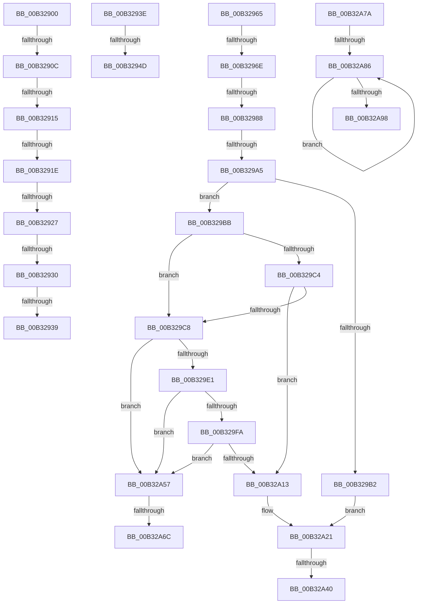

# sub_00B32900

- RVA: `0x00B32900`–`0x00B32AA1` (길이 `417` bytes)
- VA: `0x0000000140B32900`
- 실행 섹션: `PAGE`
- PDB 이름 있음: `아니요`; PDB Function 태그: `아니요`
- unwind 정보 RVA: `0x000A7E04`
- 디코드: `100`개 명령, `417/417` bytes 표시
- 미해석 바이트: `0` (있으면 어셈블리에 `.byte`로 보존)

> 이 문서는 커널 이미지의 기계어와 PDB 기호를 분석해 생성했습니다. 4번과 5번은 함수 원형과 자료형을 바이너리 사용 방식에서 추정한 C 해석이며 원본 소스 복구 결과는 아닙니다.

## 1. Dependencies

- 직접 호출 지점: **9**; 고유 호출 대상: **6**
- 직접 호출자로 확인된 함수: **0**
- RIP 상대 이미지 참조: **6**

### Outgoing calls
- `0x00B3293E` → [EncloseSubCondition](../A0/EncloseSubCondition_function_00A01BD4.md) (function, `0x00A01BD4`)
- `0x00B3297B` → [ULongAddStringSize](../A6/ULongAddStringSize_function_00A65738.md) (function, `0x00A65738`)
- `0x00B32994` → [SddlpAlloc](../92/SddlpAlloc_function_00925F88.md) (function, `0x00925F88`)
- `0x00B329D8` → [wcsnicmp](../../text/50/wcsnicmp_function_005001C0.md) (function, `0x005001C0`)
- `0x00B329F1` → [wcsnicmp](../../text/50/wcsnicmp_function_005001C0.md) (function, `0x005001C0`)
- `0x00B32A0A` → [wcsnicmp](../../text/50/wcsnicmp_function_005001C0.md) (function, `0x005001C0`)
- `0x00B32A33` → [RtlStringCchPrintfW](../../text/48/RtlStringCchPrintfW_function_00482D5C.md) (function, `0x00482D5C`)
- `0x00B32A6F` → [PdcCloseEvent](../8D/PdcCloseEvent_function_008D2404.md) (function, `0x008D2404`)
- `0x00B32A8E` → [PdcCloseEvent](../8D/PdcCloseEvent_function_008D2404.md) (function, `0x008D2404`)

### Direct callers
- 이 함수 시작 RVA로 연결되는 직접 call은 확인되지 않았습니다. 간접 호출은 완전히 역산할 수 없습니다.

### Static image references
- `0x00B32953` → RVA `0x00002BB0` (`.rdata`; read)
- `0x00B329B2` → RVA `0x00037F48` (`.rdata`; read)
- `0x00B329CE` → RVA `0x00014B00` (`.rdata`; read)
- `0x00B329E7` → RVA `0x00014AD0` (`.rdata`; read)
- `0x00B32A00` → RVA `0x00014AC0` (`.rdata`; read)
- `0x00B32A1A` → RVA `0x00037F30` (`.rdata`; read)

## 2. Other-region calls and transfers

- 다른 실행 섹션으로 향하는 call: **4**
  - `0x00B329D8` → [wcsnicmp](../../text/50/wcsnicmp_function_005001C0.md) (`PAGE` → `.text`)
  - `0x00B329F1` → [wcsnicmp](../../text/50/wcsnicmp_function_005001C0.md) (`PAGE` → `.text`)
  - `0x00B32A0A` → [wcsnicmp](../../text/50/wcsnicmp_function_005001C0.md) (`PAGE` → `.text`)
  - `0x00B32A33` → [RtlStringCchPrintfW](../../text/48/RtlStringCchPrintfW_function_00482D5C.md) (`PAGE` → `.text`)
- call이 아닌 외부 분기/꼬리 이동: **18**
  - `0x00B32906` → [LocalpGetStringForCondition + 0x258](../A0/LocalpGetStringForCondition_function_00A0122C.md) (`tail-transfer`)
  - `0x00B3290F` → [LocalpGetStringForCondition + 0x258](../A0/LocalpGetStringForCondition_function_00A0122C.md) (`tail-transfer`)
  - `0x00B32918` → [LocalpGetStringForCondition + 0x258](../A0/LocalpGetStringForCondition_function_00A0122C.md) (`tail-transfer`)
  - `0x00B32921` → [LocalpGetStringForCondition + 0x258](../A0/LocalpGetStringForCondition_function_00A0122C.md) (`tail-transfer`)
  - `0x00B3292A` → [LocalpGetStringForCondition + 0x258](../A0/LocalpGetStringForCondition_function_00A0122C.md) (`tail-transfer`)
  - `0x00B32933` → [LocalpGetStringForCondition + 0x43C](../A0/LocalpGetStringForCondition_function_00A0122C.md) (`tail-transfer`)
  - `0x00B32939` → [LocalpGetStringForCondition + 0x258](../A0/LocalpGetStringForCondition_function_00A0122C.md) (`tail-transfer`)
  - `0x00B32947` → [LocalpGetStringForCondition + 0x2D8](../A0/LocalpGetStringForCondition_function_00A0122C.md) (`tail-transfer`)
  - `0x00B32960` → [LocalpGetStringForCondition + 0x26E](../A0/LocalpGetStringForCondition_function_00A0122C.md) (`tail-transfer`)
  - `0x00B32968` → [LocalpGetStringForCondition + 0x450](../A0/LocalpGetStringForCondition_function_00A0122C.md) (`tail-transfer`)
  - `0x00B32982` → [LocalpGetStringForCondition + 0x2D3](../A0/LocalpGetStringForCondition_function_00A0122C.md) (`tail-transfer`)
  - `0x00B3299F` → [LocalpGetStringForCondition + 0x410](../A0/LocalpGetStringForCondition_function_00A0122C.md) (`tail-transfer`)
  - `0x00B32A3A` → [LocalpGetStringForCondition + 0x4FE](../A0/LocalpGetStringForCondition_function_00A0122C.md) (`tail-transfer`)
  - `0x00B32A52` → [LocalpGetStringForCondition + 0x3E0](../A0/LocalpGetStringForCondition_function_00A0122C.md) (`tail-transfer`)
  - `0x00B32A66` → [LocalpGetStringForCondition + 0x2DD](../A0/LocalpGetStringForCondition_function_00A0122C.md) (`tail-transfer`)
  - `0x00B32A75` → [LocalpGetStringForCondition + 0x2DD](../A0/LocalpGetStringForCondition_function_00A0122C.md) (`tail-transfer`)
  - `0x00B32A80` → [LocalpGetStringForCondition + 0x2E8](../A0/LocalpGetStringForCondition_function_00A0122C.md) (`tail-transfer`)
  - `0x00B32A9C` → [LocalpGetStringForCondition + 0x2E8](../A0/LocalpGetStringForCondition_function_00A0122C.md) (`tail-transfer`)

## 3. Assembly (complete function range)

```asm
00B32900  81 E9 8B 00 00 00               sub ecx, 0x8b
00B32906  0F 84 78 EB EC FF               je 0x140a01484
00B3290C  83 E9 01                        sub ecx, 1
00B3290F  0F 84 6F EB EC FF               je 0x140a01484
00B32915  83 E9 01                        sub ecx, 1
00B32918  0F 84 66 EB EC FF               je 0x140a01484
00B3291E  83 E9 01                        sub ecx, 1
00B32921  0F 84 5D EB EC FF               je 0x140a01484
00B32927  83 E9 01                        sub ecx, 1
00B3292A  0F 84 54 EB EC FF               je 0x140a01484
00B32930  83 F9 01                        cmp ecx, 1
00B32933  0F 85 2F ED EC FF               jne 0x140a01668
00B32939  E9 46 EB EC FF                  jmp 0x140a01484
00B3293E  E8 91 F2 EC FF                  call 0x140a01bd4
00B32943  8B D8                           mov ebx, eax
00B32945  85 C0                           test eax, eax
00B32947  0F 85 B7 EB EC FF               jne 0x140a01504
00B3294D  41 BB FF FF FF FF               mov r11d, 0xffffffff
00B32953  4C 8D 15 56 02 4D FF            lea r10, [rip - 0xb2fdaa]
00B3295A  41 B9 38 05 00 00               mov r9d, 0x538
00B32960  E9 35 EB EC FF                  jmp 0x140a0149a
00B32965  4D 85 E4                        test r12, r12
00B32968  0F 84 0E ED EC FF               je 0x140a0167c
00B3296E  4A 8B 74 E5 88                  mov rsi, qword ptr [rbp + r12*8 - 0x78]
00B32973  4C 8D 44 24 48                  lea r8, [rsp + 0x48]
00B32978  48 8B D6                        mov rdx, rsi
00B3297B  E8 B8 2D F3 FF                  call 0x140a65738
00B32980  85 C0                           test eax, eax
00B32982  0F 88 77 EB EC FF               js 0x140a014ff
00B32988  8B 44 24 48                     mov eax, dword ptr [rsp + 0x48]
00B3298C  83 C0 08                        add eax, 8
00B3298F  8B C8                           mov ecx, eax
00B32991  44 8B F0                        mov r14d, eax
00B32994  E8 EF 35 DF FF                  call 0x140925f88
00B32999  48 8B F8                        mov rdi, rax
00B3299C  48 85 C0                        test rax, rax
00B3299F  0F 84 97 EC EC FF               je 0x140a0163c
00B329A5  48 8D 05 04 02 4D FF            lea rax, [rip - 0xb2fdfc]
00B329AC  41 80 FF A2                     cmp r15b, 0xa2
00B329B0  75 09                           jne 0x140b329bb
00B329B2  4C 8D 05 8F 55 50 FF            lea r8, [rip - 0xafaa71]
00B329B9  EB 66                           jmp 0x140b32a21
00B329BB  42 8A 44 E8 08                  mov al, byte ptr [rax + r13*8 + 8]
00B329C0  3C 87                           cmp al, 0x87
00B329C2  74 04                           je 0x140b329c8
00B329C4  3C 8D                           cmp al, 0x8d
00B329C6  75 4B                           jne 0x140b32a13
00B329C8  41 B8 06 00 00 00               mov r8d, 6
00B329CE  48 8D 15 2B 21 4E FF            lea rdx, [rip - 0xb1ded5]
00B329D5  48 8B CE                        mov rcx, rsi
00B329D8  E8 E3 D7 9C FF                  call 0x1405001c0
00B329DD  85 C0                           test eax, eax
00B329DF  74 76                           je 0x140b32a57
00B329E1  41 B8 08 00 00 00               mov r8d, 8
00B329E7  48 8D 15 E2 20 4E FF            lea rdx, [rip - 0xb1df1e]
00B329EE  48 8B CE                        mov rcx, rsi
00B329F1  E8 CA D7 9C FF                  call 0x1405001c0
00B329F6  85 C0                           test eax, eax
00B329F8  74 5D                           je 0x140b32a57
00B329FA  41 B8 07 00 00 00               mov r8d, 7
00B32A00  48 8D 15 B9 20 4E FF            lea rdx, [rip - 0xb1df47]
00B32A07  48 8B CE                        mov rcx, rsi
00B32A0A  E8 B1 D7 9C FF                  call 0x1405001c0
00B32A0F  85 C0                           test eax, eax
00B32A11  74 44                           je 0x140b32a57
00B32A13  48 8D 05 96 01 4D FF            lea rax, [rip - 0xb2fe6a]
00B32A1A  4C 8D 05 0F 55 50 FF            lea r8, [rip - 0xafaaf1]
00B32A21  4E 8B 0C E8                     mov r9, qword ptr [rax + r13*8]
00B32A25  48 8B CF                        mov rcx, rdi
00B32A28  49 D1 EE                        shr r14, 1
00B32A2B  49 8B D6                        mov rdx, r14
00B32A2E  48 89 74 24 20                  mov qword ptr [rsp + 0x20], rsi
00B32A33  E8 24 03 95 FF                  call 0x140482d5c
00B32A38  85 C0                           test eax, eax
00B32A3A  0F 88 EA EC EC FF               js 0x140a0172a
00B32A40  33 C0                           xor eax, eax
00B32A42  4E 8D 7C E5 88                  lea r15, [rbp + r12*8 - 0x78]
00B32A47  44 8B F0                        mov r14d, eax
00B32A4A  8B 44 24 40                     mov eax, dword ptr [rsp + 0x40]
00B32A4E  89 44 24 40                     mov dword ptr [rsp + 0x40], eax
00B32A52  E9 B5 EB EC FF                  jmp 0x140a0160c
00B32A57  44 8B 74 24 40                  mov r14d, dword ptr [rsp + 0x40]
00B32A5C  BE 38 05 00 00                  mov esi, 0x538
00B32A61  8B DE                           mov ebx, esi
00B32A63  48 85 FF                        test rdi, rdi
00B32A66  0F 84 9D EA EC FF               je 0x140a01509
00B32A6C  48 8B CF                        mov rcx, rdi
00B32A6F  E8 90 F9 D9 FF                  call 0x1408d2404
00B32A74  90                              nop
00B32A75  E9 8F EA EC FF                  jmp 0x140a01509
00B32A7A  49 63 FE                        movsxd rdi, r14d
00B32A7D  45 85 F6                        test r14d, r14d
00B32A80  0F 84 8E EA EC FF               je 0x140a01514
00B32A86  48 8B 4C FD 88                  mov rcx, qword ptr [rbp + rdi*8 - 0x78]
00B32A8B  48 FF CF                        dec rdi
00B32A8E  E8 71 F9 D9 FF                  call 0x1408d2404
00B32A93  48 85 FF                        test rdi, rdi
00B32A96  75 EE                           jne 0x140b32a86
00B32A98  8B 5C 24 50                     mov ebx, dword ptr [rsp + 0x50]
00B32A9C  E9 73 EA EC FF                  jmp 0x140a01514
```

## 4. C-style interpretation (structured pseudocode)

```c
__int64 __fastcall sub_00B32900(int a1)
{
    unsigned __int64 v_stack_p20;
    unsigned int v_stack_p40;
    unsigned __int64 v_stack_p48;
    unsigned int v_stack_p50;

    a1 = (unsigned int)((a1) - (139));
    a1 = (unsigned int)((a1) - (1));
    a1 = (unsigned int)((a1) - (1));
    a1 = (unsigned int)((a1) - (1));
    a1 = (unsigned int)((a1) - (1));
}
```

## 5. (Beta) C Style

```c
int64_t sub_00B32900(int32_t Arg1)
{
    uint64_t v_stack_p20;
    uint32_t v_stack_p40;
    uint64_t v_stack_p48;
    uint32_t v_stack_p50;

    Arg1 = (uint32_t)((Arg1) - (139));
    Arg1 = (uint32_t)((Arg1) - (1));
    Arg1 = (uint32_t)((Arg1) - (1));
    Arg1 = (uint32_t)((Arg1) - (1));
    Arg1 = (uint32_t)((Arg1) - (1));
}
```

## 6. Execution-region graph

[열기: 2D/3D 그래프와 함수 탐색 컨트롤 패널](../../../control-panel.html?section=page&rva=0x00B32900&view=graph)

- 2D 그래프는 위에서 아래로 흐르고, 3D 그래프는 빈 공간을 드래그해 회전합니다. Shift+드래그는 이동, 휠은 확대·축소, 함수 노드 선택은 대상 보고서 이동입니다.

### Static fallback


