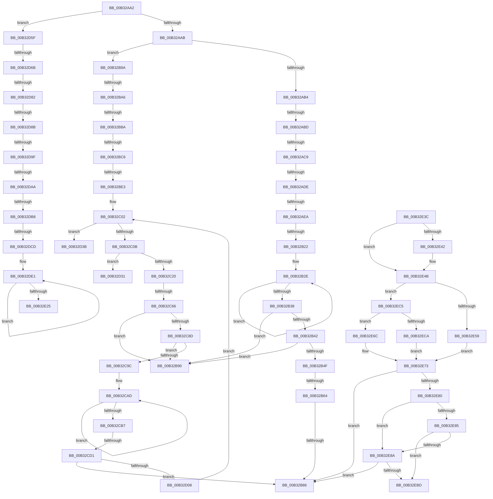

# sub_00B32AA2

- RVA: `0x00B32AA2`–`0x00B32EDE` (길이 `1,084` bytes)
- VA: `0x0000000140B32AA2`
- 실행 섹션: `PAGE`
- PDB 이름 있음: `아니요`; PDB Function 태그: `아니요`
- unwind 정보 RVA: `0x000A7E38`
- 디코드: `276`개 명령, `1,084/1,084` bytes 표시
- 미해석 바이트: `0` (있으면 어셈블리에 `.byte`로 보존)

> 이 문서는 커널 이미지의 기계어와 PDB 기호를 분석해 생성했습니다. 4번과 5번은 함수 원형과 자료형을 바이너리 사용 방식에서 추정한 C 해석이며 원본 소스 복구 결과는 아닙니다.

## 1. Dependencies

- 직접 호출 지점: **13**; 고유 호출 대상: **9**
- 직접 호출자로 확인된 함수: **0**
- RIP 상대 이미지 참조: **6**

### Outgoing calls
- `0x00B32AF5` → [memcpy](../../text/6C/memcpy_function_006C6840.md) (function, `0x006C6840`)
- `0x00B32B10` → [LocalGetStringForSid](../A0/LocalGetStringForSid_function_00A00328.md) (function, `0x00A00328`)
- `0x00B32B53` → [SddlpAlloc](../92/SddlpAlloc_function_00925F88.md) (function, `0x00925F88`)
- `0x00B32B79` → [RtlStringCchPrintfW](../../text/48/RtlStringCchPrintfW_function_00482D5C.md) (function, `0x00482D5C`)
- `0x00B32BD2` → [SddlpAlloc](../92/SddlpAlloc_function_00925F88.md) (function, `0x00925F88`)
- `0x00B32C57` → [GetPrintableOperandValue](../A0/GetPrintableOperandValue_function_00A01764.md) (function, `0x00A01764`)
- `0x00B32C7E` → [ULongAddStringSize](../A6/ULongAddStringSize_function_00A65738.md) (function, `0x00A65738`)
- `0x00B32CBD` → [SddlpReAlloc](../7A/SddlpReAlloc_function_007A5278.md) (function, `0x007A5278`)
- `0x00B32CFB` → [RtlStringCchPrintfW](../../text/48/RtlStringCchPrintfW_function_00482D5C.md) (function, `0x00482D5C`)
- `0x00B32D0D` → [PdcCloseEvent](../8D/PdcCloseEvent_function_008D2404.md) (function, `0x008D2404`)
- `0x00B32DBC` → [SddlpAlloc](../92/SddlpAlloc_function_00925F88.md) (function, `0x00925F88`)
- `0x00B32E73` → [RtlStringCchCopyW](../../text/26/RtlStringCchCopyW_function_0026E9A4.md) (function, `0x0026E9A4`)
- `0x00B32EB0` → [RtlStringCchPrintfW](../../text/48/RtlStringCchPrintfW_function_00482D5C.md) (function, `0x00482D5C`)

### Direct callers
- 이 함수 시작 RVA로 연결되는 직접 call은 확인되지 않았습니다. 간접 호출은 완전히 역산할 수 없습니다.

### Static image references
- `0x00B32B69` → RVA `0x00037F18` (`.rdata`; read)
- `0x00B32CF4` → RVA `0x00037F08` (`.rdata`; read)
- `0x00B32DD2` → RVA `0x00037FA8` (`.rdata`; read)
- `0x00B32E5F` → RVA `0x00037F70` (`.rdata`; read)
- `0x00B32E6C` → RVA `0x00037F88` (`.rdata`; read)
- `0x00B32ED1` → RVA `0x00037F98` (`.rdata`; read)

## 2. Other-region calls and transfers

- 다른 실행 섹션으로 향하는 call: **5**
  - `0x00B32AF5` → [memcpy](../../text/6C/memcpy_function_006C6840.md) (`PAGE` → `.text`)
  - `0x00B32B79` → [RtlStringCchPrintfW](../../text/48/RtlStringCchPrintfW_function_00482D5C.md) (`PAGE` → `.text`)
  - `0x00B32CFB` → [RtlStringCchPrintfW](../../text/48/RtlStringCchPrintfW_function_00482D5C.md) (`PAGE` → `.text`)
  - `0x00B32E73` → [RtlStringCchCopyW](../../text/26/RtlStringCchCopyW_function_0026E9A4.md) (`PAGE` → `.text`)
  - `0x00B32EB0` → [RtlStringCchPrintfW](../../text/48/RtlStringCchPrintfW_function_00482D5C.md) (`PAGE` → `.text`)
- call이 아닌 외부 분기/꼬리 이동: **26**
  - `0x00B32AB7` → [GetPrintableOperandValue + 0x161](../A0/GetPrintableOperandValue_function_00A01764.md) (`tail-transfer`)
  - `0x00B32AC3` → [GetPrintableOperandValue + 0x161](../A0/GetPrintableOperandValue_function_00A01764.md) (`tail-transfer`)
  - `0x00B32AD8` → [GetPrintableOperandValue + 0x161](../A0/GetPrintableOperandValue_function_00A01764.md) (`tail-transfer`)
  - `0x00B32AE4` → [GetPrintableOperandValue + 0x161](../A0/GetPrintableOperandValue_function_00A01764.md) (`tail-transfer`)
  - `0x00B32B1C` → [GetPrintableOperandValue + 0x11F](../A0/GetPrintableOperandValue_function_00A01764.md) (`tail-transfer`)
  - `0x00B32B5E` → [GetPrintableOperandValue + 0x15A](../A0/GetPrintableOperandValue_function_00A01764.md) (`tail-transfer`)
  - `0x00B32B80` → [GetPrintableOperandValue + 0x11F](../A0/GetPrintableOperandValue_function_00A01764.md) (`tail-transfer`)
  - `0x00B32B8B` → [GetPrintableOperandValue + 0x11F](../A0/GetPrintableOperandValue_function_00A01764.md) (`tail-transfer`)
  - `0x00B32B95` → [GetPrintableOperandValue + 0x11F](../A0/GetPrintableOperandValue_function_00A01764.md) (`tail-transfer`)
  - `0x00B32BA0` → [GetPrintableOperandValue + 0x161](../A0/GetPrintableOperandValue_function_00A01764.md) (`tail-transfer`)
  - `0x00B32BB4` → [GetPrintableOperandValue + 0x161](../A0/GetPrintableOperandValue_function_00A01764.md) (`tail-transfer`)
  - `0x00B32BC0` → [GetPrintableOperandValue + 0x161](../A0/GetPrintableOperandValue_function_00A01764.md) (`tail-transfer`)
  - `0x00B32BDD` → [GetPrintableOperandValue + 0x15A](../A0/GetPrintableOperandValue_function_00A01764.md) (`tail-transfer`)
  - `0x00B32C60` → [GetPrintableOperandValue + 0x11F](../A0/GetPrintableOperandValue_function_00A01764.md) (`tail-transfer`)
  - `0x00B32CCB` → [GetPrintableOperandValue + 0x15A](../A0/GetPrintableOperandValue_function_00A01764.md) (`tail-transfer`)
  - `0x00B32D36` → [GetPrintableOperandValue + 0x11F](../A0/GetPrintableOperandValue_function_00A01764.md) (`tail-transfer`)
  - `0x00B32D5A` → [GetPrintableOperandValue + 0x11F](../A0/GetPrintableOperandValue_function_00A01764.md) (`tail-transfer`)
  - `0x00B32D65` → [GetPrintableOperandValue + 0x161](../A0/GetPrintableOperandValue_function_00A01764.md) (`tail-transfer`)
  - `0x00B32D7C` → [GetPrintableOperandValue + 0x161](../A0/GetPrintableOperandValue_function_00A01764.md) (`tail-transfer`)
  - `0x00B32D85` → [GetPrintableOperandValue + 0x161](../A0/GetPrintableOperandValue_function_00A01764.md) (`tail-transfer`)
  - `0x00B32D99` → [GetPrintableOperandValue + 0x14C](../A0/GetPrintableOperandValue_function_00A01764.md) (`tail-transfer`)
  - `0x00B32DA4` → [GetPrintableOperandValue + 0x14C](../A0/GetPrintableOperandValue_function_00A01764.md) (`tail-transfer`)
  - `0x00B32DB2` → [GetPrintableOperandValue + 0x14C](../A0/GetPrintableOperandValue_function_00A01764.md) (`tail-transfer`)
  - `0x00B32DC7` → [GetPrintableOperandValue + 0x15A](../A0/GetPrintableOperandValue_function_00A01764.md) (`tail-transfer`)
  - `0x00B32E37` → [GetPrintableOperandValue + 0x11F](../A0/GetPrintableOperandValue_function_00A01764.md) (`tail-transfer`)
  - `0x00B32EC0` → [GetPrintableOperandValue + 0x11F](../A0/GetPrintableOperandValue_function_00A01764.md) (`tail-transfer`)

## 3. Assembly (complete function range)

```asm
00B32AA2  83 E9 08                        sub ecx, 8
00B32AA5  0F 84 B4 02 00 00               je 0x140b32d5f
00B32AAB  83 E9 38                        sub ecx, 0x38
00B32AAE  0F 84 E6 00 00 00               je 0x140b32b9a
00B32AB4  83 F9 01                        cmp ecx, 1
00B32AB7  0F 85 08 EE EC FF               jne 0x140a018c5
00B32ABD  8D 43 FF                        lea eax, [rbx - 1]
00B32AC0  83 F8 04                        cmp eax, 4
00B32AC3  0F 82 FC ED EC FF               jb 0x140a018c5
00B32AC9  45 8B 67 01                     mov r12d, dword ptr [r15 + 1]
00B32ACD  41 C7 01 05 00 00 00            mov dword ptr [r9], 5
00B32AD4  41 83 FC 44                     cmp r12d, 0x44
00B32AD8  0F 87 E7 ED EC FF               ja 0x140a018c5
00B32ADE  8D 43 FB                        lea eax, [rbx - 5]
00B32AE1  41 3B C4                        cmp eax, r12d
00B32AE4  0F 82 DB ED EC FF               jb 0x140a018c5
00B32AEA  45 8B C4                        mov r8d, r12d
00B32AED  49 8D 57 05                     lea rdx, [r15 + 5]
00B32AF1  48 8D 4D 9F                     lea rcx, [rbp - 0x61]
00B32AF5  E8 46 3D B9 FF                  call 0x1406c6840
00B32AFA  8A 85 87 00 00 00               mov al, byte ptr [rbp + 0x87]
00B32B00  48 8D 54 24 40                  lea rdx, [rsp + 0x40]
00B32B05  4D 8B C5                        mov r8, r13
00B32B08  88 44 24 28                     mov byte ptr [rsp + 0x28], al
00B32B0C  48 8D 4D 9F                     lea rcx, [rbp - 0x61]
00B32B10  E8 13 D8 EC FF                  call 0x140a00328
00B32B15  45 33 FF                        xor r15d, r15d
00B32B18  8B F8                           mov edi, eax
00B32B1A  85 C0                           test eax, eax
00B32B1C  0F 85 61 ED EC FF               jne 0x140a01883
00B32B22  44 01 26                        add dword ptr [rsi], r12d
00B32B25  48 8B 44 24 40                  mov rax, qword ptr [rsp + 0x40]
00B32B2A  49 83 CC FF                     or r12, 0xffffffffffffffff
00B32B2E  49 FF C4                        inc r12
00B32B31  66 46 39 3C 60                  cmp word ptr [rax + r12*2], r15w
00B32B36  75 F6                           jne 0x140b32b2e
00B32B38  41 8D 44 24 06                  lea eax, [r12 + 6]
00B32B3D  41 3B C4                        cmp eax, r12d
00B32B40  72 4E                           jb 0x140b32b90
00B32B42  48 03 C0                        add rax, rax
00B32B45  B9 FF FF FF FF                  mov ecx, 0xffffffff
00B32B4A  48 3B C1                        cmp rax, rcx
00B32B4D  77 41                           ja 0x140b32b90
00B32B4F  8B C8                           mov ecx, eax
00B32B51  8B D8                           mov ebx, eax
00B32B53  E8 30 34 DF FF                  call 0x140925f88
00B32B58  49 89 06                        mov qword ptr [r14], rax
00B32B5B  48 85 C0                        test rax, rax
00B32B5E  0F 84 5A ED EC FF               je 0x140a018be
00B32B64  4C 8B 4C 24 40                  mov r9, qword ptr [rsp + 0x40]
00B32B69  4C 8D 05 A8 53 50 FF            lea r8, [rip - 0xafac58]
00B32B70  48 D1 EB                        shr rbx, 1
00B32B73  48 8B C8                        mov rcx, rax
00B32B76  48 8B D3                        mov rdx, rbx
00B32B79  E8 DE 01 95 FF                  call 0x140482d5c
00B32B7E  85 C0                           test eax, eax
00B32B80  0F 89 FD EC EC FF               jns 0x140a01883
00B32B86  BF 32 00 00 00                  mov edi, 0x32
00B32B8B  E9 F3 EC EC FF                  jmp 0x140a01883
00B32B90  BF 16 02 00 00                  mov edi, 0x216
00B32B95  E9 E9 EC EC FF                  jmp 0x140a01883
00B32B9A  8D 43 FF                        lea eax, [rbx - 1]
00B32B9D  83 F8 04                        cmp eax, 4
00B32BA0  0F 82 1F ED EC FF               jb 0x140a018c5
00B32BA6  45 8B 6F 01                     mov r13d, dword ptr [r15 + 1]
00B32BAA  41 C7 01 05 00 00 00            mov dword ptr [r9], 5
00B32BB1  45 85 ED                        test r13d, r13d
00B32BB4  0F 84 0B ED EC FF               je 0x140a018c5
00B32BBA  8D 43 FB                        lea eax, [rbx - 5]
00B32BBD  41 3B C5                        cmp eax, r13d
00B32BC0  0F 82 FF EC EC FF               jb 0x140a018c5
00B32BC6  B8 06 00 00 00                  mov eax, 6
00B32BCB  8B C8                           mov ecx, eax
00B32BCD  48 89 44 24 58                  mov qword ptr [rsp + 0x58], rax
00B32BD2  E8 B1 33 DF FF                  call 0x140925f88
00B32BD7  49 89 06                        mov qword ptr [r14], rax
00B32BDA  48 85 C0                        test rax, rax
00B32BDD  0F 84 DB EC EC FF               je 0x140a018be
00B32BE3  66 C7 00 7B 00                  mov word ptr [rax], 0x7b
00B32BE8  33 C0                           xor eax, eax
00B32BEA  44 8B 0E                        mov r9d, dword ptr [rsi]
00B32BED  49 83 CC FF                     or r12, 0xffffffffffffffff
00B32BF1  44 8B C0                        mov r8d, eax
00B32BF4  89 44 24 4C                     mov dword ptr [rsp + 0x4c], eax
00B32BF8  44 89 4C 24 50                  mov dword ptr [rsp + 0x50], r9d
00B32BFD  41 8D 44 24 07                  lea eax, [r12 + 7]
00B32C02  45 3B E8                        cmp r13d, r8d
00B32C05  0F 86 30 01 00 00               jbe 0x140b32d3b
00B32C0B  41 8B C0                        mov eax, r8d
00B32C0E  49 03 C7                        add rax, r15
00B32C11  41 8B C9                        mov ecx, r9d
00B32C14  48 03 C8                        add rcx, rax
00B32C17  80 39 50                        cmp byte ptr [rcx], 0x50
00B32C1A  0F 84 11 01 00 00               je 0x140b32d31
00B32C20  8A 85 87 00 00 00               mov al, byte ptr [rbp + 0x87]
00B32C26  8B D3                           mov edx, ebx
00B32C28  88 44 24 38                     mov byte ptr [rsp + 0x38], al
00B32C2C  41 2B D0                        sub edx, r8d
00B32C2F  48 8B 44 24 68                  mov rax, qword ptr [rsp + 0x68]
00B32C34  4C 8D 44 24 40                  lea r8, [rsp + 0x40]
00B32C39  48 89 44 24 30                  mov qword ptr [rsp + 0x30], rax
00B32C3E  41 2B D1                        sub edx, r9d
00B32C41  48 8B 44 24 70                  mov rax, qword ptr [rsp + 0x70]
00B32C46  4C 8B CE                        mov r9, rsi
00B32C49  48 89 44 24 28                  mov qword ptr [rsp + 0x28], rax
00B32C4E  48 8B 45 87                     mov rax, qword ptr [rbp - 0x79]
00B32C52  48 89 44 24 20                  mov qword ptr [rsp + 0x20], rax
00B32C57  E8 08 EB EC FF                  call 0x140a01764
00B32C5C  8B F8                           mov edi, eax
00B32C5E  85 C0                           test eax, eax
00B32C60  0F 85 1D EC EC FF               jne 0x140a01883
00B32C66  8B 44 24 4C                     mov eax, dword ptr [rsp + 0x4c]
00B32C6A  4C 8D 44 24 48                  lea r8, [rsp + 0x48]
00B32C6F  03 06                           add eax, dword ptr [rsi]
00B32C71  48 8B 54 24 40                  mov rdx, qword ptr [rsp + 0x40]
00B32C76  8B 4C 24 58                     mov ecx, dword ptr [rsp + 0x58]
00B32C7A  89 44 24 4C                     mov dword ptr [rsp + 0x4c], eax
00B32C7E  E8 B5 2A F3 FF                  call 0x140a65738
00B32C83  33 D2                           xor edx, edx
00B32C85  85 C0                           test eax, eax
00B32C87  0F 88 03 FF FF FF               js 0x140b32b90
00B32C8D  8B 44 24 48                     mov eax, dword ptr [rsp + 0x48]
00B32C91  8D 48 04                        lea ecx, [rax + 4]
00B32C94  3B C8                           cmp ecx, eax
00B32C96  0F 82 F4 FE FF FF               jb 0x140b32b90
00B32C9C  4D 8B 06                        mov r8, qword ptr [r14]
00B32C9F  8B C1                           mov eax, ecx
00B32CA1  49 8B CC                        mov rcx, r12
00B32CA4  48 89 44 24 60                  mov qword ptr [rsp + 0x60], rax
00B32CA9  89 44 24 48                     mov dword ptr [rsp + 0x48], eax
00B32CAD  48 FF C1                        inc rcx
00B32CB0  66 41 39 14 48                  cmp word ptr [r8 + rcx*2], dx
00B32CB5  75 F6                           jne 0x140b32cad
00B32CB7  48 03 C9                        add rcx, rcx
00B32CBA  48 8B D0                        mov rdx, rax
00B32CBD  E8 B6 25 C7 FF                  call 0x1407a5278
00B32CC2  49 89 06                        mov qword ptr [r14], rax
00B32CC5  4C 8B C0                        mov r8, rax
00B32CC8  48 85 C0                        test rax, rax
00B32CCB  0F 84 ED EB EC FF               je 0x140a018be
00B32CD1  48 8B 44 24 58                  mov rax, qword ptr [rsp + 0x58]
00B32CD6  8B 54 24 60                     mov edx, dword ptr [rsp + 0x60]
00B32CDA  4C 8B 4C 24 40                  mov r9, qword ptr [rsp + 0x40]
00B32CDF  2B D0                           sub edx, eax
00B32CE1  8B C8                           mov ecx, eax
00B32CE3  83 C2 04                        add edx, 4
00B32CE6  48 D1 E9                        shr rcx, 1
00B32CE9  48 83 C1 FE                     add rcx, -2
00B32CED  48 D1 EA                        shr rdx, 1
00B32CF0  49 8D 0C 48                     lea rcx, [r8 + rcx*2]
00B32CF4  4C 8D 05 0D 52 50 FF            lea r8, [rip - 0xafadf3]
00B32CFB  E8 5C 00 95 FF                  call 0x140482d5c
00B32D00  85 C0                           test eax, eax
00B32D02  0F 88 7E FE FF FF               js 0x140b32b86
00B32D08  48 8B 4C 24 40                  mov rcx, qword ptr [rsp + 0x40]
00B32D0D  E8 F2 F6 D9 FF                  call 0x1408d2404
00B32D12  44 8B 44 24 4C                  mov r8d, dword ptr [rsp + 0x4c]
00B32D17  33 C0                           xor eax, eax
00B32D19  44 8B 4C 24 50                  mov r9d, dword ptr [rsp + 0x50]
00B32D1E  48 89 44 24 40                  mov qword ptr [rsp + 0x40], rax
00B32D23  8B 44 24 60                     mov eax, dword ptr [rsp + 0x60]
00B32D27  48 89 44 24 58                  mov qword ptr [rsp + 0x58], rax
00B32D2C  E9 D1 FE FF FF                  jmp 0x140b32c02
00B32D31  BF 38 05 00 00                  mov edi, 0x538
00B32D36  E9 48 EB EC FF                  jmp 0x140a01883
00B32D3B  8B C8                           mov ecx, eax
00B32D3D  49 8B 06                        mov rax, qword ptr [r14]
00B32D40  48 D1 E9                        shr rcx, 1
00B32D43  33 D2                           xor edx, edx
00B32D45  66 C7 44 48 F8 7D 00            mov word ptr [rax + rcx*2 - 8], 0x7d
00B32D4C  49 8B 06                        mov rax, qword ptr [r14]
00B32D4F  66 89 54 48 FA                  mov word ptr [rax + rcx*2 - 6], dx
00B32D54  43 8D 04 29                     lea eax, [r9 + r13]
00B32D58  89 06                           mov dword ptr [rsi], eax
00B32D5A  E9 24 EB EC FF                  jmp 0x140a01883
00B32D5F  8D 43 FF                        lea eax, [rbx - 1]
00B32D62  83 F8 04                        cmp eax, 4
00B32D65  0F 82 5A EB EC FF               jb 0x140a018c5
00B32D6B  45 8B 67 01                     mov r12d, dword ptr [r15 + 1]
00B32D6F  8D 43 FB                        lea eax, [rbx - 5]
00B32D72  41 C7 01 05 00 00 00            mov dword ptr [r9], 5
00B32D79  41 3B C4                        cmp eax, r12d
00B32D7C  0F 82 43 EB EC FF               jb 0x140a018c5
00B32D82  45 85 E4                        test r12d, r12d
00B32D85  0F 84 3A EB EC FF               je 0x140a018c5
00B32D8B  41 8B C4                        mov eax, r12d
00B32D8E  B9 FF FF FF FF                  mov ecx, 0xffffffff
00B32D93  48 03 C0                        add rax, rax
00B32D96  48 3B C1                        cmp rax, rcx
00B32D99  0F 87 11 EB EC FF               ja 0x140a018b0
00B32D9F  8D 50 02                        lea edx, [rax + 2]
00B32DA2  3B D0                           cmp edx, eax
00B32DA4  0F 82 06 EB EC FF               jb 0x140a018b0
00B32DAA  8B C2                           mov eax, edx
00B32DAC  48 03 C0                        add rax, rax
00B32DAF  48 3B C1                        cmp rax, rcx
00B32DB2  0F 87 F8 EA EC FF               ja 0x140a018b0
00B32DB8  8B C8                           mov ecx, eax
00B32DBA  8B D8                           mov ebx, eax
00B32DBC  E8 C7 31 DF FF                  call 0x140925f88
00B32DC1  49 89 06                        mov qword ptr [r14], rax
00B32DC4  48 85 C0                        test rax, rax
00B32DC7  0F 84 F1 EA EC FF               je 0x140a018be
00B32DCD  66 C7 00 23 00                  mov word ptr [rax], 0x23
00B32DD2  48 8D 3D CF 51 50 FF            lea rdi, [rip - 0xafae31]
00B32DD9  33 C0                           xor eax, eax
00B32DDB  44 8B D8                        mov r11d, eax
00B32DDE  44 8B E8                        mov r13d, eax
00B32DE1  8B 06                           mov eax, dword ptr [rsi]
00B32DE3  47 8D 0C 1B                     lea r9d, [r11 + r11]
00B32DE7  49 8B 0E                        mov rcx, qword ptr [r14]
00B32DEA  41 8D 51 01                     lea edx, [r9 + 1]
00B32DEE  49 03 C5                        add rax, r13
00B32DF1  41 FF C3                        inc r11d
00B32DF4  49 FF C5                        inc r13
00B32DF7  46 0F B6 14 38                  movzx r10d, byte ptr [rax + r15]
00B32DFC  45 8B C2                        mov r8d, r10d
00B32DFF  41 83 E2 0F                     and r10d, 0xf
00B32E03  49 C1 E8 04                     shr r8, 4
00B32E07  42 0F B7 04 47                  movzx eax, word ptr [rdi + r8*2]
00B32E0C  66 89 04 51                     mov word ptr [rcx + rdx*2], ax
00B32E10  41 8D 51 02                     lea edx, [r9 + 2]
00B32E14  49 8B 0E                        mov rcx, qword ptr [r14]
00B32E17  42 0F B7 04 57                  movzx eax, word ptr [rdi + r10*2]
00B32E1C  66 89 04 51                     mov word ptr [rcx + rdx*2], ax
00B32E20  45 3B DC                        cmp r11d, r12d
00B32E23  72 BC                           jb 0x140b32de1
00B32E25  49 8B 06                        mov rax, qword ptr [r14]
00B32E28  33 C9                           xor ecx, ecx
00B32E2A  48 D1 EB                        shr rbx, 1
00B32E2D  8B F9                           mov edi, ecx
00B32E2F  66 89 4C 58 FE                  mov word ptr [rax + rbx*2 - 2], cx
00B32E34  44 01 26                        add dword ptr [rsi], r12d
00B32E37  E9 47 EA EC FF                  jmp 0x140a01883
00B32E3C  41 80 FC 02                     cmp r12b, 2
00B32E40  75 09                           jne 0x140b32e4b
00B32E42  66 C7 00 2D 00                  mov word ptr [rax], 0x2d
00B32E47  49 83 C3 02                     add r11, 2
00B32E4B  48 8D 4D 8F                     lea rcx, [rbp - 0x71]
00B32E4F  BA 08 00 00 00                  mov edx, 8
00B32E54  80 FB 01                        cmp bl, 1
00B32E57  75 6C                           jne 0x140b32ec5
00B32E59  66 41 C7 03 30 00               mov word ptr [r11], 0x30
00B32E5F  4C 8D 05 0A 51 50 FF            lea r8, [rip - 0xafaef6]
00B32E66  49 83 C3 02                     add r11, 2
00B32E6A  EB 07                           jmp 0x140b32e73
00B32E6C  4C 8D 05 15 51 50 FF            lea r8, [rip - 0xafaeeb]
00B32E73  E8 2C BB 73 FF                  call 0x14026e9a4
00B32E78  85 C0                           test eax, eax
00B32E7A  0F 88 06 FD FF FF               js 0x140b32b86
00B32E80  4D 85 ED                        test r13, r13
00B32E83  75 05                           jne 0x140b32e8a
00B32E85  80 FB 01                        cmp bl, 1
00B32E88  74 33                           je 0x140b32ebd
00B32E8A  49 8B C3                        mov rax, r11
00B32E8D  4C 8D 45 8F                     lea r8, [rbp - 0x71]
00B32E91  4D 8B CD                        mov r9, r13
00B32E94  BA 20 00 00 00                  mov edx, 0x20
00B32E99  49 F7 D9                        neg r9
00B32E9C  49 8B CB                        mov rcx, r11
00B32E9F  41 80 FC 02                     cmp r12b, 2
00B32EA3  4D 0F 45 CD                     cmovne r9, r13
00B32EA7  49 2B 06                        sub rax, qword ptr [r14]
00B32EAA  48 D1 F8                        sar rax, 1
00B32EAD  48 2B D0                        sub rdx, rax
00B32EB0  E8 A7 FE 94 FF                  call 0x140482d5c
00B32EB5  85 C0                           test eax, eax
00B32EB7  0F 88 C9 FC FF FF               js 0x140b32b86
00B32EBD  83 06 0A                        add dword ptr [rsi], 0xa
00B32EC0  E9 BE E9 EC FF                  jmp 0x140a01883
00B32EC5  80 FB 03                        cmp bl, 3
00B32EC8  75 A2                           jne 0x140b32e6c
00B32ECA  41 C7 03 30 00 78 00            mov dword ptr [r11], 0x780030
00B32ED1  4C 8D 05 C0 50 50 FF            lea r8, [rip - 0xafaf40]
00B32ED8  49 83 C3 04                     add r11, 4
00B32EDC  EB 95                           jmp 0x140b32e73
```

## 4. C-style interpretation (structured pseudocode)

```c
__int64 __fastcall sub_00B32AA2(int a1, __int64 a2, __int64 a3, __int64 a4, __int64 a5, __int64 a6, __int64 a7, __int64 a8, unsigned int a9, unsigned int a10, unsigned int a11, unsigned int a12, __int64 a13, __int64 a14)
{
    __int64 result;
    __int64 v_r10;
    __int64 v_r11;
    __int64 v_r12;
    __int64 v_r13;
    __int64 v_r15;
    __int64 v_rbx;
    unsigned __int64 v_stack_p20;
    unsigned __int8 v_stack_p28;
    unsigned __int64 v_stack_p30;
    unsigned __int8 v_stack_p38;
    unsigned __int64 v_stack_p40;
    unsigned int v_stack_p48;
    unsigned int v_stack_p4C;
    unsigned int v_stack_p50;
    unsigned __int64 v_stack_p58;
    unsigned __int64 v_stack_p60;

    a1 = (unsigned int)((a1) - (8));
    if (condition_is_equal) goto loc_00B32D5F;
    a1 = (unsigned int)((a1) - (56));
    if (condition_is_equal) goto loc_00B32B9A;
    *(unsigned int *)(a4) = 5;
    result = memcpy(v_rbp - 97, v_r15 + 5, (unsigned int)((unsigned int)((unsigned int)(*(unsigned int *)(v_r15 + 1)))), a4);
    v_stack_p28 = (unsigned __int8)(*(unsigned __int8 *)(v_rbp + 135));
    result = LocalGetStringForSid(v_rbp - 97, a8, v_r13, a4);
    v_r15 = 0;
    v_r12 = ((unsigned int)(*(unsigned int *)(v_r15 + 1))) | (-1);
loc_00B32B2E:
    v_r12 = (v_r12) + 1;
    if ((*(unsigned __int16 *)(a8 + v_r12 * 2)) != 0) goto loc_00B32B2E;
    if (((unsigned int)(v_r12 + 6)) < ((unsigned int)(v_r12))) goto loc_00B32B90;
    result = (v_r12 + 6) + (v_r12 + 6);
    if (result > ((unsigned int)(0xFFFFFFFFULL))) goto loc_00B32B90;
    result = SddlpAlloc((unsigned int)((unsigned int)(result)), a8, v_r13, a4);
    *(unsigned __int64 *)(v_r14) = result;
    v_rbx = ((unsigned int)((unsigned int)(result))) >> (1);
    result = RtlStringCchPrintfW(result, v_rbx, v_rip - 11512920, a8);
loc_00B32B86:
loc_00B32B90:
loc_00B32B9A:
    *(unsigned int *)(a8) = 5;
    v_stack_p58 = 6;
    result = SddlpAlloc(6, v_rbx, v_rip - 11512920, a8);
    *(unsigned __int64 *)(v_r14) = result;
    *(unsigned __int16 *)(result) = 123;
    result = 0;
    v_r12 = (v_r12) | (-1);
    v_stack_p4C = 0;
    v_stack_p50 = (unsigned int)((unsigned int)(*(unsigned int *)(v_rsi)));
loc_00B32C02:
    if (((unsigned int)((unsigned int)(*(unsigned int *)(v_r15 + 1)))) <= 0) goto loc_00B32D3B;
    result = (0) + (0);
    a1 = ((unsigned int)((unsigned int)((unsigned int)(*(unsigned int *)(v_rsi))))) + (result);
    if ((*(unsigned __int8 *)(a1)) == 80) goto loc_00B32D31;
    v_stack_p38 = (unsigned __int8)(*(unsigned __int8 *)(v_rbp + 135));
    a2 = (unsigned int)(((unsigned int)((unsigned int)(v_rbx))) - (0));
    v_stack_p30 = a13;
    a2 = (unsigned int)((a2) - ((unsigned int)((unsigned int)(*(unsigned int *)(v_rsi)))));
    v_stack_p28 = a14;
    v_stack_p20 = *(unsigned __int64 *)(v_rbp - 121);
    result = GetPrintableOperandValue(a1, a2, a8, v_rsi);
    result = (unsigned int)(((unsigned int)(v_stack_p4C)) + (*(unsigned int *)(v_rsi)));
    v_stack_p4C = (unsigned int)(result);
    result = ULongAddStringSize((unsigned int)(a11), a8, a9, v_rsi);
    a2 = 0;
    if (sign_flag) goto loc_00B32B90;
    if (((unsigned int)((unsigned int)(a9) + 4)) < ((unsigned int)((unsigned int)(a9)))) goto loc_00B32B90;
    v_stack_p60 = (unsigned int)((unsigned int)((unsigned int)(a9) + 4));
    v_stack_p48 = (unsigned int)((unsigned int)((unsigned int)((unsigned int)(a9) + 4)));
loc_00B32CAD:
    a1 = (v_r12) + 1;
    if ((*(unsigned __int16 *)(*(unsigned __int64 *)(v_r14) + a1 * 2)) != 0) goto loc_00B32CAD;
    a1 = (a1) + (a1);
    result = SddlpReAlloc(a1, (unsigned int)((unsigned int)((unsigned int)(a9) + 4)), *(unsigned __int64 *)(v_r14), v_rsi);
    *(unsigned __int64 *)(v_r14) = result;
    a2 = (unsigned int)(((unsigned int)(a12)) - (a11));
    a2 = (unsigned int)((a2) + (4));
    a1 = ((unsigned int)(a11)) >> (1);
    a1 = (a1) + (-2);
    a2 = (a2) >> (1);
    result = RtlStringCchPrintfW(result + a1 * 2, a2, v_rip - 11513331, a8);
    if (sign_flag) goto loc_00B32B86;
    result = PdcCloseEvent(a8, a2, v_rip - 11513331, a8);
    result = 0;
    v_stack_p40 = 0;
    v_stack_p58 = (unsigned int)(a12);
    goto loc_00B32C02;
loc_00B32D31:
loc_00B32D3B:
    a1 = ((unsigned int)((unsigned int)((unsigned int)(a12)))) >> (1);
    a2 = 0;
    *(unsigned __int16 *)(*(unsigned __int64 *)(v_r14) + a1 * 2 - 8) = 125;
    *(unsigned __int16 *)(*(unsigned __int64 *)(v_r14) + a1 * 2 - 6) = 0;
    *(unsigned int *)(v_rsi) = (unsigned int)((unsigned int)(a10) + (unsigned int)(*(unsigned int *)(v_r15 + 1)) * 1);
loc_00B32D5F:
    *(unsigned int *)((unsigned int)(a10)) = 5;
    result = ((unsigned int)((unsigned int)((unsigned int)(*(unsigned int *)(v_r15 + 1))))) + ((unsigned int)((unsigned int)((unsigned int)(*(unsigned int *)(v_r15 + 1)))));
    result = ((unsigned int)((unsigned int)(result + 2))) + ((unsigned int)((unsigned int)(result + 2)));
    result = SddlpAlloc((unsigned int)((unsigned int)(result)), result + 2, (unsigned int)(v_stack_p4C), (unsigned int)(a10));
    *(unsigned __int64 *)(v_r14) = result;
    *(unsigned __int16 *)(result) = 35;
    result = 0;
loc_00B32DE1:
    result = ((unsigned int)(*(unsigned int *)(v_rsi))) + (0);
    v_r11 = (unsigned int)((0) + 1);
    v_r13 = (0) + 1;
    v_r10 = (unsigned int)((*(unsigned __int8 *)(result + v_r15 * 1)) & (15));
    a3 = ((unsigned int)((unsigned int)(*(unsigned __int8 *)(result + v_r15 * 1)))) >> (4);
    *(unsigned __int16 *)(*(unsigned __int64 *)(v_r14) + 0 + 0 * 1 + 1 * 2) = (unsigned __int16)(*(unsigned __int16 *)(v_rip - 11513393 + a3 * 2));
    *(unsigned __int16 *)(*(unsigned __int64 *)(v_r14) + 0 + 0 * 1 + 2 * 2) = (unsigned __int16)(*(unsigned __int16 *)(v_rip - 11513393 + v_r10 * 2));
    if (((unsigned int)(v_r11)) < ((unsigned int)((unsigned int)(*(unsigned int *)(v_r15 + 1))))) goto loc_00B32DE1;
    a1 = 0;
    v_rbx = ((unsigned int)((unsigned int)(result))) >> (1);
    *(unsigned __int16 *)(*(unsigned __int64 *)(v_r14) + v_rbx * 2 - 2) = 0;
}
```

## 5. (Beta) C Style

```c
int64_t sub_00B32AA2(int32_t Arg1, int64_t Arg2, int64_t Arg3, void *Arg4, uint64_t Arg5, uint64_t Arg6, uint64_t Arg7, void *Arg8, void *Arg9, uint32_t Arg10, uint32_t Arg11, uint32_t Arg12, int64_t Arg13, int64_t Arg14)
{
    uint8_t *arg4 = (uint8_t *)Arg4;
    uint8_t *arg8 = (uint8_t *)Arg8;
    uint8_t *arg9 = (uint8_t *)Arg9;

    int64_t result;
    int64_t local_r10;
    int64_t local_r11;
    int64_t local_r12;
    int64_t local_r13;
    int64_t local_r15;
    int64_t local_rbx;
    uint64_t v_stack_p20;
    uint8_t v_stack_p28;
    uint64_t v_stack_p30;
    uint8_t v_stack_p38;
    uint64_t v_stack_p40;
    uint32_t v_stack_p48;
    uint32_t v_stack_p4C;
    uint32_t v_stack_p50;
    uint64_t v_stack_p58;
    uint64_t v_stack_p60;

    Arg1 = (uint32_t)((Arg1) - (8));
    if (condition_is_equal) goto loc_00B32D5F;
    Arg1 = (uint32_t)((Arg1) - (56));
    if (condition_is_equal) goto loc_00B32B9A;
    *(uint32_t *)(arg4) = 5;
    result = memcpy(local_rbp - 97, local_r15 + 5, (uint32_t)((uint32_t)((uint32_t)(*(uint32_t *)(local_r15 + 0x1)))), Arg4);
    v_stack_p28 = (uint8_t)(*(uint8_t *)(local_rbp + 0x87));
    result = LocalGetStringForSid(local_rbp - 97, Arg8, local_r13, Arg4);
    local_r15 = 0;
    local_r12 = ((uint32_t)(*(uint32_t *)(local_r15 + 0x1))) | (-1);
loc_00B32B2E:
    local_r12 = (local_r12) + 1;
    if ((*(uint16_t *)(arg8 + local_r12 * 2)) != 0) goto loc_00B32B2E;
    if (((uint32_t)(local_r12 + 6)) < ((uint32_t)(local_r12))) goto loc_00B32B90;
    result = (local_r12 + 6) + (local_r12 + 6);
    if (result > ((uint32_t)(0xFFFFFFFFULL))) goto loc_00B32B90;
    result = SddlpAlloc((uint32_t)((uint32_t)(result)), Arg8, local_r13, Arg4);
    *(uint64_t *)(local_r14) = result;
    local_rbx = ((uint32_t)((uint32_t)(result))) >> (1);
    result = RtlStringCchPrintfW(result, local_rbx, v_rip - 11512920, Arg8);
loc_00B32B86:
loc_00B32B90:
loc_00B32B9A:
    *(uint32_t *)(arg8) = 5;
    v_stack_p58 = 6;
    result = SddlpAlloc(6, local_rbx, v_rip - 11512920, Arg8);
    *(uint64_t *)(local_r14) = result;
    *(uint16_t *)(result) = 123;
    result = 0;
    local_r12 = (local_r12) | (-1);
    v_stack_p4C = 0;
    v_stack_p50 = (uint32_t)((uint32_t)(*(uint32_t *)(local_rsi)));
loc_00B32C02:
    if (((uint32_t)((uint32_t)(*(uint32_t *)(local_r15 + 0x1)))) <= 0) goto loc_00B32D3B;
    result = (0) + (0);
    Arg1 = ((uint32_t)((uint32_t)((uint32_t)(*(uint32_t *)(local_rsi))))) + (result);
    if ((*(uint8_t *)(Arg1)) == 80) goto loc_00B32D31;
    v_stack_p38 = (uint8_t)(*(uint8_t *)(local_rbp + 0x87));
    Arg2 = (uint32_t)(((uint32_t)((uint32_t)(local_rbx))) - (0));
    v_stack_p30 = Arg13;
    Arg2 = (uint32_t)((Arg2) - ((uint32_t)((uint32_t)(*(uint32_t *)(local_rsi)))));
    v_stack_p28 = Arg14;
    v_stack_p20 = *(uint64_t *)(local_rbp - 0x79);
    result = GetPrintableOperandValue(Arg1, Arg2, Arg8, local_rsi);
    result = (uint32_t)(((uint32_t)(v_stack_p4C)) + (*(uint32_t *)(local_rsi)));
    v_stack_p4C = (uint32_t)(result);
    result = ULongAddStringSize((uint32_t)(Arg11), Arg8, Arg9, local_rsi);
    Arg2 = 0;
    if (sign_flag) goto loc_00B32B90;
    if (((uint32_t)((uint32_t)(Arg9) + 4)) < ((uint32_t)((uint32_t)(Arg9)))) goto loc_00B32B90;
    v_stack_p60 = (uint32_t)((uint32_t)((uint32_t)(Arg9) + 4));
    v_stack_p48 = (uint32_t)((uint32_t)((uint32_t)((uint32_t)(Arg9) + 4)));
loc_00B32CAD:
    Arg1 = (local_r12) + 1;
    if ((*(uint16_t *)(*(uint64_t *)(local_r14) + Arg1 * 2)) != 0) goto loc_00B32CAD;
    Arg1 = (Arg1) + (Arg1);
    result = SddlpReAlloc(Arg1, (uint32_t)((uint32_t)((uint32_t)(Arg9) + 4)), *(uint64_t *)(local_r14), local_rsi);
    *(uint64_t *)(local_r14) = result;
    Arg2 = (uint32_t)(((uint32_t)(Arg12)) - (Arg11));
    Arg2 = (uint32_t)((Arg2) + (4));
    Arg1 = ((uint32_t)(Arg11)) >> (1);
    Arg1 = (Arg1) + (-2);
    Arg2 = (Arg2) >> (1);
    result = RtlStringCchPrintfW(result + Arg1 * 2, Arg2, v_rip - 11513331, Arg8);
    if (sign_flag) goto loc_00B32B86;
    result = PdcCloseEvent(Arg8, Arg2, v_rip - 11513331, Arg8);
    result = 0;
    v_stack_p40 = 0;
    v_stack_p58 = (uint32_t)(Arg12);
    goto loc_00B32C02;
loc_00B32D31:
loc_00B32D3B:
    Arg1 = ((uint32_t)((uint32_t)((uint32_t)(Arg12)))) >> (1);
    Arg2 = 0;
    *(uint16_t *)(*(uint64_t *)(local_r14) + Arg1 * 2 - 0x8) = 125;
    *(uint16_t *)(*(uint64_t *)(local_r14) + Arg1 * 2 - 0x6) = 0;
    *(uint32_t *)(local_rsi) = (uint32_t)((uint32_t)(Arg10) + (uint32_t)(*(uint32_t *)(local_r15 + 0x1)) * 1);
loc_00B32D5F:
    *(uint32_t *)((uint32_t)(Arg10)) = 5;
    result = ((uint32_t)((uint32_t)((uint32_t)(*(uint32_t *)(local_r15 + 0x1))))) + ((uint32_t)((uint32_t)((uint32_t)(*(uint32_t *)(local_r15 + 0x1)))));
    result = ((uint32_t)((uint32_t)(result + 2))) + ((uint32_t)((uint32_t)(result + 2)));
    result = SddlpAlloc((uint32_t)((uint32_t)(result)), result + 2, (uint32_t)(v_stack_p4C), (uint32_t)(Arg10));
    *(uint64_t *)(local_r14) = result;
    *(uint16_t *)(result) = 35;
    result = 0;
loc_00B32DE1:
    result = ((uint32_t)(*(uint32_t *)(local_rsi))) + (0);
    local_r11 = (uint32_t)((0) + 1);
    local_r13 = (0) + 1;
    local_r10 = (uint32_t)((*(uint8_t *)(result + local_r15 * 1)) & (15));
    Arg3 = ((uint32_t)((uint32_t)(*(uint8_t *)(result + local_r15 * 1)))) >> (4);
    *(uint16_t *)(*(uint64_t *)(local_r14) + 0x0 + 0x0 * 1 + 0x1 * 2) = (uint16_t)(*(uint16_t *)(v_rip - 0xAFAE31 + Arg3 * 2));
    *(uint16_t *)(*(uint64_t *)(local_r14) + 0x0 + 0x0 * 1 + 0x2 * 2) = (uint16_t)(*(uint16_t *)(v_rip - 0xAFAE31 + local_r10 * 2));
    if (((uint32_t)(local_r11)) < ((uint32_t)((uint32_t)(*(uint32_t *)(local_r15 + 0x1))))) goto loc_00B32DE1;
    Arg1 = 0;
    local_rbx = ((uint32_t)((uint32_t)(result))) >> (1);
    *(uint16_t *)(*(uint64_t *)(local_r14) + local_rbx * 2 - 0x2) = 0;
}
```

### 관측된 메모리 오프셋

구조체 형식이 확인되지 않은 접근은 인자 기준의 오프셋으로만 기록했습니다.

| 기준 인자 | 오프셋 표현 | 폭 (bit) | 접근 |
|---|---:|---:|---|
| `Arg4` | `+ 0x0` | `32` | `W` |
| `Arg8` | `+ 0x0 + r12*2` | `16` | `R` |
| `Arg9` | `+ 0x4` | `32` | `R` |

## 6. Execution-region graph

[열기: 2D/3D 그래프와 함수 탐색 컨트롤 패널](../../../control-panel.html?section=page&rva=0x00B32AA2&view=graph)

- 2D 그래프는 위에서 아래로 흐르고, 3D 그래프는 빈 공간을 드래그해 회전합니다. Shift+드래그는 이동, 휠은 확대·축소, 함수 노드 선택은 대상 보고서 이동입니다.

### Static fallback


