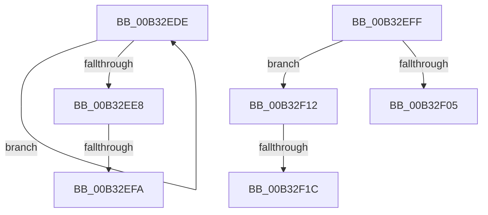

# sub_00B32EDE

- RVA: `0x00B32EDE`–`0x00B32F29` (길이 `75` bytes)
- VA: `0x0000000140B32EDE`
- 실행 섹션: `PAGE`
- PDB 이름 있음: `아니요`; PDB Function 태그: `아니요`
- unwind 정보 RVA: `0x000A7E78`
- 디코드: `19`개 명령, `75/75` bytes 표시
- 미해석 바이트: `0` (있으면 어셈블리에 `.byte`로 보존)

> 이 문서는 커널 이미지의 기계어와 PDB 기호를 분석해 생성했습니다. 4번과 5번은 함수 원형과 자료형을 바이너리 사용 방식에서 추정한 C 해석이며 원본 소스 복구 결과는 아닙니다.

## 1. Dependencies

- 직접 호출 지점: **0**; 고유 호출 대상: **0**
- 직접 호출자로 확인된 함수: **0**
- RIP 상대 이미지 참조: **0**

### Outgoing calls
- 직접 디코드된 call 명령이 없습니다.

### Direct callers
- 이 함수 시작 RVA로 연결되는 직접 call은 확인되지 않았습니다. 간접 호출은 완전히 역산할 수 없습니다.

### Static image references
- 디코드된 RIP-relative 메모리 참조가 없습니다.

## 2. Other-region calls and transfers

- 다른 실행 섹션으로 향하는 call: **0**
- call이 아닌 외부 분기/꼬리 이동: **5**
  - `0x00B32EF4` → [GetPrintableAttributeName + 0x8A](../A0/GetPrintableAttributeName_function_00A019D0.md) (`tail-transfer`)
  - `0x00B32EFA` → [GetPrintableAttributeName + 0xB6](../A0/GetPrintableAttributeName_function_00A019D0.md) (`tail-transfer`)
  - `0x00B32F0D` → [GetPrintableAttributeName + 0xC8](../A0/GetPrintableAttributeName_function_00A019D0.md) (`tail-transfer`)
  - `0x00B32F16` → [GetPrintableAttributeName + 0xCE](../A0/GetPrintableAttributeName_function_00A019D0.md) (`tail-transfer`)
  - `0x00B32F24` → [GetPrintableAttributeName + 0xC8](../A0/GetPrintableAttributeName_function_00A019D0.md) (`tail-transfer`)

## 3. Assembly (complete function range)

```asm
00B32EDE  48 FF C1                        inc rcx
00B32EE1  66 41 39 3C 4F                  cmp word ptr [r15 + rcx*2], di
00B32EE6  75 F6                           jne 0x140b32ede
00B32EE8  03 C9                           add ecx, ecx
00B32EEA  48 89 4C 24 28                  mov qword ptr [rsp + 0x28], rcx
00B32EEF  8D 41 02                        lea eax, [rcx + 2]
00B32EF2  3B C1                           cmp eax, ecx
00B32EF4  0F 82 60 EB EC FF               jb 0x140a01a5a
00B32EFA  E9 87 EB EC FF                  jmp 0x140a01a86
00B32EFF  40 80 FE FA                     cmp sil, 0xfa
00B32F03  75 0D                           jne 0x140b32f12
00B32F05  BD 14 00 00 00                  mov ebp, 0x14
00B32F0A  8D 48 14                        lea ecx, [rax + 0x14]
00B32F0D  E9 86 EB EC FF                  jmp 0x140a01a98
00B32F12  40 80 FE FC                     cmp sil, 0xfc
00B32F16  0F 85 82 EB EC FF               jne 0x140a01a9e
00B32F1C  BD 0E 00 00 00                  mov ebp, 0xe
00B32F21  8D 48 0E                        lea ecx, [rax + 0xe]
00B32F24  E9 6F EB EC FF                  jmp 0x140a01a98
```

## 4. C-style interpretation (structured pseudocode)

```c
__int64 __fastcall sub_00B32EDE(__int64 a1)
{
    unsigned __int64 v_stack_p28;

    a1 = (a1) + 1;
    if ((*(unsigned __int16 *)(v_r15 + a1 * 2)) != ((unsigned __int16)(v_rdi))) goto loc_00B32EDE;
    a1 = (unsigned int)((a1) + ((unsigned int)(a1)));
    v_stack_p28 = a1;
}
```

## 5. (Beta) C Style

```c
int64_t sub_00B32EDE(int64_t Arg1)
{
    uint64_t v_stack_p28;

    Arg1 = (Arg1) + 1;
    if ((*(uint16_t *)(local_r15 + Arg1 * 2)) != ((uint16_t)(local_rdi))) goto loc_00B32EDE;
    Arg1 = (uint32_t)((Arg1) + ((uint32_t)(Arg1)));
    v_stack_p28 = Arg1;
}
```

## 6. Execution-region graph

[열기: 2D/3D 그래프와 함수 탐색 컨트롤 패널](../../../control-panel.html?section=page&rva=0x00B32EDE&view=graph)

- 2D 그래프는 위에서 아래로 흐르고, 3D 그래프는 빈 공간을 드래그해 회전합니다. Shift+드래그는 이동, 휠은 확대·축소, 함수 노드 선택은 대상 보고서 이동입니다.

### Static fallback


