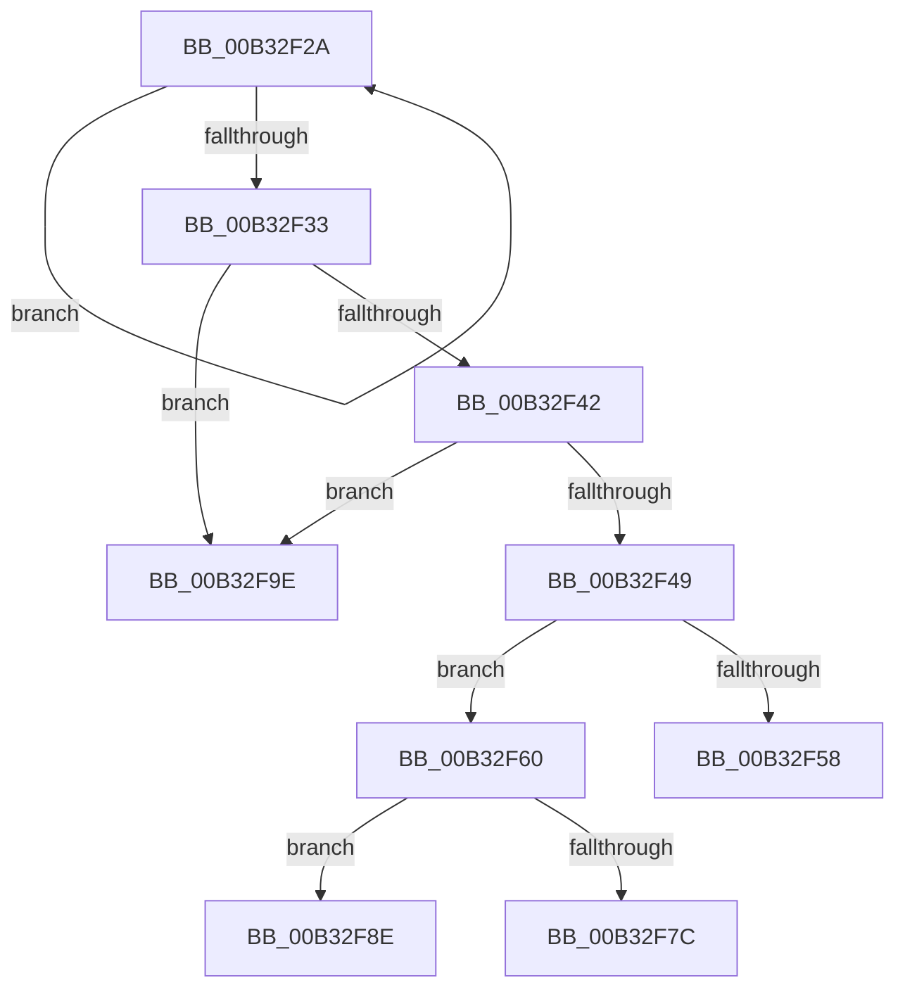

# sub_00B32F2A

- RVA: `0x00B32F2A`–`0x00B32FA8` (길이 `126` bytes)
- VA: `0x0000000140B32F2A`
- 실행 섹션: `PAGE`
- PDB 이름 있음: `아니요`; PDB Function 태그: `아니요`
- unwind 정보 RVA: `0x000A7E88`
- 디코드: `36`개 명령, `126/126` bytes 표시
- 미해석 바이트: `0` (있으면 어셈블리에 `.byte`로 보존)

> 이 문서는 커널 이미지의 기계어와 PDB 기호를 분석해 생성했습니다. 4번과 5번은 함수 원형과 자료형을 바이너리 사용 방식에서 추정한 C 해석이며 원본 소스 복구 결과는 아닙니다.

## 1. Dependencies

- 직접 호출 지점: **4**; 고유 호출 대상: **3**
- 직접 호출자로 확인된 함수: **0**
- RIP 상대 이미지 참조: **1**

### Outgoing calls
- `0x00B32F4B` → [SddlpAlloc](../92/SddlpAlloc_function_00925F88.md) (function, `0x00925F88`)
- `0x00B32F73` → [RtlStringCchPrintfW](../../text/48/RtlStringCchPrintfW_function_00482D5C.md) (function, `0x00482D5C`)
- `0x00B32F7F` → [PdcCloseEvent](../8D/PdcCloseEvent_function_008D2404.md) (function, `0x008D2404`)
- `0x00B32F91` → [PdcCloseEvent](../8D/PdcCloseEvent_function_008D2404.md) (function, `0x008D2404`)

### Direct callers
- 이 함수 시작 RVA로 연결되는 직접 call은 확인되지 않았습니다. 간접 호출은 완전히 역산할 수 없습니다.

### Static image references
- `0x00B32F63` → RVA `0x00037F60` (`.rdata`; read)

## 2. Other-region calls and transfers

- 다른 실행 섹션으로 향하는 call: **1**
  - `0x00B32F73` → [RtlStringCchPrintfW](../../text/48/RtlStringCchPrintfW_function_00482D5C.md) (`PAGE` → `.text`)
- call이 아닌 외부 분기/꼬리 이동: **4**
  - `0x00B32F5B` → [EncloseSubCondition + 0x22](../A0/EncloseSubCondition_function_00A01BD4.md) (`tail-transfer`)
  - `0x00B32F89` → [EncloseSubCondition + 0x22](../A0/EncloseSubCondition_function_00A01BD4.md) (`tail-transfer`)
  - `0x00B32F99` → [EncloseSubCondition + 0x22](../A0/EncloseSubCondition_function_00A01BD4.md) (`tail-transfer`)
  - `0x00B32FA3` → [EncloseSubCondition + 0x22](../A0/EncloseSubCondition_function_00A01BD4.md) (`tail-transfer`)

## 3. Assembly (complete function range)

```asm
00B32F2A  48 FF C0                        inc rax
00B32F2D  66 39 1C 41                     cmp word ptr [rcx + rax*2], bx
00B32F31  75 F7                           jne 0x140b32f2a
00B32F33  8B C0                           mov eax, eax
00B32F35  B9 FF FF FF FF                  mov ecx, 0xffffffff
00B32F3A  48 03 C0                        add rax, rax
00B32F3D  48 3B C1                        cmp rax, rcx
00B32F40  77 5C                           ja 0x140b32f9e
00B32F42  8D 48 06                        lea ecx, [rax + 6]
00B32F45  3B C8                           cmp ecx, eax
00B32F47  72 55                           jb 0x140b32f9e
00B32F49  8B E9                           mov ebp, ecx
00B32F4B  E8 38 30 DF FF                  call 0x140925f88
00B32F50  48 8B F0                        mov rsi, rax
00B32F53  48 85 C0                        test rax, rax
00B32F56  75 08                           jne 0x140b32f60
00B32F58  8D 58 08                        lea ebx, [rax + 8]
00B32F5B  E9 96 EC EC FF                  jmp 0x140a01bf6
00B32F60  4C 8B 0F                        mov r9, qword ptr [rdi]
00B32F63  4C 8D 05 F6 4F 50 FF            lea r8, [rip - 0xafb00a]
00B32F6A  48 D1 ED                        shr rbp, 1
00B32F6D  48 8B CE                        mov rcx, rsi
00B32F70  48 8B D5                        mov rdx, rbp
00B32F73  E8 E4 FD 94 FF                  call 0x140482d5c
00B32F78  85 C0                           test eax, eax
00B32F7A  79 12                           jns 0x140b32f8e
00B32F7C  48 8B CE                        mov rcx, rsi
00B32F7F  E8 80 F4 D9 FF                  call 0x1408d2404
00B32F84  BB 32 00 00 00                  mov ebx, 0x32
00B32F89  E9 68 EC EC FF                  jmp 0x140a01bf6
00B32F8E  48 8B 0F                        mov rcx, qword ptr [rdi]
00B32F91  E8 6E F4 D9 FF                  call 0x1408d2404
00B32F96  48 89 37                        mov qword ptr [rdi], rsi
00B32F99  E9 58 EC EC FF                  jmp 0x140a01bf6
00B32F9E  BB 16 02 00 00                  mov ebx, 0x216
00B32FA3  E9 4E EC EC FF                  jmp 0x140a01bf6
```

## 4. C-style interpretation (structured pseudocode)

```c
__int64 __fastcall sub_00B32F2A(__int64 a1)
{
    __int64 result;
    __int64 v_rbp;

    result = (result) + 1;
    if ((*(unsigned __int16 *)(a1 + result * 2)) != ((unsigned __int16)(v_rbx))) goto loc_00B32F2A;
    result = ((unsigned int)((unsigned int)(result))) + ((unsigned int)((unsigned int)(result)));
    if (result > ((unsigned int)(0xFFFFFFFFULL))) goto loc_00B32F9E;
    if (((unsigned int)(result + 6)) < ((unsigned int)(result))) goto loc_00B32F9E;
    result = SddlpAlloc(result + 6, a2, a3, a4);
    if (result != 0) goto loc_00B32F60;
loc_00B32F60:
    v_rbp = ((unsigned int)((unsigned int)(result + 6))) >> (1);
    result = RtlStringCchPrintfW(result, v_rbp, v_rip - 11513866, *(unsigned __int64 *)(v_rdi));
    if (!sign_flag) goto loc_00B32F8E;
    result = PdcCloseEvent(result, v_rbp, v_rip - 11513866, *(unsigned __int64 *)(v_rdi));
loc_00B32F8E:
    result = PdcCloseEvent(*(unsigned __int64 *)(v_rdi), v_rbp, v_rip - 11513866, *(unsigned __int64 *)(v_rdi));
    *(unsigned __int64 *)(v_rdi) = result;
loc_00B32F9E:
}
```

## 5. (Beta) C Style

```c
int64_t sub_00B32F2A(void *Arg1)
{
    uint8_t *arg1 = (uint8_t *)Arg1;

    int64_t result;
    int64_t local_rbp;

    result = (result) + 1;
    if ((*(uint16_t *)(arg1 + result * 2)) != ((uint16_t)(local_rbx))) goto loc_00B32F2A;
    result = ((uint32_t)((uint32_t)(result))) + ((uint32_t)((uint32_t)(result)));
    if (result > ((uint32_t)(0xFFFFFFFFULL))) goto loc_00B32F9E;
    if (((uint32_t)(result + 6)) < ((uint32_t)(result))) goto loc_00B32F9E;
    result = SddlpAlloc(result + 6, a2, a3, a4);
    if (result != 0) goto loc_00B32F60;
loc_00B32F60:
    local_rbp = ((uint32_t)((uint32_t)(result + 6))) >> (1);
    result = RtlStringCchPrintfW(result, local_rbp, v_rip - 11513866, *(uint64_t *)(local_rdi));
    if (!sign_flag) goto loc_00B32F8E;
    result = PdcCloseEvent(result, local_rbp, v_rip - 11513866, *(uint64_t *)(local_rdi));
loc_00B32F8E:
    result = PdcCloseEvent(*(uint64_t *)(local_rdi), local_rbp, v_rip - 11513866, *(uint64_t *)(local_rdi));
    *(uint64_t *)(local_rdi) = result;
loc_00B32F9E:
}
```

### 관측된 메모리 오프셋

구조체 형식이 확인되지 않은 접근은 인자 기준의 오프셋으로만 기록했습니다.

| 기준 인자 | 오프셋 표현 | 폭 (bit) | 접근 |
|---|---:|---:|---|
| `Arg1` | `+ 0x0 + rax*2` | `16` | `R` |

## 6. Execution-region graph

[열기: 2D/3D 그래프와 함수 탐색 컨트롤 패널](../../../control-panel.html?section=page&rva=0x00B32F2A&view=graph)

- 2D 그래프는 위에서 아래로 흐르고, 3D 그래프는 빈 공간을 드래그해 회전합니다. Shift+드래그는 이동, 휠은 확대·축소, 함수 노드 선택은 대상 보고서 이동입니다.

### Static fallback


