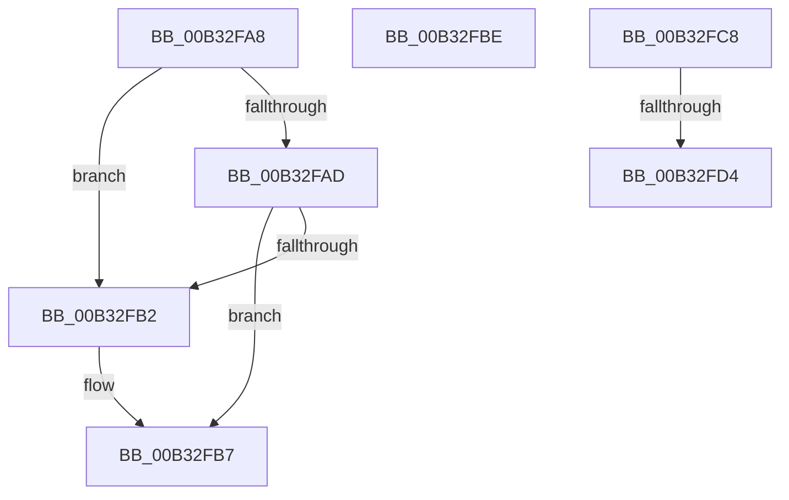

# sub_00B32FA8

- RVA: `0x00B32FA8`–`0x00B32FE4` (길이 `60` bytes)
- VA: `0x0000000140B32FA8`
- 실행 섹션: `PAGE`
- PDB 이름 있음: `아니요`; PDB Function 태그: `아니요`
- unwind 정보 RVA: `0x000A7EBC`
- 디코드: `16`개 명령, `60/60` bytes 표시
- 미해석 바이트: `0` (있으면 어셈블리에 `.byte`로 보존)

> 이 문서는 커널 이미지의 기계어와 PDB 기호를 분석해 생성했습니다. 4번과 5번은 함수 원형과 자료형을 바이너리 사용 방식에서 추정한 C 해석이며 원본 소스 복구 결과는 아닙니다.

## 1. Dependencies

- 직접 호출 지점: **1**; 고유 호출 대상: **1**
- 직접 호출자로 확인된 함수: **0**
- RIP 상대 이미지 참조: **0**

### Outgoing calls
- `0x00B32FD4` → [PdcCloseEvent](../8D/PdcCloseEvent_function_008D2404.md) (function, `0x008D2404`)

### Direct callers
- 이 함수 시작 RVA로 연결되는 직접 call은 확인되지 않았습니다. 간접 호출은 완전히 역산할 수 없습니다.

### Static image references
- 디코드된 RIP-relative 메모리 참조가 없습니다.

## 2. Other-region calls and transfers

- 다른 실행 섹션으로 향하는 call: **0**
- call이 아닌 외부 분기/꼬리 이동: **4**
  - `0x00B32FB9` → [LocalGetConditionForString + 0x49B](../A0/LocalGetConditionForString_function_00A01C20.md) (`tail-transfer`)
  - `0x00B32FC3` → [LocalGetConditionForString + 0x38B](../A0/LocalGetConditionForString_function_00A01C20.md) (`tail-transfer`)
  - `0x00B32FCE` → [LocalGetConditionForString + 0xFD](../A0/LocalGetConditionForString_function_00A01C20.md) (`tail-transfer`)
  - `0x00B32FDF` → [LocalGetConditionForString + 0xFD](../A0/LocalGetConditionForString_function_00A01C20.md) (`tail-transfer`)

## 3. Assembly (complete function range)

```asm
00B32FA8  80 F9 87                        cmp cl, 0x87
00B32FAB  74 05                           je 0x140b32fb2
00B32FAD  80 F9 8D                        cmp cl, 0x8d
00B32FB0  75 05                           jne 0x140b32fb7
00B32FB2  C6 44 24 52 01                  mov byte ptr [rsp + 0x52], 1
00B32FB7  33 C9                           xor ecx, ecx
00B32FB9  E9 FD F0 EC FF                  jmp 0x140a020bb
00B32FBE  BB 38 05 00 00                  mov ebx, 0x538
00B32FC3  E9 E3 EF EC FF                  jmp 0x140a01fab
00B32FC8  49 8B 0F                        mov rcx, qword ptr [r15]
00B32FCB  48 85 C9                        test rcx, rcx
00B32FCE  0F 84 49 ED EC FF               je 0x140a01d1d
00B32FD4  E8 2B F4 D9 FF                  call 0x1408d2404
00B32FD9  49 89 37                        mov qword ptr [r15], rsi
00B32FDC  41 89 36                        mov dword ptr [r14], esi
00B32FDF  E9 39 ED EC FF                  jmp 0x140a01d1d
```

## 4. C-style interpretation (structured pseudocode)

```c
__int64 __fastcall sub_00B32FA8(int a1)
{
    unsigned __int8 v_stack_p52;

    if (((unsigned __int8)(a1)) == 135) goto loc_00B32FB2;
    if (((unsigned __int8)(a1)) == 141) {
        v_stack_p52 = 1;
    }
    a1 = 0;
}
```

## 5. (Beta) C Style

```c
int64_t sub_00B32FA8(int32_t Arg1)
{
    uint8_t v_stack_p52;

    if (((uint8_t)(Arg1)) == 135) goto loc_00B32FB2;
    if (((uint8_t)(Arg1)) == 141) {
        v_stack_p52 = 1;
    }
    Arg1 = 0;
}
```

## 6. Execution-region graph

[열기: 2D/3D 그래프와 함수 탐색 컨트롤 패널](../../../control-panel.html?section=page&rva=0x00B32FA8&view=graph)

- 2D 그래프는 위에서 아래로 흐르고, 3D 그래프는 빈 공간을 드래그해 회전합니다. Shift+드래그는 이동, 휠은 확대·축소, 함수 노드 선택은 대상 보고서 이동입니다.

### Static fallback


