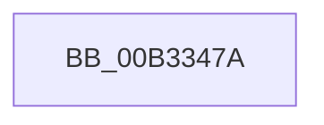

# sub_00B3347A

- RVA: `0x00B3347A`–`0x00B334A0` (길이 `38` bytes)
- VA: `0x0000000140B3347A`
- 실행 섹션: `PAGE`
- PDB 이름 있음: `아니요`; PDB Function 태그: `아니요`
- unwind 정보 RVA: `0x000A7F18`
- 디코드: `10`개 명령, `38/38` bytes 표시
- 미해석 바이트: `0` (있으면 어셈블리에 `.byte`로 보존)

> 이 문서는 커널 이미지의 기계어와 PDB 기호를 분석해 생성했습니다. 4번과 5번은 함수 원형과 자료형을 바이너리 사용 방식에서 추정한 C 해석이며 원본 소스 복구 결과는 아닙니다.

## 1. Dependencies

- 직접 호출 지점: **2**; 고유 호출 대상: **2**
- 직접 호출자로 확인된 함수: **0**
- RIP 상대 이미지 참조: **0**

### Outgoing calls
- `0x00B33487` → [memcpy](../../text/6C/memcpy_function_006C6840.md) (function, `0x006C6840`)
- `0x00B3348F` → [PdcCloseEvent](../8D/PdcCloseEvent_function_008D2404.md) (function, `0x008D2404`)

### Direct callers
- 이 함수 시작 RVA로 연결되는 직접 call은 확인되지 않았습니다. 간접 호출은 완전히 역산할 수 없습니다.

### Static image references
- 디코드된 RIP-relative 메모리 참조가 없습니다.

## 2. Other-region calls and transfers

- 다른 실행 섹션으로 향하는 call: **1**
  - `0x00B33487` → [memcpy](../../text/6C/memcpy_function_006C6840.md) (`PAGE` → `.text`)
- call이 아닌 외부 분기/꼬리 이동: **1**
  - `0x00B3349B` → [AppendCondition + 0x4C](../A0/AppendCondition_function_00A026B4.md) (`tail-transfer`)

## 3. Assembly (complete function range)

```asm
00B3347A  49 8B 1C 24                     mov rbx, qword ptr [r12]
00B3347E  49 8B CD                        mov rcx, r13
00B33481  45 8B 07                        mov r8d, dword ptr [r15]
00B33484  48 8B D3                        mov rdx, rbx
00B33487  E8 B4 33 B9 FF                  call 0x1406c6840
00B3348C  48 8B CB                        mov rcx, rbx
00B3348F  E8 70 EF D9 FF                  call 0x1408d2404
00B33494  4D 89 2C 24                     mov qword ptr [r12], r13
00B33498  41 89 37                        mov dword ptr [r15], esi
00B3349B  E9 60 F2 EC FF                  jmp 0x140a02700
```

## 4. C-style interpretation (structured pseudocode)

```c
__int64 __fastcall sub_00B3347A(void)
{
    __int64 result;

    result = memcpy(v_r13, *(unsigned __int64 *)(v_r12), (unsigned int)(*(unsigned int *)(v_r15)), a4);
    result = PdcCloseEvent(*(unsigned __int64 *)(v_r12), *(unsigned __int64 *)(v_r12), (unsigned int)(*(unsigned int *)(v_r15)), a4);
    *(unsigned __int64 *)(v_r12) = v_r13;
    *(unsigned int *)(v_r15) = (unsigned int)(v_rsi);
}
```

## 5. (Beta) C Style

```c
void sub_00B3347A(void)
{
    int64_t result;

    result = memcpy(local_r13, *(uint64_t *)(local_r12), (uint32_t)(*(uint32_t *)(local_r15)), a4);
    result = PdcCloseEvent(*(uint64_t *)(local_r12), *(uint64_t *)(local_r12), (uint32_t)(*(uint32_t *)(local_r15)), a4);
    *(uint64_t *)(local_r12) = local_r13;
    *(uint32_t *)(local_r15) = (uint32_t)(local_rsi);
}
```

## 6. Execution-region graph

[열기: 2D/3D 그래프와 함수 탐색 컨트롤 패널](../../../control-panel.html?section=page&rva=0x00B3347A&view=graph)

- 2D 그래프는 위에서 아래로 흐르고, 3D 그래프는 빈 공간을 드래그해 회전합니다. Shift+드래그는 이동, 휠은 확대·축소, 함수 노드 선택은 대상 보고서 이동입니다.

### Static fallback


