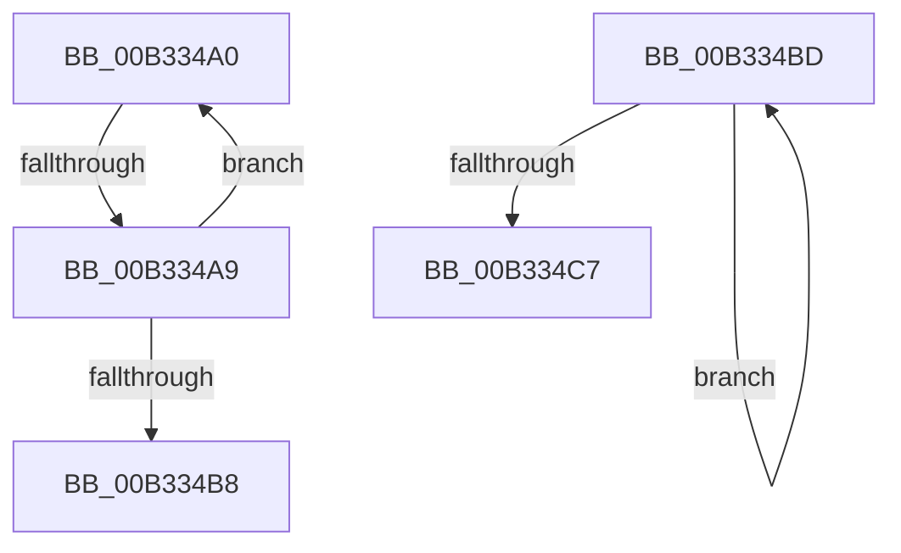

# sub_00B334A0

- RVA: `0x00B334A0`–`0x00B334D1` (길이 `49` bytes)
- VA: `0x0000000140B334A0`
- 실행 섹션: `PAGE`
- PDB 이름 있음: `아니요`; PDB Function 태그: `아니요`
- unwind 정보 RVA: `0x000A7F48`
- 디코드: `14`개 명령, `49/49` bytes 표시
- 미해석 바이트: `0` (있으면 어셈블리에 `.byte`로 보존)

> 이 문서는 커널 이미지의 기계어와 PDB 기호를 분석해 생성했습니다. 4번과 5번은 함수 원형과 자료형을 바이너리 사용 방식에서 추정한 C 해석이며 원본 소스 복구 결과는 아닙니다.

## 1. Dependencies

- 직접 호출 지점: **1**; 고유 호출 대상: **1**
- 직접 호출자로 확인된 함수: **0**
- RIP 상대 이미지 참조: **0**

### Outgoing calls
- `0x00B334AF` → [IsLegalAttributeChar2](../7A/IsLegalAttributeChar2_function_007A598C.md) (function, `0x007A598C`)

### Direct callers
- 이 함수 시작 RVA로 연결되는 직접 call은 확인되지 않았습니다. 간접 호출은 완전히 역산할 수 없습니다.

### Static image references
- 디코드된 RIP-relative 메모리 참조가 없습니다.

## 2. Other-region calls and transfers

- 다른 실행 섹션으로 향하는 call: **0**
- call이 아닌 외부 분기/꼬리 이동: **3**
  - `0x00B334A3` → [GetAttributeName + 0x8F](../A0/GetAttributeName_function_00A02768.md) (`tail-transfer`)
  - `0x00B334B8` → [GetAttributeName + 0x8F](../A0/GetAttributeName_function_00A02768.md) (`tail-transfer`)
  - `0x00B334CC` → [GetAttributeName + 0x182](../A0/GetAttributeName_function_00A02768.md) (`tail-transfer`)

## 3. Assembly (complete function range)

```asm
00B334A0  66 85 C9                        test cx, cx
00B334A3  0F 84 4E F3 EC FF               je 0x140a027f7
00B334A9  FF C7                           inc edi
00B334AB  0F B7 0C 7E                     movzx ecx, word ptr [rsi + rdi*2]
00B334AF  E8 D8 24 C7 FF                  call 0x1407a598c
00B334B4  84 C0                           test al, al
00B334B6  75 E8                           jne 0x140b334a0
00B334B8  E9 3A F3 EC FF                  jmp 0x140a027f7
00B334BD  48 FF C0                        inc rax
00B334C0  66 44 39 2C 42                  cmp word ptr [rdx + rax*2], r13w
00B334C5  75 F6                           jne 0x140b334bd
00B334C7  03 C0                           add eax, eax
00B334C9  89 41 04                        mov dword ptr [rcx + 4], eax
00B334CC  E9 19 F4 EC FF                  jmp 0x140a028ea
```

## 4. C-style interpretation (structured pseudocode)

```c
__int64 __fastcall sub_00B334A0(unsigned __int16 a1, __int64 a2)
{
    __int64 result;
    __int64 v_rdi;

    v_rdi = (unsigned int)((v_rdi) + 1);
    result = IsLegalAttributeChar2(*(unsigned __int16 *)(v_rsi + v_rdi * 2), a2, a3, a4);
    if ((unsigned __int8)(result) != 0) goto loc_00B334A0;
}
```

## 5. (Beta) C Style

```c
int64_t sub_00B334A0(uint16_t Arg1, int64_t Arg2)
{
    int64_t result;
    int64_t local_rdi;

    local_rdi = (uint32_t)((local_rdi) + 1);
    result = IsLegalAttributeChar2(*(uint16_t *)(local_rsi + local_rdi * 2), Arg2, a3, a4);
    if ((uint8_t)(result) != 0) goto loc_00B334A0;
}
```

## 6. Execution-region graph

[열기: 2D/3D 그래프와 함수 탐색 컨트롤 패널](../../../control-panel.html?section=page&rva=0x00B334A0&view=graph)

- 2D 그래프는 위에서 아래로 흐르고, 3D 그래프는 빈 공간을 드래그해 회전합니다. Shift+드래그는 이동, 휠은 확대·축소, 함수 노드 선택은 대상 보고서 이동입니다.

### Static fallback


