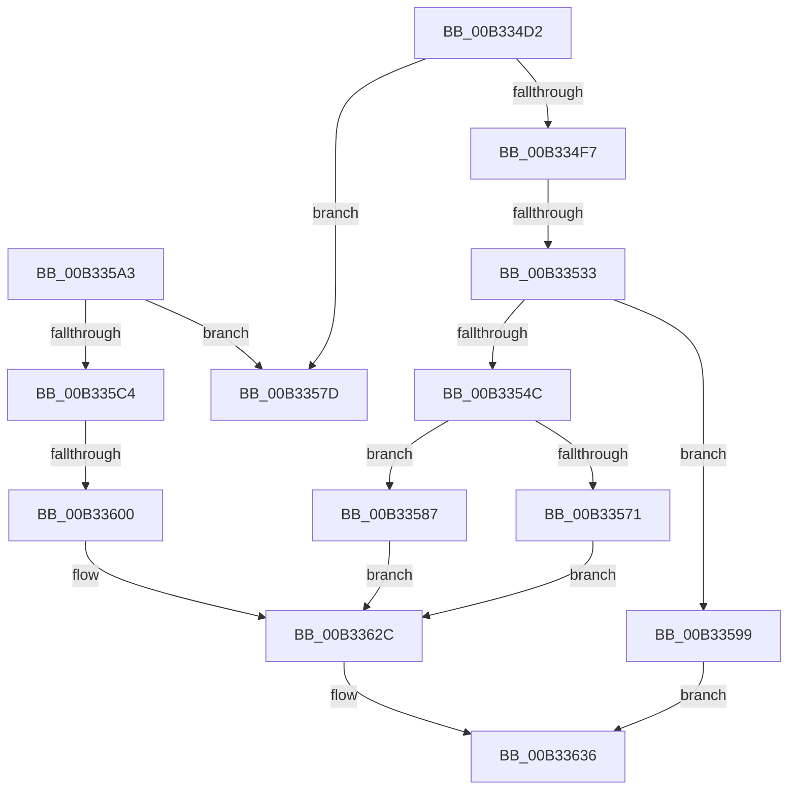

# sub_00B334D2

- RVA: `0x00B334D2`–`0x00B33644` (길이 `370` bytes)
- VA: `0x0000000140B334D2`
- 실행 섹션: `PAGE`
- PDB 이름 있음: `아니요`; PDB Function 태그: `아니요`
- unwind 정보 RVA: `0x000A8050`
- 디코드: `84`개 명령, `370/370` bytes 표시
- 미해석 바이트: `0` (있으면 어셈블리에 `.byte`로 보존)

> 이 문서는 커널 이미지의 기계어와 PDB 기호를 분석해 생성했습니다. 4번과 5번은 함수 원형과 자료형을 바이너리 사용 방식에서 추정한 C 해석이며 원본 소스 복구 결과는 아닙니다.

## 1. Dependencies

- 직접 호출 지점: **12**; 고유 호출 대상: **7**
- 직접 호출자로 확인된 함수: **0**
- RIP 상대 이미지 참조: **2**

### Outgoing calls
- `0x00B334EA` → [SeSinglePrivilegeCheck](../87/SeSinglePrivilegeCheck_function_00871E20.md) (function, `0x00871E20`)
- `0x00B33524` → [ObReferenceObjectByHandle](../86/ObReferenceObjectByHandle_function_00868DB0.md) (function, `0x00868DB0`)
- `0x00B33533` → [PsGetCurrentProcessSessionId](../../text/23/PsGetCurrentProcessSessionId_function_002303D0.md) (function, `0x002303D0`)
- `0x00B3353A` → [PsGetSessionObjectById](../../text/22/PsGetSessionObjectById_function_002250C0.md) (function, `0x002250C0`)
- `0x00B33563` → [ObpLockDirectoryExclusive](../99/ObpLockDirectoryExclusive_function_0099F24C.md) (function, `0x0099F24C`)
- `0x00B3358F` → [ObfDereferenceObject](../../text/2F/ObfDereferenceObject_function_002F9350.md) (function, `0x002F9350`)
- `0x00B335BB` → [SeSinglePrivilegeCheck](../87/SeSinglePrivilegeCheck_function_00871E20.md) (function, `0x00871E20`)
- `0x00B335F1` → [ObReferenceObjectByHandle](../86/ObReferenceObjectByHandle_function_00868DB0.md) (function, `0x00868DB0`)
- `0x00B3361C` → [ObpLockDirectoryExclusive](../99/ObpLockDirectoryExclusive_function_0099F24C.md) (function, `0x0099F24C`)
- `0x00B33621` → [PsGetCurrentProcessSessionId](../../text/23/PsGetCurrentProcessSessionId_function_002303D0.md) (function, `0x002303D0`)
- `0x00B33631` → [ObpUnlockDirectory](../99/ObpUnlockDirectory_function_0099F8A0.md) (function, `0x0099F8A0`)
- `0x00B33639` → [ObfDereferenceObject](../../text/2F/ObfDereferenceObject_function_002F9350.md) (function, `0x002F9350`)

### Direct callers
- 이 함수 시작 RVA로 연결되는 직접 call은 확인되지 않았습니다. 간접 호출은 완전히 역산할 수 없습니다.

### Static image references
- `0x00B334E3` → RVA `0x00FD9A78` (`PAGEDATA`; read)
- `0x00B334FC` → RVA `0x00F0F650` (`.data`; read)

## 2. Other-region calls and transfers

- 다른 실행 섹션으로 향하는 call: **5**
  - `0x00B33533` → [PsGetCurrentProcessSessionId](../../text/23/PsGetCurrentProcessSessionId_function_002303D0.md) (`PAGE` → `.text`)
  - `0x00B3353A` → [PsGetSessionObjectById](../../text/22/PsGetSessionObjectById_function_002250C0.md) (`PAGE` → `.text`)
  - `0x00B3358F` → [ObfDereferenceObject](../../text/2F/ObfDereferenceObject_function_002F9350.md) (`PAGE` → `.text`)
  - `0x00B33621` → [PsGetCurrentProcessSessionId](../../text/23/PsGetCurrentProcessSessionId_function_002303D0.md) (`PAGE` → `.text`)
  - `0x00B33639` → [ObfDereferenceObject](../../text/2F/ObfDereferenceObject_function_002F9350.md) (`PAGE` → `.text`)
- call이 아닌 외부 분기/꼬리 이동: **4**
  - `0x00B3352D` → [NtSetInformationObject + 0x82](../A0/NtSetInformationObject_function_00A03670.md) (`tail-transfer`)
  - `0x00B33582` → [NtSetInformationObject + 0x82](../A0/NtSetInformationObject_function_00A03670.md) (`tail-transfer`)
  - `0x00B335FA` → [NtSetInformationObject + 0x82](../A0/NtSetInformationObject_function_00A03670.md) (`tail-transfer`)
  - `0x00B3363F` → [NtSetInformationObject + 0x82](../A0/NtSetInformationObject_function_00A03670.md) (`tail-transfer`)

## 3. Assembly (complete function range)

```asm
00B334D2  65 48 8B 04 25 88 01 00 00      mov rax, qword ptr gs:[0x188]
00B334DB  8A 98 32 02 00 00               mov bl, byte ptr [rax + 0x232]
00B334E1  8A D3                           mov dl, bl
00B334E3  48 8B 0D 8E 65 4A 00            mov rcx, qword ptr [rip + 0x4a658e]
00B334EA  E8 31 E9 D3 FF                  call 0x140871e20
00B334EF  84 C0                           test al, al
00B334F1  0F 84 86 00 00 00               je 0x140b3357d
00B334F7  4C 89 74 24 40                  mov qword ptr [rsp + 0x40], r14
00B334FC  4C 8B 05 4D C1 3D 00            mov r8, qword ptr [rip + 0x3dc14d]
00B33503  4C 89 74 24 38                  mov qword ptr [rsp + 0x38], r14
00B33508  48 8D 44 24 40                  lea rax, [rsp + 0x40]
00B3350D  48 89 44 24 28                  mov qword ptr [rsp + 0x28], rax
00B33512  48 8D 44 24 38                  lea rax, [rsp + 0x38]
00B33517  48 89 44 24 20                  mov qword ptr [rsp + 0x20], rax
00B3351C  44 8A CB                        mov r9b, bl
00B3351F  33 D2                           xor edx, edx
00B33521  48 8B CE                        mov rcx, rsi
00B33524  E8 87 58 D3 FF                  call 0x140868db0
00B33529  8B F8                           mov edi, eax
00B3352B  85 C0                           test eax, eax
00B3352D  0F 88 BF 01 ED FF               js 0x140a036f2
00B33533  E8 98 CE 6F FF                  call 0x1402303d0
00B33538  8B C8                           mov ecx, eax
00B3353A  E8 81 1B 6F FF                  call 0x1402250c0
00B3353F  48 8B F0                        mov rsi, rax
00B33542  48 8B 5C 24 38                  mov rbx, qword ptr [rsp + 0x38]
00B33547  48 85 C0                        test rax, rax
00B3354A  74 4D                           je 0x140b33599
00B3354C  0F 57 C0                        xorps xmm0, xmm0
00B3354F  33 C0                           xor eax, eax
00B33551  0F 11 44 24 50                  movups xmmword ptr [rsp + 0x50], xmm0
00B33556  48 89 44 24 60                  mov qword ptr [rsp + 0x60], rax
00B3355B  48 8B D3                        mov rdx, rbx
00B3355E  48 8D 4C 24 50                  lea rcx, [rsp + 0x50]
00B33563  E8 E4 BC E6 FF                  call 0x14099f24c
00B33568  4C 39 B3 48 01 00 00            cmp qword ptr [rbx + 0x148], r14
00B3356F  75 16                           jne 0x140b33587
00B33571  48 89 B3 48 01 00 00            mov qword ptr [rbx + 0x148], rsi
00B33578  E9 AF 00 00 00                  jmp 0x140b3362c
00B3357D  BF 61 00 00 C0                  mov edi, 0xc0000061
00B33582  E9 6B 01 ED FF                  jmp 0x140a036f2
00B33587  BF 22 00 00 C0                  mov edi, 0xc0000022
00B3358C  48 8B CE                        mov rcx, rsi
00B3358F  E8 BC 5D 7C FF                  call 0x1402f9350
00B33594  E9 93 00 00 00                  jmp 0x140b3362c
00B33599  BF 55 04 00 C0                  mov edi, 0xc0000455
00B3359E  E9 93 00 00 00                  jmp 0x140b33636
00B335A3  65 48 8B 04 25 88 01 00 00      mov rax, qword ptr gs:[0x188]
00B335AC  8A 98 32 02 00 00               mov bl, byte ptr [rax + 0x232]
00B335B2  8A D3                           mov dl, bl
00B335B4  48 8B 0D BD 64 4A 00            mov rcx, qword ptr [rip + 0x4a64bd]
00B335BB  E8 60 E8 D3 FF                  call 0x140871e20
00B335C0  84 C0                           test al, al
00B335C2  74 B9                           je 0x140b3357d
00B335C4  4C 89 74 24 40                  mov qword ptr [rsp + 0x40], r14
00B335C9  4C 8B 05 80 C0 3D 00            mov r8, qword ptr [rip + 0x3dc080]
00B335D0  4C 89 74 24 38                  mov qword ptr [rsp + 0x38], r14
00B335D5  48 8D 44 24 40                  lea rax, [rsp + 0x40]
00B335DA  48 89 44 24 28                  mov qword ptr [rsp + 0x28], rax
00B335DF  48 8D 44 24 38                  lea rax, [rsp + 0x38]
00B335E4  48 89 44 24 20                  mov qword ptr [rsp + 0x20], rax
00B335E9  44 8A CB                        mov r9b, bl
00B335EC  33 D2                           xor edx, edx
00B335EE  48 8B CE                        mov rcx, rsi
00B335F1  E8 BA 57 D3 FF                  call 0x140868db0
00B335F6  8B F8                           mov edi, eax
00B335F8  85 C0                           test eax, eax
00B335FA  0F 88 F2 00 ED FF               js 0x140a036f2
00B33600  0F 57 C0                        xorps xmm0, xmm0
00B33603  33 C0                           xor eax, eax
00B33605  0F 11 44 24 50                  movups xmmword ptr [rsp + 0x50], xmm0
00B3360A  48 89 44 24 60                  mov qword ptr [rsp + 0x60], rax
00B3360F  48 8B 5C 24 38                  mov rbx, qword ptr [rsp + 0x38]
00B33614  48 8B D3                        mov rdx, rbx
00B33617  48 8D 4C 24 50                  lea rcx, [rsp + 0x50]
00B3361C  E8 2B BC E6 FF                  call 0x14099f24c
00B33621  E8 AA CD 6F FF                  call 0x1402303d0
00B33626  89 83 54 01 00 00               mov dword ptr [rbx + 0x154], eax
00B3362C  48 8D 4C 24 50                  lea rcx, [rsp + 0x50]
00B33631  E8 6A C2 E6 FF                  call 0x14099f8a0
00B33636  48 8B CB                        mov rcx, rbx
00B33639  E8 12 5D 7C FF                  call 0x1402f9350
00B3363E  90                              nop
00B3363F  E9 AE 00 ED FF                  jmp 0x140a036f2
```

## 4. C-style interpretation (structured pseudocode)

```c
__int64 __fastcall sub_00B334D2(__int64 a1, __int64 a2, __int64 a3, __int64 a4, __int64 a5, __int64 a6, __int64 a7, __int64 a8, __int64 a9, __int64 a10)
{
    __int64 result;
    unsigned __int64 v_stack_p20;
    unsigned __int64 v_stack_p28;
    unsigned __int64 v_stack_p38;
    unsigned __int64 v_stack_p40;
    unsigned __int64 v_stack_p50;
    unsigned __int64 v_stack_p60;

    result = SeSinglePrivilegeCheck(*(unsigned __int64 *)(v_rip + 4875662), (unsigned __int8)(*(unsigned __int8 *)(*(unsigned __int64 *)(gs_base + (0 + 392)) + 562)), a3, a4);
    if ((unsigned __int8)(result) == 0) goto loc_00B3357D;
    v_stack_p40 = v_r14;
    v_stack_p38 = v_r14;
    v_stack_p28 = a8;
    v_stack_p20 = a7;
    a2 = 0;
    result = ObReferenceObjectByHandle(v_rsi, a2, *(unsigned __int64 *)(v_rip + 4047181), (unsigned __int8)(*(unsigned __int8 *)(*(unsigned __int64 *)(gs_base + (0 + 392)) + 562)));
    result = PsGetCurrentProcessSessionId(v_rsi, a2, *(unsigned __int64 *)(v_rip + 4047181), (unsigned __int8)(*(unsigned __int8 *)(*(unsigned __int64 *)(gs_base + (0 + 392)) + 562)));
    result = PsGetSessionObjectById((unsigned int)((unsigned int)(result)), a2, *(unsigned __int64 *)(v_rip + 4047181), (unsigned __int8)(*(unsigned __int8 *)(*(unsigned __int64 *)(gs_base + (0 + 392)) + 562)));
    if (result == 0) goto loc_00B33599;
    result = 0;
    a10 = v_xmm0;
    v_stack_p60 = 0;
    result = ObpLockDirectoryExclusive(a10, a7, *(unsigned __int64 *)(v_rip + 4047181), (unsigned __int8)(*(unsigned __int8 *)(*(unsigned __int64 *)(gs_base + (0 + 392)) + 562)));
    if ((*(unsigned __int64 *)(a7 + 328)) != v_r14) goto loc_00B33587;
    *(unsigned __int64 *)(a7 + 328) = result;
    goto loc_00B3362C;
loc_00B3357D:
loc_00B33587:
    result = ObfDereferenceObject(result, a7, *(unsigned __int64 *)(v_rip + 4047181), (unsigned __int8)(*(unsigned __int8 *)(*(unsigned __int64 *)(gs_base + (0 + 392)) + 562)));
    goto loc_00B3362C;
loc_00B33599:
    goto loc_00B33636;
loc_00B3362C:
    result = ObpUnlockDirectory(a10, a7, *(unsigned __int64 *)(v_rip + 4047181), (unsigned __int8)(*(unsigned __int8 *)(*(unsigned __int64 *)(gs_base + (0 + 392)) + 562)));
loc_00B33636:
    result = ObfDereferenceObject(a7, a7, *(unsigned __int64 *)(v_rip + 4047181), (unsigned __int8)(*(unsigned __int8 *)(*(unsigned __int64 *)(gs_base + (0 + 392)) + 562)));
}
```

## 5. (Beta) C Style

```c
int64_t sub_00B334D2(int64_t Arg1, int64_t Arg2, int64_t Arg3, int64_t Arg4, uint64_t Arg5, uint64_t Arg6, void *Arg7, int64_t Arg8, uint64_t Arg9, int64_t Arg10)
{
    uint8_t *arg7 = (uint8_t *)Arg7;

    int64_t result;
    uint64_t v_stack_p20;
    uint64_t v_stack_p28;
    uint64_t v_stack_p38;
    uint64_t v_stack_p40;
    uint64_t v_stack_p50;
    uint64_t v_stack_p60;

    result = SeSinglePrivilegeCheck(*(uint64_t *)(v_rip + 0x4A658E), (uint8_t)(*(uint8_t *)(*(uint64_t *)(gs_base + (0 + 0x188)) + 0x232)), Arg3, Arg4);
    if ((uint8_t)(result) == 0) goto loc_00B3357D;
    v_stack_p40 = local_r14;
    v_stack_p38 = local_r14;
    v_stack_p28 = Arg8;
    v_stack_p20 = Arg7;
    Arg2 = 0;
    result = ObReferenceObjectByHandle(local_rsi, Arg2, *(uint64_t *)(v_rip + 0x3DC14D), (uint8_t)(*(uint8_t *)(*(uint64_t *)(gs_base + (0 + 0x188)) + 0x232)));
    result = PsGetCurrentProcessSessionId(local_rsi, Arg2, *(uint64_t *)(v_rip + 0x3DC14D), (uint8_t)(*(uint8_t *)(*(uint64_t *)(gs_base + (0 + 0x188)) + 0x232)));
    result = PsGetSessionObjectById((uint32_t)((uint32_t)(result)), Arg2, *(uint64_t *)(v_rip + 0x3DC14D), (uint8_t)(*(uint8_t *)(*(uint64_t *)(gs_base + (0 + 0x188)) + 0x232)));
    if (result == 0) goto loc_00B33599;
    result = 0;
    Arg10 = v_xmm0;
    v_stack_p60 = 0;
    result = ObpLockDirectoryExclusive(Arg10, Arg7, *(uint64_t *)(v_rip + 0x3DC14D), (uint8_t)(*(uint8_t *)(*(uint64_t *)(gs_base + (0 + 0x188)) + 0x232)));
    if ((*(uint64_t *)(arg7 + 0x148)) != local_r14) goto loc_00B33587;
    *(uint64_t *)(arg7 + 0x148) = result;
    goto loc_00B3362C;
loc_00B3357D:
loc_00B33587:
    result = ObfDereferenceObject(result, Arg7, *(uint64_t *)(v_rip + 0x3DC14D), (uint8_t)(*(uint8_t *)(*(uint64_t *)(gs_base + (0 + 0x188)) + 0x232)));
    goto loc_00B3362C;
loc_00B33599:
    goto loc_00B33636;
loc_00B3362C:
    result = ObpUnlockDirectory(Arg10, Arg7, *(uint64_t *)(v_rip + 0x3DC14D), (uint8_t)(*(uint8_t *)(*(uint64_t *)(gs_base + (0 + 0x188)) + 0x232)));
loc_00B33636:
    result = ObfDereferenceObject(Arg7, Arg7, *(uint64_t *)(v_rip + 0x3DC14D), (uint8_t)(*(uint8_t *)(*(uint64_t *)(gs_base + (0 + 0x188)) + 0x232)));
}
```

### 관측된 메모리 오프셋

구조체 형식이 확인되지 않은 접근은 인자 기준의 오프셋으로만 기록했습니다.

| 기준 인자 | 오프셋 표현 | 폭 (bit) | 접근 |
|---|---:|---:|---|
| `Arg7` | `+ 0x148` | `64` | `R` |
| `Arg7` | `+ 0x148` | `64` | `W` |

## 6. Execution-region graph

[열기: 2D/3D 그래프와 함수 탐색 컨트롤 패널](../../../control-panel.html?section=page&rva=0x00B334D2&view=graph)

- 2D 그래프는 위에서 아래로 흐르고, 3D 그래프는 빈 공간을 드래그해 회전합니다. Shift+드래그는 이동, 휠은 확대·축소, 함수 노드 선택은 대상 보고서 이동입니다.

### Static fallback


