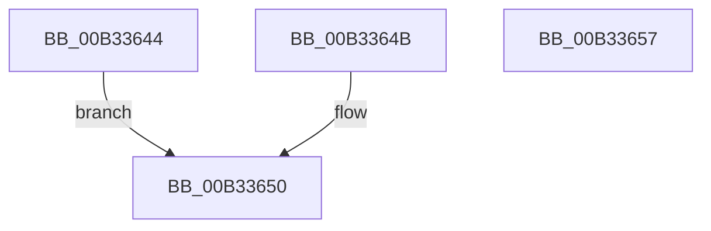

# sub_00B33644

- RVA: `0x00B33644`–`0x00B33662` (길이 `30` bytes)
- VA: `0x0000000140B33644`
- 실행 섹션: `PAGE`
- PDB 이름 있음: `아니요`; PDB Function 태그: `아니요`
- unwind 정보 RVA: `0x000A823C`
- 디코드: `9`개 명령, `30/30` bytes 표시
- 미해석 바이트: `0` (있으면 어셈블리에 `.byte`로 보존)

> 이 문서는 커널 이미지의 기계어와 PDB 기호를 분석해 생성했습니다. 4번과 5번은 함수 원형과 자료형을 바이너리 사용 방식에서 추정한 C 해석이며 원본 소스 복구 결과는 아닙니다.

## 1. Dependencies

- 직접 호출 지점: **0**; 고유 호출 대상: **0**
- 직접 호출자로 확인된 함수: **0**
- RIP 상대 이미지 참조: **0**

### Outgoing calls
- 직접 디코드된 call 명령이 없습니다.

### Direct callers
- 이 함수 시작 RVA로 연결되는 직접 call은 확인되지 않았습니다. 간접 호출은 완전히 역산할 수 없습니다.

### Static image references
- 디코드된 RIP-relative 메모리 참조가 없습니다.

## 2. Other-region calls and transfers

- 다른 실행 섹션으로 향하는 call: **0**
- call이 아닌 외부 분기/꼬리 이동: **2**
  - `0x00B33652` → [IoCheckFunctionAccess + 0xFA](../A0/IoCheckFunctionAccess_function_00A04290.md) (`tail-transfer`)
  - `0x00B3365D` → [IoCheckFunctionAccess + 0x9E](../A0/IoCheckFunctionAccess_function_00A04290.md) (`tail-transfer`)

## 3. Assembly (complete function range)

```asm
00B33644  F7 D3                           not ebx
00B33646  80 E3 10                        and bl, 0x10
00B33649  EB 05                           jmp 0x140b33650
00B3364B  F7 D3                           not ebx
00B3364D  80 E3 08                        and bl, 8
00B33650  F6 DB                           neg bl
00B33652  E9 33 0D ED FF                  jmp 0x140a0438a
00B33657  41 B8 10 00 00 C0               mov r8d, 0xc0000010
00B3365D  E9 CC 0C ED FF                  jmp 0x140a0432e
```

## 4. C-style interpretation (structured pseudocode)

```c
void __fastcall sub_00B33644(void)
{
    __int64 v_rbx;

    v_rbx = (unsigned int)(~(v_rbx));
    v_rbx = (unsigned __int8)((v_rbx) & (16));
    goto loc_00B33650;
loc_00B33650:
    v_rbx = (unsigned __int8)(-(v_rbx));
}
```

## 5. (Beta) C Style

```c
void sub_00B33644(void)
{
    int64_t local_rbx;

    local_rbx = (uint32_t)(~(local_rbx));
    local_rbx = (uint8_t)((local_rbx) & (16));
    goto loc_00B33650;
loc_00B33650:
    local_rbx = (uint8_t)(-(local_rbx));
}
```

## 6. Execution-region graph

[열기: 2D/3D 그래프와 함수 탐색 컨트롤 패널](../../../control-panel.html?section=page&rva=0x00B33644&view=graph)

- 2D 그래프는 위에서 아래로 흐르고, 3D 그래프는 빈 공간을 드래그해 회전합니다. Shift+드래그는 이동, 휠은 확대·축소, 함수 노드 선택은 대상 보고서 이동입니다.

### Static fallback


