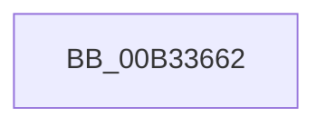

# sub_00B33662

- RVA: `0x00B33662`–`0x00B3369E` (길이 `60` bytes)
- VA: `0x0000000140B33662`
- 실행 섹션: `PAGE`
- PDB 이름 있음: `아니요`; PDB Function 태그: `아니요`
- unwind 정보 RVA: `0x000A82FC`
- 디코드: `11`개 명령, `60/60` bytes 표시
- 미해석 바이트: `0` (있으면 어셈블리에 `.byte`로 보존)

> 이 문서는 커널 이미지의 기계어와 PDB 기호를 분석해 생성했습니다. 4번과 5번은 함수 원형과 자료형을 바이너리 사용 방식에서 추정한 C 해석이며 원본 소스 복구 결과는 아닙니다.

## 1. Dependencies

- 직접 호출 지점: **2**; 고유 호출 대상: **2**
- 직접 호출자로 확인된 함수: **0**
- RIP 상대 이미지 참조: **5**

### Outgoing calls
- `0x00B33665` → [PnpDelayedRemoveWorkerContextCreate](../72/PnpDelayedRemoveWorkerContextCreate_function_0072D038.md) (function, `0x0072D038`)
- `0x00B33693` → [ExQueueWorkItem](../../text/2F/ExQueueWorkItem_function_002F9520.md) (function, `0x002F9520`)

### Direct callers
- 이 함수 시작 RVA로 연결되는 직접 call은 확인되지 않았습니다. 간접 호출은 완전히 역산할 수 없습니다.

### Static image references
- `0x00B3366A` → RVA `0x00F8CB00` (`.data`; read/write)
- `0x00B33672` → RVA `0x00A08AE0` (`PnpDelayedRemoveWorker`; read)
- `0x00B33679` → RVA `0x00F8CB10` (`.data`; write)
- `0x00B33685` → RVA `0x00F8CB00` (`.data`; read)
- `0x00B3368C` → RVA `0x00F8CB18` (`.data`; write)

## 2. Other-region calls and transfers

- 다른 실행 섹션으로 향하는 call: **1**
  - `0x00B33693` → [ExQueueWorkItem](../../text/2F/ExQueueWorkItem_function_002F9520.md) (`PAGE` → `.text`)
- call이 아닌 외부 분기/꼬리 이동: **1**
  - `0x00B33699` → [PnpChainDereferenceComplete + 0x74](../A0/PnpChainDereferenceComplete_function_00A047F4.md) (`tail-transfer`)

## 3. Assembly (complete function range)

```asm
00B33662  48 8B CB                        mov rcx, rbx
00B33665  E8 CE 99 BF FF                  call 0x14072d038
00B3366A  48 83 25 8E 94 45 00 00         and qword ptr [rip + 0x45948e], 0
00B33672  48 8D 0D 67 54 ED FF            lea rcx, [rip - 0x12ab99]
00B33679  48 89 0D 90 94 45 00            mov qword ptr [rip + 0x459490], rcx
00B33680  BA 01 00 00 00                  mov edx, 1
00B33685  48 8D 0D 74 94 45 00            lea rcx, [rip + 0x459474]
00B3368C  48 89 05 85 94 45 00            mov qword ptr [rip + 0x459485], rax
00B33693  E8 88 5E 7C FF                  call 0x1402f9520
00B33698  90                              nop
00B33699  E9 CA 11 ED FF                  jmp 0x140a04868
```

## 4. C-style interpretation (structured pseudocode)

```c
__int64 __fastcall sub_00B33662(void)
{
    __int64 result;

    result = PnpDelayedRemoveWorkerContextCreate(v_rbx, a2, a3, a4);
    *(unsigned __int64 *)(v_rip + 4560016) = v_rip - 1223577;
    *(unsigned __int64 *)(v_rip + 4560005) = result;
    result = ExQueueWorkItem(v_rip + 4559988, 1, a3, a4);
}
```

## 5. (Beta) C Style

```c
void sub_00B33662(void)
{
    int64_t result;

    result = PnpDelayedRemoveWorkerContextCreate(local_rbx, a2, a3, a4);
    *(uint64_t *)(v_rip + 0x459490) = v_rip - 1223577;
    *(uint64_t *)(v_rip + 0x459485) = result;
    result = ExQueueWorkItem(v_rip + 4559988, 1, a3, a4);
}
```

## 6. Execution-region graph

[열기: 2D/3D 그래프와 함수 탐색 컨트롤 패널](../../../control-panel.html?section=page&rva=0x00B33662&view=graph)

- 2D 그래프는 위에서 아래로 흐르고, 3D 그래프는 빈 공간을 드래그해 회전합니다. Shift+드래그는 이동, 휠은 확대·축소, 함수 노드 선택은 대상 보고서 이동입니다.

### Static fallback


