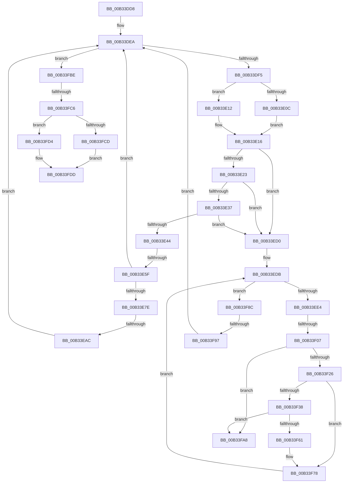

# sub_00B33DD8

- RVA: `0x00B33DD8`–`0x00B33FE8` (길이 `528` bytes)
- VA: `0x0000000140B33DD8`
- 실행 섹션: `PAGE`
- PDB 이름 있음: `아니요`; PDB Function 태그: `아니요`
- unwind 정보 RVA: `0x000A83BC`
- 디코드: `139`개 명령, `528/528` bytes 표시
- 미해석 바이트: `0` (있으면 어셈블리에 `.byte`로 보존)

> 이 문서는 커널 이미지의 기계어와 PDB 기호를 분석해 생성했습니다. 4번과 5번은 함수 원형과 자료형을 바이너리 사용 방식에서 추정한 C 해석이며 원본 소스 복구 결과는 아닙니다.

## 1. Dependencies

- 직접 호출 지점: **10**; 고유 호출 대상: **6**
- 직접 호출자로 확인된 함수: **0**
- RIP 상대 이미지 참조: **0**

### Outgoing calls
- `0x00B33DFB` → [PiListEntryToDependencyEdge](../../text/4F/PiListEntryToDependencyEdge_function_004F9648.md) (function, `0x004F9648`)
- `0x00B33E50` → [RtlStringCchLengthW](../../text/43/RtlStringCchLengthW_function_00435A70.md) (function, `0x00435A70`)
- `0x00B33E9D` → [RtlStringCchCopyExW](../../text/41/RtlStringCchCopyExW_function_0041E1C0.md) (function, `0x0041E1C0`)
- `0x00B33EF8` → [PnpUnicodeStringToWstr](../9D/PnpUnicodeStringToWstr_function_009D90C0.md) (function, `0x009D90C0`)
- `0x00B33F17` → [RtlStringCchLengthW](../../text/43/RtlStringCchLengthW_function_00435A70.md) (function, `0x00435A70`)
- `0x00B33F56` → [RtlStringCchCopyExW](../../text/41/RtlStringCchCopyExW_function_0041E1C0.md) (function, `0x0041E1C0`)
- `0x00B33F7E` → [PnpUnicodeStringToWstrFree](../8F/PnpUnicodeStringToWstrFree_function_008F59F0.md) (function, `0x008F59F0`)
- `0x00B33FAE` → [PnpUnicodeStringToWstrFree](../8F/PnpUnicodeStringToWstrFree_function_008F59F0.md) (function, `0x008F59F0`)
- `0x00B33FB3` → [PnpReleaseDependencyRelationsLock](../A0/PnpReleaseDependencyRelationsLock_function_00A06E14.md) (function, `0x00A06E14`)
- `0x00B33FDD` → [PnpReleaseDependencyRelationsLock](../A0/PnpReleaseDependencyRelationsLock_function_00A06E14.md) (function, `0x00A06E14`)

### Direct callers
- 이 함수 시작 RVA로 연결되는 직접 call은 확인되지 않았습니다. 간접 호출은 완전히 역산할 수 없습니다.

### Static image references
- 디코드된 RIP-relative 메모리 참조가 없습니다.

## 2. Other-region calls and transfers

- 다른 실행 섹션으로 향하는 call: **5**
  - `0x00B33DFB` → [PiListEntryToDependencyEdge](../../text/4F/PiListEntryToDependencyEdge_function_004F9648.md) (`PAGE` → `.text`)
  - `0x00B33E50` → [RtlStringCchLengthW](../../text/43/RtlStringCchLengthW_function_00435A70.md) (`PAGE` → `.text`)
  - `0x00B33E9D` → [RtlStringCchCopyExW](../../text/41/RtlStringCchCopyExW_function_0041E1C0.md) (`PAGE` → `.text`)
  - `0x00B33F17` → [RtlStringCchLengthW](../../text/43/RtlStringCchLengthW_function_00435A70.md) (`PAGE` → `.text`)
  - `0x00B33F56` → [RtlStringCchCopyExW](../../text/41/RtlStringCchCopyExW_function_0041E1C0.md) (`PAGE` → `.text`)
- call이 아닌 외부 분기/꼬리 이동: **7**
  - `0x00B33E59` → [PnpGetDeviceDependencyList + 0x9B](../A0/PnpGetDeviceDependencyList_function_00A05090.md) (`tail-transfer`)
  - `0x00B33EA6` → [PnpGetDeviceDependencyList + 0x9B](../A0/PnpGetDeviceDependencyList_function_00A05090.md) (`tail-transfer`)
  - `0x00B33F01` → [PnpGetDeviceDependencyList + 0x9B](../A0/PnpGetDeviceDependencyList_function_00A05090.md) (`tail-transfer`)
  - `0x00B33F91` → [PnpGetDeviceDependencyList + 0x9B](../A0/PnpGetDeviceDependencyList_function_00A05090.md) (`tail-transfer`)
  - `0x00B33FB9` → [PnpGetDeviceDependencyList + 0xB1](../A0/PnpGetDeviceDependencyList_function_00A05090.md) (`tail-transfer`)
  - `0x00B33FC0` → [PnpGetDeviceDependencyList + 0x9B](../A0/PnpGetDeviceDependencyList_function_00A05090.md) (`tail-transfer`)
  - `0x00B33FE3` → [PnpGetDeviceDependencyList + 0xA4](../A0/PnpGetDeviceDependencyList_function_00A05090.md) (`tail-transfer`)

## 3. Assembly (complete function range)

```asm
00B33DD8  4C 8B 00                        mov r8, qword ptr [rax]
00B33DDB  48 8B C8                        mov rcx, rax
00B33DDE  48 8B 75 D0                     mov rsi, qword ptr [rbp - 0x30]
00B33DE2  4C 8B 75 C8                     mov r14, qword ptr [rbp - 0x38]
00B33DE6  48 89 45 E0                     mov qword ptr [rbp - 0x20], rax
00B33DEA  8B C7                           mov eax, edi
00B33DEC  4C 3B C1                        cmp r8, rcx
00B33DEF  0F 84 C9 01 00 00               je 0x140b33fbe
00B33DF5  41 8B D7                        mov edx, r15d
00B33DF8  49 8B C8                        mov rcx, r8
00B33DFB  E8 48 58 9C FF                  call 0x1404f9648
00B33E00  4D 8B 00                        mov r8, qword ptr [r8]
00B33E03  4C 89 45 E8                     mov qword ptr [rbp - 0x18], r8
00B33E07  45 85 FF                        test r15d, r15d
00B33E0A  75 06                           jne 0x140b33e12
00B33E0C  48 8B 48 20                     mov rcx, qword ptr [rax + 0x20]
00B33E10  EB 04                           jmp 0x140b33e16
00B33E12  48 8B 48 28                     mov rcx, qword ptr [rax + 0x28]
00B33E16  48 8B 41 30                     mov rax, qword ptr [rcx + 0x30]
00B33E1A  48 85 C0                        test rax, rax
00B33E1D  0F 84 AD 00 00 00               je 0x140b33ed0
00B33E23  48 8B 80 38 01 00 00            mov rax, qword ptr [rax + 0x138]
00B33E2A  4C 8B 50 28                     mov r10, qword ptr [rax + 0x28]
00B33E2E  4D 85 D2                        test r10, r10
00B33E31  0F 84 99 00 00 00               je 0x140b33ed0
00B33E37  49 8B 42 30                     mov rax, qword ptr [r10 + 0x30]
00B33E3B  48 85 C0                        test rax, rax
00B33E3E  0F 84 8C 00 00 00               je 0x140b33ed0
00B33E44  4C 8D 45 D8                     lea r8, [rbp - 0x28]
00B33E48  BA C8 00 00 00                  mov edx, 0xc8
00B33E4D  48 8B C8                        mov rcx, rax
00B33E50  E8 1B 1C 90 FF                  call 0x140435a70
00B33E55  8B D8                           mov ebx, eax
00B33E57  85 C0                           test eax, eax
00B33E59  0F 88 CC 12 ED FF               js 0x140a0512b
00B33E5F  4C 8B 45 D8                     mov r8, qword ptr [rbp - 0x28]
00B33E63  48 8B 4D E0                     mov rcx, qword ptr [rbp - 0x20]
00B33E67  49 FF C0                        inc r8
00B33E6A  41 03 F8                        add edi, r8d
00B33E6D  4C 89 45 D8                     mov qword ptr [rbp - 0x28], r8
00B33E71  4C 3B C6                        cmp r8, rsi
00B33E74  4C 8B 45 E8                     mov r8, qword ptr [rbp - 0x18]
00B33E78  0F 87 6C FF FF FF               ja 0x140b33dea
00B33E7E  4D 8B 42 30                     mov r8, qword ptr [r10 + 0x30]
00B33E82  48 8D 45 D0                     lea rax, [rbp - 0x30]
00B33E86  C7 44 24 28 00 08 00 00         mov dword ptr [rsp + 0x28], 0x800
00B33E8E  4C 8D 4D C8                     lea r9, [rbp - 0x38]
00B33E92  48 8B D6                        mov rdx, rsi
00B33E95  48 89 44 24 20                  mov qword ptr [rsp + 0x20], rax
00B33E9A  49 8B CE                        mov rcx, r14
00B33E9D  E8 1E A3 8E FF                  call 0x14041e1c0
00B33EA2  8B D8                           mov ebx, eax
00B33EA4  85 C0                           test eax, eax
00B33EA6  0F 88 7F 12 ED FF               js 0x140a0512b
00B33EAC  4C 8B 75 C8                     mov r14, qword ptr [rbp - 0x38]
00B33EB0  48 8B 75 D0                     mov rsi, qword ptr [rbp - 0x30]
00B33EB4  49 83 C6 02                     add r14, 2
00B33EB8  4C 8B 45 E8                     mov r8, qword ptr [rbp - 0x18]
00B33EBC  48 FF CE                        dec rsi
00B33EBF  48 8B 4D E0                     mov rcx, qword ptr [rbp - 0x20]
00B33EC3  48 89 75 D0                     mov qword ptr [rbp - 0x30], rsi
00B33EC7  4C 89 75 C8                     mov qword ptr [rbp - 0x38], r14
00B33ECB  E9 1A FF FF FF                  jmp 0x140b33dea
00B33ED0  48 8D 41 38                     lea rax, [rcx + 0x38]
00B33ED4  4C 8B 28                        mov r13, qword ptr [rax]
00B33ED7  48 89 45 48                     mov qword ptr [rbp + 0x48], rax
00B33EDB  4C 3B E8                        cmp r13, rax
00B33EDE  0F 84 A8 00 00 00               je 0x140b33f8c
00B33EE4  4D 8B E5                        mov r12, r13
00B33EE7  48 8D 4D F0                     lea rcx, [rbp - 0x10]
00B33EEB  4D 8B 6D 00                     mov r13, qword ptr [r13]
00B33EEF  49 83 C4 10                     add r12, 0x10
00B33EF3  4D 8B C4                        mov r8, r12
00B33EF6  33 D2                           xor edx, edx
00B33EF8  E8 C3 51 EA FF                  call 0x1409d90c0
00B33EFD  8B D8                           mov ebx, eax
00B33EFF  85 C0                           test eax, eax
00B33F01  0F 88 24 12 ED FF               js 0x140a0512b
00B33F07  4C 8B 7D F0                     mov r15, qword ptr [rbp - 0x10]
00B33F0B  4C 8D 45 D8                     lea r8, [rbp - 0x28]
00B33F0F  49 8B CF                        mov rcx, r15
00B33F12  BA FF 7F 00 00                  mov edx, 0x7fff
00B33F17  E8 54 1B 90 FF                  call 0x140435a70
00B33F1C  8B D8                           mov ebx, eax
00B33F1E  85 C0                           test eax, eax
00B33F20  0F 88 82 00 00 00               js 0x140b33fa8
00B33F26  48 8B 45 D8                     mov rax, qword ptr [rbp - 0x28]
00B33F2A  48 FF C0                        inc rax
00B33F2D  03 F8                           add edi, eax
00B33F2F  48 89 45 D8                     mov qword ptr [rbp - 0x28], rax
00B33F33  48 3B C6                        cmp rax, rsi
00B33F36  77 40                           ja 0x140b33f78
00B33F38  48 8D 45 D0                     lea rax, [rbp - 0x30]
00B33F3C  C7 44 24 28 00 08 00 00         mov dword ptr [rsp + 0x28], 0x800
00B33F44  4C 8D 4D C8                     lea r9, [rbp - 0x38]
00B33F48  48 89 44 24 20                  mov qword ptr [rsp + 0x20], rax
00B33F4D  4D 8B C7                        mov r8, r15
00B33F50  48 8B D6                        mov rdx, rsi
00B33F53  49 8B CE                        mov rcx, r14
00B33F56  E8 65 A2 8E FF                  call 0x14041e1c0
00B33F5B  8B D8                           mov ebx, eax
00B33F5D  85 C0                           test eax, eax
00B33F5F  78 47                           js 0x140b33fa8
00B33F61  4C 8B 75 C8                     mov r14, qword ptr [rbp - 0x38]
00B33F65  48 8B 75 D0                     mov rsi, qword ptr [rbp - 0x30]
00B33F69  49 83 C6 02                     add r14, 2
00B33F6D  48 FF CE                        dec rsi
00B33F70  4C 89 75 C8                     mov qword ptr [rbp - 0x38], r14
00B33F74  48 89 75 D0                     mov qword ptr [rbp - 0x30], rsi
00B33F78  49 8B D4                        mov rdx, r12
00B33F7B  49 8B CF                        mov rcx, r15
00B33F7E  E8 6D 1A DC FF                  call 0x1408f59f0
00B33F83  48 8B 45 48                     mov rax, qword ptr [rbp + 0x48]
00B33F87  E9 4F FF FF FF                  jmp 0x140b33edb
00B33F8C  45 33 E4                        xor r12d, r12d
00B33F8F  85 DB                           test ebx, ebx
00B33F91  0F 88 94 11 ED FF               js 0x140a0512b
00B33F97  4C 8B 45 E8                     mov r8, qword ptr [rbp - 0x18]
00B33F9B  48 8B 4D E0                     mov rcx, qword ptr [rbp - 0x20]
00B33F9F  44 8B 7D 50                     mov r15d, dword ptr [rbp + 0x50]
00B33FA3  E9 42 FE FF FF                  jmp 0x140b33dea
00B33FA8  49 8B D4                        mov rdx, r12
00B33FAB  49 8B CF                        mov rcx, r15
00B33FAE  E8 3D 1A DC FF                  call 0x1408f59f0
00B33FB3  E8 5C 2E ED FF                  call 0x140a06e14
00B33FB8  90                              nop
00B33FB9  E9 83 11 ED FF                  jmp 0x140a05141
00B33FBE  85 DB                           test ebx, ebx
00B33FC0  0F 88 65 11 ED FF               js 0x140a0512b
00B33FC6  FF C7                           inc edi
00B33FC8  3B 7D 60                        cmp edi, dword ptr [rbp + 0x60]
00B33FCB  76 07                           jbe 0x140b33fd4
00B33FCD  BB 23 00 00 C0                  mov ebx, 0xc0000023
00B33FD2  EB 09                           jmp 0x140b33fdd
00B33FD4  48 8B 4D 58                     mov rcx, qword ptr [rbp + 0x58]
00B33FD8  66 44 89 24 41                  mov word ptr [rcx + rax*2], r12w
00B33FDD  E8 32 2E ED FF                  call 0x140a06e14
00B33FE2  90                              nop
00B33FE3  E9 4C 11 ED FF                  jmp 0x140a05134
```

## 4. C-style interpretation (structured pseudocode)

```c
__int64 __fastcall sub_00B33DD8(void)
{
    __int64 result;
    __int64 v_r12;
    __int64 v_r14;
    __int64 v_rdi;
    __int64 v_rsi;
    unsigned __int64 v_stack_p20;
    unsigned int v_stack_p28;

    *(unsigned __int64 *)(v_rbp - 32) = result;
loc_00B33DEA:
    if ((*(unsigned __int64 *)(result)) == result) goto loc_00B33FBE;
    result = PiListEntryToDependencyEdge(*(unsigned __int64 *)(result), (unsigned int)((unsigned int)(v_r15)), *(unsigned __int64 *)(result), a4);
    *(unsigned __int64 *)(v_rbp - 24) = *(unsigned __int64 *)(*(unsigned __int64 *)(result));
    if ((unsigned int)(v_r15) != 0) goto loc_00B33E12;
    goto loc_00B33E16;
loc_00B33E12:
loc_00B33E16:
    if (*(unsigned __int64 *)(*(unsigned __int64 *)(result + 40) + 48) == 0) goto loc_00B33ED0;
    if (*(unsigned __int64 *)(*(unsigned __int64 *)(*(unsigned __int64 *)(*(unsigned __int64 *)(result + 40) + 48) + 312) + 40) == 0) goto loc_00B33ED0;
    if (*(unsigned __int64 *)(*(unsigned __int64 *)(*(unsigned __int64 *)(*(unsigned __int64 *)(*(unsigned __int64 *)(result + 40) + 48) + 312) + 40) + 48) == 0) goto loc_00B33ED0;
    result = RtlStringCchLengthW(*(unsigned __int64 *)(*(unsigned __int64 *)(*(unsigned __int64 *)(*(unsigned __int64 *)(*(unsigned __int64 *)(result + 40) + 48) + 312) + 40) + 48), 200, v_rbp - 40, a4);
    a3 = (*(unsigned __int64 *)(v_rbp - 40)) + 1;
    v_rdi = (unsigned int)((v_rdi) + ((unsigned int)(a3)));
    *(unsigned __int64 *)(v_rbp - 40) = a3;
    if (a3 > (*(unsigned __int64 *)(v_rbp - 48))) goto loc_00B33DEA;
    v_stack_p28 = 0x800ULL;
    v_stack_p20 = v_rbp - 48;
    result = RtlStringCchCopyExW(*(unsigned __int64 *)(v_rbp - 56), *(unsigned __int64 *)(v_rbp - 48), *(unsigned __int64 *)(*(unsigned __int64 *)(*(unsigned __int64 *)(*(unsigned __int64 *)(*(unsigned __int64 *)(result + 40) + 48) + 312) + 40) + 48), v_rbp - 56);
    v_r14 = (*(unsigned __int64 *)(v_rbp - 56)) + (2);
    v_rsi = (*(unsigned __int64 *)(v_rbp - 48)) - 1;
    *(unsigned __int64 *)(v_rbp - 48) = v_rsi;
    *(unsigned __int64 *)(v_rbp - 56) = v_r14;
    goto loc_00B33DEA;
loc_00B33ED0:
    *(unsigned __int64 *)(v_rbp + 72) = *(unsigned __int64 *)(v_rbp - 32) + 56;
loc_00B33EDB:
    if ((*(unsigned __int64 *)(*(unsigned __int64 *)(v_rbp - 32) + 56)) == (*(unsigned __int64 *)(v_rbp - 32) + 56)) goto loc_00B33F8C;
    v_r12 = (*(unsigned __int64 *)(*(unsigned __int64 *)(v_rbp - 32) + 56)) + (16);
    a2 = 0;
    result = PnpUnicodeStringToWstr(v_rbp - 16, a2, v_r12, v_rbp - 56);
    result = RtlStringCchLengthW(*(unsigned __int64 *)(v_rbp - 16), (unsigned int)(0x7FFFULL), v_rbp - 40, v_rbp - 56);
    if (sign_flag) goto loc_00B33FA8;
    result = (*(unsigned __int64 *)(v_rbp - 40)) + 1;
    v_rdi = (unsigned int)((v_rdi) + ((unsigned int)(result)));
    *(unsigned __int64 *)(v_rbp - 40) = result;
    if (result > v_rsi) goto loc_00B33F78;
    v_stack_p28 = 0x800ULL;
    v_stack_p20 = v_rbp - 48;
    result = RtlStringCchCopyExW(v_r14, v_rsi, *(unsigned __int64 *)(v_rbp - 16), v_rbp - 56);
    if (sign_flag) goto loc_00B33FA8;
    v_r14 = (*(unsigned __int64 *)(v_rbp - 56)) + (2);
    v_rsi = (*(unsigned __int64 *)(v_rbp - 48)) - 1;
    *(unsigned __int64 *)(v_rbp - 56) = v_r14;
    *(unsigned __int64 *)(v_rbp - 48) = v_rsi;
loc_00B33F78:
    result = PnpUnicodeStringToWstrFree(*(unsigned __int64 *)(v_rbp - 16), v_r12, *(unsigned __int64 *)(v_rbp - 16), v_rbp - 56);
    goto loc_00B33EDB;
loc_00B33F8C:
    v_r12 = 0;
    goto loc_00B33DEA;
loc_00B33FA8:
    result = PnpUnicodeStringToWstrFree((unsigned int)(*(unsigned int *)(v_rbp + 80)), 0, *(unsigned __int64 *)(v_rbp - 24), v_rbp - 56);
    result = PnpReleaseDependencyRelationsLock((unsigned int)(*(unsigned int *)(v_rbp + 80)), 0, *(unsigned __int64 *)(v_rbp - 24), v_rbp - 56);
loc_00B33FBE:
    v_rdi = (unsigned int)((v_rdi) + 1);
    if (((unsigned int)(v_rdi)) <= (*(unsigned int *)(v_rbp + 96))) goto loc_00B33FD4;
    goto loc_00B33FDD;
loc_00B33FD4:
    *(unsigned __int16 *)(*(unsigned __int64 *)(v_rbp + 88) + result * 2) = 0;
loc_00B33FDD:
    result = PnpReleaseDependencyRelationsLock(*(unsigned __int64 *)(v_rbp + 88), 0, *(unsigned __int64 *)(v_rbp - 24), v_rbp - 56);
}
```

## 5. (Beta) C Style

```c
void sub_00B33DD8(void)
{
    int64_t result;
    int64_t local_r12;
    int64_t local_r14;
    int64_t local_rdi;
    int64_t local_rsi;
    uint64_t v_stack_p20;
    uint32_t v_stack_p28;

    *(uint64_t *)(local_rbp - 0x20) = result;
loc_00B33DEA:
    if ((*(uint64_t *)(result)) == result) goto loc_00B33FBE;
    result = PiListEntryToDependencyEdge(*(uint64_t *)(result), (uint32_t)((uint32_t)(local_r15)), *(uint64_t *)(result), a4);
    *(uint64_t *)(local_rbp - 0x18) = *(uint64_t *)(*(uint64_t *)(result));
    if ((uint32_t)(local_r15) != 0) goto loc_00B33E12;
    goto loc_00B33E16;
loc_00B33E12:
loc_00B33E16:
    if (*(uint64_t *)(*(uint64_t *)(result + 0x28) + 0x30) == 0) goto loc_00B33ED0;
    if (*(uint64_t *)(*(uint64_t *)(*(uint64_t *)(*(uint64_t *)(result + 0x28) + 0x30) + 0x138) + 0x28) == 0) goto loc_00B33ED0;
    if (*(uint64_t *)(*(uint64_t *)(*(uint64_t *)(*(uint64_t *)(*(uint64_t *)(result + 0x28) + 0x30) + 0x138) + 0x28) + 0x30) == 0) goto loc_00B33ED0;
    result = RtlStringCchLengthW(*(uint64_t *)(*(uint64_t *)(*(uint64_t *)(*(uint64_t *)(*(uint64_t *)(result + 0x28) + 0x30) + 0x138) + 0x28) + 0x30), 200, local_rbp - 40, a4);
    a3 = (*(uint64_t *)(local_rbp - 0x28)) + 1;
    local_rdi = (uint32_t)((local_rdi) + ((uint32_t)(a3)));
    *(uint64_t *)(local_rbp - 0x28) = a3;
    if (a3 > (*(uint64_t *)(local_rbp - 0x30))) goto loc_00B33DEA;
    v_stack_p28 = 0x800ULL;
    v_stack_p20 = local_rbp - 48;
    result = RtlStringCchCopyExW(*(uint64_t *)(local_rbp - 0x38), *(uint64_t *)(local_rbp - 0x30), *(uint64_t *)(*(uint64_t *)(*(uint64_t *)(*(uint64_t *)(*(uint64_t *)(result + 0x28) + 0x30) + 0x138) + 0x28) + 0x30), local_rbp - 56);
    local_r14 = (*(uint64_t *)(local_rbp - 0x38)) + (2);
    local_rsi = (*(uint64_t *)(local_rbp - 0x30)) - 1;
    *(uint64_t *)(local_rbp - 0x30) = local_rsi;
    *(uint64_t *)(local_rbp - 0x38) = local_r14;
    goto loc_00B33DEA;
loc_00B33ED0:
    *(uint64_t *)(local_rbp + 0x48) = *(uint64_t *)(local_rbp - 0x20) + 56;
loc_00B33EDB:
    if ((*(uint64_t *)(*(uint64_t *)(local_rbp - 0x20) + 0x38)) == (*(uint64_t *)(local_rbp - 0x20) + 56)) goto loc_00B33F8C;
    local_r12 = (*(uint64_t *)(*(uint64_t *)(local_rbp - 0x20) + 0x38)) + (16);
    a2 = 0;
    result = PnpUnicodeStringToWstr(local_rbp - 16, a2, local_r12, local_rbp - 56);
    result = RtlStringCchLengthW(*(uint64_t *)(local_rbp - 0x10), (uint32_t)(0x7FFFULL), local_rbp - 40, local_rbp - 56);
    if (sign_flag) goto loc_00B33FA8;
    result = (*(uint64_t *)(local_rbp - 0x28)) + 1;
    local_rdi = (uint32_t)((local_rdi) + ((uint32_t)(result)));
    *(uint64_t *)(local_rbp - 0x28) = result;
    if (result > local_rsi) goto loc_00B33F78;
    v_stack_p28 = 0x800ULL;
    v_stack_p20 = local_rbp - 48;
    result = RtlStringCchCopyExW(local_r14, local_rsi, *(uint64_t *)(local_rbp - 0x10), local_rbp - 56);
    if (sign_flag) goto loc_00B33FA8;
    local_r14 = (*(uint64_t *)(local_rbp - 0x38)) + (2);
    local_rsi = (*(uint64_t *)(local_rbp - 0x30)) - 1;
    *(uint64_t *)(local_rbp - 0x38) = local_r14;
    *(uint64_t *)(local_rbp - 0x30) = local_rsi;
loc_00B33F78:
    result = PnpUnicodeStringToWstrFree(*(uint64_t *)(local_rbp - 0x10), local_r12, *(uint64_t *)(local_rbp - 0x10), local_rbp - 56);
    goto loc_00B33EDB;
loc_00B33F8C:
    local_r12 = 0;
    goto loc_00B33DEA;
loc_00B33FA8:
    result = PnpUnicodeStringToWstrFree((uint32_t)(*(uint32_t *)(local_rbp + 0x50)), 0, *(uint64_t *)(local_rbp - 0x18), local_rbp - 56);
    result = PnpReleaseDependencyRelationsLock((uint32_t)(*(uint32_t *)(local_rbp + 0x50)), 0, *(uint64_t *)(local_rbp - 0x18), local_rbp - 56);
loc_00B33FBE:
    local_rdi = (uint32_t)((local_rdi) + 1);
    if (((uint32_t)(local_rdi)) <= (*(uint32_t *)(local_rbp + 0x60))) goto loc_00B33FD4;
    goto loc_00B33FDD;
loc_00B33FD4:
    *(uint16_t *)(*(uint64_t *)(local_rbp + 0x58) + result * 2) = 0;
loc_00B33FDD:
    result = PnpReleaseDependencyRelationsLock(*(uint64_t *)(local_rbp + 0x58), 0, *(uint64_t *)(local_rbp - 0x18), local_rbp - 56);
}
```

## 6. Execution-region graph

[열기: 2D/3D 그래프와 함수 탐색 컨트롤 패널](../../../control-panel.html?section=page&rva=0x00B33DD8&view=graph)

- 2D 그래프는 위에서 아래로 흐르고, 3D 그래프는 빈 공간을 드래그해 회전합니다. Shift+드래그는 이동, 휠은 확대·축소, 함수 노드 선택은 대상 보고서 이동입니다.

### Static fallback


