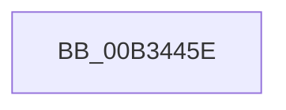

# sub_00B3445E

- RVA: `0x00B3445E`–`0x00B34471` (길이 `19` bytes)
- VA: `0x0000000140B3445E`
- 실행 섹션: `PAGE`
- PDB 이름 있음: `아니요`; PDB Function 태그: `아니요`
- unwind 정보 RVA: `0x000A83F8`
- 디코드: `4`개 명령, `19/19` bytes 표시
- 미해석 바이트: `0` (있으면 어셈블리에 `.byte`로 보존)

> 이 문서는 커널 이미지의 기계어와 PDB 기호를 분석해 생성했습니다. 4번과 5번은 함수 원형과 자료형을 바이너리 사용 방식에서 추정한 C 해석이며 원본 소스 복구 결과는 아닙니다.

## 1. Dependencies

- 직접 호출 지점: **1**; 고유 호출 대상: **1**
- 직접 호출자로 확인된 함수: **0**
- RIP 상대 이미지 참조: **0**

### Outgoing calls
- `0x00B34462` → [PnpFinalizeVetoedRemove](../A0/PnpFinalizeVetoedRemove_function_00A04968.md) (function, `0x00A04968`)

### Direct callers
- 이 함수 시작 RVA로 연결되는 직접 call은 확인되지 않았습니다. 간접 호출은 완전히 역산할 수 없습니다.

### Static image references
- 디코드된 RIP-relative 메모리 참조가 없습니다.

## 2. Other-region calls and transfers

- 다른 실행 섹션으로 향하는 call: **0**
- call이 아닌 외부 분기/꼬리 이동: **1**
  - `0x00B3446C` → [PiCheckRemovalPreconditions + 0x3A](../A0/PiCheckRemovalPreconditions_function_00A057E0.md) (`tail-transfer`)

## 3. Assembly (complete function range)

```asm
00B3445E  4D 8D 41 28                     lea r8, [r9 + 0x28]
00B34462  E8 01 05 ED FF                  call 0x140a04968
00B34467  B8 28 00 00 80                  mov eax, 0x80000028
00B3446C  E9 A9 13 ED FF                  jmp 0x140a0581a
```

## 4. C-style interpretation (structured pseudocode)

```c
__int64 __fastcall sub_00B3445E(__int64 a1, __int64 a2, __int64 a3, __int64 a4)
{
    __int64 result;

    result = PnpFinalizeVetoedRemove(a1, a2, a4 + 40, a4);
}
```

## 5. (Beta) C Style

```c
int64_t sub_00B3445E(int64_t Arg1, int64_t Arg2, int64_t Arg3, void *Arg4)
{
    uint8_t *arg4 = (uint8_t *)Arg4;

    int64_t result;

    result = PnpFinalizeVetoedRemove(Arg1, Arg2, Arg4 + 40, Arg4);
}
```

### 관측된 메모리 오프셋

구조체 형식이 확인되지 않은 접근은 인자 기준의 오프셋으로만 기록했습니다.

| 기준 인자 | 오프셋 표현 | 폭 (bit) | 접근 |
|---|---:|---:|---|
| `Arg4` | `+ 0x28` | `64` | `R` |

## 6. Execution-region graph

[열기: 2D/3D 그래프와 함수 탐색 컨트롤 패널](../../../control-panel.html?section=page&rva=0x00B3445E&view=graph)

- 2D 그래프는 위에서 아래로 흐르고, 3D 그래프는 빈 공간을 드래그해 회전합니다. Shift+드래그는 이동, 휠은 확대·축소, 함수 노드 선택은 대상 보고서 이동입니다.

### Static fallback


