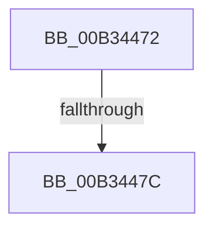

# sub_00B34472

- RVA: `0x00B34472`–`0x00B344A5` (길이 `51` bytes)
- VA: `0x0000000140B34472`
- 실행 섹션: `PAGE`
- PDB 이름 있음: `아니요`; PDB Function 태그: `아니요`
- unwind 정보 RVA: `0x000A8484`
- 디코드: `13`개 명령, `51/51` bytes 표시
- 미해석 바이트: `0` (있으면 어셈블리에 `.byte`로 보존)

> 이 문서는 커널 이미지의 기계어와 PDB 기호를 분석해 생성했습니다. 4번과 5번은 함수 원형과 자료형을 바이너리 사용 방식에서 추정한 C 해석이며 원본 소스 복구 결과는 아닙니다.

## 1. Dependencies

- 직접 호출 지점: **1**; 고유 호출 대상: **1**
- 직접 호출자로 확인된 함수: **0**
- RIP 상대 이미지 참조: **0**

### Outgoing calls
- `0x00B3449A` → [PnpRequestDeviceAction](../../text/47/PnpRequestDeviceAction_function_00477FF8.md) (function, `0x00477FF8`)

### Direct callers
- 이 함수 시작 RVA로 연결되는 직접 call은 확인되지 않았습니다. 간접 호출은 완전히 역산할 수 없습니다.

### Static image references
- 디코드된 RIP-relative 메모리 참조가 없습니다.

## 2. Other-region calls and transfers

- 다른 실행 섹션으로 향하는 call: **1**
  - `0x00B3449A` → [PnpRequestDeviceAction](../../text/47/PnpRequestDeviceAction_function_00477FF8.md) (`PAGE` → `.text`)
- call이 아닌 외부 분기/꼬리 이동: **2**
  - `0x00B34476` → [PnpInvalidateRelationsInList + 0xD4](../A0/PnpInvalidateRelationsInList_function_00A05DF8.md) (`tail-transfer`)
  - `0x00B344A0` → [PnpInvalidateRelationsInList + 0xD4](../A0/PnpInvalidateRelationsInList_function_00A05DF8.md) (`tail-transfer`)

## 3. Assembly (complete function range)

```asm
00B34472  41 83 FF 04                     cmp r15d, 4
00B34476  0F 85 50 1A ED FF               jne 0x140a05ecc
00B3447C  41 8D 57 08                     lea edx, [r15 + 8]
00B34480  33 C0                           xor eax, eax
00B34482  45 33 C9                        xor r9d, r9d
00B34485  48 89 44 24 30                  mov qword ptr [rsp + 0x30], rax
00B3448A  41 B0 01                        mov r8b, 1
00B3448D  48 89 44 24 28                  mov qword ptr [rsp + 0x28], rax
00B34492  48 8B CB                        mov rcx, rbx
00B34495  48 89 44 24 20                  mov qword ptr [rsp + 0x20], rax
00B3449A  E8 59 3B 94 FF                  call 0x140477ff8
00B3449F  90                              nop
00B344A0  E9 27 1A ED FF                  jmp 0x140a05ecc
```

## 4. C-style interpretation (structured pseudocode)

```c
__int64 __fastcall sub_00B34472(__int64 a1, __int64 a2, __int64 a3, int a4)
{
    __int64 result;
    unsigned __int64 v_stack_p20;
    unsigned __int64 v_stack_p28;
    unsigned __int64 v_stack_p30;

    result = 0;
    a4 = 0;
    v_stack_p30 = 0;
    v_stack_p28 = 0;
    v_stack_p20 = 0;
    result = PnpRequestDeviceAction(v_rbx, v_r15 + 8, 1, a4);
}
```

## 5. (Beta) C Style

```c
int64_t sub_00B34472(int64_t Arg1, int64_t Arg2, int64_t Arg3, int32_t Arg4)
{
    int64_t result;
    uint64_t v_stack_p20;
    uint64_t v_stack_p28;
    uint64_t v_stack_p30;

    result = 0;
    Arg4 = 0;
    v_stack_p30 = 0;
    v_stack_p28 = 0;
    v_stack_p20 = 0;
    result = PnpRequestDeviceAction(local_rbx, local_r15 + 8, 1, Arg4);
}
```

## 6. Execution-region graph

[열기: 2D/3D 그래프와 함수 탐색 컨트롤 패널](../../../control-panel.html?section=page&rva=0x00B34472&view=graph)

- 2D 그래프는 위에서 아래로 흐르고, 3D 그래프는 빈 공간을 드래그해 회전합니다. Shift+드래그는 이동, 휠은 확대·축소, 함수 노드 선택은 대상 보고서 이동입니다.

### Static fallback


