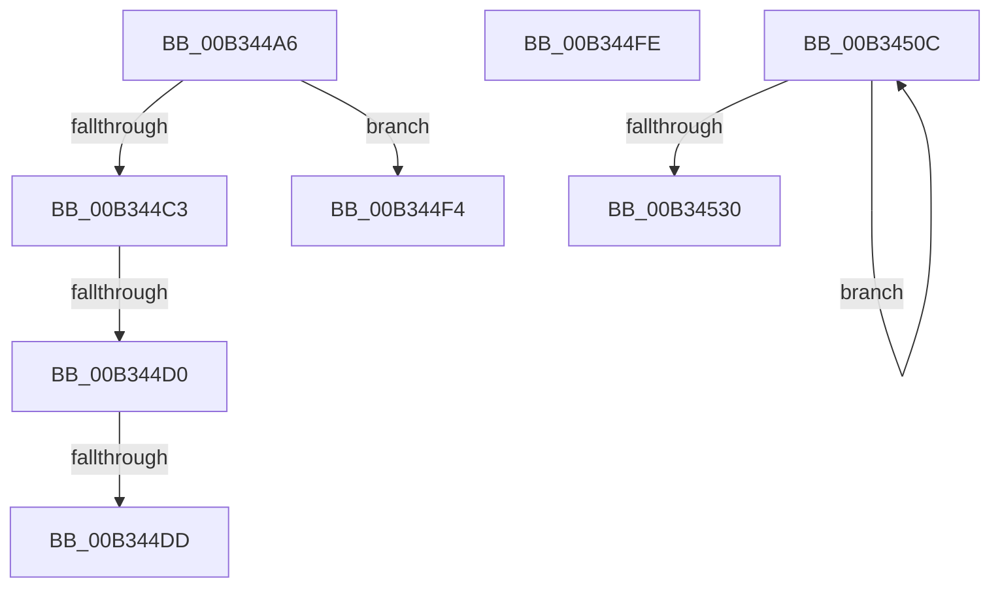

# sub_00B344A6

- RVA: `0x00B344A6`–`0x00B34535` (길이 `143` bytes)
- VA: `0x0000000140B344A6`
- 실행 섹션: `PAGE`
- PDB 이름 있음: `아니요`; PDB Function 태그: `아니요`
- unwind 정보 RVA: `0x000A84B4`
- 디코드: `39`개 명령, `143/143` bytes 표시
- 미해석 바이트: `0` (있으면 어셈블리에 `.byte`로 보존)

> 이 문서는 커널 이미지의 기계어와 PDB 기호를 분석해 생성했습니다. 4번과 5번은 함수 원형과 자료형을 바이너리 사용 방식에서 추정한 C 해석이며 원본 소스 복구 결과는 아닙니다.

## 1. Dependencies

- 직접 호출 지점: **6**; 고유 호출 대상: **6**
- 직접 호출자로 확인된 함수: **0**
- RIP 상대 이미지 참조: **0**

### Outgoing calls
- `0x00B344B0` → [IopMergeRelationLists](../73/IopMergeRelationLists_function_0073DA50.md) (function, `0x0073DA50`)
- `0x00B344B9` → [IopFreeRelationList](../A0/IopFreeRelationList_function_00A08310.md) (function, `0x00A08310`)
- `0x00B344E9` → [ExFreePoolWithTag](../../poolcode/B8/ExFreePoolWithTag_function_00B82870.md) (function, `0x00B82870`)
- `0x00B34501` → [PnpReleaseDependencyRelationsLock](../A0/PnpReleaseDependencyRelationsLock_function_00A06E14.md) (function, `0x00A06E14`)
- `0x00B34515` → [KeDelayExecutionThread](../../text/20/KeDelayExecutionThread_function_00209550.md) (function, `0x00209550`)
- `0x00B34523` → [ExAllocatePool2](../../poolcode/B8/ExAllocatePool2_function_00B820F0.md) (function, `0x00B820F0`)

### Direct callers
- 이 함수 시작 RVA로 연결되는 직접 call은 확인되지 않았습니다. 간접 호출은 완전히 역산할 수 없습니다.

### Static image references
- 디코드된 RIP-relative 메모리 참조가 없습니다.

## 2. Other-region calls and transfers

- 다른 실행 섹션으로 향하는 call: **3**
  - `0x00B344E9` → [ExFreePoolWithTag](../../poolcode/B8/ExFreePoolWithTag_function_00B82870.md) (`PAGE` → `POOLCODE`)
  - `0x00B34515` → [KeDelayExecutionThread](../../text/20/KeDelayExecutionThread_function_00209550.md) (`PAGE` → `.text`)
  - `0x00B34523` → [ExAllocatePool2](../../poolcode/B8/ExAllocatePool2_function_00B820F0.md) (`PAGE` → `POOLCODE`)
- call이 아닌 외부 분기/꼬리 이동: **6**
  - `0x00B344CA` → [PnpQueuePendingSurpriseRemoval + 0xB8](../A0/PnpQueuePendingSurpriseRemoval_function_00A05FAC.md) (`tail-transfer`)
  - `0x00B344D7` → [PnpQueuePendingSurpriseRemoval + 0xB8](../A0/PnpQueuePendingSurpriseRemoval_function_00A05FAC.md) (`tail-transfer`)
  - `0x00B344EF` → [PnpQueuePendingSurpriseRemoval + 0x60](../A0/PnpQueuePendingSurpriseRemoval_function_00A05FAC.md) (`tail-transfer`)
  - `0x00B344F9` → [PnpQueuePendingSurpriseRemoval + 0x60](../A0/PnpQueuePendingSurpriseRemoval_function_00A05FAC.md) (`tail-transfer`)
  - `0x00B34507` → [PnpQueuePendingSurpriseRemoval + 0x7A](../A0/PnpQueuePendingSurpriseRemoval_function_00A05FAC.md) (`tail-transfer`)
  - `0x00B34530` → [PnpQueuePendingSurpriseRemoval + 0xA1](../A0/PnpQueuePendingSurpriseRemoval_function_00A05FAC.md) (`tail-transfer`)

## 3. Assembly (complete function range)

```asm
00B344A6  48 8B 56 40                     mov rdx, qword ptr [rsi + 0x40]
00B344AA  41 B0 01                        mov r8b, 1
00B344AD  48 8B CF                        mov rcx, rdi
00B344B0  E8 9B 95 C0 FF                  call 0x14073da50
00B344B5  48 8B 4E 40                     mov rcx, qword ptr [rsi + 0x40]
00B344B9  E8 52 3E ED FF                  call 0x140a08310
00B344BE  48 3B DE                        cmp rbx, rsi
00B344C1  74 31                           je 0x140b344f4
00B344C3  48 8B 0E                        mov rcx, qword ptr [rsi]
00B344C6  48 39 71 08                     cmp qword ptr [rcx + 8], rsi
00B344CA  0F 85 94 1B ED FF               jne 0x140a06064
00B344D0  48 8B 46 08                     mov rax, qword ptr [rsi + 8]
00B344D4  48 39 30                        cmp qword ptr [rax], rsi
00B344D7  0F 85 87 1B ED FF               jne 0x140a06064
00B344DD  48 89 08                        mov qword ptr [rax], rcx
00B344E0  33 D2                           xor edx, edx
00B344E2  48 89 41 08                     mov qword ptr [rcx + 8], rax
00B344E6  48 8B CE                        mov rcx, rsi
00B344E9  E8 82 E3 04 00                  call 0x140b82870
00B344EE  90                              nop
00B344EF  E9 18 1B ED FF                  jmp 0x140a0600c
00B344F4  48 83 63 40 00                  and qword ptr [rbx + 0x40], 0
00B344F9  E9 0E 1B ED FF                  jmp 0x140a0600c
00B344FE  48 8B FD                        mov rdi, rbp
00B34501  E8 0E 29 ED FF                  call 0x140a06e14
00B34506  90                              nop
00B34507  E9 1A 1B ED FF                  jmp 0x140a06026
00B3450C  4C 8D 44 24 58                  lea r8, [rsp + 0x58]
00B34511  33 D2                           xor edx, edx
00B34513  33 C9                           xor ecx, ecx
00B34515  E8 36 50 6D FF                  call 0x140209550
00B3451A  44 8B C6                        mov r8d, esi
00B3451D  48 8B D5                        mov rdx, rbp
00B34520  49 8B CE                        mov rcx, r14
00B34523  E8 C8 DB 04 00                  call 0x140b820f0
00B34528  48 8B D8                        mov rbx, rax
00B3452B  48 85 C0                        test rax, rax
00B3452E  74 DC                           je 0x140b3450c
00B34530  E9 18 1B ED FF                  jmp 0x140a0604d
```

## 4. C-style interpretation (structured pseudocode)

```c
__int64 __fastcall sub_00B344A6(void)
{
    __int64 result;
    unsigned __int64 v_stack_p58;

    result = IopMergeRelationLists(v_rdi, *(unsigned __int64 *)(v_rsi + 64), 1, a4);
    result = IopFreeRelationList(*(unsigned __int64 *)(v_rsi + 64), *(unsigned __int64 *)(v_rsi + 64), 1, a4);
    if (v_rbx == v_rsi) goto loc_00B344F4;
    *(unsigned __int64 *)(*(unsigned __int64 *)(v_rsi + 8)) = *(unsigned __int64 *)(v_rsi);
    a2 = 0;
    *(unsigned __int64 *)(*(unsigned __int64 *)(v_rsi) + 8) = *(unsigned __int64 *)(v_rsi + 8);
    result = ExFreePoolWithTag(v_rsi, a2, 1, a4);
loc_00B344F4:
}
```

## 5. (Beta) C Style

```c
void sub_00B344A6(void)
{
    int64_t result;
    uint64_t v_stack_p58;

    result = IopMergeRelationLists(local_rdi, *(uint64_t *)(local_rsi + 0x40), 1, a4);
    result = IopFreeRelationList(*(uint64_t *)(local_rsi + 0x40), *(uint64_t *)(local_rsi + 0x40), 1, a4);
    if (local_rbx == local_rsi) goto loc_00B344F4;
    *(uint64_t *)(*(uint64_t *)(local_rsi + 0x8)) = *(uint64_t *)(local_rsi);
    a2 = 0;
    *(uint64_t *)(*(uint64_t *)(local_rsi) + 0x8) = *(uint64_t *)(local_rsi + 0x8);
    result = ExFreePoolWithTag(local_rsi, a2, 1, a4);
loc_00B344F4:
}
```

## 6. Execution-region graph

[열기: 2D/3D 그래프와 함수 탐색 컨트롤 패널](../../../control-panel.html?section=page&rva=0x00B344A6&view=graph)

- 2D 그래프는 위에서 아래로 흐르고, 3D 그래프는 빈 공간을 드래그해 회전합니다. Shift+드래그는 이동, 휠은 확대·축소, 함수 노드 선택은 대상 보고서 이동입니다.

### Static fallback


