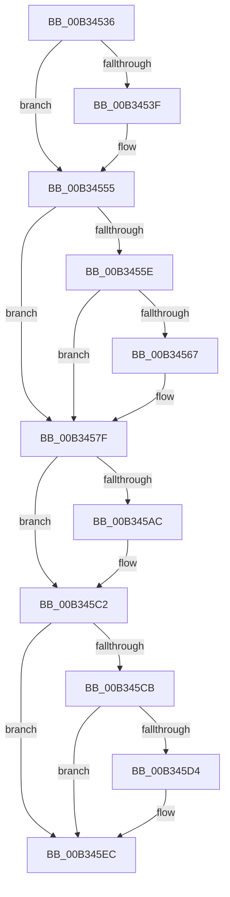

# sub_00B34536

- RVA: `0x00B34536`–`0x00B34607` (길이 `209` bytes)
- VA: `0x0000000140B34536`
- 실행 섹션: `PAGE`
- PDB 이름 있음: `아니요`; PDB Function 태그: `아니요`
- unwind 정보 RVA: `0x000A8550`
- 디코드: `56`개 명령, `209/209` bytes 표시
- 미해석 바이트: `0` (있으면 어셈블리에 `.byte`로 보존)

> 이 문서는 커널 이미지의 기계어와 PDB 기호를 분석해 생성했습니다. 4번과 5번은 함수 원형과 자료형을 바이너리 사용 방식에서 추정한 C 해석이며 원본 소스 복구 결과는 아닙니다.

## 1. Dependencies

- 직접 호출 지점: **10**; 고유 호출 대상: **2**
- 직접 호출자로 확인된 함수: **0**
- RIP 상대 이미지 참조: **0**

### Outgoing calls
- `0x00B34544` → [IoAddTriageDumpDataBlock](../../text/42/IoAddTriageDumpDataBlock_function_00428374.md) (function, `0x00428374`)
- `0x00B34550` → [IoAddTriageDumpDataBlock](../../text/42/IoAddTriageDumpDataBlock_function_00428374.md) (function, `0x00428374`)
- `0x00B34569` → [IoAddTriageDumpDataBlock](../../text/42/IoAddTriageDumpDataBlock_function_00428374.md) (function, `0x00428374`)
- `0x00B3457A` → [IoAddTriageDumpDataBlock](../../text/42/IoAddTriageDumpDataBlock_function_00428374.md) (function, `0x00428374`)
- `0x00B3459D` → [KeBugCheckEx](../../text/4F/KeBugCheckEx_function_004FD660.md) (function, `0x004FD660`)
- `0x00B345B1` → [IoAddTriageDumpDataBlock](../../text/42/IoAddTriageDumpDataBlock_function_00428374.md) (function, `0x00428374`)
- `0x00B345BD` → [IoAddTriageDumpDataBlock](../../text/42/IoAddTriageDumpDataBlock_function_00428374.md) (function, `0x00428374`)
- `0x00B345D6` → [IoAddTriageDumpDataBlock](../../text/42/IoAddTriageDumpDataBlock_function_00428374.md) (function, `0x00428374`)
- `0x00B345E7` → [IoAddTriageDumpDataBlock](../../text/42/IoAddTriageDumpDataBlock_function_00428374.md) (function, `0x00428374`)
- `0x00B34601` → [KeBugCheckEx](../../text/4F/KeBugCheckEx_function_004FD660.md) (function, `0x004FD660`)

### Direct callers
- 이 함수 시작 RVA로 연결되는 직접 call은 확인되지 않았습니다. 간접 호출은 완전히 역산할 수 없습니다.

### Static image references
- 디코드된 RIP-relative 메모리 참조가 없습니다.

## 2. Other-region calls and transfers

- 다른 실행 섹션으로 향하는 call: **10**
  - `0x00B34544` → [IoAddTriageDumpDataBlock](../../text/42/IoAddTriageDumpDataBlock_function_00428374.md) (`PAGE` → `.text`)
  - `0x00B34550` → [IoAddTriageDumpDataBlock](../../text/42/IoAddTriageDumpDataBlock_function_00428374.md) (`PAGE` → `.text`)
  - `0x00B34569` → [IoAddTriageDumpDataBlock](../../text/42/IoAddTriageDumpDataBlock_function_00428374.md) (`PAGE` → `.text`)
  - `0x00B3457A` → [IoAddTriageDumpDataBlock](../../text/42/IoAddTriageDumpDataBlock_function_00428374.md) (`PAGE` → `.text`)
  - `0x00B3459D` → [KeBugCheckEx](../../text/4F/KeBugCheckEx_function_004FD660.md) (`PAGE` → `.text`)
  - `0x00B345B1` → [IoAddTriageDumpDataBlock](../../text/42/IoAddTriageDumpDataBlock_function_00428374.md) (`PAGE` → `.text`)
  - `0x00B345BD` → [IoAddTriageDumpDataBlock](../../text/42/IoAddTriageDumpDataBlock_function_00428374.md) (`PAGE` → `.text`)
  - `0x00B345D6` → [IoAddTriageDumpDataBlock](../../text/42/IoAddTriageDumpDataBlock_function_00428374.md) (`PAGE` → `.text`)
  - `0x00B345E7` → [IoAddTriageDumpDataBlock](../../text/42/IoAddTriageDumpDataBlock_function_00428374.md) (`PAGE` → `.text`)
  - `0x00B34601` → [KeBugCheckEx](../../text/4F/KeBugCheckEx_function_004FD660.md) (`PAGE` → `.text`)
- 별도 외부 분기/꼬리 이동을 확인하지 못했습니다.

## 3. Assembly (complete function range)

```asm
00B34536  48 8D 73 38                     lea rsi, [rbx + 0x38]
00B3453A  66 39 2E                        cmp word ptr [rsi], bp
00B3453D  74 16                           je 0x140b34555
00B3453F  8B D7                           mov edx, edi
00B34541  48 8B CE                        mov rcx, rsi
00B34544  E8 2B 3E 8F FF                  call 0x140428374
00B34549  0F B7 16                        movzx edx, word ptr [rsi]
00B3454C  48 8B 4B 40                     mov rcx, qword ptr [rbx + 0x40]
00B34550  E8 1F 3E 8F FF                  call 0x140428374
00B34555  48 8B 43 10                     mov rax, qword ptr [rbx + 0x10]
00B34559  48 85 C0                        test rax, rax
00B3455C  74 21                           je 0x140b3457f
00B3455E  48 8D 48 38                     lea rcx, [rax + 0x38]
00B34562  66 39 29                        cmp word ptr [rcx], bp
00B34565  74 18                           je 0x140b3457f
00B34567  8B D7                           mov edx, edi
00B34569  E8 06 3E 8F FF                  call 0x140428374
00B3456E  48 8B 4B 10                     mov rcx, qword ptr [rbx + 0x10]
00B34572  0F B7 51 38                     movzx edx, word ptr [rcx + 0x38]
00B34576  48 8B 49 40                     mov rcx, qword ptr [rcx + 0x40]
00B3457A  E8 F5 3D 8F FF                  call 0x140428374
00B3457F  4C 8B 8B D0 02 00 00            mov r9, qword ptr [rbx + 0x2d0]
00B34586  BA 05 00 00 00                  mov edx, 5
00B3458B  4C 8B 43 20                     mov r8, qword ptr [rbx + 0x20]
00B3458F  B9 CA 00 00 00                  mov ecx, 0xca
00B34594  48 C7 44 24 20 11 00 00 00      mov qword ptr [rsp + 0x20], 0x11
00B3459D  E8 BE 90 9C FF                  call 0x1404fd660
00B345A2  CC                              int3
00B345A3  48 8D 73 38                     lea rsi, [rbx + 0x38]
00B345A7  66 39 2E                        cmp word ptr [rsi], bp
00B345AA  74 16                           je 0x140b345c2
00B345AC  8B D7                           mov edx, edi
00B345AE  48 8B CE                        mov rcx, rsi
00B345B1  E8 BE 3D 8F FF                  call 0x140428374
00B345B6  0F B7 16                        movzx edx, word ptr [rsi]
00B345B9  48 8B 4B 40                     mov rcx, qword ptr [rbx + 0x40]
00B345BD  E8 B2 3D 8F FF                  call 0x140428374
00B345C2  48 8B 43 10                     mov rax, qword ptr [rbx + 0x10]
00B345C6  48 85 C0                        test rax, rax
00B345C9  74 21                           je 0x140b345ec
00B345CB  48 8D 48 38                     lea rcx, [rax + 0x38]
00B345CF  66 39 29                        cmp word ptr [rcx], bp
00B345D2  74 18                           je 0x140b345ec
00B345D4  8B D7                           mov edx, edi
00B345D6  E8 99 3D 8F FF                  call 0x140428374
00B345DB  48 8B 4B 10                     mov rcx, qword ptr [rbx + 0x10]
00B345DF  0F B7 51 38                     movzx edx, word ptr [rcx + 0x38]
00B345E3  48 8B 49 40                     mov rcx, qword ptr [rcx + 0x40]
00B345E7  E8 88 3D 8F FF                  call 0x140428374
00B345EC  4C 8B 43 20                     mov r8, qword ptr [rbx + 0x20]
00B345F0  45 33 C9                        xor r9d, r9d
00B345F3  B9 CA 00 00 00                  mov ecx, 0xca
00B345F8  48 89 6C 24 20                  mov qword ptr [rsp + 0x20], rbp
00B345FD  41 8D 51 05                     lea edx, [r9 + 5]
00B34601  E8 5A 90 9C FF                  call 0x1404fd660
00B34606  CC                              int3
```

## 4. C-style interpretation (structured pseudocode)

```c
__int64 __fastcall sub_00B34536(void)
{
    __int64 result;
    unsigned __int64 v_stack_p20;

    if ((*(unsigned __int16 *)(v_rbx + 56)) != ((unsigned __int16)(v_rbp))) {
        a2 = (unsigned int)(v_rdi);
        a1 = v_rbx + 56;
        result = IoAddTriageDumpDataBlock(a1, a2, a3, a4);
        a2 = *(unsigned __int16 *)(v_rbx + 56);
        a1 = *(unsigned __int64 *)(v_rbx + 64);
        result = IoAddTriageDumpDataBlock(a1, a2, a3, a4);
    }
    if (*(unsigned __int64 *)(v_rbx + 16) == 0) goto loc_00B3457F;
    result = *(unsigned __int64 *)(v_rbx + 16);
    if ((*(unsigned __int16 *)(*(unsigned __int64 *)(v_rbx + 16) + 56)) != ((unsigned __int16)(v_rbp))) {
        a2 = (unsigned int)(v_rdi);
        result = IoAddTriageDumpDataBlock(*(unsigned __int64 *)(v_rbx + 16) + 56, a2, a3, a4);
        a1 = *(unsigned __int64 *)(v_rbx + 16);
        a2 = *(unsigned __int16 *)(a1 + 56);
        a1 = *(unsigned __int64 *)(a1 + 64);
        result = IoAddTriageDumpDataBlock(a1, a2, a3, a4);
    }
    v_stack_p20 = 17;
    result = KeBugCheckEx(202, 5, *(unsigned __int64 *)(v_rbx + 32), *(unsigned __int64 *)(v_rbx + 720));
    if ((*(unsigned __int16 *)(v_rbx + 56)) != ((unsigned __int16)(v_rbp))) {
        a2 = (unsigned int)(v_rdi);
        a1 = v_rbx + 56;
        result = IoAddTriageDumpDataBlock(a1, a2, *(unsigned __int64 *)(v_rbx + 32), *(unsigned __int64 *)(v_rbx + 720));
        a2 = *(unsigned __int16 *)(v_rbx + 56);
        a1 = *(unsigned __int64 *)(v_rbx + 64);
        result = IoAddTriageDumpDataBlock(a1, a2, *(unsigned __int64 *)(v_rbx + 32), *(unsigned __int64 *)(v_rbx + 720));
    }
    if (*(unsigned __int64 *)(v_rbx + 16) == 0) goto loc_00B345EC;
    result = *(unsigned __int64 *)(v_rbx + 16);
    if ((*(unsigned __int16 *)(*(unsigned __int64 *)(v_rbx + 16) + 56)) != ((unsigned __int16)(v_rbp))) {
        a2 = (unsigned int)(v_rdi);
        result = IoAddTriageDumpDataBlock(*(unsigned __int64 *)(v_rbx + 16) + 56, a2, *(unsigned __int64 *)(v_rbx + 32), *(unsigned __int64 *)(v_rbx + 720));
        a1 = *(unsigned __int64 *)(v_rbx + 16);
        a2 = *(unsigned __int16 *)(a1 + 56);
        a1 = *(unsigned __int64 *)(a1 + 64);
        result = IoAddTriageDumpDataBlock(a1, a2, *(unsigned __int64 *)(v_rbx + 32), *(unsigned __int64 *)(v_rbx + 720));
    }
    a4 = 0;
    v_stack_p20 = v_rbp;
    result = KeBugCheckEx(202, a4 + 5, *(unsigned __int64 *)(v_rbx + 32), a4);
    return result;
}
```

## 5. (Beta) C Style

```c
void sub_00B34536(void)
{
    int64_t result;
    uint64_t v_stack_p20;

    if ((*(uint16_t *)(local_rbx + 0x38)) != ((uint16_t)(local_rbp))) {
        a2 = (uint32_t)(local_rdi);
        a1 = local_rbx + 56;
        result = IoAddTriageDumpDataBlock(a1, a2, a3, a4);
        a2 = *(uint16_t *)(local_rbx + 0x38);
        a1 = *(uint64_t *)(local_rbx + 0x40);
        result = IoAddTriageDumpDataBlock(a1, a2, a3, a4);
    }
    if (*(uint64_t *)(local_rbx + 0x10) == 0) goto loc_00B3457F;
    result = *(uint64_t *)(local_rbx + 0x10);
    if ((*(uint16_t *)(*(uint64_t *)(local_rbx + 0x10) + 0x38)) != ((uint16_t)(local_rbp))) {
        a2 = (uint32_t)(local_rdi);
        result = IoAddTriageDumpDataBlock(*(uint64_t *)(local_rbx + 0x10) + 56, a2, a3, a4);
        a1 = *(uint64_t *)(local_rbx + 0x10);
        a2 = *(uint16_t *)(a1 + 0x38);
        a1 = *(uint64_t *)(a1 + 0x40);
        result = IoAddTriageDumpDataBlock(a1, a2, a3, a4);
    }
    v_stack_p20 = 17;
    result = KeBugCheckEx(202, 5, *(uint64_t *)(local_rbx + 0x20), *(uint64_t *)(local_rbx + 0x2D0));
    if ((*(uint16_t *)(local_rbx + 0x38)) != ((uint16_t)(local_rbp))) {
        a2 = (uint32_t)(local_rdi);
        a1 = local_rbx + 56;
        result = IoAddTriageDumpDataBlock(a1, a2, *(uint64_t *)(local_rbx + 0x20), *(uint64_t *)(local_rbx + 0x2D0));
        a2 = *(uint16_t *)(local_rbx + 0x38);
        a1 = *(uint64_t *)(local_rbx + 0x40);
        result = IoAddTriageDumpDataBlock(a1, a2, *(uint64_t *)(local_rbx + 0x20), *(uint64_t *)(local_rbx + 0x2D0));
    }
    if (*(uint64_t *)(local_rbx + 0x10) == 0) goto loc_00B345EC;
    result = *(uint64_t *)(local_rbx + 0x10);
    if ((*(uint16_t *)(*(uint64_t *)(local_rbx + 0x10) + 0x38)) != ((uint16_t)(local_rbp))) {
        a2 = (uint32_t)(local_rdi);
        result = IoAddTriageDumpDataBlock(*(uint64_t *)(local_rbx + 0x10) + 56, a2, *(uint64_t *)(local_rbx + 0x20), *(uint64_t *)(local_rbx + 0x2D0));
        a1 = *(uint64_t *)(local_rbx + 0x10);
        a2 = *(uint16_t *)(a1 + 0x38);
        a1 = *(uint64_t *)(a1 + 0x40);
        result = IoAddTriageDumpDataBlock(a1, a2, *(uint64_t *)(local_rbx + 0x20), *(uint64_t *)(local_rbx + 0x2D0));
    }
    a4 = 0;
    v_stack_p20 = local_rbp;
    result = KeBugCheckEx(202, a4 + 5, *(uint64_t *)(local_rbx + 0x20), a4);
    return result;
}
```

## 6. Execution-region graph

[열기: 2D/3D 그래프와 함수 탐색 컨트롤 패널](../../../control-panel.html?section=page&rva=0x00B34536&view=graph)

- 2D 그래프는 위에서 아래로 흐르고, 3D 그래프는 빈 공간을 드래그해 회전합니다. Shift+드래그는 이동, 휠은 확대·축소, 함수 노드 선택은 대상 보고서 이동입니다.

### Static fallback


