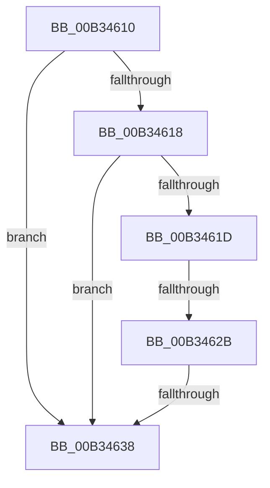

# sub_00B34610

- RVA: `0x00B34610`–`0x00B34640` (길이 `48` bytes)
- VA: `0x0000000140B34610`
- 실행 섹션: `PAGE`
- PDB 이름 있음: `아니요`; PDB Function 태그: `아니요`
- unwind 정보 RVA: `0x000A85A0`
- 디코드: `14`개 명령, `48/48` bytes 표시
- 미해석 바이트: `0` (있으면 어셈블리에 `.byte`로 보존)

> 이 문서는 커널 이미지의 기계어와 PDB 기호를 분석해 생성했습니다. 4번과 5번은 함수 원형과 자료형을 바이너리 사용 방식에서 추정한 C 해석이며 원본 소스 복구 결과는 아닙니다.

## 1. Dependencies

- 직접 호출 지점: **1**; 고유 호출 대상: **1**
- 직접 호출자로 확인된 함수: **0**
- RIP 상대 이미지 참조: **0**

### Outgoing calls
- `0x00B3462B` → [PipIsProviderStarted](../72/PipIsProviderStarted_function_00727CD0.md) (function, `0x00727CD0`)

### Direct callers
- 이 함수 시작 RVA로 연결되는 직접 call은 확인되지 않았습니다. 간접 호출은 완전히 역산할 수 없습니다.

### Static image references
- 디코드된 RIP-relative 메모리 참조가 없습니다.

## 2. Other-region calls and transfers

- 다른 실행 섹션으로 향하는 call: **0**
- call이 아닌 외부 분기/꼬리 이동: **3**
  - `0x00B34625` → [PipCheckForUnsatisfiedDependencies + 0x40](../A0/PipCheckForUnsatisfiedDependencies_function_00A06E44.md) (`tail-transfer`)
  - `0x00B34632` → [PipCheckForUnsatisfiedDependencies + 0x40](../A0/PipCheckForUnsatisfiedDependencies_function_00A06E44.md) (`tail-transfer`)
  - `0x00B3463B` → [PipCheckForUnsatisfiedDependencies + 0x45](../A0/PipCheckForUnsatisfiedDependencies_function_00A06E44.md) (`tail-transfer`)

## 3. Assembly (complete function range)

```asm
00B34610  49 8B CB                        mov rcx, r11
00B34613  48 85 D2                        test rdx, rdx
00B34616  74 20                           je 0x140b34638
00B34618  48 85 C9                        test rcx, rcx
00B3461B  74 1B                           je 0x140b34638
00B3461D  8B 44 24 30                     mov eax, dword ptr [rsp + 0x30]
00B34621  23 C6                           and eax, esi
00B34623  A8 03                           test al, 3
00B34625  0F 84 59 28 ED FF               je 0x140a06e84
00B3462B  E8 A0 36 BF FF                  call 0x140727cd0
00B34630  84 C0                           test al, al
00B34632  0F 85 4C 28 ED FF               jne 0x140a06e84
00B34638  41 B3 01                        mov r11b, 1
00B3463B  E9 49 28 ED FF                  jmp 0x140a06e89
```

## 4. C-style interpretation (structured pseudocode)

```c
__int64 __fastcall sub_00B34610(__int64 a1, __int64 a2, __int64 a3, __int64 a4, __int64 a5, unsigned int a6)
{
    __int64 result;

    if (a2 == 0) goto loc_00B34638;
    if (v_r11 == 0) goto loc_00B34638;
    result = (unsigned int)(((unsigned int)(a6)) & ((unsigned int)(v_rsi)));
    result = PipIsProviderStarted(v_r11, a2, a3, a4);
loc_00B34638:
}
```

## 5. (Beta) C Style

```c
int64_t sub_00B34610(int64_t Arg1, int64_t Arg2, int64_t Arg3, int64_t Arg4, uint64_t Arg5, uint32_t Arg6)
{
    int64_t result;

    if (Arg2 == 0) goto loc_00B34638;
    if (local_r11 == 0) goto loc_00B34638;
    result = (uint32_t)(((uint32_t)(Arg6)) & ((uint32_t)(local_rsi)));
    result = PipIsProviderStarted(local_r11, Arg2, Arg3, Arg4);
loc_00B34638:
}
```

## 6. Execution-region graph

[열기: 2D/3D 그래프와 함수 탐색 컨트롤 패널](../../../control-panel.html?section=page&rva=0x00B34610&view=graph)

- 2D 그래프는 위에서 아래로 흐르고, 3D 그래프는 빈 공간을 드래그해 회전합니다. Shift+드래그는 이동, 휠은 확대·축소, 함수 노드 선택은 대상 보고서 이동입니다.

### Static fallback


