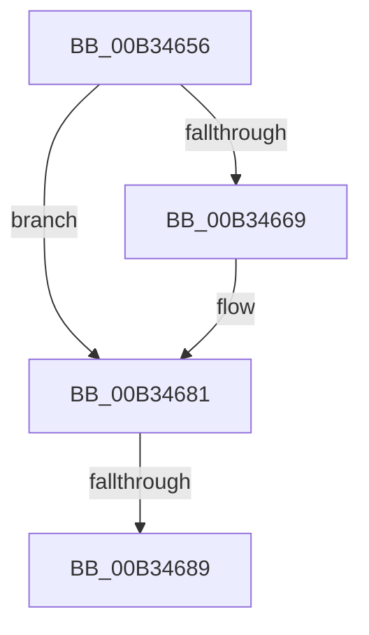

# sub_00B34656

- RVA: `0x00B34656`–`0x00B3468E` (길이 `56` bytes)
- VA: `0x0000000140B34656`
- 실행 섹션: `PAGE`
- PDB 이름 있음: `아니요`; PDB Function 태그: `아니요`
- unwind 정보 RVA: `0x000A8628`
- 디코드: `14`개 명령, `56/56` bytes 표시
- 미해석 바이트: `0` (있으면 어셈블리에 `.byte`로 보존)

> 이 문서는 커널 이미지의 기계어와 PDB 기호를 분석해 생성했습니다. 4번과 5번은 함수 원형과 자료형을 바이너리 사용 방식에서 추정한 C 해석이며 원본 소스 복구 결과는 아닙니다.

## 1. Dependencies

- 직접 호출 지점: **1**; 고유 호출 대상: **1**
- 직접 호출자로 확인된 함수: **0**
- RIP 상대 이미지 참조: **0**

### Outgoing calls
- `0x00B3467A` → [PnpProcessRelation](../A0/PnpProcessRelation_function_00A04A4C.md) (function, `0x00A04A4C`)

### Direct callers
- 이 함수 시작 RVA로 연결되는 직접 call은 확인되지 않았습니다. 간접 호출은 완전히 역산할 수 없습니다.

### Static image references
- 디코드된 RIP-relative 메모리 참조가 없습니다.

## 2. Other-region calls and transfers

- 다른 실행 섹션으로 향하는 call: **0**
- call이 아닌 외부 분기/꼬리 이동: **2**
  - `0x00B34683` → [PnpProcessDependencyRelations + 0x6E](../A0/PnpProcessDependencyRelations_function_00A07548.md) (`tail-transfer`)
  - `0x00B34689` → [PnpProcessDependencyRelations + 0x73](../A0/PnpProcessDependencyRelations_function_00A07548.md) (`tail-transfer`)

## 3. Assembly (complete function range)

```asm
00B34656  41 8B 82 30 01 00 00            mov eax, dword ptr [r10 + 0x130]
00B3465D  2D 14 03 00 00                  sub eax, 0x314
00B34662  A9 FD FF FF FF                  test eax, 0xfffffffd
00B34667  74 18                           je 0x140b34681
00B34669  4C 8B CD                        mov r9, rbp
00B3466C  4C 89 64 24 20                  mov qword ptr [rsp + 0x20], r12
00B34671  45 8B C6                        mov r8d, r14d
00B34674  41 8B D7                        mov edx, r15d
00B34677  49 8B CA                        mov rcx, r10
00B3467A  E8 CD 03 ED FF                  call 0x140a04a4c
00B3467F  8B F8                           mov edi, eax
00B34681  85 FF                           test edi, edi
00B34683  0F 89 2D 2F ED FF               jns 0x140a075b6
00B34689  E9 2D 2F ED FF                  jmp 0x140a075bb
```

## 4. C-style interpretation (structured pseudocode)

```c
__int64 __fastcall sub_00B34656(void)
{
    __int64 result;
    __int64 v_rdi;
    unsigned __int64 v_stack_p20;

    result = (unsigned int)(((unsigned int)(*(unsigned int *)(v_r10 + 304))) - (788));
    if ((((unsigned int)(result)) & (0xFFFFFFFDULL)) != 0) {
        a4 = v_rbp;
        v_stack_p20 = v_r12;
        a3 = (unsigned int)(v_r14);
        a2 = (unsigned int)(v_r15);
        a1 = v_r10;
        result = PnpProcessRelation(a1, a2, a3, a4);
        v_rdi = (unsigned int)(result);
    }
}
```

## 5. (Beta) C Style

```c
void sub_00B34656(void)
{
    int64_t result;
    int64_t local_rdi;
    uint64_t v_stack_p20;

    result = (uint32_t)(((uint32_t)(*(uint32_t *)(local_r10 + 0x130))) - (788));
    if ((((uint32_t)(result)) & (0xFFFFFFFDULL)) != 0) {
        a4 = local_rbp;
        v_stack_p20 = local_r12;
        a3 = (uint32_t)(local_r14);
        a2 = (uint32_t)(local_r15);
        a1 = local_r10;
        result = PnpProcessRelation(a1, a2, a3, a4);
        local_rdi = (uint32_t)(result);
    }
}
```

## 6. Execution-region graph

[열기: 2D/3D 그래프와 함수 탐색 컨트롤 패널](../../../control-panel.html?section=page&rva=0x00B34656&view=graph)

- 2D 그래프는 위에서 아래로 흐르고, 3D 그래프는 빈 공간을 드래그해 회전합니다. Shift+드래그는 이동, 휠은 확대·축소, 함수 노드 선택은 대상 보고서 이동입니다.

### Static fallback


