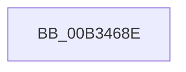

# sub_00B3468E

- RVA: `0x00B3468E`–`0x00B346BA` (길이 `44` bytes)
- VA: `0x0000000140B3468E`
- 실행 섹션: `PAGE`
- PDB 이름 있음: `아니요`; PDB Function 태그: `아니요`
- unwind 정보 RVA: `0x000A8654`
- 디코드: `11`개 명령, `44/44` bytes 표시
- 미해석 바이트: `0` (있으면 어셈블리에 `.byte`로 보존)

> 이 문서는 커널 이미지의 기계어와 PDB 기호를 분석해 생성했습니다. 4번과 5번은 함수 원형과 자료형을 바이너리 사용 방식에서 추정한 C 해석이며 원본 소스 복구 결과는 아닙니다.

## 1. Dependencies

- 직접 호출 지점: **1**; 고유 호출 대상: **1**
- 직접 호출자로 확인된 함수: **0**
- RIP 상대 이미지 참조: **0**

### Outgoing calls
- `0x00B3469D` → [memcpy](../../text/6C/memcpy_function_006C6840.md) (function, `0x006C6840`)

### Direct callers
- 이 함수 시작 RVA로 연결되는 직접 call은 확인되지 않았습니다. 간접 호출은 완전히 역산할 수 없습니다.

### Static image references
- 디코드된 RIP-relative 메모리 참조가 없습니다.

## 2. Other-region calls and transfers

- 다른 실행 섹션으로 향하는 call: **1**
  - `0x00B3469D` → [memcpy](../../text/6C/memcpy_function_006C6840.md) (`PAGE` → `.text`)
- call이 아닌 외부 분기/꼬리 이동: **1**
  - `0x00B346B5` → [PnpCompileDeviceInstancePaths + 0xB1](../A0/PnpCompileDeviceInstancePaths_function_00A07708.md) (`tail-transfer`)

## 3. Assembly (complete function range)

```asm
00B3468E  44 0F B7 41 28                  movzx r8d, word ptr [rcx + 0x28]
00B34693  48 8B D9                        mov rbx, rcx
00B34696  48 8B 51 30                     mov rdx, qword ptr [rcx + 0x30]
00B3469A  49 8B CE                        mov rcx, r14
00B3469D  E8 9E 21 B9 FF                  call 0x1406c6840
00B346A2  0F B7 43 28                     movzx eax, word ptr [rbx + 0x28]
00B346A6  48 D1 E8                        shr rax, 1
00B346A9  4D 8D 34 46                     lea r14, [r14 + rax*2]
00B346AD  66 41 89 3E                     mov word ptr [r14], di
00B346B1  49 83 C6 02                     add r14, 2
00B346B5  E9 FF 30 ED FF                  jmp 0x140a077b9
```

## 4. C-style interpretation (structured pseudocode)

```c
__int64 __fastcall sub_00B3468E(__int64 a1)
{
    __int64 result;
    __int64 v_r14;

    result = memcpy(v_r14, *(unsigned __int64 *)(a1 + 48), *(unsigned __int16 *)(a1 + 40), a4);
    result = (*(unsigned __int16 *)(a1 + 40)) >> (1);
    *(unsigned __int16 *)(v_r14 + result * 2) = (unsigned __int16)(v_rdi);
    v_r14 = (v_r14 + result * 2) + (2);
}
```

## 5. (Beta) C Style

```c
int64_t sub_00B3468E(void *Arg1)
{
    uint8_t *arg1 = (uint8_t *)Arg1;

    int64_t result;
    int64_t local_r14;

    result = memcpy(local_r14, *(uint64_t *)(arg1 + 0x30), *(uint16_t *)(arg1 + 0x28), a4);
    result = (*(uint16_t *)(arg1 + 0x28)) >> (1);
    *(uint16_t *)(local_r14 + result * 2) = (uint16_t)(local_rdi);
    local_r14 = (local_r14 + result * 2) + (2);
}
```

### 관측된 메모리 오프셋

구조체 형식이 확인되지 않은 접근은 인자 기준의 오프셋으로만 기록했습니다.

| 기준 인자 | 오프셋 표현 | 폭 (bit) | 접근 |
|---|---:|---:|---|
| `Arg1` | `+ 0x28` | `16` | `R` |
| `Arg1` | `+ 0x30` | `64` | `R` |

## 6. Execution-region graph

[열기: 2D/3D 그래프와 함수 탐색 컨트롤 패널](../../../control-panel.html?section=page&rva=0x00B3468E&view=graph)

- 2D 그래프는 위에서 아래로 흐르고, 3D 그래프는 빈 공간을 드래그해 회전합니다. Shift+드래그는 이동, 휠은 확대·축소, 함수 노드 선택은 대상 보고서 이동입니다.

### Static fallback


