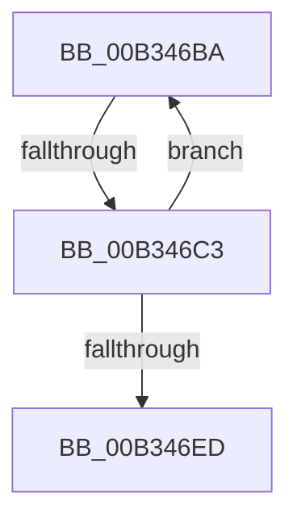

# sub_00B346BA

- RVA: `0x00B346BA`–`0x00B346F2` (길이 `56` bytes)
- VA: `0x0000000140B346BA`
- 실행 섹션: `PAGE`
- PDB 이름 있음: `아니요`; PDB Function 태그: `아니요`
- unwind 정보 RVA: `0x000A8664`
- 디코드: `14`개 명령, `56/56` bytes 표시
- 미해석 바이트: `0` (있으면 어셈블리에 `.byte`로 보존)

> 이 문서는 커널 이미지의 기계어와 PDB 기호를 분석해 생성했습니다. 4번과 5번은 함수 원형과 자료형을 바이너리 사용 방식에서 추정한 C 해석이며 원본 소스 복구 결과는 아닙니다.

## 1. Dependencies

- 직접 호출 지점: **2**; 고유 호출 대상: **2**
- 직접 호출자로 확인된 함수: **0**
- RIP 상대 이미지 참조: **0**

### Outgoing calls
- `0x00B346D5` → [KeDelayExecutionThread](../../text/20/KeDelayExecutionThread_function_00209550.md) (function, `0x00209550`)
- `0x00B346E3` → [ExAllocatePool2](../../poolcode/B8/ExAllocatePool2_function_00B820F0.md) (function, `0x00B820F0`)

### Direct callers
- 이 함수 시작 RVA로 연결되는 직접 call은 확인되지 않았습니다. 간접 호출은 완전히 역산할 수 없습니다.

### Static image references
- 디코드된 RIP-relative 메모리 참조가 없습니다.

## 2. Other-region calls and transfers

- 다른 실행 섹션으로 향하는 call: **2**
  - `0x00B346D5` → [KeDelayExecutionThread](../../text/20/KeDelayExecutionThread_function_00209550.md) (`PAGE` → `.text`)
  - `0x00B346E3` → [ExAllocatePool2](../../poolcode/B8/ExAllocatePool2_function_00B820F0.md) (`PAGE` → `POOLCODE`)
- call이 아닌 외부 분기/꼬리 이동: **2**
  - `0x00B346BD` → [PnpAllocateCriticalMemory + 0x32](../A0/PnpAllocateCriticalMemory_function_00A07924.md) (`tail-transfer`)
  - `0x00B346ED` → [PnpAllocateCriticalMemory + 0x32](../A0/PnpAllocateCriticalMemory_function_00A07924.md) (`tail-transfer`)

## 3. Assembly (complete function range)

```asm
00B346BA  83 FB 04                        cmp ebx, 4
00B346BD  0F 84 93 32 ED FF               je 0x140a07956
00B346C3  4C 8D 44 24 20                  lea r8, [rsp + 0x20]
00B346C8  48 C7 44 24 20 F0 D8 FF FF      mov qword ptr [rsp + 0x20], 0xffffffffffffd8f0
00B346D1  33 D2                           xor edx, edx
00B346D3  33 C9                           xor ecx, ecx
00B346D5  E8 76 4E 6D FF                  call 0x140209550
00B346DA  44 8B C7                        mov r8d, edi
00B346DD  48 8B D6                        mov rdx, rsi
00B346E0  48 8B CD                        mov rcx, rbp
00B346E3  E8 08 DA 04 00                  call 0x140b820f0
00B346E8  48 85 C0                        test rax, rax
00B346EB  74 CD                           je 0x140b346ba
00B346ED  E9 64 32 ED FF                  jmp 0x140a07956
```

## 4. C-style interpretation (structured pseudocode)

```c
__int64 __fastcall sub_00B346BA(int a1, int a2)
{
    __int64 result;
    unsigned __int64 v_stack_p20;

    v_stack_p20 = 0xFFFFFFFFFFFFD8F0ULL;
    a2 = 0;
    a1 = 0;
    result = KeDelayExecutionThread(a1, a2, v_stack_p20, a4);
    result = ExAllocatePool2(v_rbp, v_rsi, (unsigned int)((unsigned int)(v_rdi)), a4);
    if (result == 0) goto loc_00B346BA;
}
```

## 5. (Beta) C Style

```c
int64_t sub_00B346BA(int32_t Arg1, int32_t Arg2)
{
    int64_t result;
    uint64_t v_stack_p20;

    v_stack_p20 = 0xFFFFFFFFFFFFD8F0ULL;
    Arg2 = 0;
    Arg1 = 0;
    result = KeDelayExecutionThread(Arg1, Arg2, v_stack_p20, a4);
    result = ExAllocatePool2(local_rbp, local_rsi, (uint32_t)((uint32_t)(local_rdi)), a4);
    if (result == 0) goto loc_00B346BA;
}
```

## 6. Execution-region graph

[열기: 2D/3D 그래프와 함수 탐색 컨트롤 패널](../../../control-panel.html?section=page&rva=0x00B346BA&view=graph)

- 2D 그래프는 위에서 아래로 흐르고, 3D 그래프는 빈 공간을 드래그해 회전합니다. Shift+드래그는 이동, 휠은 확대·축소, 함수 노드 선택은 대상 보고서 이동입니다.

### Static fallback


