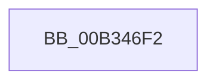

# sub_00B346F2

- RVA: `0x00B346F2`–`0x00B34727` (길이 `53` bytes)
- VA: `0x0000000140B346F2`
- 실행 섹션: `PAGE`
- PDB 이름 있음: `아니요`; PDB Function 태그: `아니요`
- unwind 정보 RVA: `0x000A86B8`
- 디코드: `12`개 명령, `53/53` bytes 표시
- 미해석 바이트: `0` (있으면 어셈블리에 `.byte`로 보존)

> 이 문서는 커널 이미지의 기계어와 PDB 기호를 분석해 생성했습니다. 4번과 5번은 함수 원형과 자료형을 바이너리 사용 방식에서 추정한 C 해석이며 원본 소스 복구 결과는 아닙니다.

## 1. Dependencies

- 직접 호출 지점: **1**; 고유 호출 대상: **1**
- 직접 호출자로 확인된 함수: **0**
- RIP 상대 이미지 참조: **1**

### Outgoing calls
- `0x00B3471C` → [CmGetInstallerClassRegProp](../99/CmGetInstallerClassRegProp_function_00994940.md) (function, `0x00994940`)

### Direct callers
- 이 함수 시작 RVA로 연결되는 직접 call은 확인되지 않았습니다. 간접 호출은 완전히 역산할 수 없습니다.

### Static image references
- `0x00B346F6` → RVA `0x00E66398` (`.data`; read)

## 2. Other-region calls and transfers

- 다른 실행 섹션으로 향하는 call: **0**
- call이 아닌 외부 분기/꼬리 이동: **1**
  - `0x00B34722` → [PpForEachDeviceInstanceDriver + 0x47B](../A0/PpForEachDeviceInstanceDriver_function_00A07D2C.md) (`tail-transfer`)

## 3. Assembly (complete function range)

```asm
00B346F2  4C 8B 45 97                     mov r8, qword ptr [rbp - 0x69]
00B346F6  48 8B 0D 9B 1C 33 00            mov rcx, qword ptr [rip + 0x331c9b]
00B346FD  48 89 44 24 30                  mov qword ptr [rsp + 0x30], rax
00B34702  48 8D 45 8F                     lea rax, [rbp - 0x71]
00B34706  49 C1 E1 05                     shl r9, 5
00B3470A  48 89 74 24 28                  mov qword ptr [rsp + 0x28], rsi
00B3470F  48 89 44 24 20                  mov qword ptr [rsp + 0x20], rax
00B34714  45 8B 0C 11                     mov r9d, dword ptr [r9 + rdx]
00B34718  48 8D 55 C7                     lea rdx, [rbp - 0x39]
00B3471C  E8 1F 02 E6 FF                  call 0x140994940
00B34721  90                              nop
00B34722  E9 80 3A ED FF                  jmp 0x140a081a7
```

## 4. C-style interpretation (structured pseudocode)

```c
__int64 __fastcall sub_00B346F2(__int64 a1, __int64 a2, __int64 a3, __int64 a4)
{
    __int64 result;
    unsigned __int64 v_stack_p20;
    unsigned __int64 v_stack_p28;
    unsigned __int64 v_stack_p30;

    v_stack_p30 = result;
    a4 = (a4) << (5);
    v_stack_p28 = v_rsi;
    v_stack_p20 = v_rbp - 113;
    result = CmGetInstallerClassRegProp(*(unsigned __int64 *)(v_rip + 3349659), v_rbp - 57, *(unsigned __int64 *)(v_rbp - 105), (unsigned int)(*(unsigned int *)(a4 + a2 * 1)));
}
```

## 5. (Beta) C Style

```c
int64_t sub_00B346F2(int64_t Arg1, int64_t Arg2, int64_t Arg3, int64_t Arg4)
{
    int64_t result;
    uint64_t v_stack_p20;
    uint64_t v_stack_p28;
    uint64_t v_stack_p30;

    v_stack_p30 = result;
    Arg4 = (Arg4) << (5);
    v_stack_p28 = local_rsi;
    v_stack_p20 = local_rbp - 113;
    result = CmGetInstallerClassRegProp(*(uint64_t *)(v_rip + 0x331C9B), local_rbp - 57, *(uint64_t *)(local_rbp - 0x69), (uint32_t)(*(uint32_t *)(Arg4 + Arg2 * 1)));
}
```

## 6. Execution-region graph

[열기: 2D/3D 그래프와 함수 탐색 컨트롤 패널](../../../control-panel.html?section=page&rva=0x00B346F2&view=graph)

- 2D 그래프는 위에서 아래로 흐르고, 3D 그래프는 빈 공간을 드래그해 회전합니다. Shift+드래그는 이동, 휠은 확대·축소, 함수 노드 선택은 대상 보고서 이동입니다.

### Static fallback


