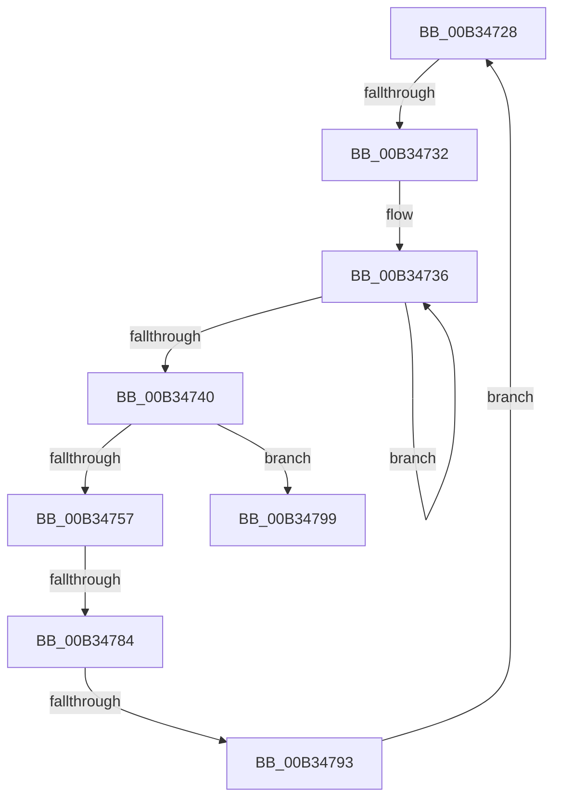

# sub_00B34728

- RVA: `0x00B34728`–`0x00B347A1` (길이 `121` bytes)
- VA: `0x0000000140B34728`
- 실행 섹션: `PAGE`
- PDB 이름 있음: `아니요`; PDB Function 태그: `아니요`
- unwind 정보 RVA: `0x000A86E0`
- 디코드: `31`개 명령, `121/121` bytes 표시
- 미해석 바이트: `0` (있으면 어셈블리에 `.byte`로 보존)

> 이 문서는 커널 이미지의 기계어와 PDB 기호를 분석해 생성했습니다. 4번과 5번은 함수 원형과 자료형을 바이너리 사용 방식에서 추정한 C 해석이며 원본 소스 복구 결과는 아닙니다.

## 1. Dependencies

- 직접 호출 지점: **3**; 고유 호출 대상: **3**
- 직접 호출자로 확인된 함수: **0**
- RIP 상대 이미지 참조: **0**

### Outgoing calls
- `0x00B3474E` → [RtlULongSub](../../text/4A/RtlULongSub_function_004A1DA8.md) (function, `0x004A1DA8`)
- `0x00B3475F` → [RtlInitUnicodeString](../../text/42/RtlInitUnicodeString_function_0042A780.md) (function, `0x0042A780`)
- `0x00B34777` → [guard_dispatch_icall](../../text/6B/guard_dispatch_icall_function_006BAAD0.md) (function, `0x006BAAD0`)

### Direct callers
- 이 함수 시작 RVA로 연결되는 직접 call은 확인되지 않았습니다. 간접 호출은 완전히 역산할 수 없습니다.

### Static image references
- 디코드된 RIP-relative 메모리 참조가 없습니다.

## 2. Other-region calls and transfers

- 다른 실행 섹션으로 향하는 call: **3**
  - `0x00B3474E` → [RtlULongSub](../../text/4A/RtlULongSub_function_004A1DA8.md) (`PAGE` → `.text`)
  - `0x00B3475F` → [RtlInitUnicodeString](../../text/42/RtlInitUnicodeString_function_0042A780.md) (`PAGE` → `.text`)
  - `0x00B34777` → [guard_dispatch_icall](../../text/6B/guard_dispatch_icall_function_006BAAD0.md) (`PAGE` → `.text`)
- call이 아닌 외부 분기/꼬리 이동: **4**
  - `0x00B3472C` → [PiForEachDriverQueryRoutine + 0x67](../A0/PiForEachDriverQueryRoutine_function_00A08278.md) (`tail-transfer`)
  - `0x00B3477E` → [PiForEachDriverQueryRoutine + 0x67](../A0/PiForEachDriverQueryRoutine_function_00A08278.md) (`tail-transfer`)
  - `0x00B3478D` → [PiForEachDriverQueryRoutine + 0x67](../A0/PiForEachDriverQueryRoutine_function_00A08278.md) (`tail-transfer`)
  - `0x00B3479C` → [PiForEachDriverQueryRoutine + 0x67](../A0/PiForEachDriverQueryRoutine_function_00A08278.md) (`tail-transfer`)

## 3. Assembly (complete function range)

```asm
00B34728  66 44 39 37                     cmp word ptr [rdi], r14w
00B3472C  0F 84 AD 3B ED FF               je 0x140a082df
00B34732  48 83 CB FF                     or rbx, 0xffffffffffffffff
00B34736  48 FF C3                        inc rbx
00B34739  66 44 39 34 5F                  cmp word ptr [rdi + rbx*2], r14w
00B3473E  75 F6                           jne 0x140b34736
00B34740  48 FF C3                        inc rbx
00B34743  4C 8D 44 24 70                  lea r8, [rsp + 0x70]
00B34748  41 8B CA                        mov ecx, r10d
00B3474B  8D 14 1B                        lea edx, [rbx + rbx]
00B3474E  E8 55 D6 96 FF                  call 0x1404a1da8
00B34753  85 C0                           test eax, eax
00B34755  78 42                           js 0x140b34799
00B34757  48 8B D7                        mov rdx, rdi
00B3475A  48 8D 4C 24 30                  lea rcx, [rsp + 0x30]
00B3475F  E8 1C 60 8F FF                  call 0x14042a780
00B34764  48 8B 46 08                     mov rax, qword ptr [rsi + 8]
00B34768  48 8D 54 24 30                  lea rdx, [rsp + 0x30]
00B3476D  4C 8B 4E 10                     mov r9, qword ptr [rsi + 0x10]
00B34771  4C 8B C5                        mov r8, rbp
00B34774  48 8B 0E                        mov rcx, qword ptr [rsi]
00B34777  E8 54 63 B8 FF                  call 0x1406baad0
00B3477C  85 C0                           test eax, eax
00B3477E  0F 88 5B 3B ED FF               js 0x140a082df
00B34784  44 8B 54 24 70                  mov r10d, dword ptr [rsp + 0x70]
00B34789  41 83 FA 02                     cmp r10d, 2
00B3478D  0F 82 4C 3B ED FF               jb 0x140a082df
00B34793  48 8D 3C 5F                     lea rdi, [rdi + rbx*2]
00B34797  EB 8F                           jmp 0x140b34728
00B34799  41 8B C6                        mov eax, r14d
00B3479C  E9 3E 3B ED FF                  jmp 0x140a082df
```

## 4. C-style interpretation (structured pseudocode)

```c
__int64 __fastcall sub_00B34728(__int64 a1, __int64 a2, __int64 a3, __int64 a4, __int64 a5, __int64 a6, __int64 a7, __int64 a8, __int64 a9, __int64 a10, __int64 a11, __int64 a12, __int64 a13, unsigned int a14)
{
    __int64 result;
    __int64 v_rbx;

    v_rbx = (v_rbx) | (-1);
loc_00B34736:
    v_rbx = (v_rbx) + 1;
    if ((*(unsigned __int16 *)(v_rdi + v_rbx * 2)) != ((unsigned __int16)(v_r14))) goto loc_00B34736;
    v_rbx = (v_rbx) + 1;
    result = RtlULongSub((unsigned int)((unsigned int)(v_r10)), v_rbx + v_rbx * 1, a14, a4);
    if (sign_flag) goto loc_00B34799;
    result = RtlInitUnicodeString(a6, v_rdi, a14, a4);
    result = guard_dispatch_icall(*(unsigned __int64 *)(v_rsi), a6, v_rbp, *(unsigned __int64 *)(v_rsi + 16));
    goto loc_00B34728;
loc_00B34799:
}
```

## 5. (Beta) C Style

```c
int64_t sub_00B34728(int64_t Arg1, int64_t Arg2, int64_t Arg3, int64_t Arg4, uint64_t Arg5, int64_t Arg6, uint64_t Arg7, uint64_t Arg8, uint64_t Arg9, uint64_t Arg10, uint64_t Arg11, uint64_t Arg12, uint64_t Arg13, uint32_t Arg14)
{
    int64_t result;
    int64_t local_rbx;

    local_rbx = (local_rbx) | (-1);
loc_00B34736:
    local_rbx = (local_rbx) + 1;
    if ((*(uint16_t *)(local_rdi + local_rbx * 2)) != ((uint16_t)(local_r14))) goto loc_00B34736;
    local_rbx = (local_rbx) + 1;
    result = RtlULongSub((uint32_t)((uint32_t)(local_r10)), local_rbx + local_rbx * 1, Arg14, Arg4);
    if (sign_flag) goto loc_00B34799;
    result = RtlInitUnicodeString(Arg6, local_rdi, Arg14, Arg4);
    result = guard_dispatch_icall(*(uint64_t *)(local_rsi), Arg6, local_rbp, *(uint64_t *)(local_rsi + 0x10));
    goto loc_00B34728;
loc_00B34799:
}
```

## 6. Execution-region graph

[열기: 2D/3D 그래프와 함수 탐색 컨트롤 패널](../../../control-panel.html?section=page&rva=0x00B34728&view=graph)

- 2D 그래프는 위에서 아래로 흐르고, 3D 그래프는 빈 공간을 드래그해 회전합니다. Shift+드래그는 이동, 휠은 확대·축소, 함수 노드 선택은 대상 보고서 이동입니다.

### Static fallback


