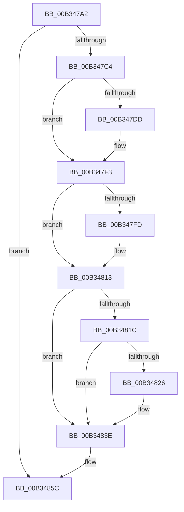

# sub_00B347A2

- RVA: `0x00B347A2`–`0x00B34867` (길이 `197` bytes)
- VA: `0x0000000140B347A2`
- 실행 섹션: `PAGE`
- PDB 이름 있음: `아니요`; PDB Function 태그: `아니요`
- unwind 정보 RVA: `0x000A8710`
- 디코드: `51`개 명령, `197/197` bytes 표시
- 미해석 바이트: `0` (있으면 어셈블리에 `.byte`로 보존)

> 이 문서는 커널 이미지의 기계어와 PDB 기호를 분석해 생성했습니다. 4번과 5번은 함수 원형과 자료형을 바이너리 사용 방식에서 추정한 C 해석이며 원본 소스 복구 결과는 아닙니다.

## 1. Dependencies

- 직접 호출 지점: **11**; 고유 호출 대상: **5**
- 직접 호출자로 확인된 함수: **0**
- RIP 상대 이미지 참조: **0**

### Outgoing calls
- `0x00B347A5` → [PiIommuUninitializeDeviceAts](../../text/4C/PiIommuUninitializeDeviceAts_function_004CCB18.md) (function, `0x004CCB18`)
- `0x00B347B1` → [PiIommuBlockDevice](../74/PiIommuBlockDevice_function_00740178.md) (function, `0x00740178`)
- `0x00B347CD` → [IoAddTriageDumpDataBlock](../../text/42/IoAddTriageDumpDataBlock_function_00428374.md) (function, `0x00428374`)
- `0x00B347E2` → [IoAddTriageDumpDataBlock](../../text/42/IoAddTriageDumpDataBlock_function_00428374.md) (function, `0x00428374`)
- `0x00B347EE` → [IoAddTriageDumpDataBlock](../../text/42/IoAddTriageDumpDataBlock_function_00428374.md) (function, `0x00428374`)
- `0x00B34802` → [IoAddTriageDumpDataBlock](../../text/42/IoAddTriageDumpDataBlock_function_00428374.md) (function, `0x00428374`)
- `0x00B3480E` → [IoAddTriageDumpDataBlock](../../text/42/IoAddTriageDumpDataBlock_function_00428374.md) (function, `0x00428374`)
- `0x00B34828` → [IoAddTriageDumpDataBlock](../../text/42/IoAddTriageDumpDataBlock_function_00428374.md) (function, `0x00428374`)
- `0x00B34839` → [IoAddTriageDumpDataBlock](../../text/42/IoAddTriageDumpDataBlock_function_00428374.md) (function, `0x00428374`)
- `0x00B34856` → [KeBugCheckEx](../../text/4F/KeBugCheckEx_function_004FD660.md) (function, `0x004FD660`)
- `0x00B3485C` → [PipDmgDestroyIommuExtension](../A2/PipDmgDestroyIommuExtension_function_00A2857C.md) (function, `0x00A2857C`)

### Direct callers
- 이 함수 시작 RVA로 연결되는 직접 call은 확인되지 않았습니다. 간접 호출은 완전히 역산할 수 없습니다.

### Static image references
- 디코드된 RIP-relative 메모리 참조가 없습니다.

## 2. Other-region calls and transfers

- 다른 실행 섹션으로 향하는 call: **9**
  - `0x00B347A5` → [PiIommuUninitializeDeviceAts](../../text/4C/PiIommuUninitializeDeviceAts_function_004CCB18.md) (`PAGE` → `.text`)
  - `0x00B347CD` → [IoAddTriageDumpDataBlock](../../text/42/IoAddTriageDumpDataBlock_function_00428374.md) (`PAGE` → `.text`)
  - `0x00B347E2` → [IoAddTriageDumpDataBlock](../../text/42/IoAddTriageDumpDataBlock_function_00428374.md) (`PAGE` → `.text`)
  - `0x00B347EE` → [IoAddTriageDumpDataBlock](../../text/42/IoAddTriageDumpDataBlock_function_00428374.md) (`PAGE` → `.text`)
  - `0x00B34802` → [IoAddTriageDumpDataBlock](../../text/42/IoAddTriageDumpDataBlock_function_00428374.md) (`PAGE` → `.text`)
  - `0x00B3480E` → [IoAddTriageDumpDataBlock](../../text/42/IoAddTriageDumpDataBlock_function_00428374.md) (`PAGE` → `.text`)
  - `0x00B34828` → [IoAddTriageDumpDataBlock](../../text/42/IoAddTriageDumpDataBlock_function_00428374.md) (`PAGE` → `.text`)
  - `0x00B34839` → [IoAddTriageDumpDataBlock](../../text/42/IoAddTriageDumpDataBlock_function_00428374.md) (`PAGE` → `.text`)
  - `0x00B34856` → [KeBugCheckEx](../../text/4F/KeBugCheckEx_function_004FD660.md) (`PAGE` → `.text`)
- call이 아닌 외부 분기/꼬리 이동: **1**
  - `0x00B34862` → [PnpSurpriseRemoveLockedDeviceNode + 0x144](../A0/PnpSurpriseRemoveLockedDeviceNode_function_00A08370.md) (`tail-transfer`)

## 3. Assembly (complete function range)

```asm
00B347A2  48 8B CF                        mov rcx, rdi
00B347A5  E8 6E 83 99 FF                  call 0x1404ccb18
00B347AA  48 8B 8F D0 02 00 00            mov rcx, qword ptr [rdi + 0x2d0]
00B347B1  E8 C2 B9 C0 FF                  call 0x140740178
00B347B6  48 63 F0                        movsxd rsi, eax
00B347B9  48 8B CF                        mov rcx, rdi
00B347BC  85 C0                           test eax, eax
00B347BE  0F 89 98 00 00 00               jns 0x140b3485c
00B347C4  BA 88 03 00 00                  mov edx, 0x388
00B347C9  48 8D 5F 28                     lea rbx, [rdi + 0x28]
00B347CD  E8 A2 3B 8F FF                  call 0x140428374
00B347D2  BD 02 00 00 00                  mov ebp, 2
00B347D7  66 44 39 33                     cmp word ptr [rbx], r14w
00B347DB  74 16                           je 0x140b347f3
00B347DD  8B D5                           mov edx, ebp
00B347DF  48 8B CB                        mov rcx, rbx
00B347E2  E8 8D 3B 8F FF                  call 0x140428374
00B347E7  0F B7 13                        movzx edx, word ptr [rbx]
00B347EA  48 8B 4B 08                     mov rcx, qword ptr [rbx + 8]
00B347EE  E8 81 3B 8F FF                  call 0x140428374
00B347F3  48 8D 5F 38                     lea rbx, [rdi + 0x38]
00B347F7  66 44 39 33                     cmp word ptr [rbx], r14w
00B347FB  74 16                           je 0x140b34813
00B347FD  8B D5                           mov edx, ebp
00B347FF  48 8B CB                        mov rcx, rbx
00B34802  E8 6D 3B 8F FF                  call 0x140428374
00B34807  0F B7 13                        movzx edx, word ptr [rbx]
00B3480A  48 8B 4F 40                     mov rcx, qword ptr [rdi + 0x40]
00B3480E  E8 61 3B 8F FF                  call 0x140428374
00B34813  48 8B 47 10                     mov rax, qword ptr [rdi + 0x10]
00B34817  48 85 C0                        test rax, rax
00B3481A  74 22                           je 0x140b3483e
00B3481C  48 8D 48 38                     lea rcx, [rax + 0x38]
00B34820  66 44 39 31                     cmp word ptr [rcx], r14w
00B34824  74 18                           je 0x140b3483e
00B34826  8B D5                           mov edx, ebp
00B34828  E8 47 3B 8F FF                  call 0x140428374
00B3482D  48 8B 4F 10                     mov rcx, qword ptr [rdi + 0x10]
00B34831  0F B7 51 38                     movzx edx, word ptr [rcx + 0x38]
00B34835  48 8B 49 40                     mov rcx, qword ptr [rcx + 0x40]
00B34839  E8 36 3B 8F FF                  call 0x140428374
00B3483E  4C 8B CE                        mov r9, rsi
00B34841  48 89 7C 24 20                  mov qword ptr [rsp + 0x20], rdi
00B34846  BA 13 00 00 00                  mov edx, 0x13
00B3484B  B9 CA 00 00 00                  mov ecx, 0xca
00B34850  41 B8 01 10 00 00               mov r8d, 0x1001
00B34856  E8 05 8E 9C FF                  call 0x1404fd660
00B3485B  CC                              int3
00B3485C  E8 1B 3D EF FF                  call 0x140a2857c
00B34861  90                              nop
00B34862  E9 4D 3C ED FF                  jmp 0x140a084b4
```

## 4. C-style interpretation (structured pseudocode)

```c
__int64 __fastcall sub_00B347A2(void)
{
    __int64 result;
    unsigned __int64 v_stack_p20;

    result = PiIommuUninitializeDeviceAts(v_rdi, a2, a3, a4);
    result = PiIommuBlockDevice(*(unsigned __int64 *)(v_rdi + 720), a2, a3, a4);
    if (!sign_flag) goto loc_00B3485C;
    result = IoAddTriageDumpDataBlock(v_rdi, 904, a3, a4);
    if ((*(unsigned __int16 *)(v_rdi + 40)) != ((unsigned __int16)(v_r14))) {
        a2 = 2;
        a1 = v_rdi + 40;
        result = IoAddTriageDumpDataBlock(a1, a2, a3, a4);
        a2 = *(unsigned __int16 *)(v_rdi + 40);
        a1 = *(unsigned __int64 *)(v_rdi + 40 + 8);
        result = IoAddTriageDumpDataBlock(a1, a2, a3, a4);
    }
    if ((*(unsigned __int16 *)(v_rdi + 56)) != ((unsigned __int16)(v_r14))) {
        a2 = 2;
        a1 = v_rdi + 56;
        result = IoAddTriageDumpDataBlock(a1, a2, a3, a4);
        a2 = *(unsigned __int16 *)(v_rdi + 56);
        a1 = *(unsigned __int64 *)(v_rdi + 64);
        result = IoAddTriageDumpDataBlock(a1, a2, a3, a4);
    }
    if (*(unsigned __int64 *)(v_rdi + 16) == 0) goto loc_00B3483E;
    result = *(unsigned __int64 *)(v_rdi + 16);
    if ((*(unsigned __int16 *)(*(unsigned __int64 *)(v_rdi + 16) + 56)) != ((unsigned __int16)(v_r14))) {
        a2 = 2;
        result = IoAddTriageDumpDataBlock(*(unsigned __int64 *)(v_rdi + 16) + 56, a2, a3, a4);
        a1 = *(unsigned __int64 *)(v_rdi + 16);
        a2 = *(unsigned __int16 *)(a1 + 56);
        a1 = *(unsigned __int64 *)(a1 + 64);
        result = IoAddTriageDumpDataBlock(a1, a2, a3, a4);
    }
    v_stack_p20 = v_rdi;
    result = KeBugCheckEx(202, 19, (unsigned int)(0x1001ULL), (int)((unsigned int)(result)));
loc_00B3485C:
    result = PipDmgDestroyIommuExtension(202, 19, (unsigned int)(0x1001ULL), (int)((unsigned int)(result)));
}
```

## 5. (Beta) C Style

```c
void sub_00B347A2(void)
{
    int64_t result;
    uint64_t v_stack_p20;

    result = PiIommuUninitializeDeviceAts(local_rdi, a2, a3, a4);
    result = PiIommuBlockDevice(*(uint64_t *)(local_rdi + 0x2D0), a2, a3, a4);
    if (!sign_flag) goto loc_00B3485C;
    result = IoAddTriageDumpDataBlock(local_rdi, 904, a3, a4);
    if ((*(uint16_t *)(local_rdi + 0x28)) != ((uint16_t)(local_r14))) {
        a2 = 2;
        a1 = local_rdi + 40;
        result = IoAddTriageDumpDataBlock(a1, a2, a3, a4);
        a2 = *(uint16_t *)(local_rdi + 0x28);
        a1 = *(uint64_t *)(local_rdi + 0x28 + 0x8);
        result = IoAddTriageDumpDataBlock(a1, a2, a3, a4);
    }
    if ((*(uint16_t *)(local_rdi + 0x38)) != ((uint16_t)(local_r14))) {
        a2 = 2;
        a1 = local_rdi + 56;
        result = IoAddTriageDumpDataBlock(a1, a2, a3, a4);
        a2 = *(uint16_t *)(local_rdi + 0x38);
        a1 = *(uint64_t *)(local_rdi + 0x40);
        result = IoAddTriageDumpDataBlock(a1, a2, a3, a4);
    }
    if (*(uint64_t *)(local_rdi + 0x10) == 0) goto loc_00B3483E;
    result = *(uint64_t *)(local_rdi + 0x10);
    if ((*(uint16_t *)(*(uint64_t *)(local_rdi + 0x10) + 0x38)) != ((uint16_t)(local_r14))) {
        a2 = 2;
        result = IoAddTriageDumpDataBlock(*(uint64_t *)(local_rdi + 0x10) + 56, a2, a3, a4);
        a1 = *(uint64_t *)(local_rdi + 0x10);
        a2 = *(uint16_t *)(a1 + 0x38);
        a1 = *(uint64_t *)(a1 + 0x40);
        result = IoAddTriageDumpDataBlock(a1, a2, a3, a4);
    }
    v_stack_p20 = local_rdi;
    result = KeBugCheckEx(202, 19, (uint32_t)(0x1001ULL), (int32_t)((uint32_t)(result)));
loc_00B3485C:
    result = PipDmgDestroyIommuExtension(202, 19, (uint32_t)(0x1001ULL), (int32_t)((uint32_t)(result)));
}
```

## 6. Execution-region graph

[열기: 2D/3D 그래프와 함수 탐색 컨트롤 패널](../../../control-panel.html?section=page&rva=0x00B347A2&view=graph)

- 2D 그래프는 위에서 아래로 흐르고, 3D 그래프는 빈 공간을 드래그해 회전합니다. Shift+드래그는 이동, 휠은 확대·축소, 함수 노드 선택은 대상 보고서 이동입니다.

### Static fallback


