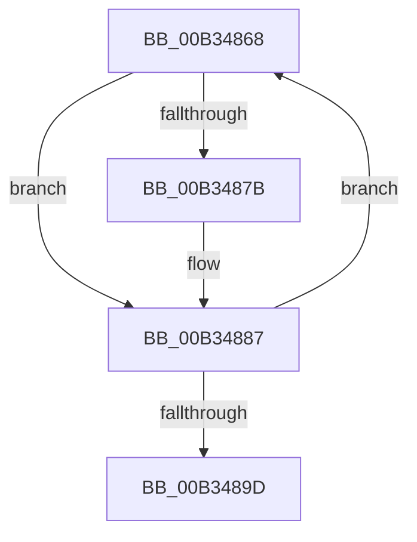

# sub_00B34868

- RVA: `0x00B34868`–`0x00B348A2` (길이 `58` bytes)
- VA: `0x0000000140B34868`
- 실행 섹션: `PAGE`
- PDB 이름 있음: `아니요`; PDB Function 태그: `아니요`
- unwind 정보 RVA: `0x000A873C`
- 디코드: `16`개 명령, `58/58` bytes 표시
- 미해석 바이트: `0` (있으면 어셈블리에 `.byte`로 보존)

> 이 문서는 커널 이미지의 기계어와 PDB 기호를 분석해 생성했습니다. 4번과 5번은 함수 원형과 자료형을 바이너리 사용 방식에서 추정한 C 해석이며 원본 소스 복구 결과는 아닙니다.

## 1. Dependencies

- 직접 호출 지점: **2**; 고유 호출 대상: **2**
- 직접 호출자로 확인된 함수: **0**
- RIP 상대 이미지 참조: **0**

### Outgoing calls
- `0x00B34870` → [RtlInitUnicodeStringEx](../../text/46/RtlInitUnicodeStringEx_function_00463960.md) (function, `0x00463960`)
- `0x00B34882` → [IoSetDeviceInterfaceState](../95/IoSetDeviceInterfaceState_function_00950740.md) (function, `0x00950740`)

### Direct callers
- 이 함수 시작 RVA로 연결되는 직접 call은 확인되지 않았습니다. 간접 호출은 완전히 역산할 수 없습니다.

### Static image references
- 디코드된 RIP-relative 메모리 참조가 없습니다.

## 2. Other-region calls and transfers

- 다른 실행 섹션으로 향하는 call: **1**
  - `0x00B34870` → [RtlInitUnicodeStringEx](../../text/46/RtlInitUnicodeStringEx_function_00463960.md) (`PAGE` → `.text`)
- call이 아닌 외부 분기/꼬리 이동: **1**
  - `0x00B3489D` → [PnpDisableDeviceInterfaces + 0x1B2](../A0/PnpDisableDeviceInterfaces_function_00A0885C.md) (`tail-transfer`)

## 3. Assembly (complete function range)

```asm
00B34868  48 8B D7                        mov rdx, rdi
00B3486B  48 8D 4C 24 50                  lea rcx, [rsp + 0x50]
00B34870  E8 EB F0 92 FF                  call 0x140463960
00B34875  8B D8                           mov ebx, eax
00B34877  85 C0                           test eax, eax
00B34879  78 0C                           js 0x140b34887
00B3487B  33 D2                           xor edx, edx
00B3487D  48 8D 4C 24 50                  lea rcx, [rsp + 0x50]
00B34882  E8 B9 BE E1 FF                  call 0x140950740
00B34887  0F B7 44 24 50                  movzx eax, word ptr [rsp + 0x50]
00B3488C  48 83 C0 02                     add rax, 2
00B34890  48 D1 E8                        shr rax, 1
00B34893  48 8D 3C 47                     lea rdi, [rdi + rax*2]
00B34897  66 44 39 27                     cmp word ptr [rdi], r12w
00B3489B  75 CB                           jne 0x140b34868
00B3489D  E9 6C 41 ED FF                  jmp 0x140a08a0e
```

## 4. C-style interpretation (structured pseudocode)

```c
__int64 __fastcall sub_00B34868(__int64 a1, __int64 a2, __int64 a3, __int64 a4, __int64 a5, __int64 a6, __int64 a7, __int64 a8, __int64 a9, unsigned __int16 a10)
{
    __int64 result;

    result = RtlInitUnicodeStringEx(a10, v_rdi, a3, a4);
    if (!(sign_flag)) {
        a2 = 0;
        a1 = a10;
        result = IoSetDeviceInterfaceState(a1, a2, a3, a4);
    }
    result = (a10) + (2);
    result = (result) >> (1);
    if ((*(unsigned __int16 *)(v_rdi + result * 2)) != ((unsigned __int16)(v_r12))) goto loc_00B34868;
}
```

## 5. (Beta) C Style

```c
int64_t sub_00B34868(int64_t Arg1, int64_t Arg2, int64_t Arg3, int64_t Arg4, uint64_t Arg5, uint64_t Arg6, uint64_t Arg7, uint64_t Arg8, uint64_t Arg9, uint16_t Arg10)
{
    int64_t result;

    result = RtlInitUnicodeStringEx(Arg10, local_rdi, Arg3, Arg4);
    if (!(sign_flag)) {
        Arg2 = 0;
        Arg1 = Arg10;
        result = IoSetDeviceInterfaceState(Arg1, Arg2, Arg3, Arg4);
    }
    result = (Arg10) + (2);
    result = (result) >> (1);
    if ((*(uint16_t *)(local_rdi + result * 2)) != ((uint16_t)(local_r12))) goto loc_00B34868;
}
```

## 6. Execution-region graph

[열기: 2D/3D 그래프와 함수 탐색 컨트롤 패널](../../../control-panel.html?section=page&rva=0x00B34868&view=graph)

- 2D 그래프는 위에서 아래로 흐르고, 3D 그래프는 빈 공간을 드래그해 회전합니다. Shift+드래그는 이동, 휠은 확대·축소, 함수 노드 선택은 대상 보고서 이동입니다.

### Static fallback


