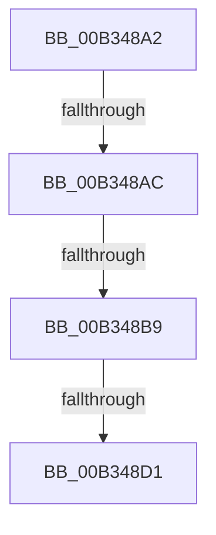

# sub_00B348A2

- RVA: `0x00B348A2`–`0x00B348E8` (길이 `70` bytes)
- VA: `0x0000000140B348A2`
- 실행 섹션: `PAGE`
- PDB 이름 있음: `아니요`; PDB Function 태그: `아니요`
- unwind 정보 RVA: `0x000A8760`
- 디코드: `17`개 명령, `70/70` bytes 표시
- 미해석 바이트: `0` (있으면 어셈블리에 `.byte`로 보존)

> 이 문서는 커널 이미지의 기계어와 PDB 기호를 분석해 생성했습니다. 4번과 5번은 함수 원형과 자료형을 바이너리 사용 방식에서 추정한 C 해석이며 원본 소스 복구 결과는 아닙니다.

## 1. Dependencies

- 직접 호출 지점: **0**; 고유 호출 대상: **0**
- 직접 호출자로 확인된 함수: **0**
- RIP 상대 이미지 참조: **0**

### Outgoing calls
- 직접 디코드된 call 명령이 없습니다.

### Direct callers
- 이 함수 시작 RVA로 연결되는 직접 call은 확인되지 않았습니다. 간접 호출은 완전히 역산할 수 없습니다.

### Static image references
- 디코드된 RIP-relative 메모리 참조가 없습니다.

## 2. Other-region calls and transfers

- 다른 실행 섹션으로 향하는 call: **0**
- call이 아닌 외부 분기/꼬리 이동: **4**
  - `0x00B348A6` → [PnpDelayedRemoveWorker + 0x1B4](../A0/PnpDelayedRemoveWorker_function_00A08AE0.md) (`tail-transfer`)
  - `0x00B348B3` → [PnpDelayedRemoveWorker + 0x1B4](../A0/PnpDelayedRemoveWorker_function_00A08AE0.md) (`tail-transfer`)
  - `0x00B348CB` → [PnpDelayedRemoveWorker + 0x1B4](../A0/PnpDelayedRemoveWorker_function_00A08AE0.md) (`tail-transfer`)
  - `0x00B348E3` → [PnpDelayedRemoveWorker + 0x90](../A0/PnpDelayedRemoveWorker_function_00A08AE0.md) (`tail-transfer`)

## 3. Assembly (complete function range)

```asm
00B348A2  49 39 50 08                     cmp qword ptr [r8 + 8], rdx
00B348A6  0F 85 E8 43 ED FF               jne 0x140a08c94
00B348AC  48 8B 42 08                     mov rax, qword ptr [rdx + 8]
00B348B0  48 39 10                        cmp qword ptr [rax], rdx
00B348B3  0F 85 DB 43 ED FF               jne 0x140a08c94
00B348B9  4C 89 00                        mov qword ptr [rax], r8
00B348BC  48 8D 4D F0                     lea rcx, [rbp - 0x10]
00B348C0  49 89 40 08                     mov qword ptr [r8 + 8], rax
00B348C4  48 8B 45 F8                     mov rax, qword ptr [rbp - 8]
00B348C8  48 39 08                        cmp qword ptr [rax], rcx
00B348CB  0F 85 C3 43 ED FF               jne 0x140a08c94
00B348D1  48 89 42 08                     mov qword ptr [rdx + 8], rax
00B348D5  4C 8D 4D F0                     lea r9, [rbp - 0x10]
00B348D9  4C 89 0A                        mov qword ptr [rdx], r9
00B348DC  48 89 10                        mov qword ptr [rax], rdx
00B348DF  48 89 55 F8                     mov qword ptr [rbp - 8], rdx
00B348E3  E9 88 42 ED FF                  jmp 0x140a08b70
```

## 4. C-style interpretation (structured pseudocode)

```c
__int64 __fastcall sub_00B348A2(__int64 a1, __int64 a2, __int64 a3)
{
    *(unsigned __int64 *)(*(unsigned __int64 *)(a2 + 8)) = a3;
    *(unsigned __int64 *)(a3 + 8) = *(unsigned __int64 *)(a2 + 8);
    *(unsigned __int64 *)(a2 + 8) = *(unsigned __int64 *)(v_rbp - 8);
    *(unsigned __int64 *)(a2) = v_rbp - 16;
    *(unsigned __int64 *)(*(unsigned __int64 *)(v_rbp - 8)) = a2;
    *(unsigned __int64 *)(v_rbp - 8) = a2;
}
```

## 5. (Beta) C Style

```c
int64_t sub_00B348A2(int64_t Arg1, void *Arg2, void *Arg3)
{
    uint8_t *arg2 = (uint8_t *)Arg2;
    uint8_t *arg3 = (uint8_t *)Arg3;

    *(void **)(*(uint64_t *)(arg2 + 0x8)) = Arg3;
    *(uint64_t *)(arg3 + 0x8) = *(uint64_t *)(arg2 + 0x8);
    *(uint64_t *)(arg2 + 0x8) = *(uint64_t *)(local_rbp - 0x8);
    *(uint64_t *)(arg2) = local_rbp - 16;
    *(void **)(*(uint64_t *)(local_rbp - 0x8)) = Arg2;
    *(void **)(local_rbp - 0x8) = Arg2;
}
```

### 관측된 메모리 오프셋

구조체 형식이 확인되지 않은 접근은 인자 기준의 오프셋으로만 기록했습니다.

| 기준 인자 | 오프셋 표현 | 폭 (bit) | 접근 |
|---|---:|---:|---|
| `Arg2` | `+ 0x0` | `64` | `W` |
| `Arg2` | `+ 0x8` | `64` | `R` |
| `Arg2` | `+ 0x8` | `64` | `W` |
| `Arg3` | `+ 0x8` | `64` | `R` |
| `Arg3` | `+ 0x8` | `64` | `W` |

## 6. Execution-region graph

[열기: 2D/3D 그래프와 함수 탐색 컨트롤 패널](../../../control-panel.html?section=page&rva=0x00B348A2&view=graph)

- 2D 그래프는 위에서 아래로 흐르고, 3D 그래프는 빈 공간을 드래그해 회전합니다. Shift+드래그는 이동, 휠은 확대·축소, 함수 노드 선택은 대상 보고서 이동입니다.

### Static fallback


