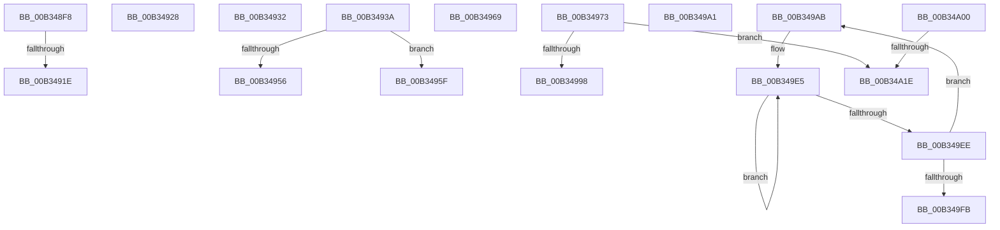

# sub_00B348F8

- RVA: `0x00B348F8`–`0x00B34A28` (길이 `304` bytes)
- VA: `0x0000000140B348F8`
- 실행 섹션: `PAGE`
- PDB 이름 있음: `아니요`; PDB Function 태그: `아니요`
- unwind 정보 RVA: `0x000A87A8`
- 디코드: `73`개 명령, `304/304` bytes 표시
- 미해석 바이트: `0` (있으면 어셈블리에 `.byte`로 보존)

> 이 문서는 커널 이미지의 기계어와 PDB 기호를 분석해 생성했습니다. 4번과 5번은 함수 원형과 자료형을 바이너리 사용 방식에서 추정한 C 해석이며 원본 소스 복구 결과는 아닙니다.

## 1. Dependencies

- 직접 호출 지점: **5**; 고유 호출 대상: **2**
- 직접 호출자로 확인된 함수: **0**
- RIP 상대 이미지 참조: **1**

### Outgoing calls
- `0x00B3490B` → [ExAllocatePool2](../../poolcode/B8/ExAllocatePool2_function_00B820F0.md) (function, `0x00B820F0`)
- `0x00B34947` → [ExAllocatePool2](../../poolcode/B8/ExAllocatePool2_function_00B820F0.md) (function, `0x00B820F0`)
- `0x00B34980` → [ExAllocatePool2](../../poolcode/B8/ExAllocatePool2_function_00B820F0.md) (function, `0x00B820F0`)
- `0x00B349DA` → [PnpSetObjectProperty](../8F/PnpSetObjectProperty_function_008F66E8.md) (function, `0x008F66E8`)
- `0x00B34A0D` → [ExAllocatePool2](../../poolcode/B8/ExAllocatePool2_function_00B820F0.md) (function, `0x00B820F0`)

### Direct callers
- 이 함수 시작 RVA로 연결되는 직접 call은 확인되지 않았습니다. 간접 호출은 완전히 역산할 수 없습니다.

### Static image references
- `0x00B349AF` → RVA `0x00011F50` (`.rdata`; read)

## 2. Other-region calls and transfers

- 다른 실행 섹션으로 향하는 call: **4**
  - `0x00B3490B` → [ExAllocatePool2](../../poolcode/B8/ExAllocatePool2_function_00B820F0.md) (`PAGE` → `POOLCODE`)
  - `0x00B34947` → [ExAllocatePool2](../../poolcode/B8/ExAllocatePool2_function_00B820F0.md) (`PAGE` → `POOLCODE`)
  - `0x00B34980` → [ExAllocatePool2](../../poolcode/B8/ExAllocatePool2_function_00B820F0.md) (`PAGE` → `POOLCODE`)
  - `0x00B34A0D` → [ExAllocatePool2](../../poolcode/B8/ExAllocatePool2_function_00B820F0.md) (`PAGE` → `POOLCODE`)
- call이 아닌 외부 분기/꼬리 이동: **12**
  - `0x00B34918` → [_CmDeleteDeviceWorker + 0xF0](../A0/_CmDeleteDeviceWorker_function_00A08F48.md) (`tail-transfer`)
  - `0x00B34923` → [_CmDeleteDeviceWorker + 0x35D](../A0/_CmDeleteDeviceWorker_function_00A08F48.md) (`tail-transfer`)
  - `0x00B3492D` → [_CmDeleteDeviceWorker + 0x35D](../A0/_CmDeleteDeviceWorker_function_00A08F48.md) (`tail-transfer`)
  - `0x00B34935` → [_CmDeleteDeviceWorker + 0x162](../A0/_CmDeleteDeviceWorker_function_00A08F48.md) (`tail-transfer`)
  - `0x00B3495A` → [_CmDeleteDeviceWorker + 0x162](../A0/_CmDeleteDeviceWorker_function_00A08F48.md) (`tail-transfer`)
  - `0x00B34964` → [_CmDeleteDeviceWorker + 0x34B](../A0/_CmDeleteDeviceWorker_function_00A08F48.md) (`tail-transfer`)
  - `0x00B3496E` → [_CmDeleteDeviceWorker + 0x34B](../A0/_CmDeleteDeviceWorker_function_00A08F48.md) (`tail-transfer`)
  - `0x00B3499C` → [_CmDeleteDeviceWorker + 0x1BE](../A0/_CmDeleteDeviceWorker_function_00A08F48.md) (`tail-transfer`)
  - `0x00B349A6` → [_CmDeleteDeviceWorker + 0x33D](../A0/_CmDeleteDeviceWorker_function_00A08F48.md) (`tail-transfer`)
  - `0x00B349FB` → [_CmDeleteDeviceWorker + 0x214](../A0/_CmDeleteDeviceWorker_function_00A08F48.md) (`tail-transfer`)
  - `0x00B34A18` → [_CmDeleteDeviceWorker + 0x24A](../A0/_CmDeleteDeviceWorker_function_00A08F48.md) (`tail-transfer`)
  - `0x00B34A23` → [_CmDeleteDeviceWorker + 0x33D](../A0/_CmDeleteDeviceWorker_function_00A08F48.md) (`tail-transfer`)

## 3. Assembly (complete function range)

```asm
00B348F8  44 8B 7C 24 60                  mov r15d, dword ptr [rsp + 0x60]
00B348FD  B9 00 01 00 00                  mov ecx, 0x100
00B34902  41 8B D7                        mov edx, r15d
00B34905  41 B8 50 4E 50 52               mov r8d, 0x52504e50
00B3490B  E8 E0 D7 04 00                  call 0x140b820f0
00B34910  33 C9                           xor ecx, ecx
00B34912  48 8B F0                        mov rsi, rax
00B34915  48 85 C0                        test rax, rax
00B34918  0F 85 1A 47 ED FF               jne 0x140a09038
00B3491E  BB 17 00 00 C0                  mov ebx, 0xc0000017
00B34923  E9 7D 49 ED FF                  jmp 0x140a092a5
00B34928  BB 01 00 00 C0                  mov ebx, 0xc0000001
00B3492D  E9 73 49 ED FF                  jmp 0x140a092a5
00B34932  41 8B C5                        mov eax, r13d
00B34935  E9 70 47 ED FF                  jmp 0x140a090aa
00B3493A  8B D3                           mov edx, ebx
00B3493C  B9 00 01 00 00                  mov ecx, 0x100
00B34941  41 B8 50 4E 50 52               mov r8d, 0x52504e50
00B34947  E8 A4 D7 04 00                  call 0x140b820f0
00B3494C  33 C9                           xor ecx, ecx
00B3494E  4C 8B E8                        mov r13, rax
00B34951  48 85 C0                        test rax, rax
00B34954  74 09                           je 0x140b3495f
00B34956  8B 44 24 68                     mov eax, dword ptr [rsp + 0x68]
00B3495A  E9 4B 47 ED FF                  jmp 0x140a090aa
00B3495F  BB 17 00 00 C0                  mov ebx, 0xc0000017
00B34964  E9 2A 49 ED FF                  jmp 0x140a09293
00B34969  BB 0D 00 00 C0                  mov ebx, 0xc000000d
00B3496E  E9 20 49 ED FF                  jmp 0x140a09293
00B34973  8B D3                           mov edx, ebx
00B34975  B9 00 01 00 00                  mov ecx, 0x100
00B3497A  41 B8 50 4E 50 52               mov r8d, 0x52504e50
00B34980  E8 6B D7 04 00                  call 0x140b820f0
00B34985  33 C9                           xor ecx, ecx
00B34987  48 89 44 24 70                  mov qword ptr [rsp + 0x70], rax
00B3498C  4C 8B F8                        mov r15, rax
00B3498F  48 85 C0                        test rax, rax
00B34992  0F 84 86 00 00 00               je 0x140b34a1e
00B34998  8B 44 24 6C                     mov eax, dword ptr [rsp + 0x6c]
00B3499C  E9 65 47 ED FF                  jmp 0x140a09106
00B349A1  BB 0D 00 00 C0                  mov ebx, 0xc000000d
00B349A6  E9 DA 48 ED FF                  jmp 0x140a09285
00B349AB  89 4C 24 48                     mov dword ptr [rsp + 0x48], ecx
00B349AF  48 8D 05 9A D5 4D FF            lea rax, [rip - 0xb22a66]
00B349B6  89 4C 24 40                     mov dword ptr [rsp + 0x40], ecx
00B349BA  45 33 C9                        xor r9d, r9d
00B349BD  48 89 4C 24 38                  mov qword ptr [rsp + 0x38], rcx
00B349C2  48 8B D7                        mov rdx, rdi
00B349C5  89 4C 24 30                     mov dword ptr [rsp + 0x30], ecx
00B349C9  48 89 44 24 28                  mov qword ptr [rsp + 0x28], rax
00B349CE  48 89 4C 24 20                  mov qword ptr [rsp + 0x20], rcx
00B349D3  45 8D 41 01                     lea r8d, [r9 + 1]
00B349D7  49 8B CC                        mov rcx, r12
00B349DA  E8 09 1D DC FF                  call 0x1408f66e8
00B349DF  48 83 C8 FF                     or rax, 0xffffffffffffffff
00B349E3  33 C9                           xor ecx, ecx
00B349E5  48 FF C0                        inc rax
00B349E8  66 39 0C 47                     cmp word ptr [rdi + rax*2], cx
00B349EC  75 F7                           jne 0x140b349e5
00B349EE  48 8D 3C 47                     lea rdi, [rdi + rax*2]
00B349F2  48 83 C7 02                     add rdi, 2
00B349F6  66 39 0F                        cmp word ptr [rdi], cx
00B349F9  75 B0                           jne 0x140b349ab
00B349FB  E9 5C 47 ED FF                  jmp 0x140a0915c
00B34A00  8B D3                           mov edx, ebx
00B34A02  B9 00 01 00 00                  mov ecx, 0x100
00B34A07  41 B8 50 4E 50 52               mov r8d, 0x52504e50
00B34A0D  E8 DE D6 04 00                  call 0x140b820f0
00B34A12  4C 8B F0                        mov r14, rax
00B34A15  48 85 C0                        test rax, rax
00B34A18  0F 85 74 47 ED FF               jne 0x140a09192
00B34A1E  BB 17 00 00 C0                  mov ebx, 0xc0000017
00B34A23  E9 5D 48 ED FF                  jmp 0x140a09285
```

## 4. C-style interpretation (structured pseudocode)

```c
__int64 __fastcall sub_00B348F8(__int64 a1, __int64 a2, __int64 a3, int a4, __int64 a5, __int64 a6, __int64 a7, __int64 a8, __int64 a9, __int64 a10, __int64 a11, unsigned int a12)
{
    __int64 result;
    unsigned __int64 v_stack_p20;
    unsigned __int64 v_stack_p28;
    unsigned int v_stack_p30;
    unsigned __int64 v_stack_p38;
    unsigned int v_stack_p40;
    unsigned int v_stack_p48;
    unsigned int v_stack_p68;
    unsigned int v_stack_p6C;
    unsigned __int64 v_stack_p70;

    result = ExAllocatePool2(256, (unsigned int)((unsigned int)((unsigned int)(a12))), (unsigned int)(0x52504E50ULL), a4);
    a1 = 0;
}
```

## 5. (Beta) C Style

```c
int64_t sub_00B348F8(int64_t Arg1, int64_t Arg2, int64_t Arg3, int32_t Arg4, uint64_t Arg5, uint64_t Arg6, uint64_t Arg7, uint64_t Arg8, uint64_t Arg9, uint64_t Arg10, uint64_t Arg11, uint32_t Arg12)
{
    int64_t result;
    uint64_t v_stack_p20;
    uint64_t v_stack_p28;
    uint32_t v_stack_p30;
    uint64_t v_stack_p38;
    uint32_t v_stack_p40;
    uint32_t v_stack_p48;
    uint32_t v_stack_p68;
    uint32_t v_stack_p6C;
    uint64_t v_stack_p70;

    result = ExAllocatePool2(256, (uint32_t)((uint32_t)((uint32_t)(Arg12))), (uint32_t)(0x52504E50ULL), Arg4);
    Arg1 = 0;
}
```

## 6. Execution-region graph

[열기: 2D/3D 그래프와 함수 탐색 컨트롤 패널](../../../control-panel.html?section=page&rva=0x00B348F8&view=graph)

- 2D 그래프는 위에서 아래로 흐르고, 3D 그래프는 빈 공간을 드래그해 회전합니다. Shift+드래그는 이동, 휠은 확대·축소, 함수 노드 선택은 대상 보고서 이동입니다.

### Static fallback


