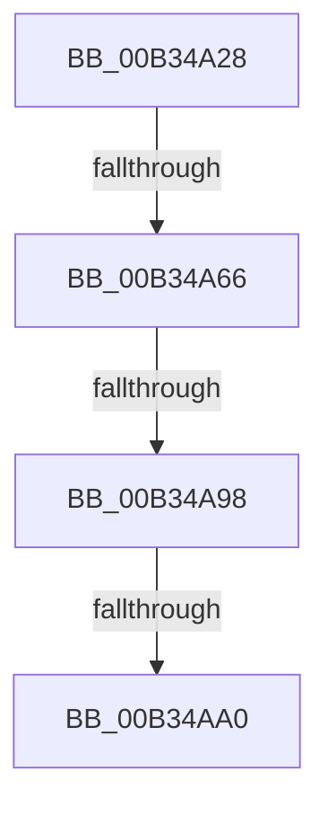

# sub_00B34A28

- RVA: `0x00B34A28`–`0x00B34AB3` (길이 `139` bytes)
- VA: `0x0000000140B34A28`
- 실행 섹션: `PAGE`
- PDB 이름 있음: `아니요`; PDB Function 태그: `아니요`
- unwind 정보 RVA: `0x000A87DC`
- 디코드: `36`개 명령, `139/139` bytes 표시
- 미해석 바이트: `0` (있으면 어셈블리에 `.byte`로 보존)

> 이 문서는 커널 이미지의 기계어와 PDB 기호를 분석해 생성했습니다. 4번과 5번은 함수 원형과 자료형을 바이너리 사용 방식에서 추정한 C 해석이며 원본 소스 복구 결과는 아닙니다.

## 1. Dependencies

- 직접 호출 지점: **2**; 고유 호출 대상: **2**
- 직접 호출자로 확인된 함수: **0**
- RIP 상대 이미지 참조: **0**

### Outgoing calls
- `0x00B34A56` → [CmGetMatchingDeviceListForSubkey](../82/CmGetMatchingDeviceListForSubkey_function_0082D5A0.md) (function, `0x0082D5A0`)
- `0x00B34A88` → [guard_dispatch_icall](../../text/6B/guard_dispatch_icall_function_006BAAD0.md) (function, `0x006BAAD0`)

### Direct callers
- 이 함수 시작 RVA로 연결되는 직접 call은 확인되지 않았습니다. 간접 호출은 완전히 역산할 수 없습니다.

### Static image references
- 디코드된 RIP-relative 메모리 참조가 없습니다.

## 2. Other-region calls and transfers

- 다른 실행 섹션으로 향하는 call: **1**
  - `0x00B34A88` → [guard_dispatch_icall](../../text/6B/guard_dispatch_icall_function_006BAAD0.md) (`PAGE` → `.text`)
- call이 아닌 외부 분기/꼬리 이동: **4**
  - `0x00B34A60` → [_CmGetMatchingDeviceList + 0xA8](../A0/_CmGetMatchingDeviceList_function_00A0951C.md) (`tail-transfer`)
  - `0x00B34A92` → [_CmGetMatchingDeviceList + 0xA8](../A0/_CmGetMatchingDeviceList_function_00A0951C.md) (`tail-transfer`)
  - `0x00B34A9A` → [_CmGetMatchingDeviceList + 0xA5](../A0/_CmGetMatchingDeviceList_function_00A0951C.md) (`tail-transfer`)
  - `0x00B34AAE` → [_CmGetMatchingDeviceList + 0xA8](../A0/_CmGetMatchingDeviceList_function_00A0951C.md) (`tail-transfer`)

## 3. Assembly (complete function range)

```asm
00B34A28  48 8B 45 CF                     mov rax, qword ptr [rbp - 0x31]
00B34A2C  45 33 C0                        xor r8d, r8d
00B34A2F  4C 8B 4D AF                     mov r9, qword ptr [rbp - 0x51]
00B34A33  33 D2                           xor edx, edx
00B34A35  48 89 44 24 38                  mov qword ptr [rsp + 0x38], rax
00B34A3A  49 8B CD                        mov rcx, r13
00B34A3D  8B 45 C7                        mov eax, dword ptr [rbp - 0x39]
00B34A40  89 44 24 30                     mov dword ptr [rsp + 0x30], eax
00B34A44  48 8B 45 BF                     mov rax, qword ptr [rbp - 0x41]
00B34A48  48 89 44 24 28                  mov qword ptr [rsp + 0x28], rax
00B34A4D  48 8B 45 B7                     mov rax, qword ptr [rbp - 0x49]
00B34A51  48 89 44 24 20                  mov qword ptr [rsp + 0x20], rax
00B34A56  E8 45 8B CF FF                  call 0x14082d5a0
00B34A5B  8B D8                           mov ebx, eax
00B34A5D  4D 85 FF                        test r15, r15
00B34A60  0F 84 5E 4B ED FF               je 0x140a095c4
00B34A66  48 8D 45 9F                     lea rax, [rbp - 0x61]
00B34A6A  89 5D 9F                        mov dword ptr [rbp - 0x61], ebx
00B34A6D  48 89 44 24 28                  mov qword ptr [rsp + 0x28], rax
00B34A72  45 8B CE                        mov r9d, r14d
00B34A75  49 8B C7                        mov rax, r15
00B34A78  C7 44 24 20 02 00 00 00         mov dword ptr [rsp + 0x20], 2
00B34A80  44 8B C6                        mov r8d, esi
00B34A83  33 D2                           xor edx, edx
00B34A85  49 8B CD                        mov rcx, r13
00B34A88  E8 43 60 B8 FF                  call 0x1406baad0
00B34A8D  3D 02 00 00 C0                  cmp eax, 0xc0000002
00B34A92  0F 84 2C 4B ED FF               je 0x140a095c4
00B34A98  3B C7                           cmp eax, edi
00B34A9A  0F 84 21 4B ED FF               je 0x140a095c1
00B34AA0  8B CB                           mov ecx, ebx
00B34AA2  85 C0                           test eax, eax
00B34AA4  BB E5 00 00 C0                  mov ebx, 0xc00000e5
00B34AA9  0F 45 CB                        cmovne ecx, ebx
00B34AAC  8B D9                           mov ebx, ecx
00B34AAE  E9 11 4B ED FF                  jmp 0x140a095c4
```

## 4. C-style interpretation (structured pseudocode)

```c
__int64 __fastcall sub_00B34A28(__int64 a1, int a2, int a3)
{
    __int64 result;
    unsigned __int64 v_stack_p20;
    unsigned __int64 v_stack_p28;
    unsigned int v_stack_p30;
    unsigned __int64 v_stack_p38;

    a3 = 0;
    a2 = 0;
    v_stack_p38 = *(unsigned __int64 *)(v_rbp - 49);
    v_stack_p30 = (unsigned int)((unsigned int)(*(unsigned int *)(v_rbp - 57)));
    v_stack_p28 = *(unsigned __int64 *)(v_rbp - 65);
    v_stack_p20 = *(unsigned __int64 *)(v_rbp - 73);
    result = CmGetMatchingDeviceListForSubkey(v_r13, a2, a3, *(unsigned __int64 *)(v_rbp - 81));
    *(unsigned int *)(v_rbp - 97) = (unsigned int)((unsigned int)((unsigned int)(result)));
    v_stack_p28 = v_rbp - 97;
    v_stack_p20 = 2;
    a2 = 0;
    result = guard_dispatch_icall(v_r13, a2, (unsigned int)((unsigned int)(v_rsi)), (unsigned int)((unsigned int)(v_r14)));
    a1 = (unsigned int)((unsigned int)((unsigned int)((unsigned int)(result))));
    if ((unsigned int)(result) != 0) { a1 = (unsigned int)((unsigned int)(0xC00000E5ULL)); }
}
```

## 5. (Beta) C Style

```c
int64_t sub_00B34A28(int64_t Arg1, int32_t Arg2, int32_t Arg3)
{
    int64_t result;
    uint64_t v_stack_p20;
    uint64_t v_stack_p28;
    uint32_t v_stack_p30;
    uint64_t v_stack_p38;

    Arg3 = 0;
    Arg2 = 0;
    v_stack_p38 = *(uint64_t *)(local_rbp - 0x31);
    v_stack_p30 = (uint32_t)((uint32_t)(*(uint32_t *)(local_rbp - 0x39)));
    v_stack_p28 = *(uint64_t *)(local_rbp - 0x41);
    v_stack_p20 = *(uint64_t *)(local_rbp - 0x49);
    result = CmGetMatchingDeviceListForSubkey(local_r13, Arg2, Arg3, *(uint64_t *)(local_rbp - 0x51));
    *(uint32_t *)(local_rbp - 0x61) = (uint32_t)((uint32_t)((uint32_t)(result)));
    v_stack_p28 = local_rbp - 97;
    v_stack_p20 = 2;
    Arg2 = 0;
    result = guard_dispatch_icall(local_r13, Arg2, (uint32_t)((uint32_t)(local_rsi)), (uint32_t)((uint32_t)(local_r14)));
    Arg1 = (uint32_t)((uint32_t)((uint32_t)((uint32_t)(result))));
    if ((uint32_t)(result) != 0) { Arg1 = (uint32_t)((uint32_t)(0xC00000E5ULL)); }
}
```

## 6. Execution-region graph

[열기: 2D/3D 그래프와 함수 탐색 컨트롤 패널](../../../control-panel.html?section=page&rva=0x00B34A28&view=graph)

- 2D 그래프는 위에서 아래로 흐르고, 3D 그래프는 빈 공간을 드래그해 회전합니다. Shift+드래그는 이동, 휠은 확대·축소, 함수 노드 선택은 대상 보고서 이동입니다.

### Static fallback


