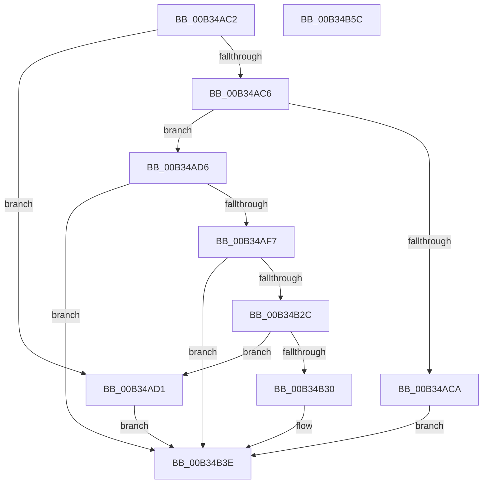

# sub_00B34AC2

- RVA: `0x00B34AC2`–`0x00B34B5D` (길이 `155` bytes)
- VA: `0x0000000140B34AC2`
- 실행 섹션: `PAGE`
- PDB 이름 있음: `아니요`; PDB Function 태그: `아니요`
- unwind 정보 RVA: `0x000A8858`
- 디코드: `51`개 명령, `155/155` bytes 표시
- 미해석 바이트: `0` (있으면 어셈블리에 `.byte`로 보존)

> 이 문서는 커널 이미지의 기계어와 PDB 기호를 분석해 생성했습니다. 4번과 5번은 함수 원형과 자료형을 바이너리 사용 방식에서 추정한 C 해석이며 원본 소스 복구 결과는 아닙니다.

## 1. Dependencies

- 직접 호출 지점: **3**; 고유 호출 대상: **3**
- 직접 호출자로 확인된 함수: **0**
- RIP 상대 이미지 참조: **0**

### Outgoing calls
- `0x00B34AEB` → [_CmDeleteDeviceRegKeyWorker](../A9/_CmDeleteDeviceRegKeyWorker_function_00A9200C.md) (function, `0x00A9200C`)
- `0x00B34B1E` → [guard_dispatch_icall](../../text/6B/guard_dispatch_icall_function_006BAAD0.md) (function, `0x006BAAD0`)
- `0x00B34B47` → [_security_check_cookie](../../text/6A/_security_check_cookie_function_006AC640.md) (function, `0x006AC640`)

### Direct callers
- 이 함수 시작 RVA로 연결되는 직접 call은 확인되지 않았습니다. 간접 호출은 완전히 역산할 수 없습니다.

### Static image references
- 디코드된 RIP-relative 메모리 참조가 없습니다.

## 2. Other-region calls and transfers

- 다른 실행 섹션으로 향하는 call: **2**
  - `0x00B34B1E` → [guard_dispatch_icall](../../text/6B/guard_dispatch_icall_function_006BAAD0.md) (`PAGE` → `.text`)
  - `0x00B34B47` → [_security_check_cookie](../../text/6A/_security_check_cookie_function_006AC640.md) (`PAGE` → `.text`)
- 별도 외부 분기/꼬리 이동을 확인하지 못했습니다.

## 3. Assembly (complete function range)

```asm
00B34AC2  3B C7                           cmp eax, edi
00B34AC4  74 0B                           je 0x140b34ad1
00B34AC6  85 C0                           test eax, eax
00B34AC8  74 0C                           je 0x140b34ad6
00B34ACA  BB E5 00 00 C0                  mov ebx, 0xc00000e5
00B34ACF  EB 6D                           jmp 0x140b34b3e
00B34AD1  8B 5D AF                        mov ebx, dword ptr [rbp - 0x51]
00B34AD4  EB 68                           jmp 0x140b34b3e
00B34AD6  8A 45 C7                        mov al, byte ptr [rbp - 0x39]
00B34AD9  49 8B D7                        mov rdx, r15
00B34ADC  44 8B 4D C3                     mov r9d, dword ptr [rbp - 0x3d]
00B34AE0  49 8B CE                        mov rcx, r14
00B34AE3  44 8B 45 BF                     mov r8d, dword ptr [rbp - 0x41]
00B34AE7  88 44 24 20                     mov byte ptr [rsp + 0x20], al
00B34AEB  E8 1C D5 F5 FF                  call 0x140a9200c
00B34AF0  8B D8                           mov ebx, eax
00B34AF2  48 85 F6                        test rsi, rsi
00B34AF5  74 47                           je 0x140b34b3e
00B34AF7  89 45 AF                        mov dword ptr [rbp - 0x51], eax
00B34AFA  41 B9 0C 00 00 00               mov r9d, 0xc
00B34B00  48 8D 45 AF                     lea rax, [rbp - 0x51]
00B34B04  49 8B D7                        mov rdx, r15
00B34B07  48 89 44 24 28                  mov qword ptr [rsp + 0x28], rax
00B34B0C  49 8B CE                        mov rcx, r14
00B34B0F  48 8B C6                        mov rax, rsi
00B34B12  C7 44 24 20 02 00 00 00         mov dword ptr [rsp + 0x20], 2
00B34B1A  45 8D 41 F5                     lea r8d, [r9 - 0xb]
00B34B1E  E8 AD 5F B8 FF                  call 0x1406baad0
00B34B23  8B C8                           mov ecx, eax
00B34B25  3D 02 00 00 C0                  cmp eax, 0xc0000002
00B34B2A  74 12                           je 0x140b34b3e
00B34B2C  3B C7                           cmp eax, edi
00B34B2E  74 A1                           je 0x140b34ad1
00B34B30  8B C3                           mov eax, ebx
00B34B32  85 C9                           test ecx, ecx
00B34B34  BB E5 00 00 C0                  mov ebx, 0xc00000e5
00B34B39  0F 45 C3                        cmovne eax, ebx
00B34B3C  8B D8                           mov ebx, eax
00B34B3E  8B C3                           mov eax, ebx
00B34B40  48 8B 4D 0F                     mov rcx, qword ptr [rbp + 0xf]
00B34B44  48 33 CC                        xor rcx, rsp
00B34B47  E8 F4 7A B7 FF                  call 0x1406ac640
00B34B4C  48 81 C4 B8 00 00 00            add rsp, 0xb8
00B34B53  41 5F                           pop r15
00B34B55  41 5E                           pop r14
00B34B57  5F                              pop rdi
00B34B58  5E                              pop rsi
00B34B59  5B                              pop rbx
00B34B5A  5D                              pop rbp
00B34B5B  C3                              ret
00B34B5C  CC                              int3
```

## 4. C-style interpretation (structured pseudocode)

```c
__int64 __fastcall sub_00B34AC2(void)
{
    __int64 result;
    __int64 v_rsp;
    unsigned __int8 v_stack_p20;
    unsigned __int64 v_stack_p28;

    if (((unsigned int)(result)) == ((unsigned int)(v_rdi))) goto loc_00B34AD1;
    if ((unsigned int)(result) == 0) goto loc_00B34AD6;
    goto loc_00B34B3E;
loc_00B34AD1:
    goto loc_00B34B3E;
loc_00B34AD6:
    v_stack_p20 = (unsigned __int8)(*(unsigned __int8 *)(v_rbp - 57));
    result = _CmDeleteDeviceRegKeyWorker(v_r14, v_r15, (unsigned int)(*(unsigned int *)(v_rbp - 65)), (unsigned int)(*(unsigned int *)(v_rbp - 61)));
    if (v_rsi == 0) goto loc_00B34B3E;
    *(unsigned int *)(v_rbp - 81) = (unsigned int)(result);
    v_stack_p28 = v_rbp - 81;
    v_stack_p20 = 2;
    result = guard_dispatch_icall(v_r14, v_r15, 12 - 11, 12);
    if (((unsigned int)(result)) == 0xC0000002ULL) goto loc_00B34B3E;
    if (((unsigned int)(result)) == ((unsigned int)(v_rdi))) goto loc_00B34AD1;
    result = (unsigned int)((unsigned int)((unsigned int)((unsigned int)(result))));
    if ((unsigned int)((unsigned int)((unsigned int)(result))) != 0) { result = (unsigned int)((unsigned int)(0xC00000E5ULL)); }
loc_00B34B3E:
    a1 = (*(unsigned __int64 *)(v_rbp + 15)) ^ (v_rsp);
    result = _security_check_cookie(a1, v_r15, 12 - 11, 12);
    v_rsp = (v_rsp) + (184);
    return result;
}
```

## 5. (Beta) C Style

```c
void sub_00B34AC2(void)
{
    int64_t result;
    int64_t local_rsp;
    uint8_t v_stack_p20;
    uint64_t v_stack_p28;

    if (((uint32_t)(result)) == ((uint32_t)(local_rdi))) goto loc_00B34AD1;
    if ((uint32_t)(result) == 0) goto loc_00B34AD6;
    goto loc_00B34B3E;
loc_00B34AD1:
    goto loc_00B34B3E;
loc_00B34AD6:
    v_stack_p20 = (uint8_t)(*(uint8_t *)(local_rbp - 0x39));
    result = _CmDeleteDeviceRegKeyWorker(local_r14, local_r15, (uint32_t)(*(uint32_t *)(local_rbp - 0x41)), (uint32_t)(*(uint32_t *)(local_rbp - 0x3D)));
    if (local_rsi == 0) goto loc_00B34B3E;
    *(uint32_t *)(local_rbp - 0x51) = (uint32_t)(result);
    v_stack_p28 = local_rbp - 81;
    v_stack_p20 = 2;
    result = guard_dispatch_icall(local_r14, local_r15, 12 - 11, 12);
    if (((uint32_t)(result)) == 0xC0000002ULL) goto loc_00B34B3E;
    if (((uint32_t)(result)) == ((uint32_t)(local_rdi))) goto loc_00B34AD1;
    result = (uint32_t)((uint32_t)((uint32_t)((uint32_t)(result))));
    if ((uint32_t)((uint32_t)((uint32_t)(result))) != 0) { result = (uint32_t)((uint32_t)(0xC00000E5ULL)); }
loc_00B34B3E:
    a1 = (*(uint64_t *)(local_rbp + 0xF)) ^ (local_rsp);
    result = _security_check_cookie(a1, local_r15, 12 - 11, 12);
    local_rsp = (local_rsp) + (184);
    return result;
}
```

## 6. Execution-region graph

[열기: 2D/3D 그래프와 함수 탐색 컨트롤 패널](../../../control-panel.html?section=page&rva=0x00B34AC2&view=graph)

- 2D 그래프는 위에서 아래로 흐르고, 3D 그래프는 빈 공간을 드래그해 회전합니다. Shift+드래그는 이동, 휠은 확대·축소, 함수 노드 선택은 대상 보고서 이동입니다.

### Static fallback


