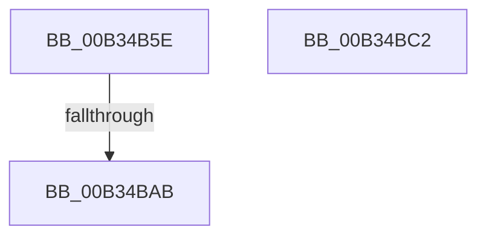

# sub_00B34B5E

- RVA: `0x00B34B5E`–`0x00B34BF3` (길이 `149` bytes)
- VA: `0x0000000140B34B5E`
- 실행 섹션: `PAGE`
- PDB 이름 있음: `아니요`; PDB Function 태그: `아니요`
- unwind 정보 RVA: `0x000A8888`
- 디코드: `36`개 명령, `149/149` bytes 표시
- 미해석 바이트: `0` (있으면 어셈블리에 `.byte`로 보존)

> 이 문서는 커널 이미지의 기계어와 PDB 기호를 분석해 생성했습니다. 4번과 5번은 함수 원형과 자료형을 바이너리 사용 방식에서 추정한 C 해석이며 원본 소스 복구 결과는 아닙니다.

## 1. Dependencies

- 직접 호출 지점: **4**; 고유 호출 대상: **4**
- 직접 호출자로 확인된 함수: **0**
- RIP 상대 이미지 참조: **2**

### Outgoing calls
- `0x00B34B94` → [PnpSetObjectProperty](../8F/PnpSetObjectProperty_function_008F66E8.md) (function, `0x008F66E8`)
- `0x00B34B9E` → [PipSendGuestAssignedNotification](../74/PipSendGuestAssignedNotification_function_007404B4.md) (function, `0x007404B4`)
- `0x00B34BB7` → [PnpRequestDeviceRemoval](../8F/PnpRequestDeviceRemoval_function_008FC294.md) (function, `0x008FC294`)
- `0x00B34BE8` → [PnpDeleteLockedDeviceNode](../A0/PnpDeleteLockedDeviceNode_function_00A09DC4.md) (function, `0x00A09DC4`)

### Direct callers
- 이 함수 시작 RVA로 연결되는 직접 call은 확인되지 않았습니다. 간접 호출은 완전히 역산할 수 없습니다.

### Static image references
- `0x00B34B62` → RVA `0x00027EC0` (`.rdata`; read)
- `0x00B34B8D` → RVA `0x00E66398` (`.data`; read)

## 2. Other-region calls and transfers

- 다른 실행 섹션으로 향하는 call: **0**
- call이 아닌 외부 분기/꼬리 이동: **3**
  - `0x00B34BA5` → [PnpDeleteLockedDeviceNodes + 0xDE](../A0/PnpDeleteLockedDeviceNodes_function_00A09B30.md) (`tail-transfer`)
  - `0x00B34BBD` → [PnpDeleteLockedDeviceNodes + 0xDE](../A0/PnpDeleteLockedDeviceNodes_function_00A09B30.md) (`tail-transfer`)
  - `0x00B34BEE` → [PnpDeleteLockedDeviceNodes + 0x1D0](../A0/PnpDeleteLockedDeviceNodes_function_00A09B30.md) (`tail-transfer`)

## 3. Assembly (complete function range)

```asm
00B34B5E  48 8B 53 30                     mov rdx, qword ptr [rbx + 0x30]
00B34B62  48 8D 05 57 33 4F FF            lea rax, [rip - 0xb0cca9]
00B34B69  33 C9                           xor ecx, ecx
00B34B6B  45 33 C9                        xor r9d, r9d
00B34B6E  89 4C 24 48                     mov dword ptr [rsp + 0x48], ecx
00B34B72  89 4C 24 40                     mov dword ptr [rsp + 0x40], ecx
00B34B76  48 89 4C 24 38                  mov qword ptr [rsp + 0x38], rcx
00B34B7B  89 4C 24 30                     mov dword ptr [rsp + 0x30], ecx
00B34B7F  44 8D 41 01                     lea r8d, [rcx + 1]
00B34B83  48 89 44 24 28                  mov qword ptr [rsp + 0x28], rax
00B34B88  48 89 4C 24 20                  mov qword ptr [rsp + 0x20], rcx
00B34B8D  48 8B 0D 04 18 33 00            mov rcx, qword ptr [rip + 0x331804]
00B34B94  E8 4F 1B DC FF                  call 0x1408f66e8
00B34B99  33 D2                           xor edx, edx
00B34B9B  48 8B CB                        mov rcx, rbx
00B34B9E  E8 11 B9 C0 FF                  call 0x1407404b4
00B34BA3  85 C0                           test eax, eax
00B34BA5  0F 89 63 50 ED FF               jns 0x140a09c0e
00B34BAB  33 D2                           xor edx, edx
00B34BAD  44 8B C8                        mov r9d, eax
00B34BB0  48 8B CB                        mov rcx, rbx
00B34BB3  44 8D 42 39                     lea r8d, [rdx + 0x39]
00B34BB7  E8 D8 76 DC FF                  call 0x1408fc294
00B34BBC  90                              nop
00B34BBD  E9 4C 50 ED FF                  jmp 0x140a09c0e
00B34BC2  33 C9                           xor ecx, ecx
00B34BC4  48 8B 84 24 C8 00 00 00         mov rax, qword ptr [rsp + 0xc8]
00B34BCC  45 33 C9                        xor r9d, r9d
00B34BCF  48 89 44 24 28                  mov qword ptr [rsp + 0x28], rax
00B34BD4  45 33 C0                        xor r8d, r8d
00B34BD7  48 8B 84 24 C0 00 00 00         mov rax, qword ptr [rsp + 0xc0]
00B34BDF  48 89 44 24 20                  mov qword ptr [rsp + 0x20], rax
00B34BE4  41 8D 51 01                     lea edx, [r9 + 1]
00B34BE8  E8 D7 51 ED FF                  call 0x140a09dc4
00B34BED  90                              nop
00B34BEE  E9 0D 51 ED FF                  jmp 0x140a09d00
```

## 4. C-style interpretation (structured pseudocode)

```c
__int64 __fastcall sub_00B34B5E(int a1, __int64 a2, __int64 a3, int a4)
{
    __int64 result;
    unsigned __int64 v_stack_p20;
    unsigned __int64 v_stack_p28;
    unsigned int v_stack_p30;
    unsigned __int64 v_stack_p38;
    unsigned int v_stack_p40;
    unsigned int v_stack_p48;
    unsigned __int64 v_stack_pC0;
    unsigned __int64 v_stack_pC8;

    a1 = 0;
    a4 = 0;
    v_stack_p48 = 0;
    v_stack_p40 = 0;
    v_stack_p38 = 0;
    v_stack_p30 = 0;
    v_stack_p28 = v_rip - 11586729;
    v_stack_p20 = 0;
    result = PnpSetObjectProperty(*(unsigned __int64 *)(v_rip + 3348484), *(unsigned __int64 *)(v_rbx + 48), a1 + 1, a4);
    a2 = 0;
    result = PipSendGuestAssignedNotification(v_rbx, a2, a1 + 1, a4);
    a2 = 0;
    result = PnpRequestDeviceRemoval(v_rbx, a2, a2 + 57, (unsigned int)((unsigned int)(result)));
}
```

## 5. (Beta) C Style

```c
int64_t sub_00B34B5E(int32_t Arg1, int64_t Arg2, int64_t Arg3, int32_t Arg4)
{
    int64_t result;
    uint64_t v_stack_p20;
    uint64_t v_stack_p28;
    uint32_t v_stack_p30;
    uint64_t v_stack_p38;
    uint32_t v_stack_p40;
    uint32_t v_stack_p48;
    uint64_t v_stack_pC0;
    uint64_t v_stack_pC8;

    Arg1 = 0;
    Arg4 = 0;
    v_stack_p48 = 0;
    v_stack_p40 = 0;
    v_stack_p38 = 0;
    v_stack_p30 = 0;
    v_stack_p28 = v_rip - 11586729;
    v_stack_p20 = 0;
    result = PnpSetObjectProperty(*(uint64_t *)(v_rip + 0x331804), *(uint64_t *)(local_rbx + 0x30), Arg1 + 1, Arg4);
    Arg2 = 0;
    result = PipSendGuestAssignedNotification(local_rbx, Arg2, Arg1 + 1, Arg4);
    Arg2 = 0;
    result = PnpRequestDeviceRemoval(local_rbx, Arg2, Arg2 + 57, (uint32_t)((uint32_t)(result)));
}
```

## 6. Execution-region graph

[열기: 2D/3D 그래프와 함수 탐색 컨트롤 패널](../../../control-panel.html?section=page&rva=0x00B34B5E&view=graph)

- 2D 그래프는 위에서 아래로 흐르고, 3D 그래프는 빈 공간을 드래그해 회전합니다. Shift+드래그는 이동, 휠은 확대·축소, 함수 노드 선택은 대상 보고서 이동입니다.

### Static fallback


