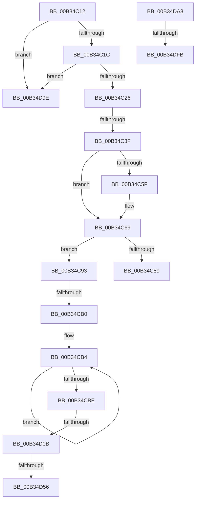

# sub_00B34C12

- RVA: `0x00B34C12`–`0x00B34E9C` (길이 `650` bytes)
- VA: `0x0000000140B34C12`
- 실행 섹션: `PAGE`
- PDB 이름 있음: `아니요`; PDB Function 태그: `아니요`
- unwind 정보 RVA: `0x000A8908`
- 디코드: `150`개 명령, `650/650` bytes 표시
- 미해석 바이트: `0` (있으면 어셈블리에 `.byte`로 보존)

> 이 문서는 커널 이미지의 기계어와 PDB 기호를 분석해 생성했습니다. 4번과 5번은 함수 원형과 자료형을 바이너리 사용 방식에서 추정한 C 해석이며 원본 소스 복구 결과는 아닙니다.

## 1. Dependencies

- 직접 호출 지점: **11**; 고유 호출 대상: **6**
- 직접 호출자로 확인된 함수: **0**
- RIP 상대 이미지 참조: **4**

### Outgoing calls
- `0x00B34C30` → [CmGetParentDeviceContainerId](../A0/CmGetParentDeviceContainerId_function_00A0AF08.md) (function, `0x00A0AF08`)
- `0x00B34C42` → [_CmGetDevicePanelGroup](../A0/_CmGetDevicePanelGroup_function_00A0B618.md) (function, `0x00A0B618`)
- `0x00B34C7C` → [ExAllocatePool2](../../poolcode/B8/ExAllocatePool2_function_00B820F0.md) (function, `0x00B820F0`)
- `0x00B34CA1` → [CmBuildDevicePanelId](../A0/CmBuildDevicePanelId_function_00A0B008.md) (function, `0x00A0B008`)
- `0x00B34CFC` → [PnpSetObjectProperty](../8F/PnpSetObjectProperty_function_008F66E8.md) (function, `0x008F66E8`)
- `0x00B34D47` → [PnpSetObjectProperty](../8F/PnpSetObjectProperty_function_008F66E8.md) (function, `0x008F66E8`)
- `0x00B34D92` → [PnpSetObjectProperty](../8F/PnpSetObjectProperty_function_008F66E8.md) (function, `0x008F66E8`)
- `0x00B34DEB` → [PnpGetObjectProperty](../8E/PnpGetObjectProperty_function_008E2180.md) (function, `0x008E2180`)
- `0x00B34E25` → [PnpSetObjectProperty](../8F/PnpSetObjectProperty_function_008F66E8.md) (function, `0x008F66E8`)
- `0x00B34E5B` → [PnpSetObjectProperty](../8F/PnpSetObjectProperty_function_008F66E8.md) (function, `0x008F66E8`)
- `0x00B34E91` → [PnpSetObjectProperty](../8F/PnpSetObjectProperty_function_008F66E8.md) (function, `0x008F66E8`)

### Direct callers
- 이 함수 시작 RVA로 연결되는 직접 call은 확인되지 않았습니다. 간접 호출은 완전히 역산할 수 없습니다.

### Static image references
- `0x00B34C5F` → RVA `0x000421D0` (`.rdata`; read)
- `0x00B34CCE` → RVA `0x000115A0` (`.rdata`; read)
- `0x00B34D28` → RVA `0x00014E10` (`.rdata`; read)
- `0x00B34D73` → RVA `0x00014E28` (`.rdata`; read)

## 2. Other-region calls and transfers

- 다른 실행 섹션으로 향하는 call: **1**
  - `0x00B34C7C` → [ExAllocatePool2](../../poolcode/B8/ExAllocatePool2_function_00B820F0.md) (`PAGE` → `POOLCODE`)
- call이 아닌 외부 분기/꼬리 이동: **9**
  - `0x00B34C39` → [_CmUpdateDevicePanelInterface + 0x15F](../A0/_CmUpdateDevicePanelInterface_function_00A09FC4.md) (`tail-transfer`)
  - `0x00B34C8E` → [_CmUpdateDevicePanelInterface + 0x15F](../A0/_CmUpdateDevicePanelInterface_function_00A09FC4.md) (`tail-transfer`)
  - `0x00B34CAA` → [_CmUpdateDevicePanelInterface + 0x15F](../A0/_CmUpdateDevicePanelInterface_function_00A09FC4.md) (`tail-transfer`)
  - `0x00B34D05` → [_CmUpdateDevicePanelInterface + 0x15F](../A0/_CmUpdateDevicePanelInterface_function_00A09FC4.md) (`tail-transfer`)
  - `0x00B34D50` → [_CmUpdateDevicePanelInterface + 0x15F](../A0/_CmUpdateDevicePanelInterface_function_00A09FC4.md) (`tail-transfer`)
  - `0x00B34D99` → [_CmUpdateDevicePanelInterface + 0x15F](../A0/_CmUpdateDevicePanelInterface_function_00A09FC4.md) (`tail-transfer`)
  - `0x00B34DA3` → [_CmUpdateDevicePanelInterface + 0x15F](../A0/_CmUpdateDevicePanelInterface_function_00A09FC4.md) (`tail-transfer`)
  - `0x00B34DF5` → [_CmUpdateDevicePanelInterface + 0xAE](../A0/_CmUpdateDevicePanelInterface_function_00A09FC4.md) (`tail-transfer`)
  - `0x00B34E97` → [_CmUpdateDevicePanelInterface + 0xAE](../A0/_CmUpdateDevicePanelInterface_function_00A09FC4.md) (`tail-transfer`)

## 3. Assembly (complete function range)

```asm
00B34C12  83 7D F3 12                     cmp dword ptr [rbp - 0xd], 0x12
00B34C16  0F 85 82 01 00 00               jne 0x140b34d9e
00B34C1C  83 7D EF 02                     cmp dword ptr [rbp - 0x11], 2
00B34C20  0F 82 78 01 00 00               jb 0x140b34d9e
00B34C26  4C 8D 45 0F                     lea r8, [rbp + 0xf]
00B34C2A  49 8B D4                        mov rdx, r12
00B34C2D  48 8B CE                        mov rcx, rsi
00B34C30  E8 D3 62 ED FF                  call 0x140a0af08
00B34C35  8B D8                           mov ebx, eax
00B34C37  85 C0                           test eax, eax
00B34C39  0F 88 E4 54 ED FF               js 0x140a0a123
00B34C3F  49 8B CE                        mov rcx, r14
00B34C42  E8 D1 69 ED FF                  call 0x140a0b618
00B34C47  89 45 E7                        mov dword ptr [rbp - 0x19], eax
00B34C4A  41 8B 46 08                     mov eax, dword ptr [r14 + 8]
00B34C4E  45 33 F6                        xor r14d, r14d
00B34C51  C1 E8 03                        shr eax, 3
00B34C54  41 8B CE                        mov ecx, r14d
00B34C57  83 E0 07                        and eax, 7
00B34C5A  83 F8 07                        cmp eax, 7
00B34C5D  73 0A                           jae 0x140b34c69
00B34C5F  48 8D 0D 6A D5 50 FF            lea rcx, [rip - 0xaf2a96]
00B34C66  8B 0C 81                        mov ecx, dword ptr [rcx + rax*4]
00B34C69  89 4D EB                        mov dword ptr [rbp - 0x15], ecx
00B34C6C  BA 72 00 00 00                  mov edx, 0x72
00B34C71  B9 00 01 00 00                  mov ecx, 0x100
00B34C76  41 B8 50 4E 50 52               mov r8d, 0x52504e50
00B34C7C  E8 6F D4 04 00                  call 0x140b820f0
00B34C81  48 8B F8                        mov rdi, rax
00B34C84  48 85 C0                        test rax, rax
00B34C87  75 0A                           jne 0x140b34c93
00B34C89  BB 17 00 00 C0                  mov ebx, 0xc0000017
00B34C8E  E9 90 54 ED FF                  jmp 0x140a0a123
00B34C93  44 8B 45 EB                     mov r8d, dword ptr [rbp - 0x15]
00B34C97  48 8D 4D 0F                     lea rcx, [rbp + 0xf]
00B34C9B  8B 55 E7                        mov edx, dword ptr [rbp - 0x19]
00B34C9E  4C 8B CF                        mov r9, rdi
00B34CA1  E8 62 63 ED FF                  call 0x140a0b008
00B34CA6  8B D8                           mov ebx, eax
00B34CA8  85 C0                           test eax, eax
00B34CAA  0F 88 73 54 ED FF               js 0x140a0a123
00B34CB0  48 83 C8 FF                     or rax, 0xffffffffffffffff
00B34CB4  48 FF C0                        inc rax
00B34CB7  66 44 39 34 47                  cmp word ptr [rdi + rax*2], r14w
00B34CBC  75 F6                           jne 0x140b34cb4
00B34CBE  44 89 74 24 48                  mov dword ptr [rsp + 0x48], r14d
00B34CC3  8D 04 45 02 00 00 00            lea eax, [rax*2 + 2]
00B34CCA  89 44 24 40                     mov dword ptr [rsp + 0x40], eax
00B34CCE  4C 8D 35 CB C8 4D FF            lea r14, [rip - 0xb23735]
00B34CD5  48 89 7C 24 38                  mov qword ptr [rsp + 0x38], rdi
00B34CDA  4D 8B CD                        mov r9, r13
00B34CDD  C7 44 24 30 12 00 00 00         mov dword ptr [rsp + 0x30], 0x12
00B34CE5  49 8B D7                        mov rdx, r15
00B34CE8  4C 89 74 24 28                  mov qword ptr [rsp + 0x28], r14
00B34CED  48 8B CE                        mov rcx, rsi
00B34CF0  45 33 F6                        xor r14d, r14d
00B34CF3  4C 89 74 24 20                  mov qword ptr [rsp + 0x20], r14
00B34CF8  45 8D 46 03                     lea r8d, [r14 + 3]
00B34CFC  E8 E7 19 DC FF                  call 0x1408f66e8
00B34D01  8B D8                           mov ebx, eax
00B34D03  85 C0                           test eax, eax
00B34D05  0F 88 18 54 ED FF               js 0x140a0a123
00B34D0B  44 89 74 24 48                  mov dword ptr [rsp + 0x48], r14d
00B34D10  48 8D 45 E7                     lea rax, [rbp - 0x19]
00B34D14  C7 44 24 40 04 00 00 00         mov dword ptr [rsp + 0x40], 4
00B34D1C  45 8D 46 03                     lea r8d, [r14 + 3]
00B34D20  48 89 44 24 38                  mov qword ptr [rsp + 0x38], rax
00B34D25  4D 8B CD                        mov r9, r13
00B34D28  48 8D 05 E1 00 4E FF            lea rax, [rip - 0xb1ff1f]
00B34D2F  C7 44 24 30 07 00 00 00         mov dword ptr [rsp + 0x30], 7
00B34D37  48 89 44 24 28                  mov qword ptr [rsp + 0x28], rax
00B34D3C  49 8B D7                        mov rdx, r15
00B34D3F  48 8B CE                        mov rcx, rsi
00B34D42  4C 89 74 24 20                  mov qword ptr [rsp + 0x20], r14
00B34D47  E8 9C 19 DC FF                  call 0x1408f66e8
00B34D4C  8B D8                           mov ebx, eax
00B34D4E  85 C0                           test eax, eax
00B34D50  0F 88 CD 53 ED FF               js 0x140a0a123
00B34D56  44 89 74 24 48                  mov dword ptr [rsp + 0x48], r14d
00B34D5B  48 8D 45 EB                     lea rax, [rbp - 0x15]
00B34D5F  C7 44 24 40 04 00 00 00         mov dword ptr [rsp + 0x40], 4
00B34D67  45 8D 46 03                     lea r8d, [r14 + 3]
00B34D6B  48 89 44 24 38                  mov qword ptr [rsp + 0x38], rax
00B34D70  4D 8B CD                        mov r9, r13
00B34D73  48 8D 05 AE 00 4E FF            lea rax, [rip - 0xb1ff52]
00B34D7A  C7 44 24 30 07 00 00 00         mov dword ptr [rsp + 0x30], 7
00B34D82  48 89 44 24 28                  mov qword ptr [rsp + 0x28], rax
00B34D87  49 8B D7                        mov rdx, r15
00B34D8A  48 8B CE                        mov rcx, rsi
00B34D8D  4C 89 74 24 20                  mov qword ptr [rsp + 0x20], r14
00B34D92  E8 51 19 DC FF                  call 0x1408f66e8
00B34D97  8B D8                           mov ebx, eax
00B34D99  E9 85 53 ED FF                  jmp 0x140a0a123
00B34D9E  BB 01 00 00 C0                  mov ebx, 0xc0000001
00B34DA3  E9 7B 53 ED FF                  jmp 0x140a0a123
00B34DA8  44 89 64 24 50                  mov dword ptr [rsp + 0x50], r12d
00B34DAD  48 8D 45 EF                     lea rax, [rbp - 0x11]
00B34DB1  48 89 44 24 48                  mov qword ptr [rsp + 0x48], rax
00B34DB6  4C 8D 35 E3 C7 4D FF            lea r14, [rip - 0xb2381d]
00B34DBD  44 89 64 24 40                  mov dword ptr [rsp + 0x40], r12d
00B34DC2  48 8D 45 F3                     lea rax, [rbp - 0xd]
00B34DC6  4C 89 64 24 38                  mov qword ptr [rsp + 0x38], r12
00B34DCB  BF 03 00 00 00                  mov edi, 3
00B34DD0  48 89 44 24 30                  mov qword ptr [rsp + 0x30], rax
00B34DD5  4D 8B CD                        mov r9, r13
00B34DD8  4C 89 74 24 28                  mov qword ptr [rsp + 0x28], r14
00B34DDD  44 8B C7                        mov r8d, edi
00B34DE0  49 8B D7                        mov rdx, r15
00B34DE3  4C 89 64 24 20                  mov qword ptr [rsp + 0x20], r12
00B34DE8  48 8B CE                        mov rcx, rsi
00B34DEB  E8 90 D3 DA FF                  call 0x1408e2180
00B34DF0  3D 23 00 00 C0                  cmp eax, 0xc0000023
00B34DF5  0F 85 77 52 ED FF               jne 0x140a0a072
00B34DFB  44 89 64 24 48                  mov dword ptr [rsp + 0x48], r12d
00B34E00  45 33 C9                        xor r9d, r9d
00B34E03  44 89 64 24 40                  mov dword ptr [rsp + 0x40], r12d
00B34E08  44 8B C7                        mov r8d, edi
00B34E0B  4C 89 64 24 38                  mov qword ptr [rsp + 0x38], r12
00B34E10  49 8B D7                        mov rdx, r15
00B34E13  44 89 64 24 30                  mov dword ptr [rsp + 0x30], r12d
00B34E18  48 8B CE                        mov rcx, rsi
00B34E1B  4C 89 74 24 28                  mov qword ptr [rsp + 0x28], r14
00B34E20  4C 89 64 24 20                  mov qword ptr [rsp + 0x20], r12
00B34E25  E8 BE 18 DC FF                  call 0x1408f66e8
00B34E2A  44 89 64 24 48                  mov dword ptr [rsp + 0x48], r12d
00B34E2F  48 8D 05 DA FF 4D FF            lea rax, [rip - 0xb20026]
00B34E36  44 89 64 24 40                  mov dword ptr [rsp + 0x40], r12d
00B34E3B  45 33 C9                        xor r9d, r9d
00B34E3E  4C 89 64 24 38                  mov qword ptr [rsp + 0x38], r12
00B34E43  44 8B C7                        mov r8d, edi
00B34E46  44 89 64 24 30                  mov dword ptr [rsp + 0x30], r12d
00B34E4B  49 8B D7                        mov rdx, r15
00B34E4E  48 89 44 24 28                  mov qword ptr [rsp + 0x28], rax
00B34E53  48 8B CE                        mov rcx, rsi
00B34E56  4C 89 64 24 20                  mov qword ptr [rsp + 0x20], r12
00B34E5B  E8 88 18 DC FF                  call 0x1408f66e8
00B34E60  44 89 64 24 48                  mov dword ptr [rsp + 0x48], r12d
00B34E65  48 8D 05 BC FF 4D FF            lea rax, [rip - 0xb20044]
00B34E6C  44 89 64 24 40                  mov dword ptr [rsp + 0x40], r12d
00B34E71  45 33 C9                        xor r9d, r9d
00B34E74  4C 89 64 24 38                  mov qword ptr [rsp + 0x38], r12
00B34E79  44 8B C7                        mov r8d, edi
00B34E7C  44 89 64 24 30                  mov dword ptr [rsp + 0x30], r12d
00B34E81  49 8B D7                        mov rdx, r15
00B34E84  48 89 44 24 28                  mov qword ptr [rsp + 0x28], rax
00B34E89  48 8B CE                        mov rcx, rsi
00B34E8C  4C 89 64 24 20                  mov qword ptr [rsp + 0x20], r12
00B34E91  E8 52 18 DC FF                  call 0x1408f66e8
00B34E96  90                              nop
00B34E97  E9 D6 51 ED FF                  jmp 0x140a0a072
```

## 4. C-style interpretation (structured pseudocode)

```c
__int64 __fastcall sub_00B34C12(void)
{
    __int64 result;
    __int64 v_r14;
    unsigned __int64 v_stack_p20;
    unsigned __int64 v_stack_p28;
    unsigned int v_stack_p30;
    unsigned __int64 v_stack_p38;
    unsigned int v_stack_p40;
    unsigned int v_stack_p48;
    unsigned int v_stack_p50;

    if ((*(unsigned int *)(v_rbp - 13)) != 18) goto loc_00B34D9E;
    if ((*(unsigned int *)(v_rbp - 17)) < 2) goto loc_00B34D9E;
    result = CmGetParentDeviceContainerId(v_rsi, v_r12, v_rbp + 15, a4);
    result = _CmGetDevicePanelGroup(v_r14, v_r12, v_rbp + 15, a4);
    *(unsigned int *)(v_rbp - 25) = (unsigned int)(result);
    v_r14 = 0;
    result = (unsigned int)(((unsigned int)(*(unsigned int *)(v_r14 + 8))) >> (3));
    result = (unsigned int)((result) & (7));
    if (((unsigned int)(result)) < 7) {
        a1 = v_rip - 11479702;
        a1 = *(unsigned int *)(a1 + result * 4);
    }
    *(unsigned int *)(v_rbp - 21) = (unsigned int)(a1);
    result = ExAllocatePool2(256, 114, (unsigned int)(0x52504E50ULL), a4);
    if (result != 0) goto loc_00B34C93;
loc_00B34C93:
    result = CmBuildDevicePanelId(v_rbp + 15, (unsigned int)(*(unsigned int *)(v_rbp - 25)), (unsigned int)(*(unsigned int *)(v_rbp - 21)), result);
    result = (result) | (-1);
loc_00B34CB4:
    result = (result) + 1;
    if ((*(unsigned __int16 *)(result + result * 2)) != 0) goto loc_00B34CB4;
    v_stack_p48 = 0;
    v_stack_p40 = (unsigned int)(result * 2 + 2);
    v_stack_p38 = result;
    v_stack_p30 = 18;
    v_stack_p28 = v_rip - 11679541;
    v_r14 = 0;
    v_stack_p20 = 0;
    result = PnpSetObjectProperty(v_rsi, v_r15, v_r14 + 3, v_r13);
    v_stack_p48 = 0;
    v_stack_p40 = 4;
    v_stack_p38 = v_rbp - 25;
    v_stack_p30 = 7;
    v_stack_p28 = v_rip - 11665183;
    v_stack_p20 = 0;
    result = PnpSetObjectProperty(v_rsi, v_r15, v_r14 + 3, v_r13);
    v_stack_p48 = 0;
    v_stack_p40 = 4;
    v_stack_p38 = v_rbp - 21;
    v_stack_p30 = 7;
    v_stack_p28 = v_rip - 11665234;
    v_stack_p20 = 0;
    result = PnpSetObjectProperty(v_rsi, v_r15, v_r14 + 3, v_r13);
loc_00B34D9E:
}
```

## 5. (Beta) C Style

```c
void sub_00B34C12(void)
{
    int64_t result;
    int64_t local_r14;
    uint64_t v_stack_p20;
    uint64_t v_stack_p28;
    uint32_t v_stack_p30;
    uint64_t v_stack_p38;
    uint32_t v_stack_p40;
    uint32_t v_stack_p48;
    uint32_t v_stack_p50;

    if ((*(uint32_t *)(local_rbp - 0xD)) != 18) goto loc_00B34D9E;
    if ((*(uint32_t *)(local_rbp - 0x11)) < 2) goto loc_00B34D9E;
    result = CmGetParentDeviceContainerId(local_rsi, local_r12, local_rbp + 15, a4);
    result = _CmGetDevicePanelGroup(local_r14, local_r12, local_rbp + 15, a4);
    *(uint32_t *)(local_rbp - 0x19) = (uint32_t)(result);
    local_r14 = 0;
    result = (uint32_t)(((uint32_t)(*(uint32_t *)(local_r14 + 0x8))) >> (3));
    result = (uint32_t)((result) & (7));
    if (((uint32_t)(result)) < 7) {
        a1 = v_rip - 11479702;
        a1 = *(uint32_t *)(a1 + result * 4);
    }
    *(uint32_t *)(local_rbp - 0x15) = (uint32_t)(a1);
    result = ExAllocatePool2(256, 114, (uint32_t)(0x52504E50ULL), a4);
    if (result != 0) goto loc_00B34C93;
loc_00B34C93:
    result = CmBuildDevicePanelId(local_rbp + 15, (uint32_t)(*(uint32_t *)(local_rbp - 0x19)), (uint32_t)(*(uint32_t *)(local_rbp - 0x15)), result);
    result = (result) | (-1);
loc_00B34CB4:
    result = (result) + 1;
    if ((*(uint16_t *)(result + result * 2)) != 0) goto loc_00B34CB4;
    v_stack_p48 = 0;
    v_stack_p40 = (uint32_t)(result * 2 + 2);
    v_stack_p38 = result;
    v_stack_p30 = 18;
    v_stack_p28 = v_rip - 11679541;
    local_r14 = 0;
    v_stack_p20 = 0;
    result = PnpSetObjectProperty(local_rsi, local_r15, local_r14 + 3, local_r13);
    v_stack_p48 = 0;
    v_stack_p40 = 4;
    v_stack_p38 = local_rbp - 25;
    v_stack_p30 = 7;
    v_stack_p28 = v_rip - 11665183;
    v_stack_p20 = 0;
    result = PnpSetObjectProperty(local_rsi, local_r15, local_r14 + 3, local_r13);
    v_stack_p48 = 0;
    v_stack_p40 = 4;
    v_stack_p38 = local_rbp - 21;
    v_stack_p30 = 7;
    v_stack_p28 = v_rip - 11665234;
    v_stack_p20 = 0;
    result = PnpSetObjectProperty(local_rsi, local_r15, local_r14 + 3, local_r13);
loc_00B34D9E:
}
```

## 6. Execution-region graph

[열기: 2D/3D 그래프와 함수 탐색 컨트롤 패널](../../../control-panel.html?section=page&rva=0x00B34C12&view=graph)

- 2D 그래프는 위에서 아래로 흐르고, 3D 그래프는 빈 공간을 드래그해 회전합니다. Shift+드래그는 이동, 휠은 확대·축소, 함수 노드 선택은 대상 보고서 이동입니다.

### Static fallback


