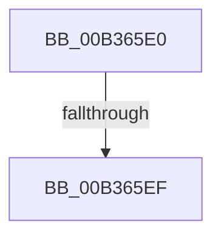

# sub_00B365E0

- RVA: `0x00B365E0`–`0x00B36614` (길이 `52` bytes)
- VA: `0x0000000140B365E0`
- 실행 섹션: `PAGE`
- PDB 이름 있음: `아니요`; PDB Function 태그: `아니요`
- unwind 정보 RVA: `0x000A89C4`
- 디코드: `13`개 명령, `52/52` bytes 표시
- 미해석 바이트: `0` (있으면 어셈블리에 `.byte`로 보존)

> 이 문서는 커널 이미지의 기계어와 PDB 기호를 분석해 생성했습니다. 4번과 5번은 함수 원형과 자료형을 바이너리 사용 방식에서 추정한 C 해석이며 원본 소스 복구 결과는 아닙니다.

## 1. Dependencies

- 직접 호출 지점: **2**; 고유 호출 대상: **2**
- 직접 호출자로 확인된 함수: **0**
- RIP 상대 이미지 참조: **0**

### Outgoing calls
- `0x00B365E0` → [CmDeleteDeviceMappedPropertyFromInstanceKeyRegValue](../82/CmDeleteDeviceMappedPropertyFromInstanceKeyRegValue_function_0082FA68.md) (function, `0x0082FA68`)
- `0x00B36609` → [PnpObjectRaisePropertyChangeEvent](../8F/PnpObjectRaisePropertyChangeEvent_function_008F7E94.md) (function, `0x008F7E94`)

### Direct callers
- 이 함수 시작 RVA로 연결되는 직접 call은 확인되지 않았습니다. 간접 호출은 완전히 역산할 수 없습니다.

### Static image references
- 디코드된 RIP-relative 메모리 참조가 없습니다.

## 2. Other-region calls and transfers

- 다른 실행 섹션으로 향하는 call: **0**
- call이 아닌 외부 분기/꼬리 이동: **2**
  - `0x00B365E9` → [_CmSetDeviceMappedProperty + 0x22F](../A0/_CmSetDeviceMappedProperty_function_00A0B098.md) (`tail-transfer`)
  - `0x00B3660F` → [_CmSetDeviceMappedProperty + 0x160](../A0/_CmSetDeviceMappedProperty_function_00A0B098.md) (`tail-transfer`)

## 3. Assembly (complete function range)

```asm
00B365E0  E8 83 94 CF FF                  call 0x14082fa68
00B365E5  8B D8                           mov ebx, eax
00B365E7  85 C0                           test eax, eax
00B365E9  0F 88 D8 4C ED FF               js 0x140a0b2c7
00B365EF  48 89 7C 24 28                  mov qword ptr [rsp + 0x28], rdi
00B365F4  4D 8B CF                        mov r9, r15
00B365F7  48 83 64 24 20 00               and qword ptr [rsp + 0x20], 0
00B365FD  41 B8 01 00 00 00               mov r8d, 1
00B36603  48 8B D6                        mov rdx, rsi
00B36606  48 8B CD                        mov rcx, rbp
00B36609  E8 86 18 DC FF                  call 0x1408f7e94
00B3660E  90                              nop
00B3660F  E9 E4 4B ED FF                  jmp 0x140a0b1f8
```

## 4. C-style interpretation (structured pseudocode)

```c
__int64 __fastcall sub_00B365E0(void)
{
    __int64 result;
    unsigned __int64 v_stack_p20;
    unsigned __int64 v_stack_p28;

    result = CmDeleteDeviceMappedPropertyFromInstanceKeyRegValue(a1, a2, a3, a4);
    v_stack_p28 = v_rdi;
    result = PnpObjectRaisePropertyChangeEvent(v_rbp, v_rsi, 1, v_r15);
}
```

## 5. (Beta) C Style

```c
void sub_00B365E0(void)
{
    int64_t result;
    uint64_t v_stack_p20;
    uint64_t v_stack_p28;

    result = CmDeleteDeviceMappedPropertyFromInstanceKeyRegValue(a1, a2, a3, a4);
    v_stack_p28 = local_rdi;
    result = PnpObjectRaisePropertyChangeEvent(local_rbp, local_rsi, 1, local_r15);
}
```

## 6. Execution-region graph

[열기: 2D/3D 그래프와 함수 탐색 컨트롤 패널](../../../control-panel.html?section=page&rva=0x00B365E0&view=graph)

- 2D 그래프는 위에서 아래로 흐르고, 3D 그래프는 빈 공간을 드래그해 회전합니다. Shift+드래그는 이동, 휠은 확대·축소, 함수 노드 선택은 대상 보고서 이동입니다.

### Static fallback


