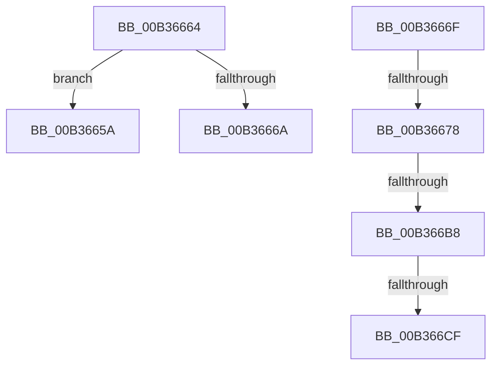

# sub_00B3665A

- RVA: `0x00B3665A`–`0x00B366FF` (길이 `165` bytes)
- VA: `0x0000000140B3665A`
- 실행 섹션: `PAGE`
- PDB 이름 있음: `아니요`; PDB Function 태그: `아니요`
- unwind 정보 RVA: `0x000A8A28`
- 디코드: `40`개 명령, `165/165` bytes 표시
- 미해석 바이트: `0` (있으면 어셈블리에 `.byte`로 보존)

> 이 문서는 커널 이미지의 기계어와 PDB 기호를 분석해 생성했습니다. 4번과 5번은 함수 원형과 자료형을 바이너리 사용 방식에서 추정한 C 해석이며 원본 소스 복구 결과는 아닙니다.

## 1. Dependencies

- 직접 호출 지점: **4**; 고유 호출 대상: **4**
- 직접 호출자로 확인된 함수: **0**
- RIP 상대 이미지 참조: **2**

### Outgoing calls
- `0x00B3667F` → [RtlTimeToTimeFields](../../text/42/RtlTimeToTimeFields_function_0042E0F0.md) (function, `0x0042E0F0`)
- `0x00B366AB` → [RtlStringCchPrintfW](../../text/48/RtlStringCchPrintfW_function_00482D5C.md) (function, `0x00482D5C`)
- `0x00B366C2` → [RtlUnalignedStringCchLengthW](../../text/40/RtlUnalignedStringCchLengthW_function_0040DE30.md) (function, `0x0040DE30`)
- `0x00B366F4` → [PnpCtxRegSetValue](../99/PnpCtxRegSetValue_function_00991B8C.md) (function, `0x00991B8C`)

### Direct callers
- 이 함수 시작 RVA로 연결되는 직접 call은 확인되지 않았습니다. 간접 호출은 완전히 역산할 수 없습니다.

### Static image references
- `0x00B36688` → RVA `0x00B0D980` (` ?? ::NNGAKEGL::`string'`; read)
- `0x00B366DB` → RVA `0x00AFEEF0` (` ?? ::NNGAKEGL::`string'`; read)

## 2. Other-region calls and transfers

- 다른 실행 섹션으로 향하는 call: **3**
  - `0x00B3667F` → [RtlTimeToTimeFields](../../text/42/RtlTimeToTimeFields_function_0042E0F0.md) (`PAGE` → `.text`)
  - `0x00B366AB` → [RtlStringCchPrintfW](../../text/48/RtlStringCchPrintfW_function_00482D5C.md) (`PAGE` → `.text`)
  - `0x00B366C2` → [RtlUnalignedStringCchLengthW](../../text/40/RtlUnalignedStringCchLengthW_function_0040DE30.md) (`PAGE` → `.text`)
- call이 아닌 외부 분기/꼬리 이동: **6**
  - `0x00B3665F` → [_CmSetDeviceMappedPropertyFromDriverKeyRegValue + 0xF9](../A0/_CmSetDeviceMappedPropertyFromDriverKeyRegValue_function_00A0B488.md) (`tail-transfer`)
  - `0x00B3666A` → [_CmSetDeviceMappedPropertyFromDriverKeyRegValue + 0x8D](../A0/_CmSetDeviceMappedPropertyFromDriverKeyRegValue_function_00A0B488.md) (`tail-transfer`)
  - `0x00B36672` → [_CmSetDeviceMappedPropertyFromDriverKeyRegValue + 0xEB](../A0/_CmSetDeviceMappedPropertyFromDriverKeyRegValue_function_00A0B488.md) (`tail-transfer`)
  - `0x00B366B2` → [_CmSetDeviceMappedPropertyFromDriverKeyRegValue + 0xEB](../A0/_CmSetDeviceMappedPropertyFromDriverKeyRegValue_function_00A0B488.md) (`tail-transfer`)
  - `0x00B366C9` → [_CmSetDeviceMappedPropertyFromDriverKeyRegValue + 0xEB](../A0/_CmSetDeviceMappedPropertyFromDriverKeyRegValue_function_00A0B488.md) (`tail-transfer`)
  - `0x00B366FA` → [_CmSetDeviceMappedPropertyFromDriverKeyRegValue + 0xEB](../A0/_CmSetDeviceMappedPropertyFromDriverKeyRegValue_function_00A0B488.md) (`tail-transfer`)

## 3. Assembly (complete function range)

```asm
00B3665A  BB 0D 00 00 C0                  mov ebx, 0xc000000d
00B3665F  E9 1D 4F ED FF                  jmp 0x140a0b581
00B36664  41 83 FA 02                     cmp r10d, 2
00B36668  73 F0                           jae 0x140b3665a
00B3666A  E9 A6 4E ED FF                  jmp 0x140a0b515
00B3666F  48 85 C0                        test rax, rax
00B36672  0F 85 FB 4E ED FF               jne 0x140a0b573
00B36678  48 8D 55 D0                     lea rdx, [rbp - 0x30]
00B3667C  49 8B CE                        mov rcx, r14
00B3667F  E8 6C 7A 8F FF                  call 0x14042e0f0
00B36684  0F BF 45 D0                     movsx eax, word ptr [rbp - 0x30]
00B36688  4C 8D 05 F1 72 FD FF            lea r8, [rip - 0x28d0f]
00B3668F  0F BF 4D D4                     movsx ecx, word ptr [rbp - 0x2c]
00B36693  BF 0B 00 00 00                  mov edi, 0xb
00B36698  44 0F BF 4D D2                  movsx r9d, word ptr [rbp - 0x2e]
00B3669D  8B D7                           mov edx, edi
00B3669F  89 44 24 28                     mov dword ptr [rsp + 0x28], eax
00B366A3  89 4C 24 20                     mov dword ptr [rsp + 0x20], ecx
00B366A7  48 8D 4D E0                     lea rcx, [rbp - 0x20]
00B366AB  E8 AC C6 94 FF                  call 0x140482d5c
00B366B0  85 C0                           test eax, eax
00B366B2  0F 88 BB 4E ED FF               js 0x140a0b573
00B366B8  4C 8D 45 C8                     lea r8, [rbp - 0x38]
00B366BC  8B D7                           mov edx, edi
00B366BE  48 8D 4D E0                     lea rcx, [rbp - 0x20]
00B366C2  E8 69 77 8D FF                  call 0x14040de30
00B366C7  85 C0                           test eax, eax
00B366C9  0F 88 A4 4E ED FF               js 0x140a0b573
00B366CF  48 8B 45 C8                     mov rax, qword ptr [rbp - 0x38]
00B366D3  44 8D 4F F6                     lea r9d, [rdi - 0xa]
00B366D7  48 8B 55 C0                     mov rdx, qword ptr [rbp - 0x40]
00B366DB  4C 8D 05 0E 88 FC FF            lea r8, [rip - 0x377f2]
00B366E2  48 FF C0                        inc rax
00B366E5  03 C0                           add eax, eax
00B366E7  89 44 24 28                     mov dword ptr [rsp + 0x28], eax
00B366EB  48 8D 45 E0                     lea rax, [rbp - 0x20]
00B366EF  48 89 44 24 20                  mov qword ptr [rsp + 0x20], rax
00B366F4  E8 93 B4 E5 FF                  call 0x140991b8c
00B366F9  90                              nop
00B366FA  E9 74 4E ED FF                  jmp 0x140a0b573
```

## 4. C-style interpretation (structured pseudocode)

```c
__int64 __fastcall sub_00B3665A(void)
{
    unsigned int v_stack_p20;
    unsigned int v_stack_p28;
}
```

## 5. (Beta) C Style

```c
void sub_00B3665A(void)
{
    uint32_t v_stack_p20;
    uint32_t v_stack_p28;
}
```

## 6. Execution-region graph

[열기: 2D/3D 그래프와 함수 탐색 컨트롤 패널](../../../control-panel.html?section=page&rva=0x00B3665A&view=graph)

- 2D 그래프는 위에서 아래로 흐르고, 3D 그래프는 빈 공간을 드래그해 회전합니다. Shift+드래그는 이동, 휠은 확대·축소, 함수 노드 선택은 대상 보고서 이동입니다.

### Static fallback


