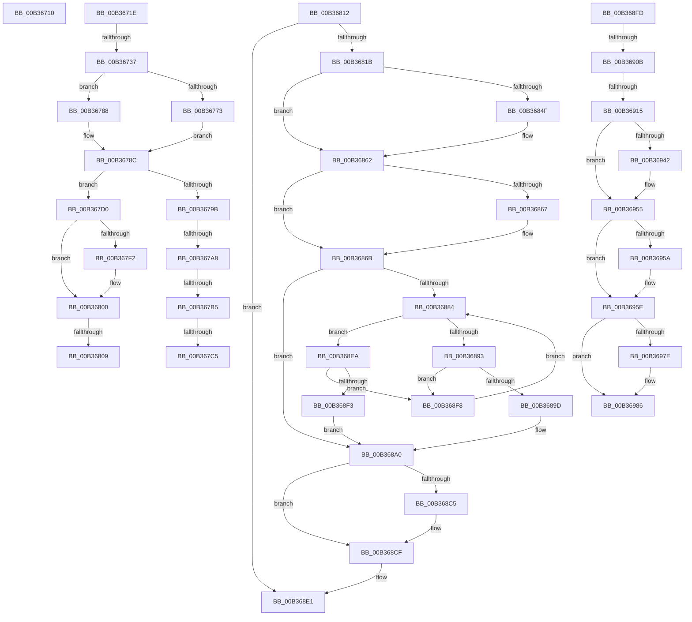

# sub_00B36710

- RVA: `0x00B36710`–`0x00B3699C` (길이 `652` bytes)
- VA: `0x0000000140B36710`
- 실행 섹션: `PAGE`
- PDB 이름 있음: `아니요`; PDB Function 태그: `아니요`
- unwind 정보 RVA: `0x000A8C1C`
- 디코드: `167`개 명령, `652/652` bytes 표시
- 미해석 바이트: `0` (있으면 어셈블리에 `.byte`로 보존)

> 이 문서는 커널 이미지의 기계어와 PDB 기호를 분석해 생성했습니다. 4번과 5번은 함수 원형과 자료형을 바이너리 사용 방식에서 추정한 C 해석이며 원본 소스 복구 결과는 아닙니다.

## 1. Dependencies

- 직접 호출 지점: **20**; 고유 호출 대상: **11**
- 직접 호출자로 확인된 함수: **0**
- RIP 상대 이미지 참조: **0**

### Outgoing calls
- `0x00B36721` → [KeAbPostRelease](../../text/2E/KeAbPostRelease_function_002E1600.md) (function, `0x002E1600`)
- `0x00B36729` → [KiLeaveCriticalRegionUnsafe](../../text/25/KiLeaveCriticalRegionUnsafe_function_0025F010.md) (function, `0x0025F010`)
- `0x00B3676A` → [KeWaitForSingleObject](../../text/20/KeWaitForSingleObject_function_0020E6B0.md) (function, `0x0020E6B0`)
- `0x00B3677E` → [PspRemoveEnclaveThreadWait](../78/PspRemoveEnclaveThreadWait_function_00788CB0.md) (function, `0x00788CB0`)
- `0x00B36791` → [ExFreePoolWithTag](../../poolcode/B8/ExFreePoolWithTag_function_00B82870.md) (function, `0x00B82870`)
- `0x00B367E1` → [KeAbPreAcquire](../../text/21/KeAbPreAcquire_function_00210230.md) (function, `0x00210230`)
- `0x00B367FB` → [ExfAcquirePushLockExclusiveEx](../../text/20/ExfAcquirePushLockExclusiveEx_function_0020FC90.md) (function, `0x0020FC90`)
- `0x00B3683C` → [KeAbPreAcquire](../../text/21/KeAbPreAcquire_function_00210230.md) (function, `0x00210230`)
- `0x00B36858` → [ExfAcquirePushLockExclusiveEx](../../text/20/ExfAcquirePushLockExclusiveEx_function_0020FC90.md) (function, `0x0020FC90`)
- `0x00B3688A` → [PspFindVsmEnclaveThread](../A0/PspFindVsmEnclaveThread_function_00A0D5F0.md) (function, `0x00A0D5F0`)
- `0x00B368AB` → [RtlAvlInsertNodeEx](../../text/26/RtlAvlInsertNodeEx_function_00265790.md) (function, `0x00265790`)
- `0x00B368CA` → [ExfTryToWakePushLock](../../text/26/ExfTryToWakePushLock_function_00265DD0.md) (function, `0x00265DD0`)
- `0x00B368D4` → [KeAbPostRelease](../../text/2E/KeAbPostRelease_function_002E1600.md) (function, `0x002E1600`)
- `0x00B368DC` → [KiLeaveCriticalRegionUnsafe](../../text/25/KiLeaveCriticalRegionUnsafe_function_0025F010.md) (function, `0x0025F010`)
- `0x00B3692F` → [KeAbPreAcquire](../../text/21/KeAbPreAcquire_function_00210230.md) (function, `0x00210230`)
- `0x00B3694B` → [ExfAcquirePushLockExclusiveEx](../../text/20/ExfAcquirePushLockExclusiveEx_function_0020FC90.md) (function, `0x0020FC90`)
- `0x00B3696A` → [RtlAvlRemoveNode](../../text/29/RtlAvlRemoveNode_function_00296650.md) (function, `0x00296650`)
- `0x00B36981` → [ExfTryToWakePushLock](../../text/26/ExfTryToWakePushLock_function_00265DD0.md) (function, `0x00265DD0`)
- `0x00B36989` → [KeAbPostRelease](../../text/2E/KeAbPostRelease_function_002E1600.md) (function, `0x002E1600`)
- `0x00B36991` → [KiLeaveCriticalRegionUnsafe](../../text/25/KiLeaveCriticalRegionUnsafe_function_0025F010.md) (function, `0x0025F010`)

### Direct callers
- 이 함수 시작 RVA로 연결되는 직접 call은 확인되지 않았습니다. 간접 호출은 완전히 역산할 수 없습니다.

### Static image references
- 디코드된 RIP-relative 메모리 참조가 없습니다.

## 2. Other-region calls and transfers

- 다른 실행 섹션으로 향하는 call: **18**
  - `0x00B36721` → [KeAbPostRelease](../../text/2E/KeAbPostRelease_function_002E1600.md) (`PAGE` → `.text`)
  - `0x00B36729` → [KiLeaveCriticalRegionUnsafe](../../text/25/KiLeaveCriticalRegionUnsafe_function_0025F010.md) (`PAGE` → `.text`)
  - `0x00B3676A` → [KeWaitForSingleObject](../../text/20/KeWaitForSingleObject_function_0020E6B0.md) (`PAGE` → `.text`)
  - `0x00B36791` → [ExFreePoolWithTag](../../poolcode/B8/ExFreePoolWithTag_function_00B82870.md) (`PAGE` → `POOLCODE`)
  - `0x00B367E1` → [KeAbPreAcquire](../../text/21/KeAbPreAcquire_function_00210230.md) (`PAGE` → `.text`)
  - `0x00B367FB` → [ExfAcquirePushLockExclusiveEx](../../text/20/ExfAcquirePushLockExclusiveEx_function_0020FC90.md) (`PAGE` → `.text`)
  - `0x00B3683C` → [KeAbPreAcquire](../../text/21/KeAbPreAcquire_function_00210230.md) (`PAGE` → `.text`)
  - `0x00B36858` → [ExfAcquirePushLockExclusiveEx](../../text/20/ExfAcquirePushLockExclusiveEx_function_0020FC90.md) (`PAGE` → `.text`)
  - `0x00B368AB` → [RtlAvlInsertNodeEx](../../text/26/RtlAvlInsertNodeEx_function_00265790.md) (`PAGE` → `.text`)
  - `0x00B368CA` → [ExfTryToWakePushLock](../../text/26/ExfTryToWakePushLock_function_00265DD0.md) (`PAGE` → `.text`)
  - `0x00B368D4` → [KeAbPostRelease](../../text/2E/KeAbPostRelease_function_002E1600.md) (`PAGE` → `.text`)
  - `0x00B368DC` → [KiLeaveCriticalRegionUnsafe](../../text/25/KiLeaveCriticalRegionUnsafe_function_0025F010.md) (`PAGE` → `.text`)
  - `0x00B3692F` → [KeAbPreAcquire](../../text/21/KeAbPreAcquire_function_00210230.md) (`PAGE` → `.text`)
  - `0x00B3694B` → [ExfAcquirePushLockExclusiveEx](../../text/20/ExfAcquirePushLockExclusiveEx_function_0020FC90.md) (`PAGE` → `.text`)
  - `0x00B3696A` → [RtlAvlRemoveNode](../../text/29/RtlAvlRemoveNode_function_00296650.md) (`PAGE` → `.text`)
  - `0x00B36981` → [ExfTryToWakePushLock](../../text/26/ExfTryToWakePushLock_function_00265DD0.md) (`PAGE` → `.text`)
  - `0x00B36989` → [KeAbPostRelease](../../text/2E/KeAbPostRelease_function_002E1600.md) (`PAGE` → `.text`)
  - `0x00B36991` → [KiLeaveCriticalRegionUnsafe](../../text/25/KiLeaveCriticalRegionUnsafe_function_0025F010.md) (`PAGE` → `.text`)
- call이 아닌 외부 분기/꼬리 이동: **12**
  - `0x00B36719` → [PsCallEnclave + 0x566](../A0/PsCallEnclave_function_00A0CF50.md) (`tail-transfer`)
  - `0x00B36731` → [PsCallEnclave + 0x37F](../A0/PsCallEnclave_function_00A0CF50.md) (`tail-transfer`)
  - `0x00B367A2` → [PsCallEnclave + 0x37F](../A0/PsCallEnclave_function_00A0CF50.md) (`tail-transfer`)
  - `0x00B367AF` → [PsCallEnclave + 0x37F](../A0/PsCallEnclave_function_00A0CF50.md) (`tail-transfer`)
  - `0x00B367BF` → [PsCallEnclave + 0x37F](../A0/PsCallEnclave_function_00A0CF50.md) (`tail-transfer`)
  - `0x00B367CB` → [PsCallEnclave + 0x37F](../A0/PsCallEnclave_function_00A0CF50.md) (`tail-transfer`)
  - `0x00B36803` → [PsCallEnclave + 0x57C](../A0/PsCallEnclave_function_00A0CF50.md) (`tail-transfer`)
  - `0x00B3680D` → [PsCallEnclave + 0x57C](../A0/PsCallEnclave_function_00A0CF50.md) (`tail-transfer`)
  - `0x00B368E5` → [PsCallEnclave + 0x36F](../A0/PsCallEnclave_function_00A0CF50.md) (`tail-transfer`)
  - `0x00B36905` → [PsCallEnclave + 0x36F](../A0/PsCallEnclave_function_00A0CF50.md) (`tail-transfer`)
  - `0x00B3690F` → [PsCallEnclave + 0x36F](../A0/PsCallEnclave_function_00A0CF50.md) (`tail-transfer`)
  - `0x00B36997` → [PsCallEnclave + 0x36F](../A0/PsCallEnclave_function_00A0CF50.md) (`tail-transfer`)

## 3. Assembly (complete function range)

```asm
00B36710  FF C8                           dec eax
00B36712  41 89 40 48                     mov dword ptr [r8 + 0x48], eax
00B36716  44 8B FF                        mov r15d, edi
00B36719  E9 98 6D ED FF                  jmp 0x140a0d4b6
00B3671E  49 8B CC                        mov rcx, r12
00B36721  E8 DA AE 7A FF                  call 0x1402e1600
00B36726  49 8B CE                        mov rcx, r14
00B36729  E8 E2 88 72 FF                  call 0x14025f010
00B3672E  45 85 FF                        test r15d, r15d
00B36731  0F 88 98 6B ED FF               js 0x140a0d2cf
00B36737  8B 84 24 00 01 00 00            mov eax, dword ptr [rsp + 0x100]
00B3673E  41 22 C5                        and al, r13b
00B36741  F6 D8                           neg al
00B36743  48 1B D2                        sbb rdx, rdx
00B36746  48 8D 84 24 A8 00 00 00         lea rax, [rsp + 0xa8]
00B3674E  48 23 D0                        and rdx, rax
00B36751  48 8B B4 24 88 00 00 00         mov rsi, qword ptr [rsp + 0x88]
00B36759  48 8D 4E 10                     lea rcx, [rsi + 0x10]
00B3675D  48 89 54 24 20                  mov qword ptr [rsp + 0x20], rdx
00B36762  45 33 C9                        xor r9d, r9d
00B36765  45 8A C5                        mov r8b, r13b
00B36768  33 D2                           xor edx, edx
00B3676A  E8 41 7F 6D FF                  call 0x14020e6b0
00B3676F  85 C0                           test eax, eax
00B36771  74 15                           je 0x140b36788
00B36773  44 8B C0                        mov r8d, eax
00B36776  48 8B D6                        mov rdx, rsi
00B36779  48 8B 4C 24 58                  mov rcx, qword ptr [rsp + 0x58]
00B3677E  E8 2D 25 C5 FF                  call 0x140788cb0
00B36783  44 8B F8                        mov r15d, eax
00B36786  EB 04                           jmp 0x140b3678c
00B36788  44 8B 7E 28                     mov r15d, dword ptr [rsi + 0x28]
00B3678C  33 D2                           xor edx, edx
00B3678E  48 8B CE                        mov rcx, rsi
00B36791  E8 DA C0 04 00                  call 0x140b82870
00B36796  45 85 FF                        test r15d, r15d
00B36799  74 35                           je 0x140b367d0
00B3679B  41 81 FF C0 00 00 00            cmp r15d, 0xc0
00B367A2  0F 84 27 6B ED FF               je 0x140a0d2cf
00B367A8  41 81 FF 12 05 00 C0            cmp r15d, 0xc0000512
00B367AF  0F 84 1A 6B ED FF               je 0x140a0d2cf
00B367B5  41 8D 87 FF FE FF FF            lea eax, [r15 - 0x101]
00B367BC  41 3B C5                        cmp eax, r13d
00B367BF  0F 86 0A 6B ED FF               jbe 0x140a0d2cf
00B367C5  41 BF 4B 00 00 C0               mov r15d, 0xc000004b
00B367CB  E9 FF 6A ED FF                  jmp 0x140a0d2cf
00B367D0  66 41 01 9E E4 01 00 00         add word ptr [r14 + 0x1e4], bx
00B367D8  90                              nop
00B367D9  45 33 C0                        xor r8d, r8d
00B367DC  33 D2                           xor edx, edx
00B367DE  49 8B CC                        mov rcx, r12
00B367E1  E8 4A 9A 6D FF                  call 0x140210230
00B367E6  48 8B F0                        mov rsi, rax
00B367E9  F0 49 0F BA 2C 24 00            lock bts qword ptr [r12], 0
00B367F0  73 0E                           jae 0x140b36800
00B367F2  4D 8B C4                        mov r8, r12
00B367F5  48 8B D0                        mov rdx, rax
00B367F8  49 8B CC                        mov rcx, r12
00B367FB  E8 90 94 6D FF                  call 0x14020fc90
00B36800  48 85 F6                        test rsi, rsi
00B36803  0F 84 C3 6C ED FF               je 0x140a0d4cc
00B36809  44 88 6E 0A                     mov byte ptr [rsi + 0xa], r13b
00B3680D  E9 BA 6C ED FF                  jmp 0x140a0d4cc
00B36812  39 7E 24                        cmp dword ptr [rsi + 0x24], edi
00B36815  0F 85 C6 00 00 00               jne 0x140b368e1
00B3681B  8B 44 24 68                     mov eax, dword ptr [rsp + 0x68]
00B3681F  89 46 20                        mov dword ptr [rsi + 0x20], eax
00B36822  66 41 01 9E E4 01 00 00         add word ptr [r14 + 0x1e4], bx
00B3682A  90                              nop
00B3682B  4C 8B 64 24 58                  mov r12, qword ptr [rsp + 0x58]
00B36830  49 83 C4 70                     add r12, 0x70
00B36834  45 33 C0                        xor r8d, r8d
00B36837  33 D2                           xor edx, edx
00B36839  49 8B CC                        mov rcx, r12
00B3683C  E8 EF 99 6D FF                  call 0x140210230
00B36841  48 89 44 24 60                  mov qword ptr [rsp + 0x60], rax
00B36846  F0 49 0F BA 2C 24 00            lock bts qword ptr [r12], 0
00B3684D  73 13                           jae 0x140b36862
00B3684F  4D 8B C4                        mov r8, r12
00B36852  48 8B D0                        mov rdx, rax
00B36855  49 8B CC                        mov rcx, r12
00B36858  E8 33 94 6D FF                  call 0x14020fc90
00B3685D  48 8B 44 24 60                  mov rax, qword ptr [rsp + 0x60]
00B36862  48 85 C0                        test rax, rax
00B36865  74 04                           je 0x140b3686b
00B36867  44 88 68 0A                     mov byte ptr [rax + 0xa], r13b
00B3686B  48 8B 54 24 58                  mov rdx, qword ptr [rsp + 0x58]
00B36870  48 83 C2 68                     add rdx, 0x68
00B36874  48 89 54 24 60                  mov qword ptr [rsp + 0x60], rdx
00B36879  4C 8B 22                        mov r12, qword ptr [rdx]
00B3687C  44 8A C7                        mov r8b, dil
00B3687F  4D 85 E4                        test r12, r12
00B36882  74 1C                           je 0x140b368a0
00B36884  49 8B D4                        mov rdx, r12
00B36887  49 8B CE                        mov rcx, r14
00B3688A  E8 61 6D ED FF                  call 0x140a0d5f0
00B3688F  85 C0                           test eax, eax
00B36891  78 57                           js 0x140b368ea
00B36893  49 8B 44 24 08                  mov rax, qword ptr [r12 + 8]
00B36898  48 85 C0                        test rax, rax
00B3689B  75 5B                           jne 0x140b368f8
00B3689D  45 8A C5                        mov r8b, r13b
00B368A0  4C 8B CE                        mov r9, rsi
00B368A3  49 8B D4                        mov rdx, r12
00B368A6  48 8B 4C 24 60                  mov rcx, qword ptr [rsp + 0x60]
00B368AB  E8 E0 EE 72 FF                  call 0x140265790
00B368B0  4C 8B 64 24 58                  mov r12, qword ptr [rsp + 0x58]
00B368B5  48 8B C3                        mov rax, rbx
00B368B8  F0 49 0F C1 44 24 70            lock xadd qword ptr [r12 + 0x70], rax
00B368BF  24 06                           and al, 6
00B368C1  3C 02                           cmp al, 2
00B368C3  75 0A                           jne 0x140b368cf
00B368C5  49 8D 4C 24 70                  lea rcx, [r12 + 0x70]
00B368CA  E8 01 F5 72 FF                  call 0x140265dd0
00B368CF  49 8D 4C 24 70                  lea rcx, [r12 + 0x70]
00B368D4  E8 27 AD 7A FF                  call 0x1402e1600
00B368D9  49 8B CE                        mov rcx, r14
00B368DC  E8 2F 87 72 FF                  call 0x14025f010
00B368E1  44 01 6E 24                     add dword ptr [rsi + 0x24], r13d
00B368E5  E9 D5 69 ED FF                  jmp 0x140a0d2bf
00B368EA  49 8B 04 24                     mov rax, qword ptr [r12]
00B368EE  48 85 C0                        test rax, rax
00B368F1  75 05                           jne 0x140b368f8
00B368F3  44 8A C7                        mov r8b, dil
00B368F6  EB A8                           jmp 0x140b368a0
00B368F8  4C 8B E0                        mov r12, rax
00B368FB  EB 87                           jmp 0x140b36884
00B368FD  48 39 BC 24 F8 00 00 00         cmp qword ptr [rsp + 0xf8], rdi
00B36905  0F 84 B4 69 ED FF               je 0x140a0d2bf
00B3690B  83 46 24 FF                     add dword ptr [rsi + 0x24], -1
00B3690F  0F 85 AA 69 ED FF               jne 0x140a0d2bf
00B36915  66 41 01 9E E4 01 00 00         add word ptr [r14 + 0x1e4], bx
00B3691D  90                              nop
00B3691E  4C 8B 64 24 58                  mov r12, qword ptr [rsp + 0x58]
00B36923  49 83 C4 70                     add r12, 0x70
00B36927  45 33 C0                        xor r8d, r8d
00B3692A  33 D2                           xor edx, edx
00B3692C  49 8B CC                        mov rcx, r12
00B3692F  E8 FC 98 6D FF                  call 0x140210230
00B36934  48 89 44 24 70                  mov qword ptr [rsp + 0x70], rax
00B36939  F0 49 0F BA 2C 24 00            lock bts qword ptr [r12], 0
00B36940  73 13                           jae 0x140b36955
00B36942  4D 8B C4                        mov r8, r12
00B36945  48 8B D0                        mov rdx, rax
00B36948  49 8B CC                        mov rcx, r12
00B3694B  E8 40 93 6D FF                  call 0x14020fc90
00B36950  48 8B 44 24 70                  mov rax, qword ptr [rsp + 0x70]
00B36955  48 85 C0                        test rax, rax
00B36958  74 04                           je 0x140b3695e
00B3695A  44 88 68 0A                     mov byte ptr [rax + 0xa], r13b
00B3695E  48 8B 4C 24 58                  mov rcx, qword ptr [rsp + 0x58]
00B36963  48 83 C1 68                     add rcx, 0x68
00B36967  48 8B D6                        mov rdx, rsi
00B3696A  E8 E1 FC 75 FF                  call 0x140296650
00B3696F  48 8B C3                        mov rax, rbx
00B36972  F0 49 0F C1 04 24               lock xadd qword ptr [r12], rax
00B36978  24 06                           and al, 6
00B3697A  3C 02                           cmp al, 2
00B3697C  75 08                           jne 0x140b36986
00B3697E  49 8B CC                        mov rcx, r12
00B36981  E8 4A F4 72 FF                  call 0x140265dd0
00B36986  49 8B CC                        mov rcx, r12
00B36989  E8 72 AC 7A FF                  call 0x1402e1600
00B3698E  49 8B CE                        mov rcx, r14
00B36991  E8 7A 86 72 FF                  call 0x14025f010
00B36996  90                              nop
00B36997  E9 23 69 ED FF                  jmp 0x140a0d2bf
```

## 4. C-style interpretation (structured pseudocode)

```c
__int64 __fastcall sub_00B36710(__int64 a1, __int64 a2, __int64 a3, int a4)
{
    __int64 result;
    unsigned int v_stack_p100;
    unsigned __int64 v_stack_p20;
    unsigned __int64 v_stack_p58;
    unsigned __int64 v_stack_p60;
    unsigned int v_stack_p68;
    unsigned __int64 v_stack_p70;
    unsigned __int64 v_stack_p88;
    unsigned __int64 v_stack_pA8;
    unsigned __int64 v_stack_pF8;

    result = (unsigned int)((result) - 1);
    *(unsigned int *)(a3 + 72) = (unsigned int)(result);
}
```

## 5. (Beta) C Style

```c
int64_t sub_00B36710(int64_t Arg1, int64_t Arg2, void *Arg3, int32_t Arg4)
{
    uint8_t *arg3 = (uint8_t *)Arg3;

    int64_t result;
    uint32_t v_stack_p100;
    uint64_t v_stack_p20;
    uint64_t v_stack_p58;
    uint64_t v_stack_p60;
    uint32_t v_stack_p68;
    uint64_t v_stack_p70;
    uint64_t v_stack_p88;
    uint64_t v_stack_pA8;
    uint64_t v_stack_pF8;

    result = (uint32_t)((result) - 1);
    *(uint32_t *)(arg3 + 0x48) = (uint32_t)(result);
}
```

### 관측된 메모리 오프셋

구조체 형식이 확인되지 않은 접근은 인자 기준의 오프셋으로만 기록했습니다.

| 기준 인자 | 오프셋 표현 | 폭 (bit) | 접근 |
|---|---:|---:|---|
| `Arg3` | `+ 0x48` | `32` | `W` |

## 6. Execution-region graph

[열기: 2D/3D 그래프와 함수 탐색 컨트롤 패널](../../../control-panel.html?section=page&rva=0x00B36710&view=graph)

- 2D 그래프는 위에서 아래로 흐르고, 3D 그래프는 빈 공간을 드래그해 회전합니다. Shift+드래그는 이동, 휠은 확대·축소, 함수 노드 선택은 대상 보고서 이동입니다.

### Static fallback


