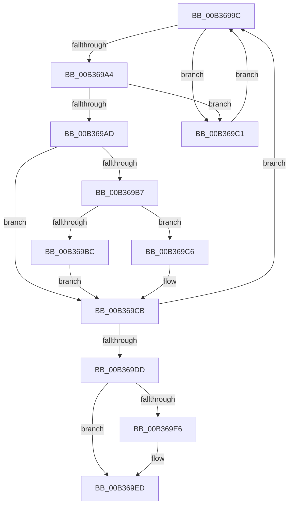

# sub_00B3699C

- RVA: `0x00B3699C`–`0x00B369FD` (길이 `97` bytes)
- VA: `0x0000000140B3699C`
- 실행 섹션: `PAGE`
- PDB 이름 있음: `아니요`; PDB Function 태그: `아니요`
- unwind 정보 RVA: `0x000A8C4C`
- 디코드: `32`개 명령, `97/97` bytes 표시
- 미해석 바이트: `0` (있으면 어셈블리에 `.byte`로 보존)

> 이 문서는 커널 이미지의 기계어와 PDB 기호를 분석해 생성했습니다. 4번과 5번은 함수 원형과 자료형을 바이너리 사용 방식에서 추정한 C 해석이며 원본 소스 복구 결과는 아닙니다.

## 1. Dependencies

- 직접 호출 지점: **3**; 고유 호출 대상: **1**
- 직접 호출자로 확인된 함수: **0**
- RIP 상대 이미지 참조: **0**

### Outgoing calls
- `0x00B369D0` → [ExFreePoolWithTag](../../poolcode/B8/ExFreePoolWithTag_function_00B82870.md) (function, `0x00B82870`)
- `0x00B369E8` → [ExFreePoolWithTag](../../poolcode/B8/ExFreePoolWithTag_function_00B82870.md) (function, `0x00B82870`)
- `0x00B369F2` → [ExFreePoolWithTag](../../poolcode/B8/ExFreePoolWithTag_function_00B82870.md) (function, `0x00B82870`)

### Direct callers
- 이 함수 시작 RVA로 연결되는 직접 call은 확인되지 않았습니다. 간접 호출은 완전히 역산할 수 없습니다.

### Static image references
- 디코드된 RIP-relative 메모리 참조가 없습니다.

## 2. Other-region calls and transfers

- 다른 실행 섹션으로 향하는 call: **3**
  - `0x00B369D0` → [ExFreePoolWithTag](../../poolcode/B8/ExFreePoolWithTag_function_00B82870.md) (`PAGE` → `POOLCODE`)
  - `0x00B369E8` → [ExFreePoolWithTag](../../poolcode/B8/ExFreePoolWithTag_function_00B82870.md) (`PAGE` → `POOLCODE`)
  - `0x00B369F2` → [ExFreePoolWithTag](../../poolcode/B8/ExFreePoolWithTag_function_00B82870.md) (`PAGE` → `POOLCODE`)
- call이 아닌 외부 분기/꼬리 이동: **1**
  - `0x00B369F8` → [PsDereferenceVsmEnclave + 0x1D](../A0/PsDereferenceVsmEnclave_function_00A0D7D4.md) (`tail-transfer`)

## 3. Assembly (complete function range)

```asm
00B3699C  48 8B 08                        mov rcx, qword ptr [rax]
00B3699F  48 85 C9                        test rcx, rcx
00B369A2  75 1D                           jne 0x140b369c1
00B369A4  48 8B 48 08                     mov rcx, qword ptr [rax + 8]
00B369A8  48 85 C9                        test rcx, rcx
00B369AB  75 14                           jne 0x140b369c1
00B369AD  48 8B 78 10                     mov rdi, qword ptr [rax + 0x10]
00B369B1  48 83 E7 FC                     and rdi, 0xfffffffffffffffc
00B369B5  74 14                           je 0x140b369cb
00B369B7  48 39 07                        cmp qword ptr [rdi], rax
00B369BA  75 0A                           jne 0x140b369c6
00B369BC  48 21 0F                        and qword ptr [rdi], rcx
00B369BF  EB 0A                           jmp 0x140b369cb
00B369C1  48 8B C1                        mov rax, rcx
00B369C4  EB D6                           jmp 0x140b3699c
00B369C6  48 83 67 08 00                  and qword ptr [rdi + 8], 0
00B369CB  33 D2                           xor edx, edx
00B369CD  48 8B C8                        mov rcx, rax
00B369D0  E8 9B BE 04 00                  call 0x140b82870
00B369D5  48 8B C7                        mov rax, rdi
00B369D8  48 85 FF                        test rdi, rdi
00B369DB  75 BF                           jne 0x140b3699c
00B369DD  48 8B 4B 78                     mov rcx, qword ptr [rbx + 0x78]
00B369E1  48 85 C9                        test rcx, rcx
00B369E4  74 07                           je 0x140b369ed
00B369E6  33 D2                           xor edx, edx
00B369E8  E8 83 BE 04 00                  call 0x140b82870
00B369ED  33 D2                           xor edx, edx
00B369EF  48 8B CB                        mov rcx, rbx
00B369F2  E8 79 BE 04 00                  call 0x140b82870
00B369F7  90                              nop
00B369F8  E9 F4 6D ED FF                  jmp 0x140a0d7f1
```

## 4. C-style interpretation (structured pseudocode)

```c
__int64 __fastcall sub_00B3699C(__int64 a1, int a2)
{
    __int64 result;
    __int64 v_rdi;

    if (*(unsigned __int64 *)(result) != 0) goto loc_00B369C1;
    if (*(unsigned __int64 *)(result + 8) != 0) goto loc_00B369C1;
    v_rdi = (*(unsigned __int64 *)(result + 16)) & (-4);
    if (condition_is_equal) goto loc_00B369CB;
    if ((*(unsigned __int64 *)(v_rdi)) != result) goto loc_00B369C6;
    goto loc_00B369CB;
loc_00B369C1:
    goto loc_00B3699C;
loc_00B369C6:
loc_00B369CB:
    a2 = 0;
    result = ExFreePoolWithTag(*(unsigned __int64 *)(result + 8), a2, a3, a4);
    if (v_rdi != 0) goto loc_00B3699C;
    result = v_rdi;
    if (*(unsigned __int64 *)(v_rbx + 120) != 0) {
        a2 = 0;
        result = ExFreePoolWithTag(*(unsigned __int64 *)(v_rbx + 120), a2, a3, a4);
    }
    a2 = 0;
    result = ExFreePoolWithTag(v_rbx, a2, a3, a4);
}
```

## 5. (Beta) C Style

```c
int64_t sub_00B3699C(int64_t Arg1, int32_t Arg2)
{
    int64_t result;
    int64_t local_rdi;

    if (*(uint64_t *)(result) != 0) goto loc_00B369C1;
    if (*(uint64_t *)(result + 0x8) != 0) goto loc_00B369C1;
    local_rdi = (*(uint64_t *)(result + 0x10)) & (-4);
    if (condition_is_equal) goto loc_00B369CB;
    if ((*(uint64_t *)(local_rdi)) != result) goto loc_00B369C6;
    goto loc_00B369CB;
loc_00B369C1:
    goto loc_00B3699C;
loc_00B369C6:
loc_00B369CB:
    Arg2 = 0;
    result = ExFreePoolWithTag(*(uint64_t *)(result + 0x8), Arg2, a3, a4);
    if (local_rdi != 0) goto loc_00B3699C;
    result = local_rdi;
    if (*(uint64_t *)(local_rbx + 0x78) != 0) {
        Arg2 = 0;
        result = ExFreePoolWithTag(*(uint64_t *)(local_rbx + 0x78), Arg2, a3, a4);
    }
    Arg2 = 0;
    result = ExFreePoolWithTag(local_rbx, Arg2, a3, a4);
}
```

## 6. Execution-region graph

[열기: 2D/3D 그래프와 함수 탐색 컨트롤 패널](../../../control-panel.html?section=page&rva=0x00B3699C&view=graph)

- 2D 그래프는 위에서 아래로 흐르고, 3D 그래프는 빈 공간을 드래그해 회전합니다. Shift+드래그는 이동, 휠은 확대·축소, 함수 노드 선택은 대상 보고서 이동입니다.

### Static fallback


