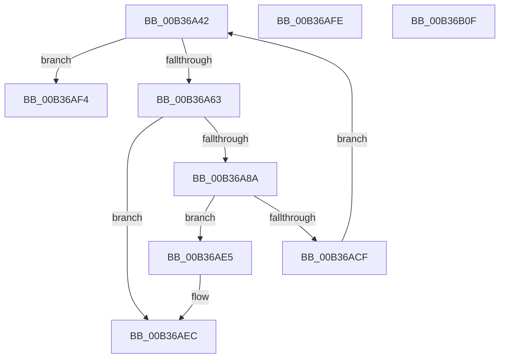

# sub_00B36A42

- RVA: `0x00B36A42`–`0x00B36B22` (길이 `224` bytes)
- VA: `0x0000000140B36A42`
- 실행 섹션: `PAGE`
- PDB 이름 있음: `아니요`; PDB Function 태그: `아니요`
- unwind 정보 RVA: `0x000A9270`
- 디코드: `50`개 명령, `224/224` bytes 표시
- 미해석 바이트: `0` (있으면 어셈블리에 `.byte`로 보존)

> 이 문서는 커널 이미지의 기계어와 PDB 기호를 분석해 생성했습니다. 4번과 5번은 함수 원형과 자료형을 바이너리 사용 방식에서 추정한 C 해석이며 원본 소스 복구 결과는 아닙니다.

## 1. Dependencies

- 직접 호출 지점: **7**; 고유 호출 대상: **6**
- 직접 호출자로 확인된 함수: **0**
- RIP 상대 이미지 참조: **1**

### Outgoing calls
- `0x00B36A4D` → [ExAcquireFastMutex](../../text/20/ExAcquireFastMutex_function_0020E5A0.md) (function, `0x0020E5A0`)
- `0x00B36A72` → [ObfReferenceObjectWithTag](../../text/21/ObfReferenceObjectWithTag_function_00210710.md) (function, `0x00210710`)
- `0x00B36A7D` → [PsGetNextProcessThread](../8C/PsGetNextProcessThread_function_008C9CF0.md) (function, `0x008C9CF0`)
- `0x00B36A98` → [ExReleaseFastMutex](../../text/25/ExReleaseFastMutex_function_002519C0.md) (function, `0x002519C0`)
- `0x00B36AA9` → [ObfDereferenceObjectWithTag](../../text/2F/ObfDereferenceObjectWithTag_function_002F78E0.md) (function, `0x002F78E0`)
- `0x00B36AC4` → [DbgkpPostFakeThreadMessages](../A1/DbgkpPostFakeThreadMessages_function_00A108CC.md) (function, `0x00A108CC`)
- `0x00B36AD8` → [ObfDereferenceObjectWithTag](../../text/2F/ObfDereferenceObjectWithTag_function_002F78E0.md) (function, `0x002F78E0`)

### Direct callers
- 이 함수 시작 RVA로 연결되는 직접 call은 확인되지 않았습니다. 간접 호출은 완전히 역산할 수 없습니다.

### Static image references
- `0x00B36A42` → RVA `0x00F8F220` (`.data`; read)

## 2. Other-region calls and transfers

- 다른 실행 섹션으로 향하는 call: **5**
  - `0x00B36A4D` → [ExAcquireFastMutex](../../text/20/ExAcquireFastMutex_function_0020E5A0.md) (`PAGE` → `.text`)
  - `0x00B36A72` → [ObfReferenceObjectWithTag](../../text/21/ObfReferenceObjectWithTag_function_00210710.md) (`PAGE` → `.text`)
  - `0x00B36A98` → [ExReleaseFastMutex](../../text/25/ExReleaseFastMutex_function_002519C0.md) (`PAGE` → `.text`)
  - `0x00B36AA9` → [ObfDereferenceObjectWithTag](../../text/2F/ObfDereferenceObjectWithTag_function_002F78E0.md) (`PAGE` → `.text`)
  - `0x00B36AD8` → [ObfDereferenceObjectWithTag](../../text/2F/ObfDereferenceObjectWithTag_function_002F78E0.md) (`PAGE` → `.text`)
- call이 아닌 외부 분기/꼬리 이동: **4**
  - `0x00B36AEF` → [DbgkpSetProcessDebugObject + 0x64](../A1/DbgkpSetProcessDebugObject_function_00A10468.md) (`tail-transfer`)
  - `0x00B36AF9` → [DbgkpSetProcessDebugObject + 0x64](../A1/DbgkpSetProcessDebugObject_function_00A10468.md) (`tail-transfer`)
  - `0x00B36B0A` → [DbgkpSetProcessDebugObject + 0x7C](../A1/DbgkpSetProcessDebugObject_function_00A10468.md) (`tail-transfer`)
  - `0x00B36B1D` → [DbgkpSetProcessDebugObject + 0xE8](../A1/DbgkpSetProcessDebugObject_function_00A10468.md) (`tail-transfer`)

## 3. Assembly (complete function range)

```asm
00B36A42  48 8D 0D D7 87 45 00            lea rcx, [rip + 0x4587d7]
00B36A49  44 88 75 50                     mov byte ptr [rbp + 0x50], r14b
00B36A4D  E8 4E 7B 6D FF                  call 0x14020e5a0
00B36A52  48 8B 5D 58                     mov rbx, qword ptr [rbp + 0x58]
00B36A56  4C 39 A6 08 03 00 00            cmp qword ptr [rsi + 0x308], r12
00B36A5D  0F 85 91 00 00 00               jne 0x140b36af4
00B36A63  BA 44 62 67 4F                  mov edx, 0x4f676244
00B36A68  4C 89 BE 08 03 00 00            mov qword ptr [rsi + 0x308], r15
00B36A6F  48 8B CB                        mov rcx, rbx
00B36A72  E8 99 9C 6D FF                  call 0x140210710
00B36A77  48 8B D3                        mov rdx, rbx
00B36A7A  48 8B CE                        mov rcx, rsi
00B36A7D  E8 6E 32 D9 FF                  call 0x1408c9cf0
00B36A82  4C 8B F0                        mov r14, rax
00B36A85  48 85 C0                        test rax, rax
00B36A88  74 62                           je 0x140b36aec
00B36A8A  48 8D 0D 8F 87 45 00            lea rcx, [rip + 0x45878f]
00B36A91  4C 89 A6 08 03 00 00            mov qword ptr [rsi + 0x308], r12
00B36A98  E8 23 AF 71 FF                  call 0x1402519c0
00B36A9D  BA 44 62 67 4F                  mov edx, 0x4f676244
00B36AA2  44 88 65 50                     mov byte ptr [rbp + 0x50], r12b
00B36AA6  48 8B CB                        mov rcx, rbx
00B36AA9  E8 32 0E 7C FF                  call 0x1402f78e0
00B36AAE  48 8D 45 58                     lea rax, [rbp + 0x58]
00B36AB2  4D 8B C6                        mov r8, r14
00B36AB5  4C 8D 4D D0                     lea r9, [rbp - 0x30]
00B36AB9  48 89 44 24 20                  mov qword ptr [rsp + 0x20], rax
00B36ABE  49 8B D7                        mov rdx, r15
00B36AC1  48 8B CE                        mov rcx, rsi
00B36AC4  E8 03 9E ED FF                  call 0x140a108cc
00B36AC9  8B F8                           mov edi, eax
00B36ACB  85 C0                           test eax, eax
00B36ACD  78 16                           js 0x140b36ae5
00B36ACF  48 8B 4D D0                     mov rcx, qword ptr [rbp - 0x30]
00B36AD3  BA 44 62 67 4F                  mov edx, 0x4f676244
00B36AD8  E8 03 0E 7C FF                  call 0x1402f78e0
00B36ADD  41 B6 01                        mov r14b, 1
00B36AE0  E9 5D FF FF FF                  jmp 0x140b36a42
00B36AE5  49 8B DC                        mov rbx, r12
00B36AE8  48 89 5D 58                     mov qword ptr [rbp + 0x58], rbx
00B36AEC  41 B6 01                        mov r14b, 1
00B36AEF  E9 D8 99 ED FF                  jmp 0x140a104cc
00B36AF4  BF 48 00 00 C0                  mov edi, 0xc0000048
00B36AF9  E9 CE 99 ED FF                  jmp 0x140a104cc
00B36AFE  4C 89 A6 08 03 00 00            mov qword ptr [rsi + 0x308], r12
00B36B05  BF 54 03 00 C0                  mov edi, 0xc0000354
00B36B0A  E9 D5 99 ED FF                  jmp 0x140a104e4
00B36B0F  48 83 63 50 00                  and qword ptr [rbx + 0x50], 0
00B36B14  F0 41 83 8D A0 05 00 00 40      lock or dword ptr [r13 + 0x5a0], 0x40
00B36B1D  E9 2E 9A ED FF                  jmp 0x140a10550
```

## 4. C-style interpretation (structured pseudocode)

```c
__int64 __fastcall sub_00B36A42(void)
{
    __int64 result;
    unsigned __int64 v_stack_p20;

    *(unsigned __int8 *)(v_rbp + 80) = (unsigned __int8)(v_r14);
    result = ExAcquireFastMutex(v_rip + 4556759, a2, a3, a4);
    if ((*(unsigned __int64 *)(v_rsi + 776)) != v_r12) goto loc_00B36AF4;
    *(unsigned __int64 *)(v_rsi + 776) = v_r15;
    result = ObfReferenceObjectWithTag(*(unsigned __int64 *)(v_rbp + 88), (unsigned int)(0x4F676244ULL), a3, a4);
    result = PsGetNextProcessThread(v_rsi, *(unsigned __int64 *)(v_rbp + 88), a3, a4);
    if (result == 0) goto loc_00B36AEC;
    *(unsigned __int64 *)(v_rsi + 776) = v_r12;
    result = ExReleaseFastMutex(v_rip + 4556687, *(unsigned __int64 *)(v_rbp + 88), a3, a4);
    *(unsigned __int8 *)(v_rbp + 80) = (unsigned __int8)(v_r12);
    result = ObfDereferenceObjectWithTag(*(unsigned __int64 *)(v_rbp + 88), (unsigned int)(0x4F676244ULL), a3, a4);
    v_stack_p20 = v_rbp + 88;
    result = DbgkpPostFakeThreadMessages(v_rsi, v_r15, result, v_rbp - 48);
    if (sign_flag) goto loc_00B36AE5;
    result = ObfDereferenceObjectWithTag(*(unsigned __int64 *)(v_rbp - 48), (unsigned int)(0x4F676244ULL), result, v_rbp - 48);
    goto loc_00B36A42;
loc_00B36AE5:
    *(unsigned __int64 *)(v_rbp + 88) = v_r12;
loc_00B36AEC:
loc_00B36AF4:
}
```

## 5. (Beta) C Style

```c
void sub_00B36A42(void)
{
    int64_t result;
    uint64_t v_stack_p20;

    *(uint8_t *)(local_rbp + 0x50) = (uint8_t)(local_r14);
    result = ExAcquireFastMutex(v_rip + 4556759, a2, a3, a4);
    if ((*(uint64_t *)(local_rsi + 0x308)) != local_r12) goto loc_00B36AF4;
    *(uint64_t *)(local_rsi + 0x308) = local_r15;
    result = ObfReferenceObjectWithTag(*(uint64_t *)(local_rbp + 0x58), (uint32_t)(0x4F676244ULL), a3, a4);
    result = PsGetNextProcessThread(local_rsi, *(uint64_t *)(local_rbp + 0x58), a3, a4);
    if (result == 0) goto loc_00B36AEC;
    *(uint64_t *)(local_rsi + 0x308) = local_r12;
    result = ExReleaseFastMutex(v_rip + 4556687, *(uint64_t *)(local_rbp + 0x58), a3, a4);
    *(uint8_t *)(local_rbp + 0x50) = (uint8_t)(local_r12);
    result = ObfDereferenceObjectWithTag(*(uint64_t *)(local_rbp + 0x58), (uint32_t)(0x4F676244ULL), a3, a4);
    v_stack_p20 = local_rbp + 88;
    result = DbgkpPostFakeThreadMessages(local_rsi, local_r15, result, local_rbp - 48);
    if (sign_flag) goto loc_00B36AE5;
    result = ObfDereferenceObjectWithTag(*(uint64_t *)(local_rbp - 0x30), (uint32_t)(0x4F676244ULL), result, local_rbp - 48);
    goto loc_00B36A42;
loc_00B36AE5:
    *(uint64_t *)(local_rbp + 0x58) = local_r12;
loc_00B36AEC:
loc_00B36AF4:
}
```

## 6. Execution-region graph

[열기: 2D/3D 그래프와 함수 탐색 컨트롤 패널](../../../control-panel.html?section=page&rva=0x00B36A42&view=graph)

- 2D 그래프는 위에서 아래로 흐르고, 3D 그래프는 빈 공간을 드래그해 회전합니다. Shift+드래그는 이동, 휠은 확대·축소, 함수 노드 선택은 대상 보고서 이동입니다.

### Static fallback


