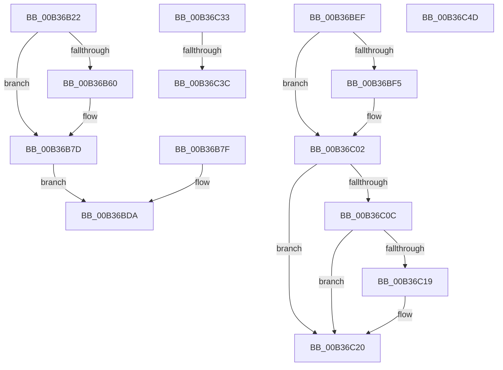

# sub_00B36B22

- RVA: `0x00B36B22`–`0x00B36C58` (길이 `310` bytes)
- VA: `0x0000000140B36B22`
- 실행 섹션: `PAGE`
- PDB 이름 있음: `아니요`; PDB Function 태그: `아니요`
- unwind 정보 RVA: `0x000A92E0`
- 디코드: `63`개 명령, `310/310` bytes 표시
- 미해석 바이트: `0` (있으면 어셈블리에 `.byte`로 보존)

> 이 문서는 커널 이미지의 기계어와 PDB 기호를 분석해 생성했습니다. 4번과 5번은 함수 원형과 자료형을 바이너리 사용 방식에서 추정한 C 해석이며 원본 소스 복구 결과는 아닙니다.

## 1. Dependencies

- 직접 호출 지점: **7**; 고유 호출 대상: **6**
- 직접 호출자로 확인된 함수: **0**
- RIP 상대 이미지 참조: **0**

### Outgoing calls
- `0x00B36B48` → [KiStackAttachProcess](../../text/21/KiStackAttachProcess_function_00216820.md) (function, `0x00216820`)
- `0x00B36B56` → [RtlImageNtHeader](../../text/44/RtlImageNtHeader_function_00443B60.md) (function, `0x00443B60`)
- `0x00B36BE4` → [KiUnstackDetachProcess](../../text/21/KiUnstackDetachProcess_function_00217D30.md) (function, `0x00217D30`)
- `0x00B36BFD` → [ExReleaseRundownProtection](../../text/34/ExReleaseRundownProtection_function_00349E80.md) (function, `0x00349E80`)
- `0x00B36C1B` → [ObCloseHandle](../8A/ObCloseHandle_function_008A1870.md) (function, `0x008A1870`)
- `0x00B36C28` → [ObfDereferenceObjectWithTag](../../text/2F/ObfDereferenceObjectWithTag_function_002F78E0.md) (function, `0x002F78E0`)
- `0x00B36C42` → [ObfDereferenceObjectWithTag](../../text/2F/ObfDereferenceObjectWithTag_function_002F78E0.md) (function, `0x002F78E0`)

### Direct callers
- 이 함수 시작 RVA로 연결되는 직접 call은 확인되지 않았습니다. 간접 호출은 완전히 역산할 수 없습니다.

### Static image references
- 디코드된 RIP-relative 메모리 참조가 없습니다.

## 2. Other-region calls and transfers

- 다른 실행 섹션으로 향하는 call: **6**
  - `0x00B36B48` → [KiStackAttachProcess](../../text/21/KiStackAttachProcess_function_00216820.md) (`PAGE` → `.text`)
  - `0x00B36B56` → [RtlImageNtHeader](../../text/44/RtlImageNtHeader_function_00443B60.md) (`PAGE` → `.text`)
  - `0x00B36BE4` → [KiUnstackDetachProcess](../../text/21/KiUnstackDetachProcess_function_00217D30.md) (`PAGE` → `.text`)
  - `0x00B36BFD` → [ExReleaseRundownProtection](../../text/34/ExReleaseRundownProtection_function_00349E80.md) (`PAGE` → `.text`)
  - `0x00B36C28` → [ObfDereferenceObjectWithTag](../../text/2F/ObfDereferenceObjectWithTag_function_002F78E0.md) (`PAGE` → `.text`)
  - `0x00B36C42` → [ObfDereferenceObjectWithTag](../../text/2F/ObfDereferenceObjectWithTag_function_002F78E0.md) (`PAGE` → `.text`)
- call이 아닌 외부 분기/꼬리 이동: **5**
  - `0x00B36BEA` → [DbgkpPostFakeThreadMessages + 0x18B](../A1/DbgkpPostFakeThreadMessages_function_00A108CC.md) (`tail-transfer`)
  - `0x00B36C2E` → [DbgkpPostFakeThreadMessages + 0x232](../A1/DbgkpPostFakeThreadMessages_function_00A108CC.md) (`tail-transfer`)
  - `0x00B36C36` → [DbgkpPostFakeThreadMessages + 0x254](../A1/DbgkpPostFakeThreadMessages_function_00A108CC.md) (`tail-transfer`)
  - `0x00B36C48` → [DbgkpPostFakeThreadMessages + 0x254](../A1/DbgkpPostFakeThreadMessages_function_00A108CC.md) (`tail-transfer`)
  - `0x00B36C53` → [DbgkpPostFakeThreadMessages + 0x254](../A1/DbgkpPostFakeThreadMessages_function_00A108CC.md) (`tail-transfer`)

## 3. Assembly (complete function range)

```asm
00B36B22  48 83 A4 24 D8 00 00 00 00      and qword ptr [rsp + 0xd8], 0
00B36B2B  49 8B 84 24 B0 02 00 00         mov rax, qword ptr [r12 + 0x2b0]
00B36B33  48 89 84 24 E0 00 00 00         mov qword ptr [rsp + 0xe0], rax
00B36B3B  4C 8D 84 24 B0 01 00 00         lea r8, [rsp + 0x1b0]
00B36B43  33 D2                           xor edx, edx
00B36B45  49 8B CC                        mov rcx, r12
00B36B48  E8 D3 FC 6D FF                  call 0x140216820
00B36B4D  90                              nop
00B36B4E  49 8B 8C 24 B0 02 00 00         mov rcx, qword ptr [r12 + 0x2b0]
00B36B56  E8 05 D0 90 FF                  call 0x140443b60
00B36B5B  48 85 C0                        test rax, rax
00B36B5E  74 1D                           je 0x140b36b7d
00B36B60  48 83 A4 24 F8 00 00 00 00      and qword ptr [rsp + 0xf8], 0
00B36B69  8B 48 0C                        mov ecx, dword ptr [rax + 0xc]
00B36B6C  89 8C 24 E8 00 00 00            mov dword ptr [rsp + 0xe8], ecx
00B36B73  8B 40 10                        mov eax, dword ptr [rax + 0x10]
00B36B76  89 84 24 EC 00 00 00            mov dword ptr [rsp + 0xec], eax
00B36B7D  EB 5B                           jmp 0x140b36bda
00B36B7F  48 83 A4 24 F8 00 00 00 00      and qword ptr [rsp + 0xf8], 0
00B36B88  83 A4 24 E8 00 00 00 00         and dword ptr [rsp + 0xe8], 0
00B36B90  83 A4 24 EC 00 00 00 00         and dword ptr [rsp + 0xec], 0
00B36B98  41 BF 44 62 67 4F               mov r15d, 0x4f676244
00B36B9E  4C 8B 74 24 40                  mov r14, qword ptr [rsp + 0x40]
00B36BA3  8B 74 24 34                     mov esi, dword ptr [rsp + 0x34]
00B36BA7  44 8A 6C 24 31                  mov r13b, byte ptr [rsp + 0x31]
00B36BAC  48 8B 7C 24 70                  mov rdi, qword ptr [rsp + 0x70]
00B36BB1  48 8B 5C 24 58                  mov rbx, qword ptr [rsp + 0x58]
00B36BB6  48 8B 44 24 78                  mov rax, qword ptr [rsp + 0x78]
00B36BBB  48 89 44 24 38                  mov qword ptr [rsp + 0x38], rax
00B36BC0  48 8B 84 24 80 00 00 00         mov rax, qword ptr [rsp + 0x80]
00B36BC8  48 89 44 24 48                  mov qword ptr [rsp + 0x48], rax
00B36BCD  48 8B 84 24 88 00 00 00         mov rax, qword ptr [rsp + 0x88]
00B36BD5  48 89 44 24 60                  mov qword ptr [rsp + 0x60], rax
00B36BDA  33 D2                           xor edx, edx
00B36BDC  48 8D 8C 24 B0 01 00 00         lea rcx, [rsp + 0x1b0]
00B36BE4  E8 47 11 6E FF                  call 0x140217d30
00B36BE9  90                              nop
00B36BEA  E9 68 9E ED FF                  jmp 0x140a10a57
00B36BEF  40 F6 C6 08                     test sil, 8
00B36BF3  74 0D                           je 0x140b36c02
00B36BF5  48 8B 8C 24 90 00 00 00         mov rcx, qword ptr [rsp + 0x90]
00B36BFD  E8 7E 32 81 FF                  call 0x140349e80
00B36C02  83 BC 24 C8 00 00 00 02         cmp dword ptr [rsp + 0xc8], 2
00B36C0A  75 14                           jne 0x140b36c20
00B36C0C  48 8B 8C 24 D8 00 00 00         mov rcx, qword ptr [rsp + 0xd8]
00B36C14  48 85 C9                        test rcx, rcx
00B36C17  74 07                           je 0x140b36c20
00B36C19  33 D2                           xor edx, edx
00B36C1B  E8 50 AC D6 FF                  call 0x1408a1870
00B36C20  BA 50 73 45 6E                  mov edx, 0x6e457350
00B36C25  48 8B CB                        mov rcx, rbx
00B36C28  E8 B3 0C 7C FF                  call 0x1402f78e0
00B36C2D  90                              nop
00B36C2E  E9 CB 9E ED FF                  jmp 0x140a10afe
00B36C33  48 85 FF                        test rdi, rdi
00B36C36  0F 84 E4 9E ED FF               je 0x140a10b20
00B36C3C  41 8B D7                        mov edx, r15d
00B36C3F  48 8B CF                        mov rcx, rdi
00B36C42  E8 99 0C 7C FF                  call 0x1402f78e0
00B36C47  90                              nop
00B36C48  E9 D3 9E ED FF                  jmp 0x140a10b20
00B36C4D  41 BC 01 00 00 C0               mov r12d, 0xc0000001
00B36C53  E9 C8 9E ED FF                  jmp 0x140a10b20
```

## 4. C-style interpretation (structured pseudocode)

```c
__int64 __fastcall sub_00B36B22(__int64 a1, int a2, __int64 a3, __int64 a4, __int64 a5, __int64 a6, __int64 a7, __int64 a8, __int64 a9, __int64 a10, __int64 a11, __int64 a12, __int64 a13, __int64 a14, __int64 a15, __int64 a16, __int64 a17, __int64 a18, __int64 a19, __int64 a20, __int64 a21, __int64 a22, __int64 a23, __int64 a24, __int64 a25, __int64 a26, __int64 a27, __int64 a28, __int64 a29, __int64 a30, __int64 a31, __int64 a32, __int64 a33, __int64 a34, __int64 a35, __int64 a36, __int64 a37, __int64 a38, __int64 a39, __int64 a40, __int64 a41, __int64 a42, __int64 a43, __int64 a44, __int64 a45, __int64 a46, __int64 a47, __int64 a48, __int64 a49, __int64 a50, __int64 a51, __int64 a52, __int64 a53, __int64 a54)
{
    __int64 result;
    unsigned __int8 v_stack_p31;
    unsigned int v_stack_p34;
    unsigned __int64 v_stack_p38;
    unsigned __int64 v_stack_p40;
    unsigned __int64 v_stack_p48;
    unsigned __int64 v_stack_p58;
    unsigned __int64 v_stack_p60;
    unsigned __int64 v_stack_p70;
    unsigned __int64 v_stack_p78;
    unsigned __int64 v_stack_p80;
    unsigned __int64 v_stack_p88;
    unsigned __int64 v_stack_p90;
    unsigned int v_stack_pC8;
    unsigned __int64 v_stack_pD8;
    unsigned __int64 v_stack_pE0;
    unsigned int v_stack_pE8;
    unsigned int v_stack_pEC;
    unsigned __int64 v_stack_pF8;

    v_stack_pE0 = *(unsigned __int64 *)(v_r12 + 688);
    a2 = 0;
    result = KiStackAttachProcess(v_r12, a2, a54, a4);
    result = RtlImageNtHeader(*(unsigned __int64 *)(v_r12 + 688), a2, a54, a4);
    if (result != 0) {
        a1 = *(unsigned int *)(result + 12);
        v_stack_pE8 = (unsigned int)(a1);
        result = *(unsigned int *)(result + 16);
        v_stack_pEC = (unsigned int)(result);
    }
    goto loc_00B36BDA;
loc_00B36BDA:
    a2 = 0;
    result = KiUnstackDetachProcess(a54, a2, a54, a4);
}
```

## 5. (Beta) C Style

```c
int64_t sub_00B36B22(int64_t Arg1, int32_t Arg2, int64_t Arg3, int64_t Arg4, uint64_t Arg5, uint64_t Arg6, uint64_t Arg7, uint64_t Arg8, uint64_t Arg9, uint64_t Arg10, uint64_t Arg11, uint64_t Arg12, uint64_t Arg13, uint64_t Arg14, uint64_t Arg15, uint64_t Arg16, uint64_t Arg17, uint64_t Arg18, uint64_t Arg19, uint64_t Arg20, uint64_t Arg21, uint64_t Arg22, uint64_t Arg23, uint64_t Arg24, uint64_t Arg25, uint64_t Arg26, int64_t Arg27, uint64_t Arg28, uint64_t Arg29, uint64_t Arg30, int64_t Arg31, uint64_t Arg32, uint64_t Arg33, uint64_t Arg34, uint64_t Arg35, uint64_t Arg36, uint64_t Arg37, uint64_t Arg38, uint64_t Arg39, uint64_t Arg40, uint64_t Arg41, uint64_t Arg42, uint64_t Arg43, uint64_t Arg44, uint64_t Arg45, uint64_t Arg46, uint64_t Arg47, uint64_t Arg48, uint64_t Arg49, uint64_t Arg50, uint64_t Arg51, uint64_t Arg52, uint64_t Arg53, int64_t Arg54)
{
    int64_t result;
    uint8_t v_stack_p31;
    uint32_t v_stack_p34;
    uint64_t v_stack_p38;
    uint64_t v_stack_p40;
    uint64_t v_stack_p48;
    uint64_t v_stack_p58;
    uint64_t v_stack_p60;
    uint64_t v_stack_p70;
    uint64_t v_stack_p78;
    uint64_t v_stack_p80;
    uint64_t v_stack_p88;
    uint64_t v_stack_p90;
    uint32_t v_stack_pC8;
    uint64_t v_stack_pD8;
    uint64_t v_stack_pE0;
    uint32_t v_stack_pE8;
    uint32_t v_stack_pEC;
    uint64_t v_stack_pF8;

    v_stack_pE0 = *(uint64_t *)(local_r12 + 0x2B0);
    Arg2 = 0;
    result = KiStackAttachProcess(local_r12, Arg2, Arg54, Arg4);
    result = RtlImageNtHeader(*(uint64_t *)(local_r12 + 0x2B0), Arg2, Arg54, Arg4);
    if (result != 0) {
        Arg1 = *(uint32_t *)(result + 0xC);
        v_stack_pE8 = (uint32_t)(Arg1);
        result = *(uint32_t *)(result + 0x10);
        v_stack_pEC = (uint32_t)(result);
    }
    goto loc_00B36BDA;
loc_00B36BDA:
    Arg2 = 0;
    result = KiUnstackDetachProcess(Arg54, Arg2, Arg54, Arg4);
}
```

## 6. Execution-region graph

[열기: 2D/3D 그래프와 함수 탐색 컨트롤 패널](../../../control-panel.html?section=page&rva=0x00B36B22&view=graph)

- 2D 그래프는 위에서 아래로 흐르고, 3D 그래프는 빈 공간을 드래그해 회전합니다. Shift+드래그는 이동, 휠은 확대·축소, 함수 노드 선택은 대상 보고서 이동입니다.

### Static fallback


