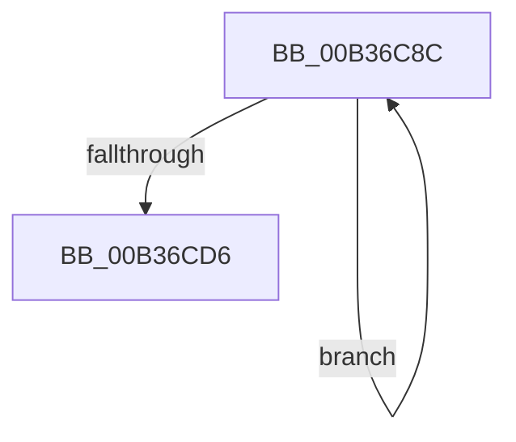

# sub_00B36C8C

- RVA: `0x00B36C8C`–`0x00B36D52` (길이 `198` bytes)
- VA: `0x0000000140B36C8C`
- 실행 섹션: `PAGE`
- PDB 이름 있음: `아니요`; PDB Function 태그: `아니요`
- unwind 정보 RVA: `0x000A951C`
- 디코드: `46`개 명령, `198/198` bytes 표시
- 미해석 바이트: `0` (있으면 어셈블리에 `.byte`로 보존)

> 이 문서는 커널 이미지의 기계어와 PDB 기호를 분석해 생성했습니다. 4번과 5번은 함수 원형과 자료형을 바이너리 사용 방식에서 추정한 C 해석이며 원본 소스 복구 결과는 아닙니다.

## 1. Dependencies

- 직접 호출 지점: **2**; 고유 호출 대상: **2**
- 직접 호출자로 확인된 함수: **0**
- RIP 상대 이미지 참조: **1**

### Outgoing calls
- `0x00B36D0A` → [RtlStringCchCopyExW](../../text/41/RtlStringCchCopyExW_function_0041E1C0.md) (function, `0x0041E1C0`)
- `0x00B36D20` → [PnpCtxRegEnumKeyWithCallback](../AA/PnpCtxRegEnumKeyWithCallback_function_00AA146C.md) (function, `0x00AA146C`)

### Direct callers
- 이 함수 시작 RVA로 연결되는 직접 call은 확인되지 않았습니다. 간접 호출은 완전히 역산할 수 없습니다.

### Static image references
- `0x00B36D13` → RVA `0x00A11300` (`DrvDbGetObjectSubKeyCallback`; read)

## 2. Other-region calls and transfers

- 다른 실행 섹션으로 향하는 call: **1**
  - `0x00B36D0A` → [RtlStringCchCopyExW](../../text/41/RtlStringCchCopyExW_function_0041E1C0.md) (`PAGE` → `.text`)
- call이 아닌 외부 분기/꼬리 이동: **1**
  - `0x00B36D4D` → [DrvDbGetObjectSubKeyCallback + 0x187](../A1/DrvDbGetObjectSubKeyCallback_function_00A11300.md) (`tail-transfer`)

## 3. Assembly (complete function range)

```asm
00B36C8C  0F 10 00                        movups xmm0, xmmword ptr [rax]
00B36C8F  0F 11 01                        movups xmmword ptr [rcx], xmm0
00B36C92  0F 10 48 10                     movups xmm1, xmmword ptr [rax + 0x10]
00B36C96  0F 11 49 10                     movups xmmword ptr [rcx + 0x10], xmm1
00B36C9A  0F 10 40 20                     movups xmm0, xmmword ptr [rax + 0x20]
00B36C9E  0F 11 41 20                     movups xmmword ptr [rcx + 0x20], xmm0
00B36CA2  0F 10 48 30                     movups xmm1, xmmword ptr [rax + 0x30]
00B36CA6  0F 11 49 30                     movups xmmword ptr [rcx + 0x30], xmm1
00B36CAA  0F 10 40 40                     movups xmm0, xmmword ptr [rax + 0x40]
00B36CAE  0F 11 41 40                     movups xmmword ptr [rcx + 0x40], xmm0
00B36CB2  0F 10 48 50                     movups xmm1, xmmword ptr [rax + 0x50]
00B36CB6  0F 11 49 50                     movups xmmword ptr [rcx + 0x50], xmm1
00B36CBA  0F 10 40 60                     movups xmm0, xmmword ptr [rax + 0x60]
00B36CBE  0F 11 41 60                     movups xmmword ptr [rcx + 0x60], xmm0
00B36CC2  48 03 CA                        add rcx, rdx
00B36CC5  0F 10 48 70                     movups xmm1, xmmword ptr [rax + 0x70]
00B36CC9  48 03 C2                        add rax, rdx
00B36CCC  0F 11 49 F0                     movups xmmword ptr [rcx - 0x10], xmm1
00B36CD0  48 83 EF 01                     sub rdi, 1
00B36CD4  75 B6                           jne 0x140b36c8c
00B36CD6  0F 10 00                        movups xmm0, xmmword ptr [rax]
00B36CD9  C7 44 24 28 00 09 00 00         mov dword ptr [rsp + 0x28], 0x900
00B36CE1  45 33 C9                        xor r9d, r9d
00B36CE4  4C 8B C6                        mov r8, rsi
00B36CE7  4C 89 7C 24 20                  mov qword ptr [rsp + 0x20], r15
00B36CEC  0F 11 01                        movups xmmword ptr [rcx], xmm0
00B36CEF  49 8B D4                        mov rdx, r12
00B36CF2  0F 10 48 10                     movups xmm1, xmmword ptr [rax + 0x10]
00B36CF6  0F 11 49 10                     movups xmmword ptr [rcx + 0x10], xmm1
00B36CFA  48 8B 40 20                     mov rax, qword ptr [rax + 0x20]
00B36CFE  48 89 41 20                     mov qword ptr [rcx + 0x20], rax
00B36D02  49 8D 4E 08                     lea rcx, [r14 + 8]
00B36D06  41 FF 46 04                     inc dword ptr [r14 + 4]
00B36D0A  E8 B1 74 8E FF                  call 0x14041e1c0
00B36D0F  48 8B 55 BF                     mov rdx, qword ptr [rbp - 0x41]
00B36D13  4C 8D 05 E6 A5 ED FF            lea r8, [rip - 0x125a1a]
00B36D1A  4D 8B CE                        mov r9, r14
00B36D1D  49 8B CD                        mov rcx, r13
00B36D20  E8 47 A7 F6 FF                  call 0x140aa146c
00B36D25  49 8B 86 18 02 00 00            mov rax, qword ptr [r14 + 0x218]
00B36D2C  48 89 83 18 02 00 00            mov qword ptr [rbx + 0x218], rax
00B36D33  41 8B 86 20 02 00 00            mov eax, dword ptr [r14 + 0x220]
00B36D3A  89 83 20 02 00 00               mov dword ptr [rbx + 0x220], eax
00B36D40  41 8B 86 24 02 00 00            mov eax, dword ptr [r14 + 0x224]
00B36D47  89 83 24 02 00 00               mov dword ptr [rbx + 0x224], eax
00B36D4D  E9 35 A7 ED FF                  jmp 0x140a11487
```

## 4. C-style interpretation (structured pseudocode)

```c
__int64 __fastcall sub_00B36C8C(__int64 a1, __int64 a2, __int64 a3, int a4)
{
    __int64 result;
    __int64 v_rdi;
    unsigned __int64 v_stack_p20;
    unsigned int v_stack_p28;

    *(unsigned __int64 *)(a1) = v_xmm0;
    *(unsigned __int64 *)(a1 + 16) = v_xmm1;
    *(unsigned __int64 *)(a1 + 32) = v_xmm0;
    *(unsigned __int64 *)(a1 + 48) = v_xmm1;
    *(unsigned __int64 *)(a1 + 64) = v_xmm0;
    *(unsigned __int64 *)(a1 + 80) = v_xmm1;
    *(unsigned __int64 *)(a1 + 96) = v_xmm0;
    a1 = (a1) + (a2);
    result = (result) + (a2);
    *(unsigned __int64 *)(a1 - 16) = v_xmm1;
    v_rdi = (v_rdi) - (1);
    if (condition_is_not_equal) goto loc_00B36C8C;
    v_stack_p28 = 0x900ULL;
    a4 = 0;
    v_stack_p20 = v_r15;
    *(unsigned __int64 *)(a1) = v_xmm0;
    *(unsigned __int64 *)(a1 + 16) = v_xmm1;
    *(unsigned __int64 *)(a1 + 32) = *(unsigned __int64 *)(result + 32);
    result = RtlStringCchCopyExW(v_r14 + 8, v_r12, v_rsi, a4);
    result = PnpCtxRegEnumKeyWithCallback(v_r13, *(unsigned __int64 *)(v_rbp - 65), v_rip - 1202714, v_r14);
    *(unsigned __int64 *)(v_rbx + 536) = *(unsigned __int64 *)(v_r14 + 536);
    *(unsigned int *)(v_rbx + 544) = (unsigned int)((unsigned int)(*(unsigned int *)(v_r14 + 544)));
    *(unsigned int *)(v_rbx + 548) = (unsigned int)((unsigned int)(*(unsigned int *)(v_r14 + 548)));
}
```

## 5. (Beta) C Style

```c
int64_t sub_00B36C8C(void *Arg1, int64_t Arg2, int64_t Arg3, int32_t Arg4)
{
    uint8_t *arg1 = (uint8_t *)Arg1;

    int64_t result;
    int64_t local_rdi;
    uint64_t v_stack_p20;
    uint32_t v_stack_p28;

    *(uint64_t *)(arg1) = v_xmm0;
    *(uint64_t *)(arg1 + 0x10) = v_xmm1;
    *(uint64_t *)(arg1 + 0x20) = v_xmm0;
    *(uint64_t *)(arg1 + 0x30) = v_xmm1;
    *(uint64_t *)(arg1 + 0x40) = v_xmm0;
    *(uint64_t *)(arg1 + 0x50) = v_xmm1;
    *(uint64_t *)(arg1 + 0x60) = v_xmm0;
    Arg1 = (Arg1) + (Arg2);
    result = (result) + (Arg2);
    *(uint64_t *)(arg1 - 0x10) = v_xmm1;
    local_rdi = (local_rdi) - (1);
    if (condition_is_not_equal) goto loc_00B36C8C;
    v_stack_p28 = 0x900ULL;
    Arg4 = 0;
    v_stack_p20 = local_r15;
    *(uint64_t *)(arg1) = v_xmm0;
    *(uint64_t *)(arg1 + 0x10) = v_xmm1;
    *(uint64_t *)(arg1 + 0x20) = *(uint64_t *)(result + 0x20);
    result = RtlStringCchCopyExW(local_r14 + 8, local_r12, local_rsi, Arg4);
    result = PnpCtxRegEnumKeyWithCallback(local_r13, *(uint64_t *)(local_rbp - 0x41), v_rip - 1202714, local_r14);
    *(uint64_t *)(local_rbx + 0x218) = *(uint64_t *)(local_r14 + 0x218);
    *(uint32_t *)(local_rbx + 0x220) = (uint32_t)((uint32_t)(*(uint32_t *)(local_r14 + 0x220)));
    *(uint32_t *)(local_rbx + 0x224) = (uint32_t)((uint32_t)(*(uint32_t *)(local_r14 + 0x224)));
}
```

### 관측된 메모리 오프셋

구조체 형식이 확인되지 않은 접근은 인자 기준의 오프셋으로만 기록했습니다.

| 기준 인자 | 오프셋 표현 | 폭 (bit) | 접근 |
|---|---:|---:|---|
| `Arg1` | `- 0x10` | `128` | `R` |
| `Arg1` | `+ 0x0` | `128` | `R` |
| `Arg1` | `+ 0x10` | `128` | `R` |
| `Arg1` | `+ 0x20` | `64` | `W` |
| `Arg1` | `+ 0x20` | `128` | `R` |
| `Arg1` | `+ 0x30` | `128` | `R` |
| `Arg1` | `+ 0x40` | `128` | `R` |
| `Arg1` | `+ 0x50` | `128` | `R` |
| `Arg1` | `+ 0x60` | `128` | `R` |

## 6. Execution-region graph

[열기: 2D/3D 그래프와 함수 탐색 컨트롤 패널](../../../control-panel.html?section=page&rva=0x00B36C8C&view=graph)

- 2D 그래프는 위에서 아래로 흐르고, 3D 그래프는 빈 공간을 드래그해 회전합니다. Shift+드래그는 이동, 휠은 확대·축소, 함수 노드 선택은 대상 보고서 이동입니다.

### Static fallback


