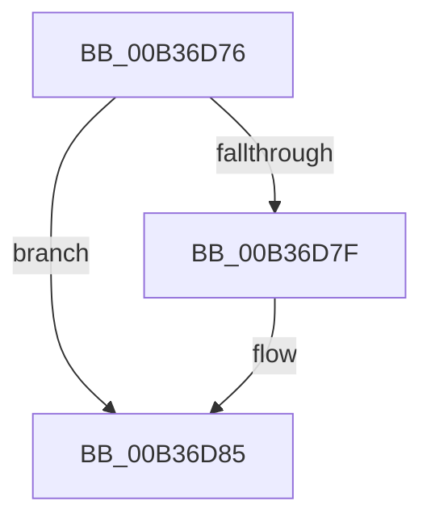

# sub_00B36D76

- RVA: `0x00B36D76`–`0x00B36D9A` (길이 `36` bytes)
- VA: `0x0000000140B36D76`
- 실행 섹션: `PAGE`
- PDB 이름 있음: `아니요`; PDB Function 태그: `아니요`
- unwind 정보 RVA: `0x000A999C`
- 디코드: `12`개 명령, `36/36` bytes 표시
- 미해석 바이트: `0` (있으면 어셈블리에 `.byte`로 보존)

> 이 문서는 커널 이미지의 기계어와 PDB 기호를 분석해 생성했습니다. 4번과 5번은 함수 원형과 자료형을 바이너리 사용 방식에서 추정한 C 해석이며 원본 소스 복구 결과는 아닙니다.

## 1. Dependencies

- 직접 호출 지점: **0**; 고유 호출 대상: **0**
- 직접 호출자로 확인된 함수: **0**
- RIP 상대 이미지 참조: **0**

### Outgoing calls
- 직접 디코드된 call 명령이 없습니다.

### Direct callers
- 이 함수 시작 RVA로 연결되는 직접 call은 확인되지 않았습니다. 간접 호출은 완전히 역산할 수 없습니다.

### Static image references
- 디코드된 RIP-relative 메모리 참조가 없습니다.

## 2. Other-region calls and transfers

- 다른 실행 섹션으로 향하는 call: **0**
- call이 아닌 외부 분기/꼬리 이동: **1**
  - `0x00B36D95` → [SepIsImageInMinTcbList + 0xF4](../A1/SepIsImageInMinTcbList_function_00A12DE0.md) (`tail-transfer`)

## 3. Assembly (complete function range)

```asm
00B36D76  41 8A 06                        mov al, byte ptr [r14]
00B36D79  24 0F                           and al, 0xf
00B36D7B  3C 04                           cmp al, 4
00B36D7D  73 06                           jae 0x140b36d85
00B36D7F  41 8A 07                        mov al, byte ptr [r15]
00B36D82  41 88 06                        mov byte ptr [r14], al
00B36D85  41 8A 00                        mov al, byte ptr [r8]
00B36D88  40 80 E7 F2                     and dil, 0xf2
00B36D8C  24 08                           and al, 8
00B36D8E  40 32 F8                        xor dil, al
00B36D91  40 80 CF 02                     or dil, 2
00B36D95  E9 3A C1 ED FF                  jmp 0x140a12ed4
```

## 4. C-style interpretation (structured pseudocode)

```c
__int64 __fastcall sub_00B36D76(__int64 a1, __int64 a2, __int64 a3)
{
    __int64 result;
    __int64 v_rdi;

    result = (unsigned __int8)((*(unsigned __int8 *)(v_r14)) & (15));
    if (((unsigned __int8)(result)) < 4) {
        result = *(unsigned __int8 *)(v_r15);
        *(unsigned __int8 *)(v_r14) = (unsigned __int8)(result);
    }
    v_rdi = (unsigned __int8)((v_rdi) & (242));
    result = (unsigned __int8)((*(unsigned __int8 *)(a3)) & (8));
    v_rdi = (unsigned __int8)((v_rdi) ^ ((unsigned __int8)(result)));
    v_rdi = (unsigned __int8)((v_rdi) | (2));
}
```

## 5. (Beta) C Style

```c
int64_t sub_00B36D76(int64_t Arg1, int64_t Arg2, void *Arg3)
{
    uint8_t *arg3 = (uint8_t *)Arg3;

    int64_t result;
    int64_t local_rdi;

    result = (uint8_t)((*(uint8_t *)(local_r14)) & (15));
    if (((uint8_t)(result)) < 4) {
        result = *(uint8_t *)(local_r15);
        *(uint8_t *)(local_r14) = (uint8_t)(result);
    }
    local_rdi = (uint8_t)((local_rdi) & (242));
    result = (uint8_t)((*(uint8_t *)(arg3)) & (8));
    local_rdi = (uint8_t)((local_rdi) ^ ((uint8_t)(result)));
    local_rdi = (uint8_t)((local_rdi) | (2));
}
```

### 관측된 메모리 오프셋

구조체 형식이 확인되지 않은 접근은 인자 기준의 오프셋으로만 기록했습니다.

| 기준 인자 | 오프셋 표현 | 폭 (bit) | 접근 |
|---|---:|---:|---|
| `Arg3` | `+ 0x0` | `8` | `R` |

## 6. Execution-region graph

[열기: 2D/3D 그래프와 함수 탐색 컨트롤 패널](../../../control-panel.html?section=page&rva=0x00B36D76&view=graph)

- 2D 그래프는 위에서 아래로 흐르고, 3D 그래프는 빈 공간을 드래그해 회전합니다. Shift+드래그는 이동, 휠은 확대·축소, 함수 노드 선택은 대상 보고서 이동입니다.

### Static fallback


