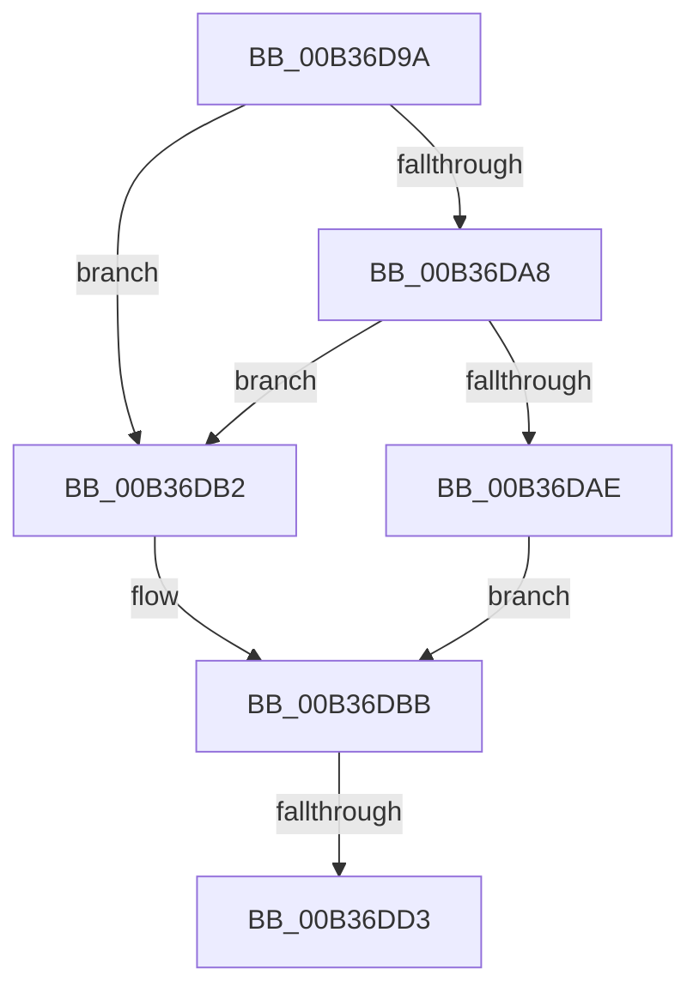

# sub_00B36D9A

- RVA: `0x00B36D9A`–`0x00B36DE1` (길이 `71` bytes)
- VA: `0x0000000140B36D9A`
- 실행 섹션: `PAGE`
- PDB 이름 있음: `아니요`; PDB Function 태그: `아니요`
- unwind 정보 RVA: `0x000A99CC`
- 디코드: `25`개 명령, `71/71` bytes 표시
- 미해석 바이트: `0` (있으면 어셈블리에 `.byte`로 보존)

> 이 문서는 커널 이미지의 기계어와 PDB 기호를 분석해 생성했습니다. 4번과 5번은 함수 원형과 자료형을 바이너리 사용 방식에서 추정한 C 해석이며 원본 소스 복구 결과는 아닙니다.

## 1. Dependencies

- 직접 호출 지점: **2**; 고유 호출 대상: **1**
- 직접 호출자로 확인된 함수: **0**
- RIP 상대 이미지 참조: **0**

### Outgoing calls
- `0x00B36D9F` → [SeCompareSigningLevels](../A1/SeCompareSigningLevels_function_00A13760.md) (function, `0x00A13760`)
- `0x00B36DC6` → [SeCompareSigningLevels](../A1/SeCompareSigningLevels_function_00A13760.md) (function, `0x00A13760`)

### Direct callers
- 이 함수 시작 RVA로 연결되는 직접 call은 확인되지 않았습니다. 간접 호출은 완전히 역산할 수 없습니다.

### Static image references
- 디코드된 RIP-relative 메모리 참조가 없습니다.

## 2. Other-region calls and transfers

- 다른 실행 섹션으로 향하는 call: **0**
- call이 아닌 외부 분기/꼬리 이동: **2**
  - `0x00B36DCD` → [SeQuerySigningPolicy + 0xFB](../A1/SeQuerySigningPolicy_function_00A12F44.md) (`tail-transfer`)
  - `0x00B36DDC` → [SeQuerySigningPolicy + 0xFB](../A1/SeQuerySigningPolicy_function_00A12F44.md) (`tail-transfer`)

## 3. Assembly (complete function range)

```asm
00B36D9A  8A D3                           mov dl, bl
00B36D9C  41 8A CE                        mov cl, r14b
00B36D9F  E8 BC C9 ED FF                  call 0x140a13760
00B36DA4  85 C0                           test eax, eax
00B36DA6  75 0A                           jne 0x140b36db2
00B36DA8  41 F6 07 07                     test byte ptr [r15], 7
00B36DAC  74 04                           je 0x140b36db2
00B36DAE  8A CB                           mov cl, bl
00B36DB0  EB 09                           jmp 0x140b36dbb
00B36DB2  41 8A DE                        mov bl, r14b
00B36DB5  41 8A CE                        mov cl, r14b
00B36DB8  80 E3 0F                        and bl, 0xf
00B36DBB  8A 07                           mov al, byte ptr [rdi]
00B36DBD  41 22 C4                        and al, r12b
00B36DC0  0A C3                           or al, bl
00B36DC2  88 07                           mov byte ptr [rdi], al
00B36DC4  8A 16                           mov dl, byte ptr [rsi]
00B36DC6  E8 95 C9 ED FF                  call 0x140a13760
00B36DCB  85 C0                           test eax, eax
00B36DCD  0F 85 6C C2 ED FF               jne 0x140a1303f
00B36DD3  8A 06                           mov al, byte ptr [rsi]
00B36DD5  41 22 C4                        and al, r12b
00B36DD8  0A C3                           or al, bl
00B36DDA  88 06                           mov byte ptr [rsi], al
00B36DDC  E9 5E C2 ED FF                  jmp 0x140a1303f
```

## 4. C-style interpretation (structured pseudocode)

```c
__int64 __fastcall sub_00B36D9A(void)
{
    __int64 result;
    __int64 v_rbx;

    result = SeCompareSigningLevels((unsigned __int8)(v_r14), (unsigned __int8)(v_rbx), a3, a4);
    if ((unsigned int)(result) != 0) goto loc_00B36DB2;
    if (((*(unsigned __int8 *)(v_r15)) & (7)) == 0) goto loc_00B36DB2;
    goto loc_00B36DBB;
loc_00B36DB2:
    v_rbx = (unsigned __int8)(((unsigned __int8)(v_r14)) & (15));
loc_00B36DBB:
    result = (unsigned __int8)((*(unsigned __int8 *)(v_rdi)) & ((unsigned __int8)(v_r12)));
    result = (unsigned __int8)((result) | ((unsigned __int8)(v_rbx)));
    *(unsigned __int8 *)(v_rdi) = (unsigned __int8)(result);
    result = SeCompareSigningLevels((unsigned __int8)(v_r14), *(unsigned __int8 *)(v_rsi), a3, a4);
    result = (unsigned __int8)((*(unsigned __int8 *)(v_rsi)) & ((unsigned __int8)(v_r12)));
    result = (unsigned __int8)((result) | ((unsigned __int8)(v_rbx)));
    *(unsigned __int8 *)(v_rsi) = (unsigned __int8)(result);
}
```

## 5. (Beta) C Style

```c
void sub_00B36D9A(void)
{
    int64_t result;
    int64_t local_rbx;

    result = SeCompareSigningLevels((uint8_t)(local_r14), (uint8_t)(local_rbx), a3, a4);
    if ((uint32_t)(result) != 0) goto loc_00B36DB2;
    if (((*(uint8_t *)(local_r15)) & (7)) == 0) goto loc_00B36DB2;
    goto loc_00B36DBB;
loc_00B36DB2:
    local_rbx = (uint8_t)(((uint8_t)(local_r14)) & (15));
loc_00B36DBB:
    result = (uint8_t)((*(uint8_t *)(local_rdi)) & ((uint8_t)(local_r12)));
    result = (uint8_t)((result) | ((uint8_t)(local_rbx)));
    *(uint8_t *)(local_rdi) = (uint8_t)(result);
    result = SeCompareSigningLevels((uint8_t)(local_r14), *(uint8_t *)(local_rsi), a3, a4);
    result = (uint8_t)((*(uint8_t *)(local_rsi)) & ((uint8_t)(local_r12)));
    result = (uint8_t)((result) | ((uint8_t)(local_rbx)));
    *(uint8_t *)(local_rsi) = (uint8_t)(result);
}
```

## 6. Execution-region graph

[열기: 2D/3D 그래프와 함수 탐색 컨트롤 패널](../../../control-panel.html?section=page&rva=0x00B36D9A&view=graph)

- 2D 그래프는 위에서 아래로 흐르고, 3D 그래프는 빈 공간을 드래그해 회전합니다. Shift+드래그는 이동, 휠은 확대·축소, 함수 노드 선택은 대상 보고서 이동입니다.

### Static fallback


