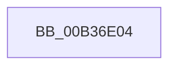

# sub_00B36E04

- RVA: `0x00B36E04`–`0x00B36E7C` (길이 `120` bytes)
- VA: `0x0000000140B36E04`
- 실행 섹션: `PAGE`
- PDB 이름 있음: `아니요`; PDB Function 태그: `아니요`
- unwind 정보 RVA: `0x000A9A28`
- 디코드: `26`개 명령, `120/120` bytes 표시
- 미해석 바이트: `0` (있으면 어셈블리에 `.byte`로 보존)

> 이 문서는 커널 이미지의 기계어와 PDB 기호를 분석해 생성했습니다. 4번과 5번은 함수 원형과 자료형을 바이너리 사용 방식에서 추정한 C 해석이며 원본 소스 복구 결과는 아닙니다.

## 1. Dependencies

- 직접 호출 지점: **1**; 고유 호출 대상: **1**
- 직접 호출자로 확인된 함수: **0**
- RIP 상대 이미지 참조: **1**

### Outgoing calls
- `0x00B36E71` → [SepIsImageInMinTcbList](../A1/SepIsImageInMinTcbList_function_00A12DE0.md) (function, `0x00A12DE0`)

### Direct callers
- 이 함수 시작 RVA로 연결되는 직접 call은 확인되지 않았습니다. 간접 호출은 완전히 역산할 수 없습니다.

### Static image references
- `0x00B36E61` → RVA `0x00B4CED0` (`PAGE`; read)

## 2. Other-region calls and transfers

- 다른 실행 섹션으로 향하는 call: **0**
- call이 아닌 외부 분기/꼬리 이동: **1**
  - `0x00B36E77` → [SepIsSystemAppTCB + 0x82](../A1/SepIsSystemAppTCB_function_00A13434.md) (`tail-transfer`)

## 3. Assembly (complete function range)

```asm
00B36E04  0F B7 17                        movzx edx, word ptr [rdi]
00B36E07  4C 8D 44 24 50                  lea r8, [rsp + 0x50]
00B36E0C  0F B7 C2                        movzx eax, dx
00B36E0F  45 8B CF                        mov r9d, r15d
00B36E12  66 2B C6                        sub ax, si
00B36E15  0F B7 C8                        movzx ecx, ax
00B36E18  48 8B 47 08                     mov rax, qword ptr [rdi + 8]
00B36E1C  48 2B D1                        sub rdx, rcx
00B36E1F  48 D1 EA                        shr rdx, 1
00B36E22  66 89 4C 24 50                  mov word ptr [rsp + 0x50], cx
00B36E27  66 89 4C 24 52                  mov word ptr [rsp + 0x52], cx
00B36E2C  48 8D 0C 50                     lea rcx, [rax + rdx*2]
00B36E30  48 8B 84 24 B0 00 00 00         mov rax, qword ptr [rsp + 0xb0]
00B36E38  48 89 44 24 40                  mov qword ptr [rsp + 0x40], rax
00B36E3D  BA 02 00 00 00                  mov edx, 2
00B36E42  48 8B 84 24 A8 00 00 00         mov rax, qword ptr [rsp + 0xa8]
00B36E4A  48 89 44 24 38                  mov qword ptr [rsp + 0x38], rax
00B36E4F  48 8B 84 24 A0 00 00 00         mov rax, qword ptr [rsp + 0xa0]
00B36E57  48 89 44 24 30                  mov qword ptr [rsp + 0x30], rax
00B36E5C  48 89 4C 24 58                  mov qword ptr [rsp + 0x58], rcx
00B36E61  48 8D 0D 68 60 01 00            lea rcx, [rip + 0x16068]
00B36E68  44 88 74 24 28                  mov byte ptr [rsp + 0x28], r14b
00B36E6D  88 5C 24 20                     mov byte ptr [rsp + 0x20], bl
00B36E71  E8 6A BF ED FF                  call 0x140a12de0
00B36E76  90                              nop
00B36E77  E9 3A C6 ED FF                  jmp 0x140a134b6
```

## 4. C-style interpretation (structured pseudocode)

```c
__int64 __fastcall sub_00B36E04(__int64 a1, __int64 a2, __int64 a3, __int64 a4, __int64 a5, __int64 a6, __int64 a7, __int64 a8, __int64 a9, __int64 a10, __int64 a11, __int64 a12, __int64 a13, __int64 a14, __int64 a15, __int64 a16, __int64 a17, __int64 a18, __int64 a19, __int64 a20, __int64 a21, __int64 a22)
{
    __int64 result;
    unsigned __int8 v_stack_p20;
    unsigned __int8 v_stack_p28;
    unsigned __int64 v_stack_p30;
    unsigned __int64 v_stack_p38;
    unsigned __int64 v_stack_p40;
    unsigned __int16 v_stack_p50;
    unsigned __int16 v_stack_p52;
    unsigned __int64 v_stack_p58;

    result = (unsigned __int16)(((unsigned __int16)(*(unsigned __int16 *)(v_rdi))) - ((unsigned __int16)(v_rsi)));
    a2 = (*(unsigned __int16 *)(v_rdi)) - ((unsigned __int16)(result));
    a2 = (a2) >> (1);
    v_stack_p50 = (unsigned __int16)((unsigned __int16)(result));
    v_stack_p52 = (unsigned __int16)((unsigned __int16)(result));
    v_stack_p40 = a22;
    v_stack_p38 = a21;
    v_stack_p30 = a20;
    v_stack_p58 = *(unsigned __int64 *)(v_rdi + 8) + a2 * 2;
    v_stack_p28 = (unsigned __int8)(v_r14);
    v_stack_p20 = (unsigned __int8)(v_rbx);
    result = SepIsImageInMinTcbList(v_rip + 90216, 2, a10, (unsigned int)((unsigned int)(v_r15)));
}
```

## 5. (Beta) C Style

```c
int64_t sub_00B36E04(int64_t Arg1, int64_t Arg2, int64_t Arg3, int64_t Arg4, uint64_t Arg5, uint64_t Arg6, uint64_t Arg7, uint64_t Arg8, uint64_t Arg9, int64_t Arg10, uint64_t Arg11, uint64_t Arg12, uint64_t Arg13, uint64_t Arg14, uint64_t Arg15, uint64_t Arg16, uint64_t Arg17, uint64_t Arg18, uint64_t Arg19, int64_t Arg20, int64_t Arg21, int64_t Arg22)
{
    int64_t result;
    uint8_t v_stack_p20;
    uint8_t v_stack_p28;
    uint64_t v_stack_p30;
    uint64_t v_stack_p38;
    uint64_t v_stack_p40;
    uint16_t v_stack_p50;
    uint16_t v_stack_p52;
    uint64_t v_stack_p58;

    result = (uint16_t)(((uint16_t)(*(uint16_t *)(local_rdi))) - ((uint16_t)(local_rsi)));
    Arg2 = (*(uint16_t *)(local_rdi)) - ((uint16_t)(result));
    Arg2 = (Arg2) >> (1);
    v_stack_p50 = (uint16_t)((uint16_t)(result));
    v_stack_p52 = (uint16_t)((uint16_t)(result));
    v_stack_p40 = Arg22;
    v_stack_p38 = Arg21;
    v_stack_p30 = Arg20;
    v_stack_p58 = *(uint64_t *)(local_rdi + 0x8) + Arg2 * 2;
    v_stack_p28 = (uint8_t)(local_r14);
    v_stack_p20 = (uint8_t)(local_rbx);
    result = SepIsImageInMinTcbList(v_rip + 90216, 2, Arg10, (uint32_t)((uint32_t)(local_r15)));
}
```

## 6. Execution-region graph

[열기: 2D/3D 그래프와 함수 탐색 컨트롤 패널](../../../control-panel.html?section=page&rva=0x00B36E04&view=graph)

- 2D 그래프는 위에서 아래로 흐르고, 3D 그래프는 빈 공간을 드래그해 회전합니다. Shift+드래그는 이동, 휠은 확대·축소, 함수 노드 선택은 대상 보고서 이동입니다.

### Static fallback


