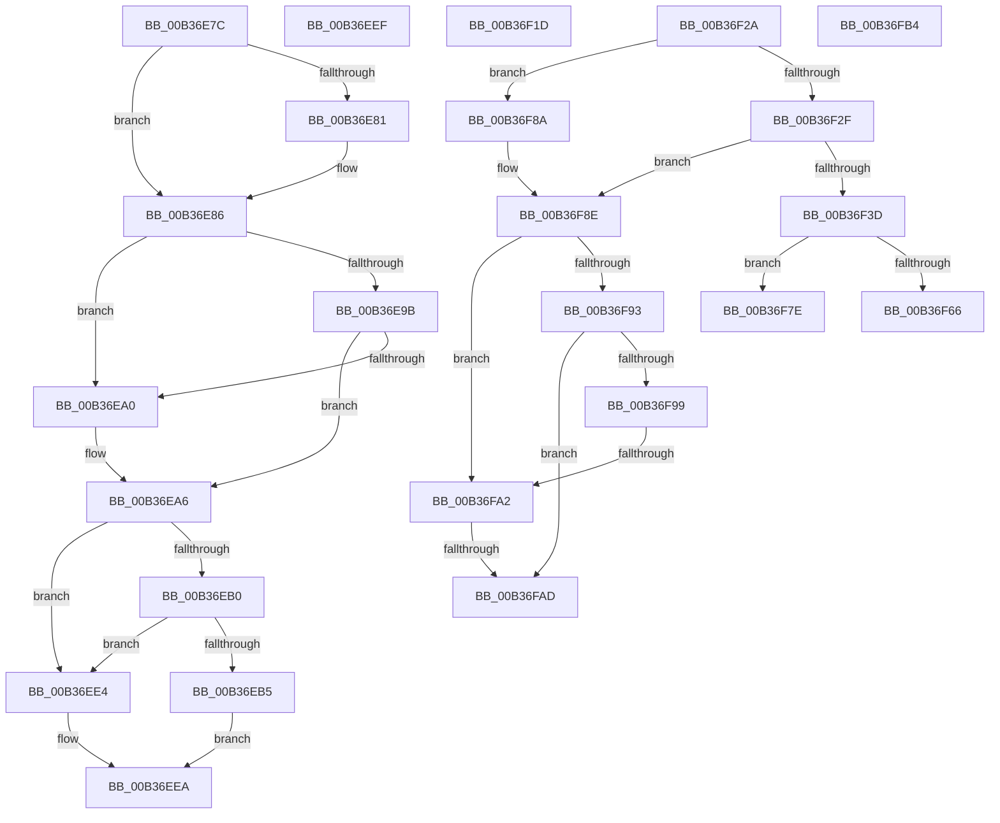

# sub_00B36E7C

- RVA: `0x00B36E7C`–`0x00B36FCB` (길이 `335` bytes)
- VA: `0x0000000140B36E7C`
- 실행 섹션: `PAGE`
- PDB 이름 있음: `아니요`; PDB Function 태그: `아니요`
- unwind 정보 RVA: `0x000A9C64`
- 디코드: `88`개 명령, `335/335` bytes 표시
- 미해석 바이트: `0` (있으면 어셈블리에 `.byte`로 보존)

> 이 문서는 커널 이미지의 기계어와 PDB 기호를 분석해 생성했습니다. 4번과 5번은 함수 원형과 자료형을 바이너리 사용 방식에서 추정한 C 해석이며 원본 소스 복구 결과는 아닙니다.

## 1. Dependencies

- 직접 호출 지점: **2**; 고유 호출 대상: **2**
- 직접 호출자로 확인된 함수: **0**
- RIP 상대 이미지 참조: **0**

### Outgoing calls
- `0x00B36E81` → [ExRaiseDatatypeMisalignment](../89/ExRaiseDatatypeMisalignment_function_00899FD0.md) (function, `0x00899FD0`)
- `0x00B36F5B` → [PiControlMakeUserModeCallersCopy](../8E/PiControlMakeUserModeCallersCopy_function_008E4630.md) (function, `0x008E4630`)

### Direct callers
- 이 함수 시작 RVA로 연결되는 직접 call은 확인되지 않았습니다. 간접 호출은 완전히 역산할 수 없습니다.

### Static image references
- 디코드된 RIP-relative 메모리 참조가 없습니다.

## 2. Other-region calls and transfers

- 다른 실행 섹션으로 향하는 call: **0**
- call이 아닌 외부 분기/꼬리 이동: **9**
  - `0x00B36EEA` → [PiCMCaptureInterfaceListInputData + 0xF2](../A1/PiCMCaptureInterfaceListInputData_function_00A165D4.md) (`tail-transfer`)
  - `0x00B36F18` → [PiCMCaptureInterfaceListInputData + 0xF2](../A1/PiCMCaptureInterfaceListInputData_function_00A165D4.md) (`tail-transfer`)
  - `0x00B36F25` → [PiCMCaptureInterfaceListInputData + 0x123](../A1/PiCMCaptureInterfaceListInputData_function_00A165D4.md) (`tail-transfer`)
  - `0x00B36F79` → [PiCMCaptureInterfaceListInputData + 0x123](../A1/PiCMCaptureInterfaceListInputData_function_00A165D4.md) (`tail-transfer`)
  - `0x00B36F85` → [PiCMCaptureInterfaceListInputData + 0x123](../A1/PiCMCaptureInterfaceListInputData_function_00A165D4.md) (`tail-transfer`)
  - `0x00B36F9C` → [PiCMCaptureInterfaceListInputData + 0x123](../A1/PiCMCaptureInterfaceListInputData_function_00A165D4.md) (`tail-transfer`)
  - `0x00B36FA7` → [PiCMCaptureInterfaceListInputData + 0x123](../A1/PiCMCaptureInterfaceListInputData_function_00A165D4.md) (`tail-transfer`)
  - `0x00B36FAF` → [PiCMCaptureInterfaceListInputData + 0x1A1](../A1/PiCMCaptureInterfaceListInputData_function_00A165D4.md) (`tail-transfer`)
  - `0x00B36FC6` → [PiCMCaptureInterfaceListInputData + 0x127](../A1/PiCMCaptureInterfaceListInputData_function_00A165D4.md) (`tail-transfer`)

## 3. Assembly (complete function range)

```asm
00B36E7C  F6 C1 03                        test cl, 3
00B36E7F  74 05                           je 0x140b36e86
00B36E81  E8 4A 31 D6 FF                  call 0x140899fd0
00B36E86  44 8B C2                        mov r8d, edx
00B36E89  4C 03 C1                        add r8, rcx
00B36E8C  48 B8 00 00 FF FF FF 7F 00 00   movabs rax, 0x7fffffff0000
00B36E96  4C 3B C0                        cmp r8, rax
00B36E99  77 05                           ja 0x140b36ea0
00B36E9B  4C 3B C1                        cmp r8, rcx
00B36E9E  73 06                           jae 0x140b36ea6
00B36EA0  8A 00                           mov al, byte ptr [rax]
00B36EA2  8B 5C 24 34                     mov ebx, dword ptr [rsp + 0x34]
00B36EA6  BE 0D 00 00 C0                  mov esi, 0xc000000d
00B36EAB  83 FA 24                        cmp edx, 0x24
00B36EAE  72 34                           jb 0x140b36ee4
00B36EB0  83 39 24                        cmp dword ptr [rcx], 0x24
00B36EB3  75 2F                           jne 0x140b36ee4
00B36EB5  41 C7 01 28 00 00 00            mov dword ptr [r9], 0x28
00B36EBC  8B 41 04                        mov eax, dword ptr [rcx + 4]
00B36EBF  41 89 41 04                     mov dword ptr [r9 + 4], eax
00B36EC3  0F 10 41 08                     movups xmm0, xmmword ptr [rcx + 8]
00B36EC7  F3 41 0F 7F 41 08               movdqu xmmword ptr [r9 + 8], xmm0
00B36ECD  8B 41 18                        mov eax, dword ptr [rcx + 0x18]
00B36ED0  49 89 41 18                     mov qword ptr [r9 + 0x18], rax
00B36ED4  8B 41 1C                        mov eax, dword ptr [rcx + 0x1c]
00B36ED7  41 89 41 20                     mov dword ptr [r9 + 0x20], eax
00B36EDB  8B 41 20                        mov eax, dword ptr [rcx + 0x20]
00B36EDE  41 89 41 24                     mov dword ptr [r9 + 0x24], eax
00B36EE2  EB 06                           jmp 0x140b36eea
00B36EE4  8B DE                           mov ebx, esi
00B36EE6  89 5C 24 34                     mov dword ptr [rsp + 0x34], ebx
00B36EEA  E9 D7 F7 ED FF                  jmp 0x140a166c6
00B36EEF  8B D8                           mov ebx, eax
00B36EF1  89 44 24 34                     mov dword ptr [rsp + 0x34], eax
00B36EF5  33 FF                           xor edi, edi
00B36EF7  BE 0D 00 00 C0                  mov esi, 0xc000000d
00B36EFC  4C 8B B4 24 98 00 00 00         mov r14, qword ptr [rsp + 0x98]
00B36F04  89 7C 24 38                     mov dword ptr [rsp + 0x38], edi
00B36F08  8A 44 24 30                     mov al, byte ptr [rsp + 0x30]
00B36F0C  88 84 24 80 00 00 00            mov byte ptr [rsp + 0x80], al
00B36F13  4C 8B 64 24 40                  mov r12, qword ptr [rsp + 0x40]
00B36F18  E9 A9 F7 ED FF                  jmp 0x140a166c6
00B36F1D  49 89 3F                        mov qword ptr [r15], rdi
00B36F20  41 89 7C 24 20                  mov dword ptr [r12 + 0x20], edi
00B36F25  E9 CD F7 ED FF                  jmp 0x140a166f7
00B36F2A  4D 85 ED                        test r13, r13
00B36F2D  74 5B                           je 0x140b36f8a
00B36F2F  4D 8D 66 20                     lea r12, [r14 + 0x20]
00B36F33  45 8B 04 24                     mov r8d, dword ptr [r12]
00B36F37  41 83 F8 02                     cmp r8d, 2
00B36F3B  72 51                           jb 0x140b36f8e
00B36F3D  BE 01 00 00 00                  mov esi, 1
00B36F42  89 74 24 28                     mov dword ptr [rsp + 0x28], esi
00B36F46  8A 84 24 80 00 00 00            mov al, byte ptr [rsp + 0x80]
00B36F4D  88 44 24 20                     mov byte ptr [rsp + 0x20], al
00B36F51  44 8D 4E 01                     lea r9d, [rsi + 1]
00B36F55  49 8B D5                        mov rdx, r13
00B36F58  49 8B CF                        mov rcx, r15
00B36F5B  E8 D0 D6 DA FF                  call 0x1408e4630
00B36F60  8B D8                           mov ebx, eax
00B36F62  85 C0                           test eax, eax
00B36F64  78 18                           js 0x140b36f7e
00B36F66  89 74 24 38                     mov dword ptr [rsp + 0x38], esi
00B36F6A  41 8B 0C 24                     mov ecx, dword ptr [r12]
00B36F6E  48 D1 E9                        shr rcx, 1
00B36F71  49 8B 07                        mov rax, qword ptr [r15]
00B36F74  66 89 7C 48 FE                  mov word ptr [rax + rcx*2 - 2], di
00B36F79  E9 79 F7 ED FF                  jmp 0x140a166f7
00B36F7E  49 89 3F                        mov qword ptr [r15], rdi
00B36F81  41 89 3C 24                     mov dword ptr [r12], edi
00B36F85  E9 6D F7 ED FF                  jmp 0x140a166f7
00B36F8A  49 83 C4 20                     add r12, 0x20
00B36F8E  4D 85 ED                        test r13, r13
00B36F91  75 0F                           jne 0x140b36fa2
00B36F93  41 39 3C 24                     cmp dword ptr [r12], edi
00B36F97  77 14                           ja 0x140b36fad
00B36F99  4D 85 ED                        test r13, r13
00B36F9C  0F 84 55 F7 ED FF               je 0x140a166f7
00B36FA2  41 83 3C 24 02                  cmp dword ptr [r12], 2
00B36FA7  0F 83 4A F7 ED FF               jae 0x140a166f7
00B36FAD  8B DE                           mov ebx, esi
00B36FAF  E9 C1 F7 ED FF                  jmp 0x140a16775
00B36FB4  0F 57 C0                        xorps xmm0, xmm0
00B36FB7  33 C0                           xor eax, eax
00B36FB9  41 0F 11 06                     movups xmmword ptr [r14], xmm0
00B36FBD  41 0F 11 46 10                  movups xmmword ptr [r14 + 0x10], xmm0
00B36FC2  49 89 46 20                     mov qword ptr [r14 + 0x20], rax
00B36FC6  E9 30 F7 ED FF                  jmp 0x140a166fb
```

## 4. C-style interpretation (structured pseudocode)

```c
__int64 __fastcall sub_00B36E7C(__int64 a1, int a2, __int64 a3, __int64 a4)
{
    __int64 result;
    __int64 v_rbx;
    unsigned __int8 v_stack_p20;
    unsigned int v_stack_p28;
    unsigned __int8 v_stack_p30;
    unsigned int v_stack_p34;
    unsigned int v_stack_p38;
    unsigned __int64 v_stack_p40;
    unsigned __int8 v_stack_p80;
    unsigned __int64 v_stack_p98;

    if ((((unsigned __int8)(a1)) & (3)) != 0) {
        result = ExRaiseDatatypeMisalignment(a1, a2, a3, a4);
    }
    a3 = ((unsigned int)(a2)) + (a1);
    if (a3 > result) goto loc_00B36EA0;
    if (a3 < a1) {
        result = *(unsigned __int8 *)(result);
        v_rbx = v_stack_p34;
    }
    if (a2 < 36) goto loc_00B36EE4;
    if ((*(unsigned int *)(a1)) != 36) goto loc_00B36EE4;
    *(unsigned int *)(a4) = 40;
    *(unsigned int *)(a4 + 4) = (unsigned int)((unsigned int)(*(unsigned int *)(a1 + 4)));
    *(unsigned __int64 *)(a4 + 8) = v_xmm0;
    *(unsigned __int64 *)(a4 + 24) = (unsigned int)(*(unsigned int *)(a1 + 24));
    *(unsigned int *)(a4 + 32) = (unsigned int)((unsigned int)(*(unsigned int *)(a1 + 28)));
    *(unsigned int *)(a4 + 36) = (unsigned int)((unsigned int)(*(unsigned int *)(a1 + 32)));
    goto loc_00B36EEA;
loc_00B36EE4:
    v_stack_p34 = (unsigned int)((unsigned int)((unsigned int)((unsigned int)(0xC000000DULL))));
loc_00B36EEA:
}
```

## 5. (Beta) C Style

```c
int64_t sub_00B36E7C(int64_t Arg1, int32_t Arg2, int64_t Arg3, int64_t Arg4)
{
    int64_t result;
    int64_t local_rbx;
    uint8_t v_stack_p20;
    uint32_t v_stack_p28;
    uint8_t v_stack_p30;
    uint32_t v_stack_p34;
    uint32_t v_stack_p38;
    uint64_t v_stack_p40;
    uint8_t v_stack_p80;
    uint64_t v_stack_p98;

    if ((((uint8_t)(Arg1)) & (3)) != 0) {
        result = ExRaiseDatatypeMisalignment(Arg1, Arg2, Arg3, Arg4);
    }
    Arg3 = ((uint32_t)(Arg2)) + (Arg1);
    if (Arg3 > result) goto loc_00B36EA0;
    if (Arg3 < Arg1) {
        result = *(uint8_t *)(result);
        local_rbx = v_stack_p34;
    }
    if (Arg2 < 36) goto loc_00B36EE4;
    if ((*(uint32_t *)(Arg1)) != 36) goto loc_00B36EE4;
    *(uint32_t *)(Arg4) = 40;
    *(uint32_t *)(Arg4 + 0x4) = (uint32_t)((uint32_t)(*(uint32_t *)(Arg1 + 0x4)));
    *(uint64_t *)(Arg4 + 0x8) = v_xmm0;
    *(uint64_t *)(Arg4 + 0x18) = (uint32_t)(*(uint32_t *)(Arg1 + 0x18));
    *(uint32_t *)(Arg4 + 0x20) = (uint32_t)((uint32_t)(*(uint32_t *)(Arg1 + 0x1C)));
    *(uint32_t *)(Arg4 + 0x24) = (uint32_t)((uint32_t)(*(uint32_t *)(Arg1 + 0x20)));
    goto loc_00B36EEA;
loc_00B36EE4:
    v_stack_p34 = (uint32_t)((uint32_t)((uint32_t)((uint32_t)(0xC000000DULL))));
loc_00B36EEA:
}
```

## 6. Execution-region graph

[열기: 2D/3D 그래프와 함수 탐색 컨트롤 패널](../../../control-panel.html?section=page&rva=0x00B36E7C&view=graph)

- 2D 그래프는 위에서 아래로 흐르고, 3D 그래프는 빈 공간을 드래그해 회전합니다. Shift+드래그는 이동, 휠은 확대·축소, 함수 노드 선택은 대상 보고서 이동입니다.

### Static fallback


