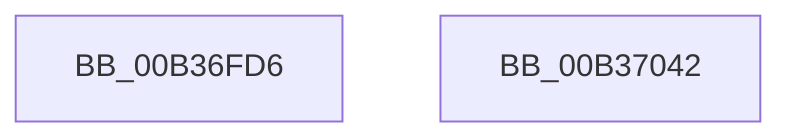

# sub_00B36FD6

- RVA: `0x00B36FD6`–`0x00B370C4` (길이 `238` bytes)
- VA: `0x0000000140B36FD6`
- 실행 섹션: `PAGE`
- PDB 이름 있음: `아니요`; PDB Function 태그: `아니요`
- unwind 정보 RVA: `0x000A9DE8`
- 디코드: `39`개 명령, `238/238` bytes 표시
- 미해석 바이트: `0` (있으면 어셈블리에 `.byte`로 보존)

> 이 문서는 커널 이미지의 기계어와 PDB 기호를 분석해 생성했습니다. 4번과 5번은 함수 원형과 자료형을 바이너리 사용 방식에서 추정한 C 해석이며 원본 소스 복구 결과는 아닙니다.

## 1. Dependencies

- 직접 호출 지점: **2**; 고유 호출 대상: **1**
- 직접 호출자로 확인된 함수: **0**
- RIP 상대 이미지 참조: **2**

### Outgoing calls
- `0x00B37037` → [tlgWriteTransfer_EtwWriteTransfer](../../text/42/tlgWriteTransfer_EtwWriteTransfer_function_004260E0.md) (function, `0x004260E0`)
- `0x00B370B9` → [tlgWriteTransfer_EtwWriteTransfer](../../text/42/tlgWriteTransfer_EtwWriteTransfer_function_004260E0.md) (function, `0x004260E0`)

### Direct callers
- 이 함수 시작 RVA로 연결되는 직접 call은 확인되지 않았습니다. 간접 호출은 완전히 역산할 수 없습니다.

### Static image references
- `0x00B37029` → RVA `0x0005A8B2` (`.rdata`; read)
- `0x00B37030` → RVA `0x00E0A630` (`.data`; read)

## 2. Other-region calls and transfers

- 다른 실행 섹션으로 향하는 call: **2**
  - `0x00B37037` → [tlgWriteTransfer_EtwWriteTransfer](../../text/42/tlgWriteTransfer_EtwWriteTransfer_function_004260E0.md) (`PAGE` → `.text`)
  - `0x00B370B9` → [tlgWriteTransfer_EtwWriteTransfer](../../text/42/tlgWriteTransfer_EtwWriteTransfer_function_004260E0.md) (`PAGE` → `.text`)
- call이 아닌 외부 분기/꼬리 이동: **2**
  - `0x00B3703D` → [VrpPreQueryKeyName + 0x67](../A1/VrpPreQueryKeyName_function_00A16DB8.md) (`tail-transfer`)
  - `0x00B370BF` → [VrpPreQueryKeyName + 0x113](../A1/VrpPreQueryKeyName_function_00A16DB8.md) (`tail-transfer`)

## 3. Assembly (complete function range)

```asm
00B36FD6  0F B7 08                        movzx ecx, word ptr [rax]
00B36FD9  48 8B 40 08                     mov rax, qword ptr [rax + 8]
00B36FDD  48 8D 94 24 98 00 00 00         lea rdx, [rsp + 0x98]
00B36FE5  48 89 94 24 80 00 00 00         mov qword ptr [rsp + 0x80], rdx
00B36FED  48 C7 84 24 88 00 00 00 02 00 00 00  mov qword ptr [rsp + 0x88], 2
00B36FF9  48 89 84 24 90 00 00 00         mov qword ptr [rsp + 0x90], rax
00B37001  89 8C 24 98 00 00 00            mov dword ptr [rsp + 0x98], ecx
00B37008  89 BC 24 9C 00 00 00            mov dword ptr [rsp + 0x9c], edi
00B3700F  48 8D 44 24 60                  lea rax, [rsp + 0x60]
00B37014  48 89 44 24 28                  mov qword ptr [rsp + 0x28], rax
00B37019  C7 44 24 20 04 00 00 00         mov dword ptr [rsp + 0x20], 4
00B37021  45 33 C9                        xor r9d, r9d
00B37024  4C 8D 44 24 50                  lea r8, [rsp + 0x50]
00B37029  48 8D 15 82 38 52 FF            lea rdx, [rip - 0xadc77e]
00B37030  48 8D 0D F9 35 2D 00            lea rcx, [rip + 0x2d35f9]
00B37037  E8 A4 F0 8E FF                  call 0x1404260e0
00B3703C  90                              nop
00B3703D  E9 DD FD ED FF                  jmp 0x140a16e1f
00B37042  48 8D 84 24 98 00 00 00         lea rax, [rsp + 0x98]
00B3704A  48 89 84 24 80 00 00 00         mov qword ptr [rsp + 0x80], rax
00B37052  48 8B 46 08                     mov rax, qword ptr [rsi + 8]
00B37056  48 89 84 24 90 00 00 00         mov qword ptr [rsp + 0x90], rax
00B3705E  0F B7 06                        movzx eax, word ptr [rsi]
00B37061  89 84 24 98 00 00 00            mov dword ptr [rsp + 0x98], eax
00B37068  48 8D 44 24 30                  lea rax, [rsp + 0x30]
00B3706D  48 89 84 24 A0 00 00 00         mov qword ptr [rsp + 0xa0], rax
00B37075  48 8D 44 24 60                  lea rax, [rsp + 0x60]
00B3707A  48 89 44 24 28                  mov qword ptr [rsp + 0x28], rax
00B3707F  C7 44 24 20 05 00 00 00         mov dword ptr [rsp + 0x20], 5
00B37087  48 C7 84 24 88 00 00 00 02 00 00 00  mov qword ptr [rsp + 0x88], 2
00B37093  89 BC 24 9C 00 00 00            mov dword ptr [rsp + 0x9c], edi
00B3709A  89 5C 24 30                     mov dword ptr [rsp + 0x30], ebx
00B3709E  48 C7 84 24 A8 00 00 00 04 00 00 00  mov qword ptr [rsp + 0xa8], 4
00B370AA  45 33 C9                        xor r9d, r9d
00B370AD  4C 8D 44 24 50                  lea r8, [rsp + 0x50]
00B370B2  48 8D 0D 77 35 2D 00            lea rcx, [rip + 0x2d3577]
00B370B9  E8 22 F0 8E FF                  call 0x1404260e0
00B370BE  90                              nop
00B370BF  E9 07 FE ED FF                  jmp 0x140a16ecb
```

## 4. C-style interpretation (structured pseudocode)

```c
__int64 __fastcall sub_00B36FD6(__int64 a1, __int64 a2, __int64 a3, int a4, __int64 a5, __int64 a6, __int64 a7, __int64 a8, __int64 a9, __int64 a10, __int64 a11, __int64 a12, __int64 a13, __int64 a14, __int64 a15, __int64 a16, __int64 a17, __int64 a18, __int64 a19)
{
    __int64 result;
    unsigned int v_stack_p20;
    unsigned __int64 v_stack_p28;
    unsigned __int64 v_stack_p30;
    unsigned __int64 v_stack_p50;
    unsigned __int64 v_stack_p60;
    unsigned __int64 v_stack_p80;
    unsigned __int64 v_stack_p88;
    unsigned __int64 v_stack_p90;
    unsigned int v_stack_p98;
    unsigned int v_stack_p9C;
    unsigned __int64 v_stack_pA0;
    unsigned __int64 v_stack_pA8;

    v_stack_p80 = a19;
    v_stack_p88 = 2;
    v_stack_p90 = *(unsigned __int64 *)(result + 8);
    v_stack_p98 = (unsigned int)(*(unsigned __int16 *)(result));
    v_stack_p9C = (unsigned int)(v_rdi);
    v_stack_p28 = a12;
    v_stack_p20 = 4;
    a4 = 0;
    result = tlgWriteTransfer_EtwWriteTransfer(v_rip + 2962937, v_rip - 11388798, a10, a4);
}
```

## 5. (Beta) C Style

```c
int64_t sub_00B36FD6(int64_t Arg1, int64_t Arg2, int64_t Arg3, int32_t Arg4, uint64_t Arg5, uint64_t Arg6, uint64_t Arg7, uint64_t Arg8, uint64_t Arg9, int64_t Arg10, uint64_t Arg11, int64_t Arg12, uint64_t Arg13, uint64_t Arg14, uint64_t Arg15, uint64_t Arg16, uint64_t Arg17, uint64_t Arg18, int64_t Arg19)
{
    int64_t result;
    uint32_t v_stack_p20;
    uint64_t v_stack_p28;
    uint64_t v_stack_p30;
    uint64_t v_stack_p50;
    uint64_t v_stack_p60;
    uint64_t v_stack_p80;
    uint64_t v_stack_p88;
    uint64_t v_stack_p90;
    uint32_t v_stack_p98;
    uint32_t v_stack_p9C;
    uint64_t v_stack_pA0;
    uint64_t v_stack_pA8;

    v_stack_p80 = Arg19;
    v_stack_p88 = 2;
    v_stack_p90 = *(uint64_t *)(result + 0x8);
    v_stack_p98 = (uint32_t)(*(uint16_t *)(result));
    v_stack_p9C = (uint32_t)(local_rdi);
    v_stack_p28 = Arg12;
    v_stack_p20 = 4;
    Arg4 = 0;
    result = tlgWriteTransfer_EtwWriteTransfer(v_rip + 2962937, v_rip - 11388798, Arg10, Arg4);
}
```

## 6. Execution-region graph

[열기: 2D/3D 그래프와 함수 탐색 컨트롤 패널](../../../control-panel.html?section=page&rva=0x00B36FD6&view=graph)

- 2D 그래프는 위에서 아래로 흐르고, 3D 그래프는 빈 공간을 드래그해 회전합니다. Shift+드래그는 이동, 휠은 확대·축소, 함수 노드 선택은 대상 보고서 이동입니다.

### Static fallback


