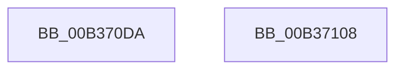

# sub_00B370DA

- RVA: `0x00B370DA`–`0x00B37110` (길이 `54` bytes)
- VA: `0x0000000140B370DA`
- 실행 섹션: `PAGE`
- PDB 이름 있음: `아니요`; PDB Function 태그: `아니요`
- unwind 정보 RVA: `0x000AA020`
- 디코드: `14`개 명령, `54/54` bytes 표시
- 미해석 바이트: `0` (있으면 어셈블리에 `.byte`로 보존)

> 이 문서는 커널 이미지의 기계어와 PDB 기호를 분석해 생성했습니다. 4번과 5번은 함수 원형과 자료형을 바이너리 사용 방식에서 추정한 C 해석이며 원본 소스 복구 결과는 아닙니다.

## 1. Dependencies

- 직접 호출 지점: **1**; 고유 호출 대상: **1**
- 직접 호출자로 확인된 함수: **0**
- RIP 상대 이미지 참조: **0**

### Outgoing calls
- `0x00B370E3` → [memcpy](../../text/6C/memcpy_function_006C6840.md) (function, `0x006C6840`)

### Direct callers
- 이 함수 시작 RVA로 연결되는 직접 call은 확인되지 않았습니다. 간접 호출은 완전히 역산할 수 없습니다.

### Static image references
- 디코드된 RIP-relative 메모리 참조가 없습니다.

## 2. Other-region calls and transfers

- 다른 실행 섹션으로 향하는 call: **1**
  - `0x00B370E3` → [memcpy](../../text/6C/memcpy_function_006C6840.md) (`PAGE` → `.text`)
- call이 아닌 외부 분기/꼬리 이동: **2**
  - `0x00B37103` → [LocalpConvertStringSidToSid + 0x260](../A1/LocalpConvertStringSidToSid_function_00A17490.md) (`tail-transfer`)
  - `0x00B3710B` → [LocalpConvertStringSidToSid + 0x2FC](../A1/LocalpConvertStringSidToSid_function_00A17490.md) (`tail-transfer`)

## 3. Assembly (complete function range)

```asm
00B370DA  4D 8B C4                        mov r8, r12
00B370DD  49 8B D5                        mov rdx, r13
00B370E0  49 8B CE                        mov rcx, r14
00B370E3  E8 58 F7 B8 FF                  call 0x1406c6840
00B370E8  48 8B 44 24 60                  mov rax, qword ptr [rsp + 0x60]
00B370ED  45 33 C0                        xor r8d, r8d
00B370F0  44 8B 64 24 40                  mov r12d, dword ptr [rsp + 0x40]
00B370F5  40 FE C6                        inc sil
00B370F8  66 47 89 04 37                  mov word ptr [r15 + r14], r8w
00B370FD  48 89 38                        mov qword ptr [rax], rdi
00B37100  40 8A C6                        mov al, sil
00B37103  E9 E8 05 EE FF                  jmp 0x140a176f0
00B37108  49 89 3F                        mov qword ptr [r15], rdi
00B3710B  E9 7C 06 EE FF                  jmp 0x140a1778c
```

## 4. C-style interpretation (structured pseudocode)

```c
__int64 __fastcall sub_00B370DA(__int64 a1, __int64 a2, __int64 a3, __int64 a4, __int64 a5, __int64 a6, __int64 a7, unsigned int a8, __int64 a9, __int64 a10, __int64 a11, __int64 a12)
{
    __int64 result;
    __int64 v_rsi;

    result = memcpy(v_r14, v_r13, v_r12, a4);
    a3 = 0;
    v_rsi = (unsigned __int8)((v_rsi) + 1);
    *(unsigned __int16 *)(v_r15 + v_r14 * 1) = 0;
    *(unsigned __int64 *)(a12) = v_rdi;
}
```

## 5. (Beta) C Style

```c
int64_t sub_00B370DA(int64_t Arg1, int64_t Arg2, int64_t Arg3, int64_t Arg4, uint64_t Arg5, uint64_t Arg6, uint64_t Arg7, uint32_t Arg8, uint64_t Arg9, uint64_t Arg10, uint64_t Arg11, void *Arg12)
{
    uint8_t *arg12 = (uint8_t *)Arg12;

    int64_t result;
    int64_t local_rsi;

    result = memcpy(local_r14, local_r13, local_r12, Arg4);
    Arg3 = 0;
    local_rsi = (uint8_t)((local_rsi) + 1);
    *(uint16_t *)(local_r15 + local_r14 * 1) = 0;
    *(uint64_t *)(arg12) = local_rdi;
}
```

### 관측된 메모리 오프셋

구조체 형식이 확인되지 않은 접근은 인자 기준의 오프셋으로만 기록했습니다.

| 기준 인자 | 오프셋 표현 | 폭 (bit) | 접근 |
|---|---:|---:|---|
| `Arg12` | `+ 0x0` | `64` | `W` |

## 6. Execution-region graph

[열기: 2D/3D 그래프와 함수 탐색 컨트롤 패널](../../../control-panel.html?section=page&rva=0x00B370DA&view=graph)

- 2D 그래프는 위에서 아래로 흐르고, 3D 그래프는 빈 공간을 드래그해 회전합니다. Shift+드래그는 이동, 휠은 확대·축소, 함수 노드 선택은 대상 보고서 이동입니다.

### Static fallback


