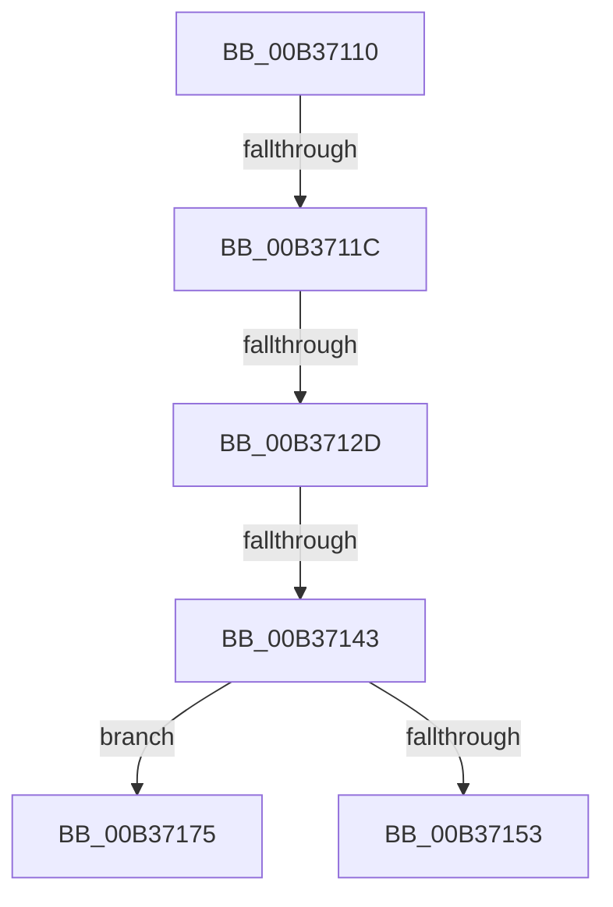

# sub_00B37110

- RVA: `0x00B37110`–`0x00B37181` (길이 `113` bytes)
- VA: `0x0000000140B37110`
- 실행 섹션: `PAGE`
- PDB 이름 있음: `아니요`; PDB Function 태그: `아니요`
- unwind 정보 RVA: `0x000AA114`
- 디코드: `25`개 명령, `113/113` bytes 표시
- 미해석 바이트: `0` (있으면 어셈블리에 `.byte`로 보존)

> 이 문서는 커널 이미지의 기계어와 PDB 기호를 분석해 생성했습니다. 4번과 5번은 함수 원형과 자료형을 바이너리 사용 방식에서 추정한 C 해석이며 원본 소스 복구 결과는 아닙니다.

## 1. Dependencies

- 직접 호출 지점: **2**; 고유 호출 대상: **2**
- 직접 호출자로 확인된 함수: **0**
- RIP 상대 이미지 참조: **0**

### Outgoing calls
- `0x00B3714A` → [PsReferencePartitionSafe](../../text/3B/PsReferencePartitionSafe_function_003BA6C0.md) (function, `0x003BA6C0`)
- `0x00B3716A` → [ExQueueWorkItemToPartition](../../text/35/ExQueueWorkItemToPartition_function_00356E2C.md) (function, `0x00356E2C`)

### Direct callers
- 이 함수 시작 RVA로 연결되는 직접 call은 확인되지 않았습니다. 간접 호출은 완전히 역산할 수 없습니다.

### Static image references
- 디코드된 RIP-relative 메모리 참조가 없습니다.

## 2. Other-region calls and transfers

- 다른 실행 섹션으로 향하는 call: **2**
  - `0x00B3714A` → [PsReferencePartitionSafe](../../text/3B/PsReferencePartitionSafe_function_003BA6C0.md) (`PAGE` → `.text`)
  - `0x00B3716A` → [ExQueueWorkItemToPartition](../../text/35/ExQueueWorkItemToPartition_function_00356E2C.md) (`PAGE` → `.text`)
- call이 아닌 외부 분기/꼬리 이동: **5**
  - `0x00B37116` → [MiContractWsSwapPageFile + 0x39](../A1/MiContractWsSwapPageFile_function_00A182C4.md) (`tail-transfer`)
  - `0x00B37127` → [MiContractWsSwapPageFile + 0x39](../A1/MiContractWsSwapPageFile_function_00A182C4.md) (`tail-transfer`)
  - `0x00B3713D` → [MiContractWsSwapPageFile + 0x39](../A1/MiContractWsSwapPageFile_function_00A182C4.md) (`tail-transfer`)
  - `0x00B37170` → [MiContractWsSwapPageFile + 0x39](../A1/MiContractWsSwapPageFile_function_00A182C4.md) (`tail-transfer`)
  - `0x00B3717C` → [MiContractWsSwapPageFile + 0x39](../A1/MiContractWsSwapPageFile_function_00A182C4.md) (`tail-transfer`)

## 3. Assembly (complete function range)

```asm
00B37110  8B 41 14                        mov eax, dword ptr [rcx + 0x14]
00B37113  41 3B C0                        cmp eax, r8d
00B37116  0F 82 E1 11 EE FF               jb 0x140a182fd
00B3711C  8B 11                           mov edx, dword ptr [rcx]
00B3711E  8B 49 08                        mov ecx, dword ptr [rcx + 8]
00B37121  49 2B D0                        sub rdx, r8
00B37124  48 3B D1                        cmp rdx, rcx
00B37127  0F 82 D0 11 EE FF               jb 0x140a182fd
00B3712D  B9 01 00 00 00                  mov ecx, 1
00B37132  33 C0                           xor eax, eax
00B37134  F0 41 0F B1 8B 90 04 00 00      lock cmpxchg dword ptr [r11 + 0x490], ecx
00B3713D  0F 85 BA 11 EE FF               jne 0x140a182fd
00B37143  49 8B 8B B8 00 00 00            mov rcx, qword ptr [r11 + 0xb8]
00B3714A  E8 71 35 88 FF                  call 0x1403ba6c0
00B3714F  84 C0                           test al, al
00B37151  74 22                           je 0x140b37175
00B37153  4D 8B 8B B8 00 00 00            mov r9, qword ptr [r11 + 0xb8]
00B3715A  49 8D 8B 70 04 00 00            lea rcx, [r11 + 0x470]
00B37161  41 83 C8 FF                     or r8d, 0xffffffff
00B37165  BA 03 00 00 00                  mov edx, 3
00B3716A  E8 BD FC 81 FF                  call 0x140356e2c
00B3716F  90                              nop
00B37170  E9 88 11 EE FF                  jmp 0x140a182fd
00B37175  41 87 9B 90 04 00 00            xchg dword ptr [r11 + 0x490], ebx
00B3717C  E9 7C 11 EE FF                  jmp 0x140a182fd
```

## 4. C-style interpretation (structured pseudocode)

```c
__int64 __fastcall sub_00B37110(__int64 a1, __int64 a2, __int64 a3)
{
    __int64 result;

    a2 = ((unsigned int)(*(unsigned int *)(a1))) - (a3);
    result = 0;
    result = PsReferencePartitionSafe(*(unsigned __int64 *)(v_r11 + 184), a2, a3, a4);
    if ((unsigned __int8)(result) == 0) goto loc_00B37175;
    a3 = (unsigned int)((a3) | (0xFFFFFFFFULL));
    result = ExQueueWorkItemToPartition(v_r11 + 1136, 3, a3, *(unsigned __int64 *)(v_r11 + 184));
loc_00B37175:
}
```

## 5. (Beta) C Style

```c
int64_t sub_00B37110(void *Arg1, int64_t Arg2, int64_t Arg3)
{
    uint8_t *arg1 = (uint8_t *)Arg1;

    int64_t result;

    Arg2 = ((uint32_t)(*(uint32_t *)(arg1))) - (Arg3);
    result = 0;
    result = PsReferencePartitionSafe(*(uint64_t *)(local_r11 + 0xB8), Arg2, Arg3, a4);
    if ((uint8_t)(result) == 0) goto loc_00B37175;
    Arg3 = (uint32_t)((Arg3) | (0xFFFFFFFFULL));
    result = ExQueueWorkItemToPartition(local_r11 + 1136, 3, Arg3, *(uint64_t *)(local_r11 + 0xB8));
loc_00B37175:
}
```

### 관측된 메모리 오프셋

구조체 형식이 확인되지 않은 접근은 인자 기준의 오프셋으로만 기록했습니다.

| 기준 인자 | 오프셋 표현 | 폭 (bit) | 접근 |
|---|---:|---:|---|
| `Arg1` | `+ 0x0` | `32` | `R` |
| `Arg1` | `+ 0x8` | `32` | `R` |
| `Arg1` | `+ 0x14` | `32` | `R` |

## 6. Execution-region graph

[열기: 2D/3D 그래프와 함수 탐색 컨트롤 패널](../../../control-panel.html?section=page&rva=0x00B37110&view=graph)

- 2D 그래프는 위에서 아래로 흐르고, 3D 그래프는 빈 공간을 드래그해 회전합니다. Shift+드래그는 이동, 휠은 확대·축소, 함수 노드 선택은 대상 보고서 이동입니다.

### Static fallback


