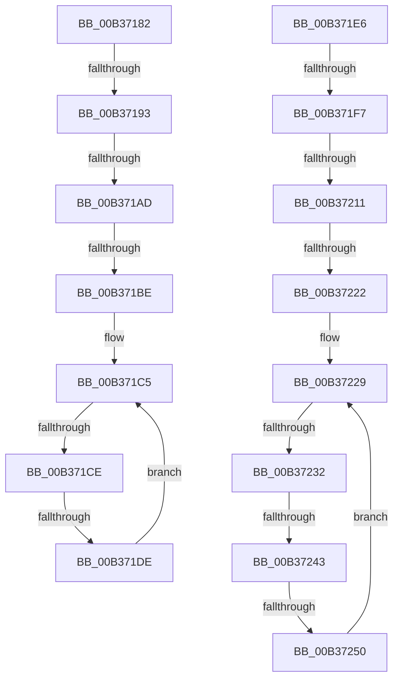

# sub_00B37182

- RVA: `0x00B37182`–`0x00B37255` (길이 `211` bytes)
- VA: `0x0000000140B37182`
- 실행 섹션: `PAGE`
- PDB 이름 있음: `아니요`; PDB Function 태그: `아니요`
- unwind 정보 RVA: `0x000AA17C`
- 디코드: `52`개 명령, `211/211` bytes 표시
- 미해석 바이트: `0` (있으면 어셈블리에 `.byte`로 보존)

> 이 문서는 커널 이미지의 기계어와 PDB 기호를 분석해 생성했습니다. 4번과 5번은 함수 원형과 자료형을 바이너리 사용 방식에서 추정한 C 해석이며 원본 소스 복구 결과는 아닙니다.

## 1. Dependencies

- 직접 호출 지점: **2**; 고유 호출 대상: **1**
- 직접 호출자로 확인된 함수: **0**
- RIP 상대 이미지 참조: **0**

### Outgoing calls
- `0x00B371A0` → [RtlULongLongMult](../../text/43/RtlULongLongMult_function_0043E530.md) (function, `0x0043E530`)
- `0x00B37204` → [RtlULongLongMult](../../text/43/RtlULongLongMult_function_0043E530.md) (function, `0x0043E530`)

### Direct callers
- 이 함수 시작 RVA로 연결되는 직접 call은 확인되지 않았습니다. 간접 호출은 완전히 역산할 수 없습니다.

### Static image references
- 디코드된 RIP-relative 메모리 참조가 없습니다.

## 2. Other-region calls and transfers

- 다른 실행 섹션으로 향하는 call: **2**
  - `0x00B371A0` → [RtlULongLongMult](../../text/43/RtlULongLongMult_function_0043E530.md) (`PAGE` → `.text`)
  - `0x00B37204` → [RtlULongLongMult](../../text/43/RtlULongLongMult_function_0043E530.md) (`PAGE` → `.text`)
- call이 아닌 외부 분기/꼬리 이동: **11**
  - `0x00B3718D` → [AuthzBasepGetClaimAttributeValueCopyoutBufferSize + 0x89](../A1/AuthzBasepGetClaimAttributeValueCopyoutBufferSize_function_00A18470.md) (`tail-transfer`)
  - `0x00B371A7` → [AuthzBasepGetClaimAttributeValueCopyoutBufferSize + 0x8E](../A1/AuthzBasepGetClaimAttributeValueCopyoutBufferSize_function_00A18470.md) (`tail-transfer`)
  - `0x00B371B8` → [AuthzBasepGetClaimAttributeValueCopyoutBufferSize + 0x89](../A1/AuthzBasepGetClaimAttributeValueCopyoutBufferSize_function_00A18470.md) (`tail-transfer`)
  - `0x00B371C8` → [AuthzBasepGetClaimAttributeValueCopyoutBufferSize + 0xF0](../A1/AuthzBasepGetClaimAttributeValueCopyoutBufferSize_function_00A18470.md) (`tail-transfer`)
  - `0x00B371D8` → [AuthzBasepGetClaimAttributeValueCopyoutBufferSize + 0x89](../A1/AuthzBasepGetClaimAttributeValueCopyoutBufferSize_function_00A18470.md) (`tail-transfer`)
  - `0x00B371F1` → [AuthzBasepGetClaimAttributeValueCopyoutBufferSize + 0x89](../A1/AuthzBasepGetClaimAttributeValueCopyoutBufferSize_function_00A18470.md) (`tail-transfer`)
  - `0x00B3720B` → [AuthzBasepGetClaimAttributeValueCopyoutBufferSize + 0x8E](../A1/AuthzBasepGetClaimAttributeValueCopyoutBufferSize_function_00A18470.md) (`tail-transfer`)
  - `0x00B3721C` → [AuthzBasepGetClaimAttributeValueCopyoutBufferSize + 0x89](../A1/AuthzBasepGetClaimAttributeValueCopyoutBufferSize_function_00A18470.md) (`tail-transfer`)
  - `0x00B3722C` → [AuthzBasepGetClaimAttributeValueCopyoutBufferSize + 0xF0](../A1/AuthzBasepGetClaimAttributeValueCopyoutBufferSize_function_00A18470.md) (`tail-transfer`)
  - `0x00B3723D` → [AuthzBasepGetClaimAttributeValueCopyoutBufferSize + 0x89](../A1/AuthzBasepGetClaimAttributeValueCopyoutBufferSize_function_00A18470.md) (`tail-transfer`)
  - `0x00B3724A` → [AuthzBasepGetClaimAttributeValueCopyoutBufferSize + 0x89](../A1/AuthzBasepGetClaimAttributeValueCopyoutBufferSize_function_00A18470.md) (`tail-transfer`)

## 3. Assembly (complete function range)

```asm
00B37182  4D 8D 59 07                     lea r11, [r9 + 7]
00B37186  49 83 E3 F8                     and r11, 0xfffffffffffffff8
00B3718A  4D 3B D9                        cmp r11, r9
00B3718D  0F 82 66 13 EE FF               jb 0x140a184f9
00B37193  8B 51 3C                        mov edx, dword ptr [rcx + 0x3c]
00B37196  4C 8D 44 24 30                  lea r8, [rsp + 0x30]
00B3719B  B9 10 00 00 00                  mov ecx, 0x10
00B371A0  E8 8B 73 90 FF                  call 0x14043e530
00B371A5  85 C0                           test eax, eax
00B371A7  0F 88 51 13 EE FF               js 0x140a184fe
00B371AD  48 8B 4C 24 30                  mov rcx, qword ptr [rsp + 0x30]
00B371B2  49 03 CB                        add rcx, r11
00B371B5  49 3B CB                        cmp rcx, r11
00B371B8  0F 82 3B 13 EE FF               jb 0x140a184f9
00B371BE  49 83 C2 48                     add r10, 0x48
00B371C2  49 8B 12                        mov rdx, qword ptr [r10]
00B371C5  49 3B D2                        cmp rdx, r10
00B371C8  0F 84 92 13 EE FF               je 0x140a18560
00B371CE  44 8B 42 30                     mov r8d, dword ptr [rdx + 0x30]
00B371D2  4C 03 C1                        add r8, rcx
00B371D5  4C 3B C1                        cmp r8, rcx
00B371D8  0F 82 1B 13 EE FF               jb 0x140a184f9
00B371DE  48 8B 12                        mov rdx, qword ptr [rdx]
00B371E1  49 8B C8                        mov rcx, r8
00B371E4  EB DF                           jmp 0x140b371c5
00B371E6  4D 8D 59 07                     lea r11, [r9 + 7]
00B371EA  49 83 E3 F8                     and r11, 0xfffffffffffffff8
00B371EE  4D 3B D9                        cmp r11, r9
00B371F1  0F 82 02 13 EE FF               jb 0x140a184f9
00B371F7  8B 51 3C                        mov edx, dword ptr [rcx + 0x3c]
00B371FA  4C 8D 44 24 30                  lea r8, [rsp + 0x30]
00B371FF  B9 10 00 00 00                  mov ecx, 0x10
00B37204  E8 27 73 90 FF                  call 0x14043e530
00B37209  85 C0                           test eax, eax
00B3720B  0F 88 ED 12 EE FF               js 0x140a184fe
00B37211  48 8B 4C 24 30                  mov rcx, qword ptr [rsp + 0x30]
00B37216  49 03 CB                        add rcx, r11
00B37219  49 3B CB                        cmp rcx, r11
00B3721C  0F 82 D7 12 EE FF               jb 0x140a184f9
00B37222  49 83 C2 48                     add r10, 0x48
00B37226  49 8B 12                        mov rdx, qword ptr [r10]
00B37229  49 3B D2                        cmp rdx, r10
00B3722C  0F 84 2E 13 EE FF               je 0x140a18560
00B37232  44 0F B7 42 30                  movzx r8d, word ptr [rdx + 0x30]
00B37237  4C 03 C1                        add r8, rcx
00B3723A  4C 3B C1                        cmp r8, rcx
00B3723D  0F 82 B6 12 EE FF               jb 0x140a184f9
00B37243  49 8D 48 02                     lea rcx, [r8 + 2]
00B37247  49 3B C8                        cmp rcx, r8
00B3724A  0F 82 A9 12 EE FF               jb 0x140a184f9
00B37250  48 8B 12                        mov rdx, qword ptr [rdx]
00B37253  EB D4                           jmp 0x140b37229
```

## 4. C-style interpretation (structured pseudocode)

```c
__int64 __fastcall sub_00B37182(__int64 a1, __int64 a2, __int64 a3, __int64 a4, __int64 a5, __int64 a6)
{
    __int64 result;
    __int64 v_r10;
    __int64 v_r11;
    unsigned __int64 v_stack_p30;

    v_r11 = (a4 + 7) & (-8);
    result = RtlULongLongMult(16, (unsigned int)(*(unsigned int *)(a1 + 60)), a6, a4);
    a1 = (a6) + (v_r11);
    v_r10 = (v_r10) + (72);
loc_00B371C5:
    a3 = ((unsigned int)(*(unsigned int *)(*(unsigned __int64 *)(v_r10) + 48))) + (a1);
    goto loc_00B371C5;
}
```

## 5. (Beta) C Style

```c
int64_t sub_00B37182(void *Arg1, int64_t Arg2, int64_t Arg3, void *Arg4, uint64_t Arg5, int64_t Arg6)
{
    uint8_t *arg1 = (uint8_t *)Arg1;
    uint8_t *arg4 = (uint8_t *)Arg4;

    int64_t result;
    int64_t local_r10;
    int64_t local_r11;
    uint64_t v_stack_p30;

    local_r11 = (Arg4 + 7) & (-8);
    result = RtlULongLongMult(16, (uint32_t)(*(uint32_t *)(arg1 + 0x3C)), Arg6, Arg4);
    Arg1 = (Arg6) + (local_r11);
    local_r10 = (local_r10) + (72);
loc_00B371C5:
    Arg3 = ((uint32_t)(*(uint32_t *)(*(uint64_t *)(local_r10) + 0x30))) + (Arg1);
    goto loc_00B371C5;
}
```

### 관측된 메모리 오프셋

구조체 형식이 확인되지 않은 접근은 인자 기준의 오프셋으로만 기록했습니다.

| 기준 인자 | 오프셋 표현 | 폭 (bit) | 접근 |
|---|---:|---:|---|
| `Arg1` | `+ 0x3C` | `32` | `R` |
| `Arg4` | `+ 0x7` | `64` | `R` |

## 6. Execution-region graph

[열기: 2D/3D 그래프와 함수 탐색 컨트롤 패널](../../../control-panel.html?section=page&rva=0x00B37182&view=graph)

- 2D 그래프는 위에서 아래로 흐르고, 3D 그래프는 빈 공간을 드래그해 회전합니다. Shift+드래그는 이동, 휠은 확대·축소, 함수 노드 선택은 대상 보고서 이동입니다.

### Static fallback


